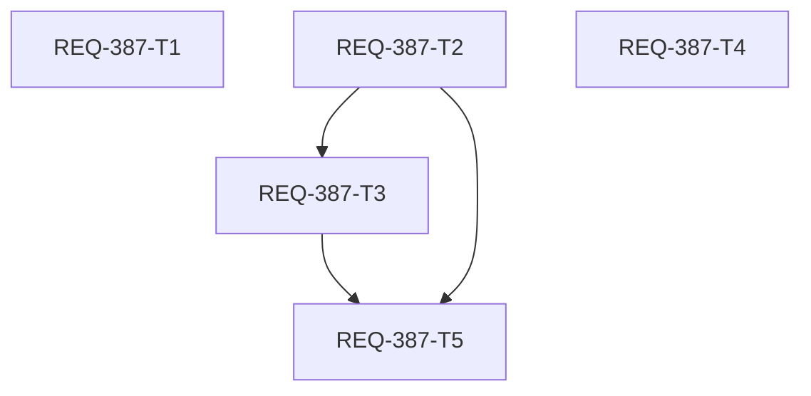
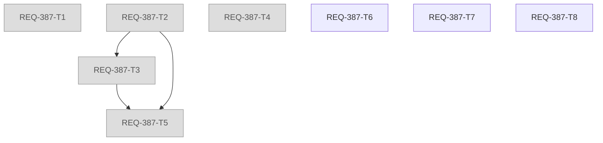

# REQ-387 Implementation Plan

## Overview

Generation snapshot を配信窓に有界化し、revision キーでキャッシュする。窓外の job は job 単位照会で補う。これにより、BE のイベントループが全件 DB 読込（約370ms/回）で占有される状態を解消する。仕様（SPEC_GENERATE）には配信窓・非ブロック制約・ログ抑制・SQLite 設定を追記する。詳細は `docs/design/REQ-387.md`、テストは `docs/design/REQ-387-test-plan.md` を参照。

## Task Cards

| Task | change_kind / 役割 | 所有ファイル | AC | 依存 | 局所検証 |
| --- | --- | --- | --- | --- | --- |
| REQ-387-T1 | document / doc-editor | `docs/specs/SPEC_GENERATE.md` | AC-5 | なし | 差分に削除行なし・追記6項目・UTF-8/LF |
| REQ-387-T2 | code / engineer | `generation_repository.py`、`test_generation_repository.py` | AC-1, AC-8 | なし | `pytest …test_generation_repository.py`、`-k req387`、mypy |
| REQ-387-T3 | code / engineer | `generation_service.py`、`routers/generation.py`、`test_generation_service.py` | AC-2, AC-4, AC-6 | T2 | `pytest …service.py …integration.py`、`-k req387`、mypy |
| REQ-387-T4 | code / engineer | `database.py`、`logging_config.py`、`tests/unit/test_config.py` | AC-7 | なし | `pytest backend/tests/unit`、`-k req387`、mypy |
| REQ-387-T5 | code / engineer | `test_generation_integration.py` | AC-2, AC-3, AC-4 | T2, T3 | `pytest …integration.py`、`-k req387`、mypy |

## DAG

- Max_Depth: 3（T2 → T3 → T5）。警告域だが、T3 は T2 の新メソッド（`get_job`/`find_job_by_prompt`）と窓化に、T5 は両方の完成に実際に依存する。
- 並行可能: T1・T2・T4 はルートで所有ファイルが重ならない。

## Atomicity Audit

- **T1**: 仕様追記だけを担う。文書検証で独立に受け入れられ、コードと所有が重ならない。
- **T2**: 窓・キャッシュ・単件照会は、同じ `snapshot()` とテストファイルを触る一体の責務。分けると同一ファイルの競合が生じるため1枚にした。
- **T3**: Service と Router の変更は `find_job` 公開 API で結ばれる。同じテストファイル（MemoryRepository）を共有するため1枚にした。
- **T4**: 接続設定とログレベルは独立した小変更。unit テストだけで受け入れられる。
- **T5**: 実時間の統合シナリオ。プロダクションコードは所有しない。閾値未達時は設計へ差し戻す。
- 各 Card は300行以内。並行の利点はルート3枚の同時実行にある。ただし本 surface には委任機構がないため、実行は逐次になる見込み。

## Verification（最終 3-Gate）

- `.agents/verification.json` の fixed_commands 7行に、Gate 3 シナリオ1行（`pytest … -k req387`）を加える。詳細はテスト計画 §5。（Rework 1 でシナリオ行に `test_generation_api.py` を追加。下記 Rework 1 参照）
- AC-5 は doc-verify で判定する。コードゲートの PASS では閉じない。
- 独立受入（tester-reviewer / doc-reviewer）は実装者の自己検証で代替しない。担当者を確保できない場合は受入を保留する。

## Trade-offs and Risks

- **件数窓（直近20 batch / released は session 毎10件）を採用**: 期間窓は長時間の放置で空になるため不採用とした。古い Studio batch を開き続けると窓から外れて進捗が出なくなる恐れはあるが、非終端を含む batch と現在 group は常に含むため、実害は限定的である。
- **revision キーのキャッシュ**: 全書込みが revision を増やす前提に依存する。テストで全書込みメソッドの無効化を固定する。
- **`asyncio.to_thread` 不採用**: 有界化とキャッシュで数msに収まる見込みである。Lock 下の順序保証を再検証するコストとリスクを避けた。
- **WAL**: `-wal`/`-shm` が生成され、バックアップは3ファイル一体で扱う必要がある。初回接続時に journal_mode が切り替わる。
- **ログ抑制**: stack trace は初回だけになる。回復ログで障害区間を特定する。
- **実時間閾値テスト**: 負荷で揺れ得るため、余裕のある閾値と構造的アサーション（SELECT 回数・キャッシュヒット）を併用する。
- **対象外**: `prune_terminal` の未配線（REQ-333 方針とのずれ）、`BaseHTTPMiddleware`、FE 変更。prune は後続課題として扱う。

## Rework 1（受入 FAIL を受けた改訂。2026-10-25）

受入 FAIL（Gate 2: 既存 API テストの回帰 1 件、AC-5 の軽微指摘）に対する差し戻し。利用者決定により、状態取得（キー `revision` / `normal_group_id` の読込を含む）が失敗したら 503 とする契約を明確化する（案 a）。`generation_jobs` だけが壊れる障害はキャッシュ有効の間は隠れ得るが、許容リスクとする。詳細は `docs/design/REQ-387.md` §8、テストは `docs/design/REQ-387-test-plan.md`。T1〜T5 は done のまま変更しない。プロダクションコードの変更はない（キャッシュ・窓の実装は維持）。設計監査（ba-audit design）は利用者決定により保留のまま進める。

### Rework Task Cards

| Task | change_kind / 役割 | 所有ファイル | AC | 依存 | 局所検証 |
| --- | --- | --- | --- | --- | --- |
| REQ-387-T6 | document / doc-editor | `docs/specs/SPEC_GENERATE.md` | AC-5 | なし | `git diff --numstat` 追加12・削除0、置換文言の `grep -c`、UTF-8/LF |
| REQ-387-T7 | code / engineer | `backend/tests/integration/legacy/test_generation_api.py`、`test_generation_repository.py` | AC-1, AC-4 | なし | `pytest …test_generation_api.py`、`pytest …api.py …repository.py -k req387`、mypy |
| REQ-387-T8 | code / engineer | `backend/tests/integration/legacy/test_generation_service.py` | AC-6 | なし | `pytest …service.py -k "req387 and ac6"`、mypy |

### Rework DAG

- Rework の Max_Depth: 1（T6・T7・T8 はいずれも依存なしのルート）。
- 並行可能: 3 枚とも可能。所有ファイルは重ならない（T6 = 仕様文書、T7 = API/repository のテスト、T8 = service のテスト）。
- 依存を設けない根拠: T7/T8 のテストは、設計側が現行コード（T2/T3 完了後）に対して緑になることを確認済みで、プロダクションコードを変更しない。T6 の仕様追記は、テストの出力を必要としない。T7 と T8 は別ファイルで、互いの fixture・ヘルパーを共有しない（それぞれのファイル内の既存ヘルパーを使う）。

### Atomicity Audit（Rework）

- **T6**: 仕様文書の 3 行の是正（m1/m2/m5）と 503 契約 1 文だけ。T1 と同じ所有ファイルだが、T1 は done で、変更は T1 が追加した行に限る。文書検証で独立に受け入れられる。AC-5。
- **T7**: 503 契約の回帰（RT6）、窓外の HTTP 層（RT5）、repository の境界（RT1/RT3）。テストの責務は「状態取得と窓の境界」で一体。API と repository の 2 ファイルを持つが、どちらも AC-1/AC-4 の同じ契約を異なる層で固定する。1 ファイルずつに分けると、RT6 の更新と追加を別 Card に割る意味が薄く、ハンドオフのコストが利点を上回る。`generation_repository.py` は所有しない（現行実装で契約を満たすことを確認済み）。
- **T8**: service のログ抑制の境界テスト 1 件。別ファイルで独立している。T7 に統合しない理由は、所有ファイルと AC が異なり、並行で進められるため。
- 各 Card は 300 行以内。

### Rework の検証

- コード: 局所検証の後、Gate 1〜3 を再実行する。Gate 3 シナリオ行は `test_generation_api.py` を含める（テスト計画 §5）。Gate 2 は旧 RT6 の既存テストの再判定を含む。
- 文書: AC-5 の doc-verify を再実行する（独立担当）。
- 設計監査: 保留（利用者決定）。
- 独立受入は実装者の自己検証で代替しない。

### Trade-offs and Risks（Rework）

- **許容リスク**: `generation_jobs` のみの障害は、次の書込みまでキャッシュに隠れ得る。生存確認クエリ（案 b）は AC-2 の構造を複雑にするため見送った。リスクは設計 §8-3 に記録し、SPEC には 503 契約の 1 文だけを書く。
- **注入点の変更**: 旧 RT6 の検証対象は「`generation_jobs` の欠損」から「キー読込を含む DB 障害」へ変わる。
- **観察事項（対象外）**: `docs/openapi.yaml` の `GET /api/generation/state` に 503 の記載がない（REQ-387 以前からの乖離）。後続課題の候補。
