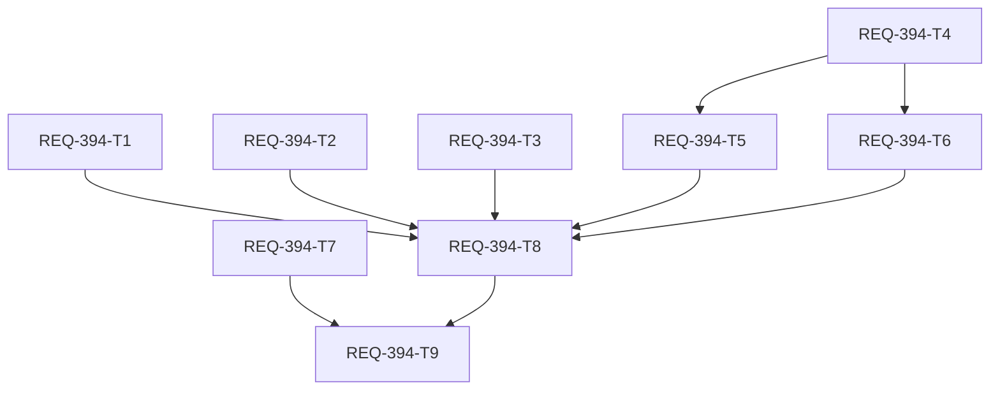

# REQ-394 Implementation Plan

## Overview

テストスイートの実行時間劣化（FE vitest 約134秒、BE `pytest -n auto` 約43秒）を、計測で寄与が確認できた要因ごとに是正する。FE は DOM 不要の `.test.ts` 43件を node 環境へ移す（約 -20秒）。BE はルート `pytest.ini` に `testpaths` を足し（約 -10秒）、WS テストの監視間隔待ちと HTTP サーバの shutdown 待ちを縮める（約 -4秒）。あわせて性能予算と環境選択方針を `SPEC_TEST_ARCHITECTURE.md` に規範として定義する（文書カード T9、doc-architect が詳細設計）。

詳細は `docs/design/REQ-394.md`、テストは `docs/design/REQ-394-test-plan.md`、計測ログは `docs/logs/REQ-394/`（git 管理外）を参照。

本 PBI は **mixed**（T1〜T8 = code、T9 = document）。検証リスクは **high**（vitest/pytest 設定は検証コマンドの入力を変える）なので、**V1 Baseline（Gate 1〜3 の新規フル実行）が必須**で、V2 には移行しない。

## 提案する性能予算（人間レビューで確定）

| 項目 | 予算 | 現状（設計時の実測） | 適用後の見込み |
| --- | --- | --- | --- |
| FE `npm test` wall | 中央値(3回) ≤ 125s、最大 ≤ 140s | 133〜136s（高負荷時 151s） | 約 112s（104〜119s） |
| BE `pytest -n auto`（ルート） | 中央値(3回) ≤ 36s、最大 ≤ 42s | 43〜45s | 約 28〜29s |
| BE 逐次（参考） | ≤ 105s | 124〜126s | 約 85〜93s |
| AC-3 ルート収集 | パス指定の 1.25 倍以内 | 4〜5 倍（8.2〜9.2s vs 1.9s） | 約 1 倍 |
| 収集件数 | FE 2609、BE 777 | FE 2607、BE 774 | 宣言した新規のみ増（FE +2、BE +3） |
| FE pool/isolate | forks 既定、isolate=true | 同左 | 同左（isolate=false 禁止） |

有効計測は CPU 負荷 60% 以下のみ。超過した計測は無効で、予算超過は黙って緩めず設計へ戻す。FE の旧実績「~38秒」は再現できず、本 PBI の施策では到達しない（フォローアップ候補を末尾に記載）。

## Task Cards

| Task | change_kind / 役割 | 所有ファイル | AC | 依存 | 局所検証 |
| --- | --- | --- | --- | --- | --- |
| REQ-394-T1 | code / engineer | `pytest.ini`、`backend/tests/governance/test_pytest_collection.py` | AC-3, AC-2 | なし | `pytest …test_pytest_collection.py -k "REQ-394/AC-3"`、`--collect-only` が 777 件 |
| REQ-394-T2 | code / engineer | `backend/tests/integration/legacy/test_ws.py`、`backend/tests/governance/test_vram_guard.py` | AC-4, AC-2 | なし | 21件 PASS、WS 系が各 1.5s 未満 |
| REQ-394-T3 | code / engineer | `test_comfy_proxy.py`、`tests/unit/test_server_status.py`、`tests/unit/test_server_manager_timeout.py` | AC-2 | なし | 3ファイル全 PASS、`--durations` で短縮を確認 |
| REQ-394-T4 | code / engineer | 43件の `.test.ts`（1行目追加）、`queryHelpers.test.ts`、`storeHelpers.test.ts` | AC-1 | なし | カナリア 2 件、`npm test` 2609 件 |
| REQ-394-T5 | code / engineer | 遅いテスト 4 ファイル | AC-1 | T4 | 対象 4 ファイル、`npm test` 2609 件 |
| REQ-394-T6 | code / engineer | `frontend/vite.config.ts` | AC-1 | T4 | `npm run typecheck`、`npm test` |
| REQ-394-T7 | code（検証契約）/ engineer。**承認済み（approval-design.json）** | `.agents/verification.json` | AC-2, AC-3 | なし | JSON 検証、差分 2行追加・1行削除 |
| REQ-394-T8 | code（計測記録のみ）/ engineer | `docs/logs/REQ-394/final-*` | AC-1〜AC-4 | T1〜T6 | final-* と summary の存在、予算照合 |
| REQ-394-T9 | **document（予約）** / doc-editor | `docs/specs/SPEC_TEST_ARCHITECTURE.md` | AC-5 | T1〜T8 | doc-verify（詳細は doc-architect が設計） |

T9 のカードファイルは doc-architect が作成する。ID `REQ-394-T9` は予約済み。T7 が承認されない場合は T7 を外し、T9 の depends_on からも外す。

## DAG

- Max_Depth: 4（T4 → T5 → T8 → T9）。警告域だが、すべて実際の依存。T5 は T4 と `queryCachePersister.test.ts` を共有し、T8 は全施策適用後の最終構成を測る必要があり、T9 は T8 の再計測値を SPEC に書く。T6 は T4 で確定する構成を前提にコメントを書く。
- 並行可能: T1・T2・T3・T4・T7 はルートで、所有ファイルが重ならない。T5 と T6 は T4 完了後に並行できる。
- T9 は全 code カード（T1〜T8）に依存する。

## 検証計画（V1 Baseline、フル実行）

| Gate | コマンド |
| --- | --- |
| Gate 1 | `backend\.venv\Scripts\python scripts/verify_ui_invariants.py`、`cd frontend; npm run typecheck`、`backend\.venv\Scripts\python -m mypy backend`、`backend\.venv\Scripts\python -m pytest backend/tests/unit`、`cd frontend; npx vitest run src/utils src/components/**/__tests__` |
| Gate 2 | `backend\.venv\Scripts\python scripts/run_full_suite.py`（フィルタなしの全件。FE 2609 / BE 777） |
| Gate 3 | `backend\.venv\Scripts\python scripts/run_e2e.py`、シナリオ/Red Team はテスト計画 §4 |

フォールバック条件（高リスク範囲に該当、収集件数の不一致、想定外の skip、追跡入力の変更など）は常にフル実行。`pytest.ini` は現行の identity に含まれないため、T7 が未承認なら tester が手動で候補記録に含める。

## Trade-off Disclosure

| 論点 | 採用 | 検討して退けた案 | 理由 |
| --- | --- | --- | --- |
| FE の環境切替 | 各ファイル先頭の docblock | `environmentMatchGlobs` | 43 パスの列挙が設定に集中し、vitest 更新で非推奨・廃止される。docblock は記載漏れが安全側（jsdom）に倒れる |
| 並列度と pool | 変更しない | maxForks=6/8/10、threads、vmThreads/vmForks | 前者は負荷変動（±20%）に埋もれて有意差なし。vm 系は 21 ファイルが失敗（msw、location） |
| isolate | `true` を明示 | `false` | forks/threads とも状態リークで無限ループ（ログ 17MB / 95,927行超）。再挑戦は状態リーク検証付きの別 PBI |
| WS の待ち | `INTERVAL` を 0.05 に縮小 | 接続直後送信フィクスチャ | 製品コードを変えずに済む。接続時送信は製品仕様の変更になる |
| 重い BE テスト | 定数縮小、`poll_interval` 短縮 | `slow` マーカーで既定除外 | 除外は収集件数を変え、実トークナイザ検証が Gate 2 から消える。FuguMT は据え置き |
| pytest.ini の追跡 | T7 で identity に追加（承認済み・実施） | 追加しない | 追跡入力の検知漏れ。ただし検証契約の変更なので明示承認が必要 |
| 予算 | 余裕込みの絶対値と有効計測条件 | 旧実績 ~38s/~30s | 旧値は条件不明で再現不能。負荷で ±20% ぶれる |

- FE の短縮は約 15〜20% にとどまる（134s → 約 112s）。jsdom の初期化がプロセス単位に残るため。happy-dom への切替や projects 分割はさらに縮められるが、挙動差のリスクがあり本 PBI の範囲外。
- 恒久ガードを少数追加する: FE のカナリア 2 件、BE の testpaths 検証 3 件、WS の経過時間ガード。件数の増分（FE +2、BE +3）は宣言済みで、テスト計画のノードID差分で検証する。
- 既存の `test_pytest_collection.py` の挙動テストは、testpaths 追加で形骸化するため `.` を明示して `norecursedirs` の検証を保つ（T1）。

## Risks

- 高リスク範囲（検証・共有フィクスチャ・argv 相当の入力）に触れる。V1 を新規にフル実行する。engineer のログは PASS 根拠にしない。
- 負荷依存の計測: 常駐アプリで ±20% ぶれる。有効計測条件（負荷 60% 以下）を満たさない結果は無効。
- node 環境化したテストが DOM を暗黙に使っていないことは、実行（CLI で node を強制）で確認済み。要確認の 4 ファイルは T4 で本文を確認する。
- 設計中の探索実行で `scripts/verify_test_naming.py --strict` が追跡ファイル `docs/design/REQ-356-test-mapping.md` を上書きした。`git checkout` で復元し差分なしを確認済み。今後の検証コマンドには含めない。

## Open Issues

- 予算値の確定（人間レビュー）。
- T7（検証契約の変更）の承認可否。
- FE 旧実績「~38s」と「maxForks=6 で 111s」は再現しなかった。基準コミットでの再計測は未実施。
- フォローアップ候補: FE をさらに縮める手段（happy-dom、projects 分割、`.test.tsx` の DOM 要件の精査）、`tests/unit` 単独実行が `app` を import できない既存問題。
