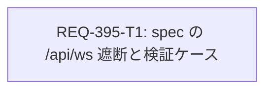

# REQ-395 Implementation Plan

## Overview

Gate 3 で `frontend/e2e/generateMobileGallery.spec.ts` の [REQ-372] AC-3/4/5/7 が、ローカルバックエンド（:8000）の稼働中に失敗する。原因は、spec が HTTP の `/api/*` だけをスタブし、WebSocket `/api/ws` が Vite proxy 経由で実バックエンドへ届くこと（`docs/incident_report_e2e_ws.md`）。spec の `stubApi()` に `page.routeWebSocket` による遮断を足し、遮断が効いていることを示すテストケース `[REQ-395/AC-3]` を 1 件追加する。製品コード・SPEC・検証スクリプトは変更しない。

## Task Cards

| Task ID | 内容 | 役割 | 所有ファイル | 依存 | 検証コマンド |
| --- | --- | --- | --- | --- | --- |
| REQ-395-T1 | `stubApi()` に `/api/ws` の `routeWebSocket` を追加し、捕捉した URL を返す。`openGenerate()` で受け渡す。`[REQ-395/AC-3]` ケースを追加する | engineer（code） | `frontend/e2e/generateMobileGallery.spec.ts` | なし | `npm.cmd --prefix frontend run typecheck` / `backend\.venv\Scripts\python.exe scripts/run_e2e.py e2e/generateMobileGallery.spec.ts`（9 passed） |

## DAG

単一カードで、深さは 1。並列化の対象はない。

## 検証計画（V1 Baseline、フル実行）

- リスク分類は high（Gate 3 の検証に使うテストファイルの変更）。V1 Baseline で Gate 1〜3 を新しく実行する。
- Gate 3: `scripts/run_e2e.py` 全体（変更前 288 件 → 289 件、AC-4）。
- シナリオ: S1（バックエンド稼働中に spec 単体 9 passed）、S2（バックエンド停止中に同じ結果。停止はユーザーが行う）。
- Red Team: 遮断行を外す（RT1）、`connectToServer()` で中継する（RT2）とケースが失敗することを、スクラッチ複製で確認する。
- 詳細は `docs/design/REQ-395-test-plan.md`。

## Trade-off Disclosure

| 項目 | 採用 | 代替案 | 理由 |
| --- | --- | --- | --- |
| WS の扱い | 接続を捕捉して何も送らない | 決定論的スナップショットを WS で送る | 現行ケースは HTTP スタブだけで成立する。送信内容の保守と二重管理を避ける |
| 修正範囲 | 失敗している spec 1 ファイル | 共通ヘルパーを作り e2e の全 7 spec に適用 | 他の spec は現状 PASS（Gate 3 全体で失敗は 4 件だけ）。REQ-394 の Gate 再実行を早く進める |
| 再発防止 | spec 内のアサーション | `run_e2e.py` での :8000 検出 / SPEC への MUST 追記 | `run_e2e.py` は Gate 3 固定コマンドで、変更すると検証インフラの変更になる。SPEC は REQ-394 の所有ファイル。どちらも別 PBI の候補 |

## Risks

- R1: 他の 6 spec も `/api/ws` を遮断していない（潜在的な環境依存）。別 PBI の候補。
- R2: AC-2 はバックエンドの停止が必要。tester はユーザーのプロセスを止めないので、ユーザーが停止できなければ AC-2 は pending になる。
- R3: `routeWebSocket` は Playwright 1.48 以降が前提（現在 1.64.1）。

## Open Issues

- AC-2 の検証時にバックエンドを停止できるか。
- R1 の横展開と SPEC への追記を別 PBI として起票するか。
