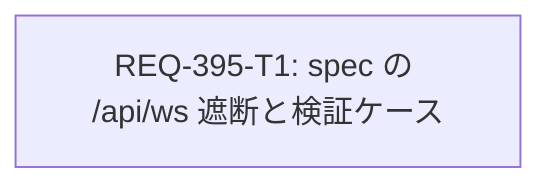

# REQ-395 詳細設計: generateMobileGallery.spec.ts で /api/ws を遮断し実バックエンドに依存しないようにする

- PBI: `docs/backlog/pbi/active/REQ-395.md`（type: bug）
- 起点: `docs/incident_report_e2e_ws.md`（Type A: Implementation Defect）
- change_kind: code（単一カード T1）
- 設計担当: architect / dev-design を coordinator セッションが直列で代行した（このセッションには委譲ツールがないため。専用 Agent の登録ではなく代行として記録する）

## 1. Boundary Audit

- Target_Paths: `C:\Users\audih\ws\comfy-create-helper2\frontend\e2e\generateMobileGallery.spec.ts`（変更するのはこの 1 ファイルだけ）
- Shared_Dependency_Paths: `C:\Users\audih\.claude\skills\agent-tooling-maintenance\helpers`（pbi_manager / audit_contract / local_model_adapter の実行のみ）
- Git_Root_Mismatch: なし（編集対象はすべてワークスペースの Git ルート内）
- Hallucination_Lock: ACTIVE。製品コード（`frontend/src/**`）、`frontend/vite.config.ts`、`scripts/run_e2e.py`、`docs/specs/**` は変更しない
- 並行 PBI: REQ-394（in-progress）が所有する `.agents/context.md`、`.agents/verification.json`、`docs/specs/SPEC_TEST_ARCHITECTURE.md`、`frontend/vite.config.ts` などとは重ならない。REQ-394 は Gate 3 のこの失敗で保留中で、「REQ-395 の修正後に Gate 1〜3 をすべて新しく再実行する」と記録済み（`docs/logs/REQ-394/qa-triage-1.json`）

## 2. 設計時に確認した事実

| # | 事実 | 根拠 |
| --- | --- | --- |
| F1 | バックエンド（:8000）が稼働中だと `generateMobileGallery.spec.ts` の [REQ-372] AC-3/4/5/7 が失敗する（4 failed / 4 passed） | `python scripts/run_e2e.py e2e/generateMobileGallery.spec.ts`（2026-10-25） |
| F2 | Gate 3 全体（`python scripts/run_e2e.py`）の失敗はこの 4 件だけ（4 failed / 284 passed）。他の spec はバックエンド稼働中でも PASS する | 同日の全体実行 |
| F3 | スクラッチ複製の `stubApi()` に `page.routeWebSocket((url) => url.pathname === '/api/ws', () => {})` を 1 行足すと 8 件すべて PASS する | 同日の対照実験 |
| F4 | Generate ページは読み込み時に `ws://localhost:5173/api/ws` へ 1 回接続する。`page.routeWebSocket` の handler で捕捉できる | 同日のスクラッチ probe（`WS_URLS ["ws://localhost:5173/api/ws"]`） |
| F5 | `page.route` は WebSocket を捕捉しない。`frontend/vite.config.ts` の proxy `/api`（`ws: true`、target `http://127.0.0.1:8000`）が WS を実バックエンドへ中継する | `frontend/vite.config.ts:78-84`、`frontend/src/store/services/systemWsService.ts:26` |
| F6 | Playwright は 1.64.1。`page.routeWebSocket` は 1.48 以降で使える | `npx playwright --version` |

## 3. 方針

`stubApi()` の先頭で `/api/ws` を `page.routeWebSocket` により捕捉する。handler では `ws.connectToServer()` を呼ばない。Playwright は接続をモックとして開いたままにし、ページからの送信は捨てられ、サーバーからのフレームは届かない。生成状態の唯一の供給源が HTTP スタブ（`/generation/state`）になり、結果はバックエンドの稼働状態や実 DB の内容に左右されなくなる。

さらに、捕捉した WS の URL を配列に記録し、`stubApi()` → `openGenerate()` の戻り値として返す。新しいテストケース `[REQ-395/AC-3]` で「接続が少なくとも 1 回捕捉された」ことをアサートし、遮断が実際に効いていることを実行可能なテストで示す（遮断が外れる退行の検出器）。

WS で決定論的なスナップショットを送る案は採らない。現行の 8 ケースは HTTP スタブだけで成立しており（F3）、WS からの送信は検証対象外だからである（§7 トレードオフ）。

## 4. 変更内容（T1）

1. `stubApi(page, isEmpty)` の戻り値を `Promise<void>` から `Promise<string[]>` に変える。先頭で次を登録する:
   ```ts
   const wsUrls: string[] = []
   // Sever the app WebSocket: page.route does not intercept WebSockets, and the Vite proxy would
   // forward /api/ws to a live backend whose snapshot overrides the HTTP stub (REQ-395).
   await page.routeWebSocket((url) => url.pathname === '/api/ws', (ws) => {
     wsUrls.push(ws.url())
   })
   ```
   最後に `return wsUrls`。
2. `openGenerate(...)` の戻り値を `Promise<string[]>` に変え、`stubApi` の戻り値を返す。既存の呼び出し側は戻り値を使わないので変更不要。
3. `Mobile Viewport (375x667)` の describe に、テスト `[REQ-395/AC-3] Mobile 375px: app WebSocket /api/ws is served by the stub and never reaches the backend` を追加する。`openGenerate(page, 375, 667)` の戻り値に対し `expect.poll(() => wsUrls.length).toBeGreaterThan(0)` を確認し、各 URL の pathname が `/api/ws` であることをアサートする。
4. 既存の [REQ-372] 8 ケースの本文・期待値・タイムアウトは変更しない。

## 5. Seam Map

1. **Integrated (real code)**: React アプリ全体（GeneratePage、GenerationGallerySection、MobileImageSheet、Zustand、React Query、systemWsService）を Vite dev server 上で実際に動かす。
2. **Severed (external I/O only)**: HTTP `/api/*`（`page.route`）、ComfyUI 画像 `/view`（`page.route`）、WebSocket `/api/ws`（`page.routeWebSocket`、今回追加）。いずれもブラウザのネットワーク境界で遮断する。
3. **Mock Level**: アプリ内部の関数・ストア・サービスは置換しない。ネットワーク境界でだけ遮断する。
4. **PBT Decision**: 対象外（パーサ・数値ロジック・広い入力空間を扱わない）。
5. **Fault Injection**: 外部統合の新設・変更はない。今回の変更は、テストが外部（実バックエンド）に依存しなくなるよう遮断を足すものである。「バックエンド稼働中」と「停止中」の両条件で同じ結果になることを、テスト計画のシナリオで確認する。

## 6. UI アーキタイプ・UI 不変条件

テストコードだけの変更で、UI・CSS・レイアウトは変更しない。UI 6 大不変条件の適用対象外。

## 7. トレードオフとリスク

| 項目 | 採用 | 代替案 | 判断理由 |
| --- | --- | --- | --- |
| WS の扱い | 接続を捕捉して何も送らない | 決定論的スナップショットを WS で送る | 現行ケースは HTTP スタブだけで成立する。送信内容の保守コストが増え、HTTP スタブと二重管理になる |
| 修正範囲 | 失敗している spec 1 ファイル | `frontend/e2e` 共通ヘルパーを作り全 spec に適用 | 他の spec はバックエンド稼働中でも PASS している（F2）。共通化は 7 spec の改修になり、REQ-394 の Gate 再実行を待たせる。横展開は別 PBI で扱う |
| 再発防止の仕組み | spec 内のアサーション（AC-3 のテスト） | `run_e2e.py` で :8000 の稼働を検出して警告 / SPEC_TEST_ARCHITECTURE.md に Gate 3 の WS 遮断を MUST として追記 | SPEC は REQ-394 の所有ファイルで、同時編集は所有権の衝突になる。`run_e2e.py` は Gate 3 の固定コマンドで、変更すると検証インフラの変更（高リスク）になる。どちらも別 PBI の候補として残す |

残るリスク:
- R1: 他の 6 spec も `/api/ws` を遮断しておらず、同種の環境依存が潜在している。現時点では PASS しているが、アプリが WS の内容により強く依存するようになると同じ失敗が起きうる。別 PBI の候補とする。
- R2: AC-2（バックエンド停止中）の検証には :8000 のプロセスを止める必要がある。これはユーザーのプロセスなので、tester は止めない。検証時にユーザーが停止するか、停止できない場合は AC-2 を pending とする。
- R3: Playwright の `routeWebSocket` で接続を開いたままにする挙動は 1.48 以降が前提。バージョンを下げると AC-3 のテストが失敗して検出される。

## 8. カード分割（DAG）

- T1（code / engineer）: `frontend/e2e/generateMobileGallery.spec.ts` だけを所有。依存なし。
- 分割しない理由: 変更は 1 ファイル・約 20 行で、遮断と検証アサーションは同じ責務（spec のネットワーク隔離）に属する。分割すると同一ファイルの所有権が衝突する。



## 9. 仕様同期

- SSoT 影響分析: `doc_mapper.py docs/specs docs/backlog/pbi/active/REQ-395.md` は該当文書なし（No mapped documents found）。
- 本 PBI で SPEC は変更しない。`docs/specs/SPEC_TEST_ARCHITECTURE.md:22`（ネットワーク I/O の境界は WebSocket も含めてモックする）に spec を合わせる修正であり、仕様の意味は変わらない。インシデントレポートの「SSoT_Update_Required: No」と整合する。
- Gate 3 の WS 遮断を MUST として SPEC に明記する作業は、REQ-394 のクローズ後に別 PBI で扱う候補とする（§7）。

## 10. 未解決事項

- U1: AC-2 の検証時にバックエンドを停止できるか（R2）。設計レビューでユーザーに確認する。
- U2: R1 の横展開と SPEC への追記を別 PBI にするか。設計レビューでユーザーに確認する。
