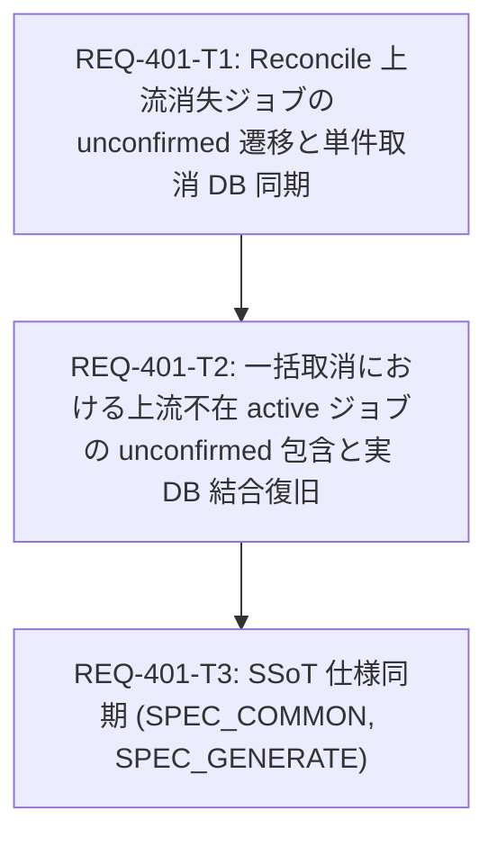

# Implementation Plan - REQ-401: prompt_id確定後の上流消失ジョブがrunning/queuedのまま残留し取消・解除できない不具合の修正

## Proposed Changes

### 1. 概要と背景

ComfyUI の停止・再起動やネットワーク断等により、`prompt_id` が確定したアクティブジョブ（`queued`, `submitting`, `running`）が上流のキュー（`running`/`pending`）および実行履歴（`history`）の双方から消失した場合に、以下の連鎖的不具合が発生していました。

1. **Reconcile 消失検知の欠落**: `_reconcile_locked` は上流キューに不在の `prompt_id` に対し `bridge.history()` を照会するが、上流 ComfyUI 再起動等で履歴が空（`record is None`）の場合、何も更新せずに `continue` してしまい、DB 上で `running`/`queued` のまま恒久残留する。
2. **単件取消時の DB 更新欠落**: `cancel_queued` および `_cancel_single` は上流不通または queue 不在時に `CancelResult(outcome="unconfirmed")` を返すが、DB 上のステータスを `unconfirmed` に更新しないため、DB 状態と API 応答が乖離する。
3. **一括取消での上流不在ジョブ脱落**: `_cancel_global` および `_cancel_normal` は上流キューに実在するジョブのみを走査するため、上流キューから消失した active ジョブが取消対象から完全に抜け落ち、DB 状態も `running`/`queued` のまま放置される。
4. **手動解除のブロックと Normal Group 恒久開放**: DB 上のステータスが `unconfirmed` に遷移しないため、FE の「状態未確認の記録」（`status === 'unconfirmed'`）に表示されず、手動解除（`/api/generation/release`）のガード（`status != "unconfirmed"` は 400）によって解除もできない。さらに active ジョブとしてカウントされ続けるため、`normal_group_id` が永久に開いたままとなり、後続の通常生成（250件以上）が同一グループに累積し続ける。

本改修では、上流キュー不在かつ履歴不在のジョブを確実に `status="unconfirmed"` へ遷移させ、既存の `selectUnconfirmedJobs` および手動解除（`release`）の出口に接続することで、ゾンビジョブの残留とグループ開放バグを根本解決します。

### 2. タスク別の変更内容

#### REQ-401-T1: Reconcile 上流消失ジョブの unconfirmed 遷移と単件取消の DB 状態同期 [REQ-401-T1]
- **対象**: `backend/app/services/generation_service.py`
- **内容**:
  1. `_reconcile_locked`: `bridge.history(prompt_id)` が正常に空辞書を返した場合（`not isinstance(record, dict)`）、上流消失と判定して `self._mark_unconfirmed(job, ...)` を呼び DB ステータスを `unconfirmed` に遷移させる。照会例外時（`except Exception:`）は保守的に `continue` して誤検知を防ぐ。
  2. `cancel_queued`: 上流 queue 照会エラー時および `queue.pending` 不在時に `self._mark_unconfirmed(job, ...)` を呼び出して DB ステータスを `unconfirmed` に更新し、`publish = True` とする。
  3. `_cancel_single`: 上流 queue 照会エラー時および queue 不在時に `self._mark_unconfirmed(target, ...)` を呼び出して DB ステータスを `unconfirmed` に更新する。
  4. **WS 再接続最適化**: WebSocket 接続時（status 受信時）に `self._wake.set()` を呼び出し、2.5 秒の待機を挟まず即時 reconcile をトリガーする。
- **検証**:
  - `backend/tests/integration/legacy/test_generation_service.py`（AC-1, AC-2, AC-4）
  - `backend/tests/integration/legacy/test_generation_api.py`（AC-2）

#### REQ-401-T2: 一括取消における上流不在 active ジョブの unconfirmed 包含と実 DB 結合復旧 [REQ-401-T2]
- **対象**: `backend/app/services/generation_service.py`
- **内容**:
  1. `_cancel_global`: スコープ内の全 active ジョブのうち、上流 queue（`pending`/`running`）に存在しないジョブを走査し、`self._mark_unconfirmed(job, ...)` で `unconfirmed` 化するとともに `results` に `outcome="unconfirmed"` を追加する。
  2. `_cancel_normal`: `known_normal` 内の active ジョブのうち、上流 queue に不在のジョブを走査して同様に `unconfirmed` 化し `results` に追加する。
  3. 取消 API が HTTP 202 を返し、レスポンス `items` に全未確認ジョブが含まれることを保証。
- **検証**:
  - `backend/tests/integration/legacy/test_generation_integration.py`（実 SQLite DB、AC-1, AC-3, AC-4）

#### REQ-401-T3: SSoT 仕様同期 (`SPEC_COMMON.md`, `SPEC_GENERATE.md`) [REQ-401-T3]
- **対象**: `docs/specs/SPEC_COMMON.md`, `docs/specs/SPEC_GENERATE.md`
- **内容**:
  1. `SPEC_COMMON.md`: prompt_id 確定ジョブの上流消失時 unconfirmed 遷移契約、取消未確認時の DB 同期、normal_group 解放契約を明文化。
  2. `SPEC_GENERATE.md`: 一括取消での未確認ジョブ回収と HTTP 202 返却、ジョブ管理モーダルからの手動解除契約を明記。
- **検証**:
  - `scripts/verify_ui_invariants.py`
  - BOM なし UTF-8 / LF 文字コード検証

---

## Dependency Graph (DAG)

---

## Trade-off Disclosure and Technical Decisions

### 1. 即時 unconfirmed 判定 vs 遅延判定（TTL/リトライカウンタ）
- **検討内容**: 上流 `bridge.history()` が空だった場合に、一時的な書き込み遅延を考慮して数秒待つか、即座に `unconfirmed` へ倒すか。
- **決定**: 即時 `unconfirmed` 判定を採用。
- **理由**: ComfyUI はタスク終了時に同期的に history に書き込むため、queue から消えていて history 照会が正常成功したにもかかわらず history に無い状態は、クラッシュ・再起動以外に発生しない。また仮に極小の競合で `unconfirmed` に倒れたとしても、`unconfirmed` は「終端（cancelled/failed）」ではなく「状態未確認」であるため、後続の照合や手動解除の安全弁があり、正常系を損なわない。

### 2. 単件・一括取消時の DB 状態更新
- **検討内容**: 取消 API が `outcome="unconfirmed"` を返す際に、DB 状態を `queued`/`running` のまま維持するか、`unconfirmed` へ更新するか。
- **決定**: DB 状態を `unconfirmed` へ更新する。
- **理由**: 利用者が取消操作を行ったにもかかわらず DB が `running`/`queued` のまま残ると、利用者は二度と操作できず（解除ボタンも現れず）、本件の障害（ゾンビ残留）が不可避となる。取消が未確認となった時点で DB も「未確認」と同期するのが一貫した設計である。

---

## Risk Assessment and Mitigation

| リスク | 影響度 | 発生確率 | 緩和策 |
|---|---|---|---|
| ComfyUI 通信一時瞬断時の誤判定 | 高 | 低 | `bridge.history()` や `bridge.queue()` が例外（ConnectError/Timeout）を送出した場合は一切 `unconfirmed` に遷移させず `continue`（保守的ガード）を徹底する。 |
| 正常完了ジョブの巻き込み | 高 | 極低 | 上流の正常完了時は `history` に必ずレコードが存在するため、空辞書判定（`not isinstance(record, dict)`）で拾われることはない。 |
| 高リスク領域（ジョブ状態機械）の変更 | 高 | 高 | 検証プロファイルを V1 Baseline とし、Gate 2 で完全テストスイート（`scripts/run_full_suite.py`）、Gate 3 で E2E（`scripts/run_e2e.py`）を実行して回帰を全件検知する。 |

---

## Acceptance Criteria Traceability Matrix

| AC | 要旨 | 対応 Task Card | 検証層 / テストケース |
|---|---|---|---|
| AC-1 | 上流消失ジョブが reconcile で unconfirmed に遷移し normal_group が閉じる | T1, T2 | Unit & Integration (`test_req401_ac1_*`) |
| AC-2 | 単件取消・待機取消で outcome='unconfirmed' かつ DB status='unconfirmed' | T1 | Unit & API (`test_req401_ac2_*`) |
| AC-3 | 一括取消で上流不在 active ジョブが unconfirmed として items に含まれ DB 更新 | T2 | Unit & Integration (`test_req401_ac3_*`) |
| AC-4 | unconfirmed ジョブが release で status='released' に遷移しアクティブから消去 | T1, T2 | Unit & Integration (`test_req401_ac4_*`) |
| AC-5 | SPEC_COMMON.md / SPEC_GENERATE.md に契約明文化 | T3 | Doc review & UI Invariant check |
