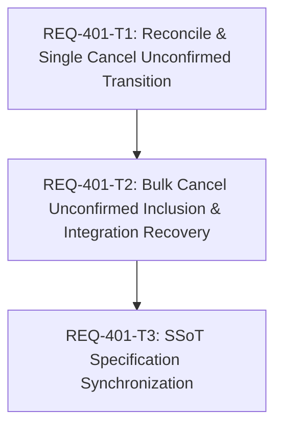

# REQ-401 詳細設計書: prompt_id確定後の上流消失ジョブがrunning/queuedのまま残留し取消・解除できない不具合の修正

- 作成: architect (dev-design) / 状態: 設計レビュー待ち
- PBI: `docs/backlog/pbi/active/REQ-401.md`（Type A bug / status: new）
- 調査報告: `docs/incident_report.md`
- テスト計画: `docs/design/REQ-401-test-plan.md`
- 実装計画・DAG: `implementation_plan.md`

## 1. 概要と目的

ComfyUI停止や再起動などにより、上流ComfyUIへ投入されて `prompt_id` が確定したアクティブジョブ（`status IN ('queued', 'submitting', 'running')`）が上流の `queue`（`running`/`pending`）および `history` から消失した場合に：
1. `GenerationService._reconcile_locked` で状態が更新されず `running`/`queued` のまま残留する。
2. 利用者が単件取消や待機取消を実行しても、API応答に `outcome="unconfirmed"` を返すのみでDB上の `job.status` を `unconfirmed` に遷移させない。
3. 一括取消（`mode=all|queued`, `scope=all|normal`）では、上流キューに不在のジョブが処理対象から完全に抜け落ち、DB状態が不変のままとなる。
4. DB上の `job.status` が `running`/`queued` のまま維持されるため、フロントエンドの「状態未確認の記録」セクションに表示されず、手動解除（`/api/generation/release`）の出口も塞がれ、`normal_group_id` が恒久的に開いたままになって後続の通常生成が同一グループに累積し続ける。

本設計では、上流消失時および取消確認不能時に `status="unconfirmed"` へ確実に遷移させ、既存の `selectUnconfirmedJobs` および手動解除（`release`）の出口を完全に接続することで、本残留障害を根本解決する。

## 2. Acceptance Criteria 一覧

| AC | 要旨 |
|---|---|
| AC-1 | prompt_id を持つ queued/submitting/running ジョブが上流 queue および history から消失している場合、reconcile 実行により status が 'unconfirmed' へ遷移し、待機中・実行中から除外され normal_group_id が閉じること |
| AC-2 | prompt_id を持つ queued/running ジョブが存在し上流 queue に不在または上流不通である場合、単件取消（_cancel_single または cancel_queued）を実行すると outcome='unconfirmed' が返るとともに DB 上の job.status が 'unconfirmed' へ更新されること |
| AC-3 | 上流 queue に不在の prompt_id 確定済み active ジョブが存在する場合、一括取消（cancel mode=all/queued）を実行すると当該ジョブが items に outcome='unconfirmed' として含まれ、DB 上の job.status が 'unconfirmed' へ更新されること |
| AC-4 | 上記により unconfirmed へ遷移したジョブについて、ユーザーが release（記録を解除）を実行すると正常に status='released' へ遷移し、待機・進捗・未確認のいずれからも解消されること |
| AC-5 | SPEC_COMMON.md および SPEC_GENERATE.md に、prompt_id 確定後の上流消失時および取消未確認時の status='unconfirmed' 遷移契約を明記すること |

## 3. 境界監査 (Boundary Audit)

- Target_Paths（編集対象）: `backend/app/services/generation_service.py`, `docs/specs/SPEC_COMMON.md`, `docs/specs/SPEC_GENERATE.md`
- Shared_Dependency_Paths（読み取り/実行のみ）: `helpers`（doc_mapper, audit_contract, local_model_adapter）
- Git_Root_Mismatch: なし。全ファイルが WORKSPACE_ROOT 配下。
- Hallucination_Lock: ACTIVE。

## 4. SSoT 影響分析

| 文書 | 該当箇所 | 影響と更新内容 |
|---|---|---|
| `docs/specs/SPEC_COMMON.md` | L551-555 | prompt_id 確定済みジョブの上流 queue/history 消失時の reconcile による unconfirmed 遷移、および取消未確認時の unconfirmed DB 遷移契約を追記 |
| `docs/specs/SPEC_GENERATE.md` | L214-218 | 取消未確認時の DB status='unconfirmed' 化と、一括取消における未確認 items の報告、解除への連携契約を明記 |
| `docs/design/REQ-335.md` | L269 (R13), L289 (Q8) | REQ-335 で保留されていた「prompt_id を持つ active ジョブの上流消失」の仕様補足としての整合性を確保 |

## 5. 現状分析と根本原因

1. **Reconcile 照会の脱落 (`generation_service.py:1285-1308`)**:
   `prompt_id` を持つ非終端ジョブが上流 `queue.running` / `queue.pending` の双方に不在のとき、`bridge.history(prompt_id)` を呼び出すが、ComfyUI 停止・再起動等でメモリがクリアされると `{}`（空辞書）が返る。L1291-1292 で `record` が `None` となり、そのまま `continue` して次のジョブへ抜けるため、DB 上の `job.status` が永久に更新されない。
2. **単件取消時の DB 更新欠落 (`generation_service.py:283-292, 788-826`)**:
   `cancel_queued`（L286, L292）および `_cancel_single`（L791, L826）は、上流 queue 不通時や queue 不在時に `outcome="unconfirmed"` の `CancelResult` を返すが、`self._mark_unconfirmed(job, ...)` を呼ばないため DB は `running` / `queued` のまま維持される。
3. **一括取消での上流不在ジョブの脱落 (`generation_service.py:859-930, 1149-1240`)**:
   `_cancel_global` は上流 `before.pending` / `before.running` に実在する `prompt_id` のみを走査し、`_cancel_normal` も `pending_normal`（上流 queue.pending に実在するもの）のみを走査する。上流キューにすでに不在となった DB 上の `queued` / `submitting` / `running` は `result_targets` に入らず、DB 状態も変わらず、取消応答の `items` にも含まれない。
4. **手動解除のブロックと Normal Group の恒久開放**:
   DB 上の `status` が `unconfirmed` に遷移しないため、FE の `selectUnconfirmedJobs`（`status === 'unconfirmed'`）に載らず、`POST /api/generation/release`（`status != "unconfirmed"` ガード）でも解除できない。さらに `_ACTIVE_STATUSES = ("queued", "submitting", "running")` に留まり続けるため、`normal_group_id` が恒久的に開いたままとなる。

## 6. 詳細設計

### 6.1 Reconcile での上流消失検知と unconfirmed 遷移

`GenerationService._reconcile_locked()` の走査ロジックを以下のように改修する：

```python
# prompt_id が上流 queue (running/pending) に不在の場合
try:
    history = await self.bridge.history(prompt_id)
except Exception:
    logger.debug("History lookup unavailable for %s", prompt_id, exc_info=True)
    continue

record = history.get(prompt_id) if isinstance(history, dict) else None
if not isinstance(record, dict):
    # 上流 queue にも不在かつ history 照会が成功した上で履歴も存在しない場合
    # => 上流から実行記録が完全に消失したと判断し、状態未確認へ遷移させる
    self._mark_unconfirmed(job, "upstream execution completed or lost without recorded history")
    self._cancel_requested.discard(job.job_id)
    changed = True
    continue
```

- **安全弁（競合防止）**: `self.bridge.history(prompt_id)` が例外（500/timeout/接続エラー）を出した場合は `except` 節で `continue` され、誤って `unconfirmed` に落とすことはない（保守的判定）。
- **順序保証**: ComfyUI は `/prompt` 受付時に同期的に queue へ追加するため、`_lock` 保持下で動作する reconcile が「送信直後で queue に入る前」の宙に浮いた状態を観測することはない。

### 6.2 単件取消・待機取消における DB 状態の unconfirmed 遷移

- `cancel_queued(identifier)`:
  - 上流 queue 照会エラー時（L286）: `self._mark_unconfirmed(job, ...)` を呼び、DB を `unconfirmed` に更新して `publish = True` とする。
  - 上流 queue.pending 不在時（L292）: 同様に `self._mark_unconfirmed(job, ...)` を呼び、DB を `unconfirmed` に更新して `publish = True` とする。
- `_cancel_single(state, payload)`:
  - 上流 queue 照会エラー時（L791）: `self._mark_unconfirmed(job, ...)` で `unconfirmed` 化。
  - 上流 queue 不在時（L826）: `self._mark_unconfirmed(job, ...)` で `unconfirmed` 化。

### 6.3 一括取消（_cancel_global / _cancel_normal）における未確認ジョブの網羅

- 対象スコープ内の全 active ジョブ（`status in {"queued", "submitting", "running"}` かつ `prompt_id is not None`）のうち、上流 queue に実在しないもの（または上流 queue 照会失敗時）を検出し：
  1. `self._mark_unconfirmed(job, ...)` により DB 上で `unconfirmed` へ遷移させる。
  2. `results` に `outcome="unconfirmed"` の `CancelResult` として必ず追加する。
- 既存の `_unconfirmed_leftovers()` はすでに `status == "unconfirmed"` のジョブを `items` に集約する仕組みを持っているため、取消実行時に DB 状態を `unconfirmed` へ進めることで、`_unconfirmed_leftovers()` との相乗効果で全未確認ジョブが確実に FE へ報告される。

## 7. Seam Map

1. **Integrated (real code)**:
   - `GenerationService` の全ライフサイクルメソッド（`reconcile`, `cancel_operation`, `cancel_queued`, `cancel_unsubmitted`, `release_unconfirmed`）。
   - `GenerationRepository` の DB トランザクション（`transition`, `release_unconfirmed`, `snapshot`）。
2. **Severed (external I/O only)**:
   - `LiveBridgePort`（`FakeBridge`）: `queue()`, `history()`, `delete_queue()`, `clear_queue()`, `interrupt()`, `interrupt_all()` をモック。
   - 時刻（`clock`）: 固定 ISO 文字列生成。
3. **Mock Level**:
   - `GenerationService` や `GenerationRepository` の内部ロジックに対する monkey-patch は厳禁。`FakeBridge` の I/O レスポンス（キュー空、履歴空、例外送出など）を通じて上流障害を表現する。
4. **PBT Decision**:
   - 本不変条件は有限状態機械（active 3状態 × prompt_id有無 × 上流在否）の組み合わせであるため、`pytest.mark.parametrize` による網羅的な組み合わせテストを採用する。
5. **Fault Injection**:
   - 上流 ComfyUI の突然のクラッシュ（queue 空かつ history 空）。
   - 上流通信タイムアウト（`queue_error = TimeoutError(...)`）。
   - 履歴照会失敗（`history_error = RuntimeError(...)`）。

## 8. トレードオフと代替案

| 論点 | 採用案 | 代替案と不採用理由 |
|---|---|---|
| 上流履歴不在時の判定 | queue 不在かつ history 空（正常応答）で即時 `unconfirmed` 遷移 | **一定時間の猶予（debounce/TTL）を待つ案**: 複雑なタイムスタンプ管理が必要となり、本件のように ComfyUI 再起動で上流が完全に消えた状況で即座に UI を正常化できない。history 照会が成功してレコードが無い以上、これ以上の情報は上流から得られないため即時判定が妥当。 |
| 単件取消失敗時の DB 状態 | レスポンスで `unconfirmed` を返す契機で DB も `unconfirmed` へ遷移 | **DB は running/queued のまま維持する案（現行）**: 利用者が「取消」を試みたにもかかわらず状態が戻らず、解除ボタンも出ないため「解除できないゾンビジョブ」となる（現行不具合の元凶）。 |
| 一括取消での上流不在ジョブ | 対象スコープ内の全 active ジョブを走査して未確認化 | **上流キューの項目のみを走査する案（現行）**: 上流キューから消えたジョブが取り残され、モーダルが閉じてしまう（fail-open）。 |

## 9. リスクと緩和策

| リスク | 影響 | 緩和策 |
|---|---|---|
| ComfyUI の一時的スローダウンによる誤判定 | 正常実行中ジョブが誤って `unconfirmed` に遷移する | `bridge.history()` または `bridge.queue()` がエラー（例外）を返した場合は一切遷移させず `continue` する（保守的ガード）。 |
| 既存の正常完了フローへの影響 | 正常完了したジョブが `unconfirmed` になる | ComfyUI の正常完了時は `history` に必ずレコードが入るため、`history.get(prompt_id)` が `None` になることはない。 |

## 10. タスク分解・DAG



- **REQ-401-T1**: `backend/app/services/generation_service.py` の `_reconcile_locked`, `_cancel_single`, `cancel_queued` 改修と単体テスト（AC-1, AC-2, AC-4）。
- **REQ-401-T2**: `backend/app/services/generation_service.py` の `_cancel_global`, `_cancel_normal` 改修と実 SQLite / 結合テスト（AC-3, AC-4）。
- **REQ-401-T3**: `docs/specs/SPEC_COMMON.md`, `docs/specs/SPEC_GENERATE.md` への仕様明文化（AC-5）。

## 11. 検証ベースライン

- Gate 1:
  - `backend\.venv\Scripts\python scripts/verify_ui_invariants.py`
  - `backend\.venv\Scripts\mypy backend`
  - `backend\.venv\Scripts\python -m pytest backend/tests/unit`
  - `backend\.venv\Scripts\python scripts/verify_test_naming.py --strict`
- Gate 2:
  - `backend\.venv\Scripts\python scripts/run_full_suite.py`
  - `cd frontend; npm test`
- Gate 3:
  - `backend\.venv\Scripts\python scripts/run_e2e.py`
