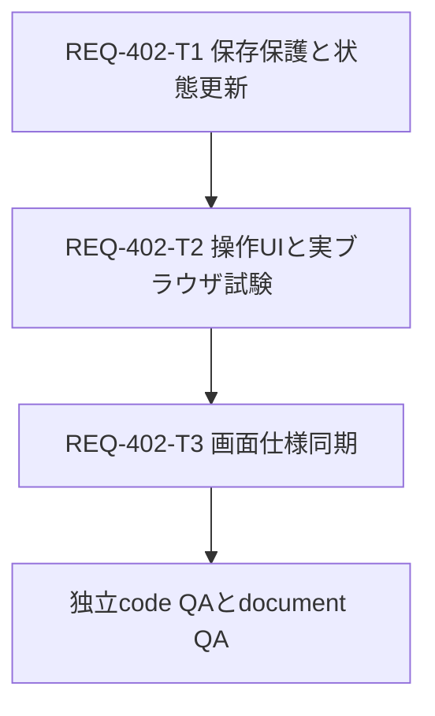

# REQ-402 Implementation Plan

## Goal
プリセットtabの右click/longtap/通常tapから他・左・右のtabを閉じる。操作したtab自身は全modeで残す。

## Approach
既存表示順でtargetを決め、保存ACKを待ち、tab構成と選択を一度で更新する。保存障害/操作中状態変更なら全tab保持、保存済server dataのrollbackなし。
常設ellipsis、desktop portal menu、mobile既存BottomSheet。共有tab部品を両layoutへ配線する。

## Tasks
| Card | change_kind / route | 所有責務 | depends_on |
|---|---|---|---|
| REQ-402-T1 | code / engineer | planner、store close、保存adapter、unit/実integration | なし |
| REQ-402-T2 | code / engineer | 共有tab/menu、両layout、UI tests/browser E2E | T1 |
| REQ-402-T3 | document / doc-editor | SPEC_GENERATE §2-6/§5-3/構成一覧同期 | T2 |

## Verification
13ACをtest-planのCase Matrixへ対応づけ。pending/503/409/断/部分保存/編集/workflow移動を実production hookで確認。
V1固定Gate1、FE/BE full discovery、全E2Eと追加normal/failure/preservation scenarioを最終candidateで独立実行。doc-reviewerの意味/参照判定はcode verdictと別途統合。
人レビュー切替を継続、従前INCONCLUSIVEをmodel PASSに変更しない。

## Trade-offs and Risks
- risk=unknown。保存/pollへの影響を最終実装で未検証のためlow扱いせず、V1 full discoveryを実行する。
- 保存ACK待ちで遅延、保存中変更時は再操作が必要。global input lockなし。
- ellipsisでtab幅増、44px操作と横scrollを実browserで確認。
- 成功前marker/単一pending slot改修によるtab切替/poll/生成前flush/履歴の回帰risk。一般保存system全体の刷新はしない。
- WebStorage複数キーtransactionは保証できず、書込失敗時はcloseせず復旧試行と通知。
- 3段DAGの待ちを許容し同file競合と未完成挙動の仕様化を防ぐ。

## Review Status
物理design/test-plan/Task Cardsを提示する段階。親がT3のbounded doc-architect確認を統合し、人の設計承認後に実装へ。実装/tests/GatesのPASSは未取得。
root implementation_plan.mdは既存他作業を保持し、本fileを今回の計画とする。
