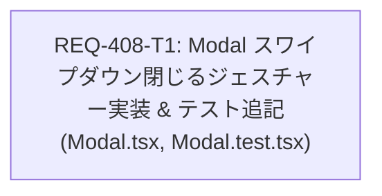

# Implementation Plan: REQ-408 モバイル ボトムシートのスワイプダウンによる閉じるジェスチャー操作

## Summary
モバイル表示（画面幅768px未満）における共通モーダル（`Modal.tsx`）のボトムシートUIに対し、上部ハンドルまたはコンテンツ上端からのスワイプダウン（下方向ドラッグ／フリック）による直感的な閉じるジェスチャーを実装します。
内部コンテンツの縦スクロール（`scrollTop > 0`）との調停、規定閾値（80px / フリック速度0.5px/ms）に基づく閉じる判定、閾値未満での原点スナップ復帰、オプトアウト用プロパティ（`disableSwipeToClose`）、およびデスクトップ表示（>= 768px）や既存の閉じる経路（ボタン、バックドロップ、Escキー）の完全維持（MUI-10準拠）を担保します。

---

## Task DAG (Dependency Graph)



---

## Planned Tasks Breakdown

### REQ-408-T1: Modal モバイル下部シートのスワイプダウン閉じるジェスチャー実装と既存動作非破壊検証
- **責務**:
  - `ModalProps` に `disableSwipeToClose?: boolean` を追加。
  - `Modal.tsx` にタッチイベントハンドラ（`onTouchStart`, `onTouchMove`, `onTouchEnd`, `onTouchCancel`）およびドラッグ追従 `transform: translateY(...)` スタイルを組み込み。
  - 画面幅判定（`window.innerWidth < 768`）および内部縦スクロール位置判定（`scrollTop === 0`）によるジェスチャー調停。
  - 80px 閾値およびフリック速度（> 0.5px/ms）判定による `onClose` 発火と、閾値未満時のスナップ復帰。
  - `Modal.test.tsx` に AC-1〜AC-5 および境界検証（RT-1〜RT-3）計8件のテストを追加。
- **所有ファイル**:
  - `frontend/src/components/common/Modal.tsx`
  - `frontend/src/components/common/__tests__/Modal.test.tsx`
- **受入基準マッピング**:
  - AC-1: モバイル表示時、80px以上の下方向ドラッグまたはフリックでシートが閉じ onClose が呼ばれること
  - AC-2: 閾値未満のドラッグでは onClose は呼ばれず、元の位置にスナップ復帰すること
  - AC-3: scrollTop > 0 では内部スクロールが優先され、スワイプ閉じる操作が発火しないこと
  - AC-4: 明示的なボタン、バックドロップタップ、Escキーによる既存の閉じる経路が完全維持されること (MUI-10準拠)
  - AC-5: デスクトップ表示（>= 768px）ではスワイプダウンによる閉じる動作が無効化されること
- **検証コマンド**:
  ```bash
  cd frontend; npm run typecheck
  cd frontend; npx vitest run src/components/common/__tests__/Modal.test.tsx -t "REQ-408"
  cd frontend; npx vitest run src/components/common/__tests__/Modal.test.tsx
  ```

---

## Trade-off and Risk Disclosure

### 1. トレードオフ
- **デスクトップ（>= 768px）におけるドラッグ操作非対応**:
  - *採用理由*: デスクトップ環境ではテキスト選択やスクロールバー操作が頻繁に行われるため、マウスドラッグによる意図しないモーダル誤閉鎖を100%防止する。
  - *代替性*: デスクトップ中央モーダルでは、既存のヘッダークローズボタン、キャンセルボタン、バックドロップクリック、Escキーによって十分な離脱経路が担保されている。
- **上方向ドラッグの0クランプ**:
  - *採用理由*: シートを上方向に引っ張った際に上部ヘッダーや画面外へ突き抜けるレイアウト破損を防ぐため、`Math.max(0, deltaY)` で0に固定する。

### 2. リスクと対策
- **内部コンテンツの横スワイプ操作（カルーセル・タブ）との競合**:
  - *対策*: `touchMove` 検知時に水平方向の移動量が垂直方向を上回る場合（`|deltaX| > |deltaY|`）、ドラッグフラグを直ちに解除し水平ジェスチャーを優先する。
- **フォーム入力中の誤スワイプによるデータ消失**:
  - *対策*: 未保存データ保護が必要なモーダル向けに `disableSwipeToClose?: boolean` プロパティを提供し、画面ごとにスワイプ閉じるを明示的に無効化可能とする。

---

## Verification Plan

### Gate 1: 静的型検査
- `cd frontend; npm run typecheck` (エラー 0 件)

### Gate 2: ユニット＆結合テスト
- 局所テスト: `cd frontend; npx vitest run src/components/common/__tests__/Modal.test.tsx -t "REQ-408"`
- ファイル全件: `cd frontend; npx vitest run src/components/common/__tests__/Modal.test.tsx` (全38件 PASS)

### Gate 3: E2E・非破壊確認
- `backend\.venv\Scripts\python scripts/run_e2e.py e2e/presetManagementModal.spec.ts`
