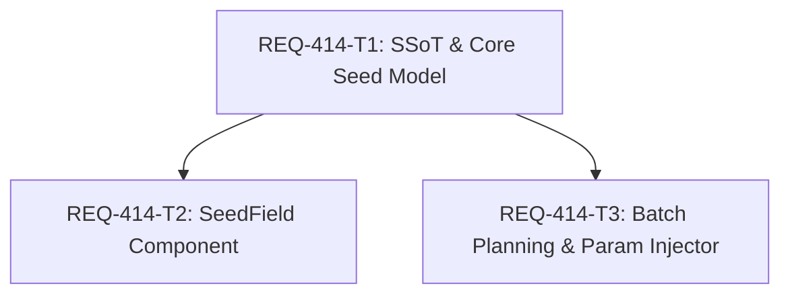

# Architectural Design: REQ-414 ComfyUI Node許容Seed大整数範囲対応

## 1. Executive Summary & Problem Context
ComfyUIの標準ノード（KSampler等）はSeed入力として `INT [min: 0, max: 0xffffffffffffffff (18,446,744,073,709,551,615 = 2^64-1)]`、ComfyUI WebUIのランダムSeedでも `1,125,899,906,842,624` (2^50) 等の大整数を許容・生成している。
これに対し、既存の仕様（REQ-350, SPEC_GENERATE.md §2-5, §8）はSeedを32ビット符号なし整数（`0` 〜 `4,294,967,295` = `UINT32_MAX`）と過小に規定していた。
そのため、ComfyUIで作成された一般的なワークフローを取り込んだ際、`getInitialParams` が抽出したSeed値が `parseSeedValue`、`readSeedSettings`、`SeedField`、`seedBatch.ts`、`workflowParamInjector.ts` のすべてで範囲外エラーを引き起こし、UI上でのエラー表示および画像生成の事前拒否が発生していた。

本改修では、SSoT（`SPEC_GENERATE.md`）およびフロントエンドのSeed処理系を拡張し、JavaScript安全整数範囲（`0` 〜 `Number.MAX_SAFE_INTEGER` = `9,007,199,254,740,991` = `2^53 - 1`）およびComfyUI WebUI標準（`1,125,899,906,842,624`）のSeedをネイティブに完全サポートする。さらに、万一64bit整数（`> Number.MAX_SAFE_INTEGER`）がワークフローに含まれていた場合でも、安全にフォールド（modulo / bitwise）してJS安全整数に収めることで、ワークフロー取り込み時のクラッシュ・検証エラーを完全に防止する。

## 2. Shared Contracts & Specifications (D4)
### 2.1 定数定義 (`frontend/src/utils/seedModel.ts`)
- `export const MAX_SAFE_SEED = Number.MAX_SAFE_INTEGER` (9007199254740991)
- `export const COMFY_RANDOM_SEED_MAX = 1125899906842624` (2^50, ComfyUI WebUI標準乱数上限)
- `export const UINT32_MAX = 4294967295` (後方互換用aliasとして維持)

### 2.2 Seed値パース・正規化契約 (`parseSeedValue`)
```ts
export function parseSeedValue(raw: string, label: string): number {
  if (!/^[0-9]+$/.test(raw)) throw new Error(`${label} must be an unsigned integer`)
  let value = Number(raw)
  if (!Number.isSafeInteger(value) || value < 0) {
    try {
      const b = BigInt(raw)
      if (b < 0n) throw new Error()
      value = Number(b % BigInt(MAX_SAFE_SEED))
    } catch {
      throw new Error(`${label} must be between 0 and ${MAX_SAFE_SEED}`)
    }
  }
  return value
}
```
- 正当な符号なし数値文字列に対して、`MAX_SAFE_SEED` 以下の値はそのままの数値を保持。
- `MAX_SAFE_SEED` を超える巨大整数（64bit整数等）は `BigInt(raw) % BigInt(MAX_SAFE_SEED)` により安全整数へ正規化。
- 負数、小数、空文字、英字等を含む不正値は厳格に拒否。

### 2.3 バッチ生成・乱数生成契約 (`frontend/src/utils/seedBatch.ts`)
- `randomSeed`: `options.randomSeed ?? (() => Math.floor(Math.random() * (COMFY_RANDOM_SEED_MAX + 1)))` (0 〜 1125899906842624)
- 固定Seedバッチ検証: `setting.seed + options.batchSize - 1 > MAX_SAFE_SEED` で検証。

### 2.4 UI入力ガード契約 (`frontend/src/components/SeedField.tsx`)
- `<input type="number" value={value} min={0} max={MAX_SAFE_SEED} step={1} ... />`

## 3. Seam Map (W-DD-SEAM)
1. **Integrated (real code)**:
   - `frontend/src/utils/seedModel.ts`: `parseSeedValue`, `readSeedSettings`, `setSeedModeForMapping`
   - `frontend/src/utils/seedBatch.ts`: `prepareSeedBatch`, `validateSeedBatch`
   - `frontend/src/utils/workflowParamInjector.ts`: `getInitialParams`, `injectWorkflowParams`
   - `frontend/src/components/SeedField.tsx`: UIレンダリング・入力更新
2. **Severed (external I/O only)**:
   - ComfyUI API (`/api/comfy/prompt`): 外部通信は行わず、生成パラメータ注入後のワークフローJSONの完全性を検証
3. **Mock Level**:
   - 内部関数のモンキーパッチは禁止。コンポーネントテストでは標準のDOM・イベントエミュレーション、統合テストではMSW/Fetchモック境界を遵守。
4. **PBT Decision**:
   - `parseSeedValue` および `prepareSeedBatch` の数値入力空間（0, 境界値, 大整数, 64bit整数, 不正文字列）に対して、vitest によるテーブル駆動・境界値プロパティ検証を実施。
5. **Fault Injection**:
   - 負値、浮動小数点数（`"12.3"`）、指数表記（`"1e5"`）、空文字列、非数値文字列（`"abc"`）、過大値の異常系入力に対する厳格拒否をテスト。

## 4. Task Decomposition & File Ownership (D1, D2, D3)
### Task REQ-414-T1: SSoT改定およびコアSeedモデルの大整数対応
- **Change Kind**: mixed
- **Owned Files**:
  - `docs/specs/SPEC_GENERATE.md`
  - `frontend/src/utils/seedModel.ts`
  - `frontend/src/utils/__tests__/seedModel.test.ts`
- **Scope**:
  - `SPEC_GENERATE.md` §2-5, §8 を改定し、Seed許容範囲を `Number.MAX_SAFE_INTEGER`（9,007,199,254,740,991）およびComfyUI標準（1,125,899,906,842,624）に更新。
  - `seedModel.ts` に `MAX_SAFE_SEED`, `COMFY_RANDOM_SEED_MAX` を定義。`parseSeedValue` を大整数・64bitフォールド対応に改修。
  - `seedModel.test.ts` を拡張し、AC-1, AC-5 の単体テストを整備。
- **Dependencies**: なし (Root)

### Task REQ-414-T2: SeedFieldコンポーネントの大整数入力対応
- **Change Kind**: code
- **Owned Files**:
  - `frontend/src/components/SeedField.tsx`
  - `frontend/src/components/__tests__/SeedField.test.tsx`
- **Scope**:
  - `SeedField.tsx` の input `max` 属性を `MAX_SAFE_SEED` に更新。大整数入力時の表示・編集・エラー制御を担保。
  - `SeedField.test.tsx` に大整数Seed（例: 1052824982390234, MAX_SAFE_SEED）のレンダリングおよび編集テスト（AC-2）を追加。
- **Dependencies**: REQ-414-T1 (requires `MAX_SAFE_SEED` from `seedModel.ts`)

### Task REQ-414-T3: バッチ生成・乱数生成およびワークフロー注入の大整数整合
- **Change Kind**: code
- **Owned Files**:
  - `frontend/src/utils/seedBatch.ts`
  - `frontend/src/utils/workflowParamInjector.ts`
  - `frontend/src/utils/__tests__/seedBatch.test.ts`
  - `frontend/src/pages/GeneratePage/__tests__/dedicatedSeedIntegration.test.tsx`
- **Scope**:
  - `seedBatch.ts` のバッチ上限チェック・乱数生成を `MAX_SAFE_SEED` / `COMFY_RANDOM_SEED_MAX` に更新。
  - `workflowParamInjector.ts` の注入前バリデーションと整合。
  - `seedBatch.test.ts` および `dedicatedSeedIntegration.test.tsx` の境界値テストを更新（AC-3, AC-4）。
- **Dependencies**: REQ-414-T1 (requires `seedModel.ts` constants and parser)

## 5. DAG and Execution Order


## 6. AC Mapping & Verification Plan (D5)
| AC | Description | Task | Verification Command / Test Case |
|---|---|---|---|
| AC-1 | 4294967295超大整数Seedの抽出・パース | T1 | `npx vitest run src/utils/__tests__/seedModel.test.ts -t "[REQ-414/AC-1]"` |
| AC-2 | 大整数SeedのSeedField正常表示と有効状態 | T2 | `npx vitest run src/components/__tests__/SeedField.test.tsx -t "[REQ-414/AC-2]"` |
| AC-3 | 大整数固定Seedの複数枚バッチ生成 | T3 | `npx vitest run src/utils/__tests__/seedBatch.test.ts -t "[REQ-414/AC-3]"` |
| AC-4 | ランダムSeed生成のComfyUI互換範囲検証 | T3 | `npx vitest run src/utils/__tests__/seedBatch.test.ts -t "[REQ-414/AC-4]"` |
| AC-5 | 不正Seed値（負数・小数・文字等）の厳格拒否 | T1 | `npx vitest run src/utils/__tests__/seedModel.test.ts -t "[REQ-414/AC-5]"` |

## 7. Delegation & Boundaries (D6, D7)
- **Delegated Scope (D6)**:
  - エンジニアは、`MAX_SAFE_SEED` および `COMFY_RANDOM_SEED_MAX` の命名および内部ヘルパー関数の分割、テストケースの記述方法を裁量内で決定可能。
- **Prohibited Scope (D7)**:
  - バックエンドAPIスキーマやDBモデル（`WorkflowPreset.seed` 等）への破壊的変更の禁止。
  - レガシーグローバルSeed（`Sampler_Seed`）の既存挙動への影響波及の禁止。
  - `__seed_modes_v1` メタデータ形式の変更禁止。
