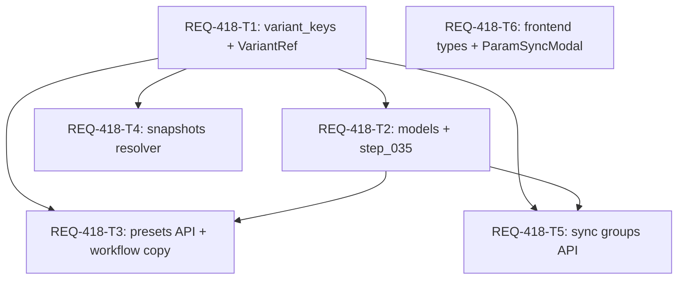

# Technical Design: REQ-418 プリセット・スナップショット・同期グループの role 参照から variant_id 参照への移行

- 設計者: architect (`dev-design`) / 対象 PBI: `docs/backlog/pbi/active/REQ-418.md` (`change_kind: code`, リスク区分: **high**)
- 前提: REQ-417 (`mapping_variants` 永続化、`UNIQUE(role)`、step_033/034) 完了済み。

### 1. 実現可能性判定・境界監査・アーキテクチャ設計

**判定: 条件付きで実現可能 (AC-1〜AC-4)。** PBI 記述と現行コードのギャップおよび解決方針は以下のとおり。

| # | PBI 記述 | 現行コードの実態 | 設計上の解決 |
|---|----------|------------------|--------------|
| G1 | プリセット値テーブルに `variant_id` 列追加 | `workflow_presets.param_values` JSON 1 列のみ | 正規化テーブル `workflow_preset_values` を新設し FK を付与。旧 JSON 列は予約キー (`__*`) 専用に維持 |
| G2 | 未解決行が 1 件でもあれば全体ロールバック | `param_values` に派生キー (`<role>_lora_count` 等) や予約キー (`__*`) が混在 | キーを 5 種に分類。予約キー・派生キーは解決済みとし、ゴーストキーのみ未解決として AC-1 どおり中断・全件列挙 |
| G3 | スナップショットを `variant_id` キーで DB 永続化 | `snapshots.params` は JSON テキスト | JSON キーを `v:<variant_id>[:sub]` 形式で保存。旧 `role` キーは復元時の後方互換リゾルバで解決し欠落キーは `logger.warning` + 除外 (AC-2) |
| G4 | フロント状態 (`presetState.ts` 等) の整合 | 実体は `usePresetState.ts` 等。内部状態は role キー | API 応答が FK 経由で現在の `role` キーと `variants` を返す境界変換を採用し、UI 変更は `types.ts` と `ParamSyncModal.tsx` に限定 (AC-3, AC-4) |
| G5 | 外部キー制約による孤立参照防止 | `database.py` は `PRAGMA foreign_keys` 無効 | DDL に FK (`ON DELETE CASCADE`) を宣言しつつ、ORM `cascade="all, delete-orphan"` と読み出し時欠落スキップで孤立を防止 |
| G6 | `applied_assets` (`{role: asset_ids}`) | プリセット内の別 JSON 列 | 本 PBI 対象外 (変更禁止)。既存の `MappingService.execute_cascade_rename` を維持 |

- **Boundary Audit**: Target_Paths = `backend/app/{models.py,migrations/steps.py,routers/{presets,snapshots,param_sync_groups,workflows}.py,schemas/{preset,snapshot,param_sync_groups,variant_ref}.py,services/{variant_keys,snapshot_service}.py}`、`frontend/src/{api/types.ts,components/ParamSyncModal.tsx}`、および各既存テストファイル (`test_variant_keys.py` のみモジュール名由来の新規作成)。Git_Root_Mismatch = なし。

### 1.1 データモデル (REQ-418-T2)

- `workflow_preset_values` (新設, AC-1): `id` PK, `preset_id` FK `workflow_presets(id)` ON DELETE CASCADE NOT NULL, `variant_id` FK `mapping_variants(id)` ON DELETE CASCADE NOT NULL, `sub_key` TEXT NOT NULL DEFAULT `''`, `value` TEXT NOT NULL, `UNIQUE(preset_id, variant_id, sub_key)`。
- `param_sync_groups` (列追加, AC-3): `master_variant_id` INTEGER NULL FK `mapping_variants(id)` ON DELETE CASCADE (SQLite ALTER 制約のため DB/ORM とも `nullable=True`、移行と API で非 NULL を保証。旧 `master_role` は書き込み時に現在 role を格納、`slave_roles` は `'[]'`)。
- `param_sync_group_members` (新設・中間テーブルによる slave メンバー管理, AC-3): `id` PK, `group_id` FK `param_sync_groups(id)` ON DELETE CASCADE NOT NULL, `variant_id` FK `mapping_variants(id)` ON DELETE CASCADE NOT NULL, `UNIQUE(group_id, variant_id)` により同期対象パラメータ一覧を外部キー制約付き中間テーブルとして管理する。
- `snapshots.params`: スキーマ変更なし。JSON キーを `v:<id>[:sub]` + 予約キー (`__*`) で保存。

### 1.2 キー分類とワイヤ契約 (REQ-418-T1、全タスク共有)

キー種別 (`KeyKind`) の判定順は固定:
1. `RESERVED`: `__` で始まる (プリセット・スナップショットとも素通し)
2. `VARIANT`: `^v:(?P<id>\d+)(?::(?P[A-Za-z0-9_]+))?$` に一致かつ `id` が `mapping_variants` に存在 (存在しなければ `UNRESOLVED`)
3. `ROLE`: 全文が `MappingVariant.role` に完全一致
4. `DERIVED_ROLE`: `^(?P<base>.+)_(?Plora_count|(?:lora_name|lora_wt|model_str|clip_str)_\d+)$` に一致かつ `base` が `role` に完全一致
5. `UNRESOLVED`: 上記以外

### 1.3 マイグレーション `step_035_variant_id_references` (REQ-418-T2, AC-1 / AC-3)

1. `workflow_presets` も `param_sync_groups` も無ければ no-op。`mapping_variants` テーブルまたは `role` 列が無ければ `ValueError` で中断 (AC-1 前提テーブル欠如エラー、DB 無変更)。
2. **検証相 (書き込みゼロ)**: `audit_role_references(conn)` で全プリセットの `param_values` と全未移行同期グループの `master_role` / `slave_roles` を分類。`UNRESOLVED` が 1 件でもあれば全件を列挙した `ValueError` を送出し、既存の `role` 参照データを一切変更せずロールバックする (AC-1)。
3. **変更相**: `CREATE TABLE IF NOT EXISTS` で新テーブルを作成し、`master_variant_id` 列を追加 (FK 付与)。`workflow_presets` と未移行 `param_sync_groups` の行数を確認し、空テーブル (`not preset_rows and not sync_rows`) の場合はデータ移行 INSERT/UPDATE をスキップしてスキーマ変更と制約付与のみコミットして完了する (AC-1)。既存データがあれば `workflow_preset_values` / `param_sync_group_members` へ INSERT し、`workflow_presets.param_values` を予約キーのみの JSON に書き換える (2 回目以降の再実行で冪等)。

### 1.4 バックエンド API とフロントエンド連携 (REQ-418-T3 / T4 / T5 / T6)

- **プリセット API (T3, AC-4)**: `GET /api/workflow-presets` は `workflow_preset_values` と予約キー JSON から `expand_stored_params` で最新の `role` キー `param_values`、`variant_param_values` (`v:<id>`)、および `MappingVariant` (`.master.display_name` 含む) の一括クエリ (`MappingVariant.id.in_(referenced_ids)`) で構築した最新の `variants: list[VariantRef]` を即座に返す (AC-4)。`POST`/`PUT` は `normalize_params` で値行を置換し (未解決キーは `logger.warning` で破棄)、`updated_at` を明示更新して 409 競合判定を維持。`copy_workflow` は値行と同期グループ (`master_variant_id` + `members`) を同一 `variant_id` で複製。
- **スナップショット API / Service (T4, AC-2)**: `create_snapshot` / `update_snapshot` は `to_storage_params` で `v:<id>[:sub]` + 予約キーとして保存。`GET /api/snapshots/{id}` と一覧は `expand_stored_params` で解決可能なキーのみ `params` に展開し、対応する `variant_id` が存在しないキーは `logger.warning` にスナップショット ID と欠落キーを明記してレスポンスの `params` 辞書から除外する。フロントエンドのスナップショット適用処理は `snapshot.params` に存在するキーのみを画面フォームへ上書き適用するため、除外された欠落キーに対応する入力フィールドは自動的に初期値（未設定）のまま維持され、有効なパラメータのみ画面展開が完了する (AC-2)。
- **同期グループ API (T5, AC-3 / AC-4)**: `POST`/`PUT` は `master_variant_id` / `slave_variant_ids` を優先し、未指定時は `master_role` / `slave_roles` から解決 (未知 ID/role や必須欠落は 422)。`GET` は FK 参照先の `MappingVariant` (`.master.display_name` 含む) を一括取得し、最新の `master_role`, `slave_roles`, `variants: list[VariantRef]` を即座に返す (AC-4)。
- **フロントエンド (T6, AC-3)**: `types.ts` に `VariantRef` と各型の `variant_*` / `variants` を追加。`ParamSyncModal.tsx` は `activeWorkflow.mappings` から `role -> variant_id` を引き、作成・更新時に `master_variant_id` / `slave_variant_ids` を送信する (`variant_id` が無いマッピングのみ `role` にフォールバック)。同一グループ内のパラメータ変更同期は既存の `useGenerateAction` 等で保持される (AC-3)。UI の見た目・クラスは変更禁止。

---

### 2. Seam Map [W-DD-SEAM]

1. **Integrated (実コード)**: FastAPI ルータ → サービス (`variant_keys`, `SnapshotService`) → SQLAlchemy ORM → SQLite (in-memory)。マイグレーションは `run_migrations(target_engine)` を実 `steps.py` で実行。フロントは `ParamSyncModal` → Zustand `useGenerationStore` → モック API 境界。
2. **Severed (外部 I/O のみ)**: 外部 HTTP (ComfyUI/LM Studio) は `conftest.py` の `respx` で遮断。スナップショット画像は `isolated_snapshot_dir`。フロントは API client (`workflowsApi`, `mappingMastersApi`, `stageMastersApi`) を `vi.mock` で遮断。
3. **Mock Level**: 内部ビジネスロジック (`VariantIndex`, `normalize_params`, `expand_stored_params`, `step_035`) のモンキーパッチ禁止。
4. **PBT 判定**: **必須**。`variant_keys` のキー分類・エンコード/デコードに対して Hypothesis によるラウンドトリップ・非例外プロパティテストを `backend/tests/unit/test_variant_keys.py` に実装する (T1)。
5. **Fault Injection**: ① `mapping_variants` テーブル欠如時のマイグレーション中断 (AC-1)、② ゴーストキー混入時の全体ロールバック (AC-1)、③ 削除済み/未登録 `variant_id`・旧 `role` キーを含むスナップショット復元時の警告と除外 (AC-2)、④ 未知 `variant_id` 指定時の同期グループ 422 拒否 (AC-3)、⑤ 古い `base_updated_at` によるプリセット 409 競合維持 (AC-4)。

---

### 3. 設計書契約 D1-D7 [W-DD-BOUNDARY]

### D1 タスク別の責務・範囲・完了条件

| Task | 責務 | 所有ファイル (D3: 重複なし) | 完了条件 |
|------|------|------------------------------|----------|
| REQ-418-T1 | キー分類・正規化・展開ロジックと `VariantRef` | `backend/app/services/variant_keys.py`, `backend/app/schemas/variant_ref.py`, `backend/tests/unit/test_variant_keys.py` | D4-C1/C2 の全関数と単体/PBT が PASS (DB 非依存) |
| REQ-418-T2 | 新モデル追加と `step_035` マイグレーション | `backend/app/models.py`, `backend/app/migrations/steps.py`, `backend/tests/integration/models/test_migrations.py` | AC-1 の 4 経路 (前提欠如/空/全解決/未解決ロールバック) と AC-3 DB 移行・冪等性が PASS |
| REQ-418-T3 | プリセット API の `variant_id` 化と workflow copy | `backend/app/schemas/preset.py`, `backend/app/routers/presets.py`, `backend/app/routers/workflows.py`, `backend/tests/integration/api/test_presets.py` | AC-4 (プリセット最新 Variant 反映) と 409 競合判定・copy が PASS |
| REQ-418-T4 | スナップショット保存と旧 role 復元リゾルバ | `backend/app/schemas/snapshot.py`, `backend/app/services/snapshot_service.py`, `backend/app/routers/snapshots.py`, `backend/tests/integration/api/test_snapshots.py`, `backend/tests/integration/services/test_snapshot_service.py` | AC-2 (警告ログ出力・欠落キー未設定維持・有効パラメータ展開) が PASS |
| REQ-418-T5 | 同期グループ API の `variant_id` 化 | `backend/app/schemas/param_sync_groups.py`, `backend/app/routers/param_sync_groups.py`, `backend/tests/integration/legacy/test_param_sync_groups.py` | AC-3 (永続化) と AC-4 (同期グループ最新 Variant 反映) が PASS |
| REQ-418-T6 | フロント API 型と `ParamSyncModal` の `variant_id` 送信 | `frontend/src/api/types.ts`, `frontend/src/components/ParamSyncModal.tsx`, `frontend/src/components/__tests__/ParamSyncModal.test.tsx` | AC-3 (UI の `variant_id` 送信・フォールバック・同期保持) と typecheck/vitest が PASS |

### D2 タスク間依存と理由

- `T1 -> T2`: `step_035` が `VariantIndex.classify` を使用してキー判定規則を一元化するため。
- `T1 -> T4`: スナップショットの保存・復元リゾルバが `to_storage_params` / `expand_stored_params` を使用するため。
- `T1, T2 -> T3 / T5`: 新テーブルモデル (T2) と共有キー解決ヘルパ (T1) の双方を使用するため。
- `T6`: 依存なし (D4-C3 のワイヤ契約が固定済みであり、フロント単体テストは API 境界をモックするため)。

### D4 共有契約

- **C1 (`backend/app/services/variant_keys.py`)**:
  - `KeyKind(RESERVED, VARIANT, ROLE, DERIVED_ROLE, UNRESOLVED)`、`ClassifiedKey(kind, key, variant_id, sub_key)`
  - `encode_variant_key(variant_id: int, sub_key: str = "") -> str`、`decode_variant_key(key: str) -> tuple[int, str] | None`
  - `VariantIndex(roles_by_id)` / `.from_session(db)` / `.role_of(vid)` / `.classify(key)` / `.role_key(vid, sub_key="")`
  - `normalize_params(index, params) -> NormalizedParams(entries, reserved, unresolved)`
  - `expand_stored_params(index, stored, *, owner_label, warn=True) -> ExpandedParams(role_keyed, variant_keyed, missing)`
  - `to_storage_params(index, params) -> tuple[dict[str, Any], list[str]]`
- **C2 (`backend/app/schemas/variant_ref.py`)**: `class VariantRef(BaseModel): id: int; role: str; display_name: Optional[str] = None`
- **C3 (ワイヤ契約)**:
  - `WorkflowPresetRead`: 既存フィールド + `variant_param_values: dict[str, str] = {}`, `variants: list[VariantRef] = []`
  - `SnapshotRead` / `SnapshotSummary`: 既存フィールド + `variant_params: dict[str, Any] = {}`, `variants: list[VariantRef] = []`
  - `ParamSyncGroupRead`: `{id, workflow_id, name, is_enabled, created_at, master_variant_id: int, slave_variant_ids: list[int], master_role: str, slave_roles: list[str], variants: list[VariantRef]}`
  - `ParamSyncGroupCreate` / `Update`: `master_variant_id` / `slave_variant_ids` と `master_role` / `slave_roles` の両方を受付 (ID 優先)
- **C4 (ORM モデル)**: `WorkflowPresetValue`, `ParamSyncGroupMember`, `ParamSyncGroup.master_variant_id`, `WorkflowPreset.values`, `ParamSyncGroup.members` / `.master_variant`。

### D5 AC → Task → 検証方法

| AC | 担当 Task | 検証ケース (`docs/design/REQ-418-test-plan.md`) |
|----|-----------|--------------------------------------------------|
| AC-1 | REQ-418-T1, REQ-418-T2 | `test_variant_ref_ac1_*` (`test_variant_keys.py` unit/PBT + `test_migrations.py` integration) |
| AC-2 | REQ-418-T1, REQ-418-T4 | `test_variant_ref_ac2_*` (`test_variant_keys.py` + `test_snapshot_service.py` + `test_snapshots.py`) |
| AC-3 | REQ-418-T2, REQ-418-T5, REQ-418-T6 | `test_variant_ref_ac3_*` (`test_migrations.py` + `test_param_sync_groups.py`) + Vitest `REQ-418/AC-3` (`ParamSyncModal.test.tsx`) |
| AC-4 | REQ-418-T3, REQ-418-T5 | `test_variant_ref_ac4_*` (`test_presets.py` + `test_param_sync_groups.py`) |

### D6 エンジニアに委譲する判断範囲 (`[W-DT-AUTONOMY]`)

所有ファイル内の private ヘルパ分割・命名、警告ログの文言細部（ただし `owner_label`/ID と全欠落キーを含めること）、所有テストファイル内の既存フィクスチャへの `MappingVariant` シード追加はエンジニアが単独で判断してよい。D4 の関数署名・ワイヤ形式・キー判定順・DDL 列構成の変更、および所有外ファイルの編集は禁止し、必要な場合は設計へエスカレーションする。

### D7 変更禁止範囲

`MappingVariant` の既存カラム・制約、`step_001`〜`step_034`、`MappingService` カスケード処理、`applied_assets`、`database.py` の PRAGMA、`conftest.py`、`schemas/__init__.py`、`ParamSyncModal.tsx` の JSX レイアウト・CSS クラス、およびフロントエンドの既存ストア/注入ロジック (`usePresetState.ts`, `useGenerateAction.ts` 等)。

---

### 4. リスク・トレードオフ・DAG 監査

- **リスク区分: high** (DB マイグレーション・公開 API 契約変更のため、V1 フルスイート検証必須)。
  - **R1 (本番 DB のゴーストキー)**: `audit_role_references(conn)` により事前ドライラン可能。未解決行がある場合は AC-1 どおり変更相に進まず中断。
  - **R2 (`updated_at` 競合判定の保護)**: 値テーブル更新時も `WorkflowPreset.updated_at` を明示更新し 409 判定を維持。
- **主要トレードオフ**:
  - **T-A (境界変換 vs フロント全面改修)**: API が FK から現在の `role` キーを返すことで、フロント内部ストアの回帰リスクをゼロにしつつ AC-1〜AC-4 を達成。
  - **T-B (`workflow_preset_values` 新設)**: JSON 列では張れない `mapping_variants(id)` FK を正規化テーブルで実現。
  - **T-C (実行時書き込みは警告+破棄、マイグレーションは中断)**: 自動保存の旧キー混入で 422 失敗し続けるのを防ぎつつ、マイグレーションは AC-1 どおり厳格にロールバック。

- **DAG / Atomicity 監査**: 最大深さ 3 (`T1 -> T2 -> T3/T5`)。全 6 カードはファイル所有権が完全に分離され、各カード 300 行以内。クロージング時は `docs/specs/SPEC_GENERATE.md`、`docs/specs/SPEC_HISTORY.md`、`docs/design/REQ-417.md` の同期対象を確認する。

