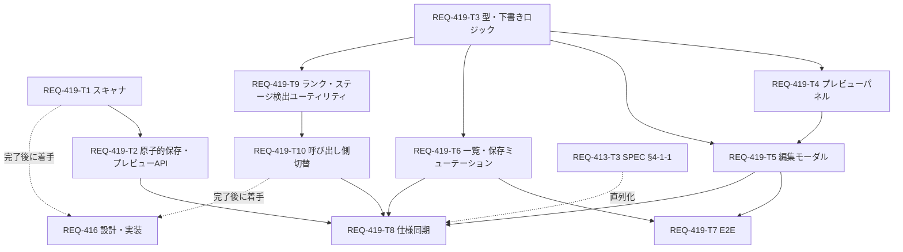

# Implementation Plan: REQ-419 マッピングマスタ設定UIの再構成と判定プレビュー（改訂2）

## Overview
REQ-417 の Master／Variant／判定定義（BindingRuleSet・NodeSelector）の3層構造に合わせ、Master 編集画面を「Master 値定義＋ステージ別 Variant 行＋判定プレビュー」に再構成する。1回の保存は新しい原子的保存 API で **単一トランザクション** として適用し、失敗時は全件ロールバックする。スキャナ（バックエンド）とフロントの候補ランク付け・ステージ検出から旧フィールドへの依存を取り除き、画面に出ている定義だけで判定する。

- 設計: `docs/design/REQ-419.md`（改訂2）／テスト計画: `docs/design/REQ-419-test-plan.md`（改訂2）
- Task Cards: `docs/backlog/task/active/REQ-419-T1.md` 〜 `REQ-419-T10.md`
- リスク分類: high。検証は V1 Baseline（全スイート）。
- 設計監査: ローカル BA 監査は3回とも出力不正で INCONCLUSIVE。2026-11-07 にユーザーが改訂2を承認し、人による設計レビューで代替（監査 PASS ではない）。PBI に AC-12・AC-13 が追加され、トレーサビリティを更新済み。

## Task List
| Task | 種別 | 内容 | 依存 |
|---|---|---|---|
| REQ-419-T1 | code/backend | スキャナの旧フォールバック廃止、Variant 詳細結果関数 | なし |
| REQ-419-T2 | code/backend | 原子的保存 API、非永続プレビュー API、Variant 読み取りのインライン定義、OpenAPI | T1 |
| REQ-419-T3 | code/frontend | 型・API クライアント、下書きモデル（検証・共有判定・原子的保存要求・プレビュー要求） | なし |
| REQ-419-T4 | code/frontend | 判定プレビューパネル | T3 |
| REQ-419-T5 | code/frontend | MappingMasterEditModal 再構成 | T3, T4 |
| REQ-419-T6 | code/frontend | 一覧カードの Variant 数バッジ、原子的保存ミューテーション、ステージ管理の検索語不在検証 | T3 |
| REQ-419-T7 | code/e2e | 375px／1280px の Playwright シナリオ（AC-11） | T5, T6 |
| REQ-419-T8 | document | SPEC_SETTINGS.md §3-1-1/§3-1-2/§3-2/§4-1/§4-1-1/§6 の同期 | T2, T5, T6, T10（外部: REQ-413-T3） |
| REQ-419-T9 | code/frontend | 候補ランク付け・ステージ検出の共通ユーティリティの3層化 | T3 |
| REQ-419-T10 | code/frontend | Upload/Rescan/配線/接続設定の呼び出し側を Variant 単位へ切替 | T9 |

## Dependency DAG

- 起点: T1・T3。最大深さ 4（T3→T4→T5→T7、T3→T4→T5→T8、T3→T9→T10→T8）。各辺は実際のコード依存（関数・型・画面契約）。
- 並行: T2 と T3〜T6・T9 は契約を設計で固定して並行可能。T4・T6・T9 は T3 完了後に並行。

## Cross-PBI Sequencing（コーディネーター向け）
| 制約 | 理由 |
|---|---|
| REQ-413-T3 → REQ-419-T8 | 同じ `SPEC_SETTINGS.md` §4-1-1 を編集する。同時編集禁止。REQ-419-T8 は REQ-413-T3 の追記を保持したまま tier 表を更新する。 |
| REQ-419-T1・T10 → REQ-416 | REQ-416 の対象（`UploadWorkflowModal.tsx`、`workflow_scanner.py`）を REQ-419 が先に変更する。REQ-416 は新しい Variant 単位の候補定義と新スキャナを前提に設計する。`useMasterMappingRows.ts` は REQ-419 では変更しない。 |
| REQ-413-T1/T2 と REQ-419 | 所有ファイルは重ならない。REQ-419 は `MappingVariant` に任意フィールドを追加するのみで、REQ-413 が依存する既存フィールドは変えない。順序の制約なし（同時進行可）。 |

## AC Coverage
| AC | 主担当 | 検証 |
|---|---|---|
| AC-1 | T5, T9, T10 | component, unit |
| AC-2 | T2, T3, T5 | API, unit, component |
| AC-3 | T2, T3, T5, T7 | API, unit, component, e2e |
| AC-4 | T3, T5, T7 | unit, component, e2e |
| AC-5 | T2, T3, T5, T6, T7 | API, unit, component, e2e |
| AC-6 | T2, T3, T5, T6 | API（422・DB 無変更）, unit, component |
| AC-7 | T6 | component |
| AC-8 | T5, T6 | component |
| AC-9 | T1, T2, T4, T5, T7 | integration+PBT, API, component, e2e |
| AC-10 | T2, T4 | API スナップショット比較, component |
| AC-11 | T7 | e2e |
| AC-12 | T2, T3, T5, T6, T7 | API（1要求反映・DB 失敗注入ロールバック・PBT）, unit, component, e2e |
| AC-13 | T1, T2, T9, T10 | scanner, preview API, unit, component（各層に (a)(b) 明示ケース） |

## Trade-off Disclosure
1. **保存の原子性（改訂2で変更）**: 既存 CRUD の逐次呼び出しは部分失敗が残るため不採用（ユーザー判断）。原子的保存 API は全件ロールバックを保証するが、定義・Master・Variant を横断する新しい公開契約とサーバ側検証が増え、既存 CRUD と検証規則が二重になる。名前一意・参照規則が既存ルーターと一致することをテストで固定する。
2. **プレビュー方式**: 非永続 dry-run API（本番スキャナを再利用）を採用。TS への移植は二重実装による乖離のため不採用。
3. **旧フィールド依存の除去（Q1・Q2 承認）**: スキャナ・候補ランク付け・ステージ検出が RuleSet/NodeSelector のみに従う。再スキャン・アップロード・配線画面の推奨ノードとステージ表示が変わり得る（保存済みマッピングは不変）。候補は Master 単位から Variant 単位になり、ステージごとに順位が異なり得る。
4. **データ源**: 候補・ステージ検出用の Entry/パターンを `MappingVariantRead` にインラインで含める。応答は大きくなるが、呼び出し側に追加クエリを入れて既存テストの API モック体系を広く改修するより影響が小さい。
5. **共有選択 UI**: モーダル内の行内パネル（ネストモーダルを増やさない）。
6. **撤去（承認済み）**: 旧プレビュー・ノードピッカー・Role上書き入力、旧 UI 専用テスト2本。
7. **作成モード（Q3 承認）**: 「初期RuleSetのパラメータ名」のみ残す。

## Verification (V1 Baseline)
- Gate 1: `backend\.venv\Scripts\python scripts/verify_ui_invariants.py`、`cd frontend; npm run typecheck`、`mypy backend`、`backend\.venv\Scripts\python scripts/verify_test_naming.py --strict`
- Gate 2: `backend\.venv\Scripts\python -m pytest -n auto`、`cd frontend; npm test`
- Gate 3: `cd frontend; npx playwright test` とテスト計画 §5・§6

## Open Questions
- R1（解決）: AC-12・AC-13 を PBI に追加。
- R2（解決）: 値注入フォールバックは範囲外のまま。
