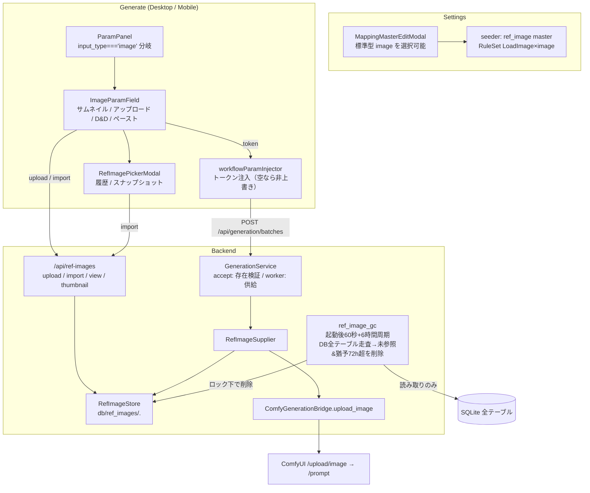

# REQ-427: 参照画像（ref画像）入力型・汎用ロールおよび画像選択UI 詳細設計書

## 1. アーキテクチャ概要

本設計は、`LoadImage` 系ノードへ渡す参照画像（AnimaRefAdapter / Openpose 等）をアプリ上で指定・差し替え可能にするため、次の 5 要素を追加する。

1. **標準 `input_type: 'image'`**（`seed` と同じ扱いの標準型。`ParamTypeMaster.widget_type` には追加しない）。`mapping_masters.input_type` は自由文字列列のため DB スキーマ変更・migration は不要。
2. **汎用参照画像ロール `ref_image` の初期定義**（`MappingMaster` + RuleSet Entry `LoadImage` × `image` + main Variant）。起動時の冪等 seeder（`seed_data.MAPPING_MASTER_SEEDS`）で投入する。
3. **アプリ内参照画像ストア**（バックエンド、内容アドレス方式）と **画像入力 UI**（`ImageParamField` + `RefImagePickerModal`）。値は参照トークン文字列 `refimg:<sha256>.<ext>` として既存の role 別パラメータ保存領域（`paramValues` / プリセット / Multi-Set / 生成記録 / Snapshot.params）にそのまま保存する。
4. **未参照画像の自動クリーンアップ（GC）**: どこからも参照されず猶予期間を過ぎたストア内画像を、起動時と定期実行で削除する（fail-safe、§5-2）。
5. **生成時の ComfyUI 供給**: フロントエンドは生成用 graph の対象ノード入力へトークンを注入し、バックエンド生成 worker が `POST /prompt` 直前にトークンを解決して ComfyUI `POST /upload/image` へ供給し、返却された ComfyUI 側参照名（`<subfolder>/<name>`）へ置換して投入する。



---

## 2. PBI 推論箇所の設計決定

| # | 推論項目 | 設計決定 |
|---|---|---|
| 1 | 汎用ロールの初期 `base_key` | `ref_image`（display_name `Reference Image`）。用途別ロールは Settings で `input_type: 'image'` の Master を追加して増やす運用とする。 |
| 2 | 画像値の保存形式 | **参照トークン文字列 `refimg:<sha256 小文字64桁>.<png\|jpg\|webp>`**。既存のプリセット値（`workflow_preset_values.value` TEXT）、`GenerationSet.paramValues`、`BatchItem.param_values`、`Snapshot.params` は role→文字列の契約であり、トークンは追加スキーマなしでそのまま保存・復元される。実体はバックエンドの内容アドレス型ストア（`<snapshot_dir の親>/ref_images/`、本番既定 `db/ref_images/`）に原本バイト列のまま保持する（再エンコードしない。Openpose 等の制御画像の劣化を防ぐ）。 |
| 3 | 履歴・スナップショット画像の扱い | 選択時に **ストアへ複製（import）してトークン化** する。履歴の ComfyUI output は 200 件窓でパージされ得るため、直接参照はプリセット・履歴再現の永続性を満たさない。 |
| 4 | ComfyUI への供給タイミング | **生成 worker の上流 POST 直前**（job ごと）。選択時アップロードは ComfyUI 再起動・URL 変更・input 削除に弱く、AC-6 の「生成実行時に供給」とも合わない。同一内容は同一ファイル名（`<sha256>.<ext>`）・`overwrite=true` のため再供給は冪等。 |
| 5 | 未指定時の挙動 | 値が空、またはトークン形式でない値は「未指定」とみなし、対象ノード入力を上書きしない（元 workflow JSON の値のまま投入）。初期値（`getInitialParams`）は、ノード入力がトークン形式ならその値、それ以外は空文字。 |
| 6 | クリア操作 | 実装しない（PBI で AC 対象外と明記）。 |
| 7 | 受付時検証 | `POST /api/generation/batches` 受付時（新規 request のみ）に graph 内トークンのストア実在を検証し、欠落があれば 422 `ref_image_not_found` で全体拒否（job を作らない）。上流 ComfyUI への通信は受付時に行わない（既存の「受付は上流状態を待たない」契約を維持）。 |
| 8 | 供給失敗時の job 状態 | アップロードは `/prompt` 投入前のため、失敗時は上流投入が確実に行われていない。job を `failed`（outcome `failed`）へ遷移し、`/prompt` は送らない。自動再試行はしない。 |
| 9 | ストアの保持・削除 | どこからも参照されず猶予 72 時間を過ぎた画像を、起動後 60 秒＋6 時間周期の自動クリーンアップ（GC）で削除する。参照収集は DB 全テーブル・全列の汎用走査とし、一部でも失敗・不確実なら削除しない（§5-2）。 |
| 10 | プロファイル一括編集 | `ProfileBulkEditModal` のパラメータタブで `image` 型を正式に扱う。`ImageParamField`（＋`RefImagePickerModal`）を共通部品として再利用し、選択したトークンを既存の `paramPatch` 経路で複数プリセットへ同一値として一括適用する（§6-2）。 |

### 2-2. 参照画像ストア（`ref_images`）を挟む理由
履歴・スナップショット・ComfyUI のファイルを直接参照せず、アプリ内ストアへ複製してから使う理由は次のとおり（GC 導入後も維持する）。
1. **履歴 200 件窓のパージ**: ComfyUI の output と BE キャッシュは最新 200 件で整理されるため、直接参照するとプリセットや履歴再現の画像が後で消える。
2. **スナップショットの劣化**: Snapshot 画像は WebP（quality 90）へ再エンコード済みで、Openpose などの制御画像が劣化し得る。ストアは原本バイト列をそのまま保持する。
3. **ComfyUI 非依存**: ComfyUI の再起動・URL 変更・input フォルダの削除の影響を受けない。生成のたびに worker がストアから供給し直す。
4. **冪等**: ファイル名を内容ハッシュ（sha256）にするため、同じ画像を何度選んでも 1 ファイルで済み、ComfyUI への再供給も上書きで冪等になる。

---

## 3. SSoT 影響分析

`doc_mapper.py docs/specs docs/backlog/pbi/active/REQ-427.md` は「No mapped documents found」を返したため、PBI の Surface（Generate `ParamPanel`, Settings `MappingMaster`）から対象仕様を特定した。クロージャ時に以下へ反映する（本フェーズでは仕様書を編集しない）。

| 仕様書 | 節 | 反映内容 |
|---|---|---|
| `docs/specs/SPEC_SETTINGS.md` | §4-1 MappingMaster & ParamTypeMaster（Seed 段落の後） | 標準 `input_type: 'image'` の定義、値はトークン文字列で role 別保存、初期 Master `ref_image`（RuleSet `LoadImage`×`image`, main Variant, `default_enabled` true）、migration なし。 |
| `docs/specs/SPEC_GENERATE.md` | §2-5 パラメータ入力パネル | 動的生成対象に `image` を追加し、`ImageParamField`（サムネイル、履歴/スナップショット選択、アップロード、D&D、フォーカス時ペースト、失敗時の値保持）を記載。 |
| `docs/specs/SPEC_GENERATE.md` | §5 ワークフロー JSON へのパラメータ注入 | `image` はトークンのときのみ対象入力へ注入、未指定は非上書き。 |
| `docs/specs/SPEC_GENERATE.md` | §2-9 ジョブ（`POST /api/generation/batches`） | 受付時トークン実在検証（422 `ref_image_not_found`）、worker の `/upload/image` 供給と置換、供給失敗は `failed` で `/prompt` 非送信。 |
| `docs/specs/SPEC_GENERATE.md` | API 一覧（新設節） | `/api/ref-images` 4 エンドポイントと `RefImageRead` / `RefImageImportRequest`。 |
| `docs/specs/SPEC_GENERATE.md` | 参照画像ストア（新設節） | ストアを挟む理由、保存場所、touch 契機、GC（猶予 72 時間、起動後 60 秒＋6 時間周期、DB 全テーブル走査、fail-safe 中止条件、対象ファイル限定、削除後の挙動）。 |
| `docs/specs/SPEC_COMMON.md` | §5-4 プリセット一括編集モーダル | パラメータタブで `image` 型を `ImageParamSection`（`ImageParamField` 再利用）で扱うこと、構成ファイル一覧に `tabs/ParamBulkEditTab/ImageParamSection.tsx` を追加、画像ピッカー表示中の Escape は一括編集モーダルを閉じないこと。 |
| `docs/specs/SPEC_GENERATE.md` | §2-6 プリセット一括編集（パラメータ一括編集） | `image` 型の一括選択・適用（チェック ON かつ画像選択済みのときのみ上書き、未選択は不変、同一トークンを全対象へ書込み、途中失敗は既存の一括適用規則）。 |
| `docs/specs/SPEC_HISTORY.md` | Snapshot params | `Snapshot.params` に参照画像トークンが含まれ得ること、復元時にそのまま入力値へ戻ること。Snapshot・生成履歴が参照する画像は GC で削除されないこと。 |
| `backend/openapi.json` / `frontend/src/api/schema.ts` | 生成契約 | `scripts/export_openapi.py` と `npm run openapi:generate` で再生成（T1）。 |

変更しない SSoT: `SPEC_COMMON.md`（UI 6 大不変条件は遵守のみ）、プリセット API・Snapshot API のスキーマ、`mapping_slot_states` / Variant 無効化の契約（REQ-358 / REQ-413）。

---

## 4. 共有契約（Shared Contracts: トークン・REST API）

### C1: 参照トークン
- 正規表現（BE/FE 共通、完全一致）: `^refimg:([0-9a-f]{64})\.(png|jpg|webp)$`
- `ref_id` = `<sha256>.<ext>`、トークン = `refimg:` + `ref_id`。`sha256` は保存原本バイト列のハッシュ。拡張子は Pillow 検出フォーマットから決定（PNG→`png`、JPEG→`jpg`、WEBP→`webp`）。ファイル名・Content-Type は判定に使わない。

### C2: REST API `/api/ref-images`（新規 router `backend/app/routers/ref_images.py`）
| メソッド/パス | 入力 | 成功 | 失敗 |
|---|---|---|---|
| `POST /api/ref-images/upload` | multipart `file` | 201 `RefImageRead` | 415 `unsupported_media_type`（非画像・破損・PNG/JPEG/WebP 以外）、413 `too_large`（> 20 MiB または > 50,000,000 画素）、422 `empty_file` |
| `POST /api/ref-images/import` | JSON `RefImageImportRequest` | 201 `RefImageRead` | 422 検証エラー（パス区切り・`..`・不正 type・必須欠落）、404 `source_not_found`、502 `upstream_unavailable`、415/413 は upload と同じ |
| `GET /api/ref-images/{ref_id}` | `ref_id` は C1 の `ref_id` 形式 | 200 原本（`image/png` 等、`Cache-Control: public, max-age=86400`。GC の猶予計算と整合させるため `immutable` は付けない） | 404 `not_found`（形式不一致も 404） |
| `GET /api/ref-images/{ref_id}/thumbnail` | 同上 | 200 WebP（長辺 256px、同 Cache-Control） | 404 `not_found` |

```python
class RefImageRead(BaseModel):
    token: str          # "refimg:<sha256>.<ext>"
    ref_id: str         # "<sha256>.<ext>"
    media_type: str     # "image/png" | "image/jpeg" | "image/webp"
    width: int
    height: int
    byte_size: int
    view_url: str       # "/api/ref-images/<ref_id>"
    thumbnail_url: str  # "/api/ref-images/<ref_id>/thumbnail"

class RefImageImportRequest(BaseModel):
    model_config = ConfigDict(extra="forbid")
    source: Literal["history", "snapshot"]
    filename: str | None = None        # history 必須。"/", "\\", ".." を含めば 422
    subfolder: str = ""                # ".." / 絶対パス / "\\" を含めば 422
    type: Literal["output", "temp"] = "output"
    snapshot_id: int | None = None     # snapshot 必須
```
- エラー本文は `HTTPException(status, detail={"code": <code>, "message": <日本語メッセージ>})`。
- history import の取得順序: ComfyUI `GET {settings.comfy_url}/view?filename&subfolder&type`（原本）→ 404/接続失敗時は既存フルサイズ WebP キャッシュ（`app.routers.comfy._get_full_webp_disk_path(f"{type}:{subfolder}:{filename}")`）→ どちらも無ければ 404 `source_not_found`（上流接続失敗かつキャッシュ無しは 502 `upstream_unavailable`）。
- snapshot import: `Snapshot.image_path` の basename を `settings.snapshot_path` 配下で解決し、解決後パスが同ディレクトリ配下であることを検証。存在しない Snapshot・ローカル画像なしは 404 `source_not_found`。

---

## 4-2. 共有契約（続き: ストア・ブリッジ・供給）

### C3: ストア（`backend/app/services/ref_image_store.py`）
```python
REF_TOKEN_RE: re.Pattern[str]          # C1
MAX_REF_IMAGE_BYTES = 20 * 1024 * 1024
MAX_REF_IMAGE_PIXELS = 50_000_000
class RefImageError(Exception): code: str; status: int; message: str
class StoredRefImage(NamedTuple): ref_id: str; media_type: str; width: int; height: int; byte_size: int
def parse_ref_token(value: object) -> str | None        # 完全一致時 ref_id、それ以外 None
def token_for(ref_id: str) -> str
class RefImageStore:
    def __init__(self, root: Callable[[], Path] | None = None) -> None  # 既定は毎回 settings.snapshot_path.parent / "ref_images"
    @classmethod
    def default(cls) -> "RefImageStore"
    def save_bytes(self, data: bytes) -> StoredRefImage    # 検証・原子的保存（tmp→replace）・サムネイル生成、同一内容は冪等
    def exists(self, ref_id: str) -> bool
    def read(self, ref_id: str) -> tuple[bytes, str]      # (原本, media_type)、無ければ RefImageError(404)
    def thumbnail_path(self, ref_id: str) -> Path         # 無ければ再生成、原本無しは RefImageError(404)
    def describe(self, ref_id: str) -> StoredRefImage
    def touch(self, ref_id: str, *, min_interval_s: float = 0.0) -> bool  # ストアロック下で原本 mtime を現在時刻へ更新（GC 猶予の延長）。原本無しは False
    def claim(self, ref_ids: Iterable[str]) -> list[str]  # ストアロック下で存在確認＋touch を原子的に行い、欠落 ref_id を返す
STORE_LOCK: threading.RLock                               # プロセス内共有。save_bytes / touch / claim / GC 削除フェーズが保持
```
- ルートはインスタンス生成時ではなく各操作時に解決する（テストの `isolated_snapshot_dir` で tmp 配下に隔離される）。
- 保持期限は固定しない。どこからも参照されず猶予期間を過ぎた画像は自動クリーンアップ（GC）で削除する（§5-2、C8）。
- `save_bytes` は同一内容が既に存在する場合も `touch` する（再選択で猶予期間が延長される）。`GET /{ref_id}` と `GET /{ref_id}/thumbnail` は `touch(ref_id, min_interval_s=3600)` を行う（表示中の画像の猶予を延長。書き込み頻度は 1 時間に 1 回へ抑制）。

### C4: ブリッジ（`ComfyGenerationBridge.upload_image`）
```python
async def upload_image(self, data: bytes, filename: str, media_type: str, *, subfolder: str = "prompt_surgeon_ref") -> dict[str, str]
# POST /upload/image (multipart: image=(filename, data, media_type), type="input", subfolder, overwrite="true"), timeout=30.0
# 戻り値 {"name": str, "subfolder": str, "type": str}; name 欠落・非 JSON は UpstreamResponseError
```

### C5: 供給（`backend/app/services/ref_image_supply.py`）
```python
@runtime_checkable
class RefImageUploadPort(Protocol):
    async def upload_image(self, data: bytes, filename: str, media_type: str, *, subfolder: str = ...) -> dict[str, str]: ...
class RefImageSupplyError(Exception): ...
def collect_ref_ids(graph: dict[str, Any]) -> list[str]                       # node.inputs の str 値で C1 完全一致のみ、出現順・重複除去
def replace_ref_tokens(graph: dict[str, Any], resolved: dict[str, str]) -> dict[str, Any]  # 深いコピーを返す、非トークン値・リンク配列は不変
class RefImageSupplier:
    def __init__(self, store: RefImageStore, uploader: RefImageUploadPort) -> None
    def claim_refs(self, graph: dict[str, Any]) -> list[str]                 # store.claim(collect_ref_ids(graph)) の欠落 ref_id
    async def resolve(self, graph: dict[str, Any]) -> dict[str, Any]          # 失敗は RefImageSupplyError（日本語理由）
```
- 置換値は `f"{subfolder}/{name}"`（subfolder 空なら `name`）。

---

## 4-3. 共有契約（続き: 生成サービス・フロントエンド・GC）

### C6: 生成サービス統合
- `GenerationService.__init__(..., ref_image_supplier: RefImageSupplier | None = None)`。省略時、`isinstance(bridge, RefImageUploadPort)` なら `RefImageSupplier(RefImageStore.default(), bridge)` を内部生成、そうでなければ `None`。
- `accept`: 新規 request（replay でない）に限り、全 item の graph にトークンがあり supplier が `None`、または `supplier.claim_refs(graph)`（= `store.claim`、存在確認と touch を原子的に実施）の欠落が非空なら `HTTPException(422, detail=ErrorDetail(code="ref_image_not_found", ...).model_dump())` を送出し、何も commit しない。
- worker: `submitting` 遷移後、`bridge.submit` 前にトークンが 1 つでもあれば `resolve` を実行し、成功時は置換後 graph を submit。失敗時は `failed`（reason は日本語、outcome `failed`、`finished_at`）へ遷移し publish、`submit` は呼ばない。`CancelledError` は `failed`（理由「上流投入前にサービスが停止しました」）に遷移後に再送出。

### C7: フロントエンド
- `frontend/src/utils/refImage.ts`: `REF_IMAGE_TOKEN_RE`, `isRefImageToken(v: unknown): v is string`, `refIdFromToken(token: string): string | null`, `refImageThumbnailUrl(token: string): string | null`, `refImageViewUrl(token: string): string | null`, `parseHistoryImageUrl(url: string): { filename: string; subfolder: string; type: 'output' | 'temp' } | null`, `ACCEPTED_REF_IMAGE_MIME = ['image/png','image/jpeg','image/webp'] as const`, `MAX_REF_IMAGE_BYTES = 20 * 1024 * 1024`。
- `frontend/src/api/domains/refImages.ts`: `refImagesApi.upload(file: Blob, filename?: string): Promise<RefImageRead>`, `refImagesApi.importFromHistory(src: { filename: string; subfolder: string; type: 'output' | 'temp' }): Promise<RefImageRead>`, `refImagesApi.importFromSnapshot(snapshotId: number): Promise<RefImageRead>`。`client.ts` から再エクスポート。
- `frontend/src/api/types.ts`: `export type RefImageRead = Schema<'RefImageRead'>`、`MappingMaster.input_type` の union に `'image'` を追加（`mappingStageGroups.ts` / `wiringStageGroups.ts` の同型 union も同様）。
- 注入（`workflowParamInjector.ts`）: `input_type === 'image'` は `isRefImageToken(paramValues[role])` のときのみ `node.inputs[input_name || param_name || 'image'] = token`。それ以外は対象入力を変更しない。`getInitialParams` は対象入力がトークンならその値、それ以外は `''`。
- `ImageParamField` props（Generate と一括編集で共通利用するため mapping 型に依存しない）: `{ label: string; fieldKey: string; value: string | undefined; onChange: (token: string) => void; mobile?: boolean; disabled?: boolean; workflowId?: number; onPickerOpenChange?: (open: boolean) => void }`。`fieldKey` は DOM id・テスト id の接頭辞（例 role）。`RefImagePickerModal` props: `{ isOpen: boolean; onClose: () => void; onSelected: (image: RefImageRead) => void; workflowId?: number }`。

### C8: 参照画像 GC（`backend/app/services/ref_image_gc.py`）
```python
GC_GRACE_SECONDS = 72 * 3600          # 原本 mtime からの猶予
GC_INITIAL_DELAY_SECONDS = 60         # 起動後の初回実行までの待機
GC_INTERVAL_SECONDS = 6 * 3600        # 定期実行周期
GC_MAX_DELETIONS_PER_RUN = 500
TMP_STALE_SECONDS = 3600              # .tmp_* 残骸の削除閾値
class GcReport(NamedTuple):
    aborted: bool; reason: str | None; tables_scanned: tuple[str, ...]; referenced: int
    stored: int; deleted: tuple[str, ...]; kept_recent: int; kept_referenced: int
def collect_db_references(conn: Connection) -> tuple[set[str], tuple[str, ...]]   # (ref_id 集合, 走査テーブル名)
def run_gc(store: RefImageStore, connect: Callable[[], ContextManager[Connection]], *, now: Callable[[], float] = time.time) -> GcReport
async def gc_loop(store: RefImageStore, connect: Callable[[], ContextManager[Connection]], *,
                  initial_delay: float = GC_INITIAL_DELAY_SECONDS, interval: float = GC_INTERVAL_SECONDS) -> None
# 初回待機→run_gc（to_thread）→周期待機を繰り返す。CancelledError 以外の例外はログのみで継続
```

---

## 5. バックエンド設計（ストア・API・供給経路）

### 5.1 ストア保存処理（`save_bytes`）
1. 空バイト列は `RefImageError(422, "empty_file")`、`> MAX_REF_IMAGE_BYTES` は 413。
2. `Image.open(BytesIO(data))` → `verify()` → 再 open して `format` と `size` を取得。`format` が PNG/JPEG/WEBP 以外・例外（`UnidentifiedImageError`, `OSError`, `SyntaxError`）は 415。`width*height > MAX_REF_IMAGE_PIXELS` または `Image.DecompressionBombError` / `DecompressionBombWarning` は 413（警告は例外化して扱う）。
3. `sha256(data)` → `ref_id`。既存ファイルがあれば再書き込みしない（冪等）。無ければ `.tmp_<uuid>` へ書いて `replace`。
4. サムネイル `thumbs/<sha256>.webp`（`ImageOps.exif_transpose` 後に長辺 256px、quality 80）を同様に原子的生成。

### 5.2 Router
- upload は `await file.read(MAX_REF_IMAGE_BYTES + 1)` で上限 +1 バイトまでのみ読み、超過は 413。Pillow 処理は `asyncio.to_thread`。
- `main.py` に `app.include_router(ref_images.router)` を追加（`/api/snapshots/images` の静的 mount とは独立。ストアディレクトリは静的公開しない）。

### 5.3 供給経路
- 受付（C6 accept）→ worker（C6 worker）。`collect_ref_ids` はノードの `inputs` 辞書の **文字列値で C1 に完全一致するものだけ** を対象とし、リンク配列 `[node_id, index]`・非トークン文字列・`_meta` は対象外（PBT で保証）。
- バイパス済みノードは送信 graph（`finalGraph`）から除去済みのため、供給対象にならない。
- 旧プロキシ `POST /api/comfy/prompt` はトークン解決を行わない（変更しない）。Generate / Studio は `POST /api/generation/batches` を使うため対象外。

### 5.4 初期マスタ seed（AC-2）
- `MAPPING_MASTER_SEEDS` に追加:
  `{"role": "ref_image", "expected_class_types": ["LoadImage"], "param_name": "image", "input_type": "image", "display_name": "Reference Image", "title_patterns": ["RefImage", "Ref_Image", "ReferenceImage"]}`
- 既存 `_seed_mapping_masters` により Master（group `latent`＝「Latent・画像」）、RuleSet `Reference Image Rules`（Entry `LoadImage`×`image`, priority 1）、NodeSelector `ref_image Selector`（exact パターン）、main Variant（role `ref_image`）が冪等に作られる。セレクタはタイトル不一致でも除外しない（判定段階 3＝セレクタなし扱い）ため、既定タイトル `Load Image` の `LoadImage` ノードも候補になる。
- **起動安全ガード**: seed の role と同じ `MappingVariant.role` が別 Master に既に存在する場合（`UNIQUE(role)` 衝突）、その seed 項目の Master/Variant 作成をスキップし `logger.warning` を出す（起動失敗を防ぐ）。既存 seed の既存行の扱いは変えない。

---

## 5-2. 参照画像ストアの自動クリーンアップ（GC）: 参照収集と猶予期間

履歴・スナップショットから「試しに選んだだけ」の画像でストアが肥大化しないよう、どこからも参照されず猶予期間を過ぎた画像を定期的に削除する。誤って参照中の画像を消すと、プリセットや履歴の再現ができなくなる重大事故になる。このため **「参照収集が一部でも不確実なら一切削除しない」** を最優先の原則とする。

### 5-2.1 参照元の網羅（列挙漏れ防止）
- **方式: DB 全テーブル・全列の汎用走査**（`collect_db_references`）。保存場所を個別に列挙するのではなく、`sqlite_master`（`type='table'`、`sqlite_%` を除く）から実行時にテーブル一覧を取得し、各テーブルの全列の全値を走査する。値が `str` ならそのまま、`bytes` なら UTF-8（`errors="ignore"`）で復号し、正規表現 `refimg:([0-9a-f]{64})\.(png|jpg|webp)`（**部分一致**。JSON 内・JSON 文字列の入れ子内も拾う）で `ref_id` を収集する。トークンは ASCII のみで、Python `json.dumps` / JS `JSON.stringify` によるエスケープ対象文字を含まないため、JSON の多重エンコード内でも同じ文字列として現れる。
- これにより次の既知の保存場所が自動的に対象になり、**将来テーブルや列が追加されても列挙の更新が不要**:
  - `workflow_presets.param_values`（予約キー JSON）、`workflow_preset_values.value`（プリセット・Multi-Set の各セット）
  - `snapshots.params`（Snapshot・生成レコード `__prompt_surgeon_metadata_v1` を含む）、`prompt_metadata.param_values`（生成履歴）
  - `generation_jobs.graph_json` / `metadata_json`（キュー中・実行中・終端ジョブ。受付は DB commit 後に worker へ渡るため、メモリ上の pending/frozen graph は必ず DB 行を伴う）
  - `workflows.json_body`（「既定値として保存」）、`workflow_history.json_body` / `mappings` / `mapping_slot_states`、`app_settings.value`、Dataset Studio 系テーブル
- **一貫性**: 全テーブルの読み取りを 1 つの読み取りトランザクション（`with conn.begin():`）内で行う（WAL により書き込みと並行しても一貫したスナップショットになる）。
- **列挙漏れ防止テスト**: (a) `Base.metadata` の全テーブルが `tables_scanned` に含まれることを検証するテスト（新テーブル追加時も自動で検証対象になる）、(b) ORM 定義に無いテーブル（例 `CREATE TABLE future_x(data TEXT)`）に入れたトークンも収集されることを検証するテスト、(c) 上記既知の保存場所それぞれにトークンを入れて収集されることを検証するテスト。
- **DB 外の参照**（ブラウザの未保存ドラフト、Undo 履歴の sessionStorage、IndexedDB の API キャッシュ、閉じたタブ）はサーバーから観測できない。これは猶予期間と touch（§5-2.2）で保護し、残余リスクは §5-2.5 の整合挙動で扱う。

### 5-2.2 猶予期間（grace period）と touch
- **猶予 72 時間**（原本ファイルの mtime 基準）。mtime が現在時刻から 72 時間以内の画像は参照の有無にかかわらず削除しない。
- mtime は次の契機で現在時刻に更新する（`STORE_LOCK` 下）:
  - アップロード・import（新規保存時、および同一内容が既に存在する場合）
  - 生成受付（`claim`: 存在確認と touch を原子的に実施）
  - 原本・サムネイルの GET（表示中の画像。1 時間に 1 回へ抑制）
- **72 時間の根拠**: オートセーブ（1 秒デバウンス）や競合解決の待ちに対して十分大きい。原本・サムネイル GET の `Cache-Control` を `public, max-age=86400`（24 時間、`immutable` は付けない）とするため、再表示（再描画・タブ復帰・プリセット切替など）された画像は「キャッシュ失効 24 時間＋touch 抑制 1 時間」以内に再取得されて touch される。72 時間はこれに 2 倍以上の余裕を持たせた値（再表示されないまま開きっぱなしのタブは §5-2.5 の残余リスク）。また「試しに選んだだけ」の画像は最長でも約 3 日強（猶予＋周期 6 時間）で回収される。

---

## 5-3. 参照画像ストアの自動クリーンアップ（GC）続き: 実行・安全原則・削除後挙動

### 5-2.3 実行契機・排他・原子性
- **契機**: 起動後 60 秒で初回実行し（起動処理を遅らせない）、以降 6 時間周期で実行する（`gc_loop`）。`main.py` の lifespan で `asyncio.create_task` により開始し、終了時に cancel する。`run_gc` は `asyncio.to_thread` で実行する（イベントループを占有しない）。
- **6 時間周期の根拠**: 画像の流入はユーザー操作の頻度に限られ、ディスク回収に即時性は不要。一方で全 DB 走査（プロンプト履歴 1000 件・ジョブ 1000 件規模）を短周期で繰り返す負荷は避けたい。1 日 4 回あれば猶予 72 時間に対して回収遅延は小さい。
- **二段階削除**:
  1. 収集 1 回目 → 候補 = ストア内の正規名ファイルのうち「未参照」かつ「mtime が猶予超過」
  2. 収集 2 回目（候補が非空のときのみ）→ 両方で未参照の候補だけを残す
  3. 各候補について `STORE_LOCK` を取得し、mtime を再取得してなお猶予超過なら原本とサムネイルを削除する。`claim` / `touch` / `save_bytes` も同じロックを取るため、受付・アップロードと削除が交錯しても「touch 済みの画像を消す」ことはない。
- 1 回の実行の削除上限は 500 件（残りは次回）。同時に 2 つの GC が走らないよう、`gc_loop` はプロセス内で 1 タスクのみとする（単一 uvicorn プロセス前提。複数プロセス構成でも、猶予期間と mtime 再確認により安全側に倒れる）。
- **失敗時**: `run_gc` 内の例外はすべて捕捉して `GcReport(aborted=True, reason=...)` とし、`logger.warning` を 1 回出すのみとする。`gc_loop` は継続し、起動・生成・API は影響を受けない。

### 5-2.4 安全側の原則（fail-safe）
- 次のいずれかに当たれば、その回は **1 件も削除せず中止**する（`aborted=True`）:
  - テーブル一覧の取得失敗、いずれかのテーブル・行の読み取り例外
  - 2 回目の収集の失敗
  - ストアルートの列挙失敗、ルートの不存在
- **対象ファイルの限定**: ストアルート直下の `^[0-9a-f]{64}\.(png|jpg|webp)$`、`thumbs/` 直下の `^[0-9a-f]{64}\.webp$`、ルート直下の `.tmp_*`（mtime 1 時間超のみ。書き込み途中の残骸）に限る。
  - 上記以外の名前・サブディレクトリ・シンボリックリンク（`is_symlink()`）・ルート外へ解決されるパスには触れない。
  - サムネイルは、原本が無く mtime が猶予を超えたものだけを削除する。
- ストア外（`db/snapshots`、`full_cache`、ComfyUI input など）は一切削除しない。ComfyUI 側の `prompt_surgeon_ref/` も削除しない（ComfyUI の管理領域であり、同名再アップロードで上書きされる）。

### 5-2.5 削除後に参照が残っていた場合（想定外）の挙動
- これは DB 外の参照が猶予期間を超えて残っていた場合に限られる。
- **表示**: サムネイル GET が 404 → `ImageParamField` は「プレビューを表示できません」を表示し、値（トークン）は保持する（既存の T5 仕様）。
- **生成**: 受付時の `claim` で欠落を検出し、422 `ref_image_not_found` で全体拒否する（既存の C6）。無断で「未指定扱い」にして参照画像なしで生成することはしない（意図しない出力を防ぐ）。利用者が画像を選び直せば復旧する。
- **受付後〜送信前の削除**: 受付時の `claim` で touch されるため猶予内となり、GC 対象にならない。万一欠落した場合は worker が `failed`（参照画像が見つかりません）にし、`/prompt` は送らない（既存の C6）。

---

## 6. フロントエンド UI 設計（Desktop / Mobile）

### 6.1 `ParamPanel` 分岐
`renderParamMapping` の先頭（seed 分岐の前）で `m.input_type === 'image'` を `ImageParamField`（`label = display_name || role`、`fieldKey = role`）に委譲する。ParamSync の slave 表示時は `disabled`。Desktop の stage group 表示・Mobile の従来表示は ParamPanel の既存経路をそのまま使う（`DesktopLayout` / `MobileLayout` は変更しない）。

### 6.2 `ImageParamField`（Archetype 3: Forms & Controls、ドロップ領域は Generic）
- 構成: ラベル行（`display_name`、`min-w-0 flex-1 truncate`）／本体行（サムネイル `shrink-0`、Desktop 64px・Mobile 56px 角、`object-cover`、未指定時は「未指定」プレースホルダー）＋操作ボタン群（`flex flex-wrap gap-2 min-w-0`）。
- ボタン: 「履歴/スナップショットから選択」（主導線）、「アップロード」（`input[type=file][accept="image/png,image/jpeg,image/webp"]` を起動）。各ボタンは `relative min-h-11 min-w-11` もしくは Hit-Slop `before:absolute before:-inset-2`、`touch-action: manipulation`。
- D&D: フィールド全体を drop 対象とし、`dragover` で強調、`drop` の最初のファイルをアップロード。
- ペースト: フィールドのコンテナは `tabIndex=0`。**フィールドにフォーカスがあるときのみ** `onPaste` で `clipboardData.files[0]`（または `items` の image）をアップロード。グローバル paste は横取りしない。
- 検証: クライアント側で MIME（`ACCEPTED_REF_IMAGE_MIME`）とサイズ上限を事前判定し、非画像・上限超過はアップロードせずエラー。サーバー 4xx/5xx・通信失敗もエラー。
- エラー通知: フィールド内 `role="alert"`（`text-xs text-red-400`、truncate しない）＋ストアの `setErrorToast({ message, type: 'error' })`。**失敗時は `onChange` を呼ばず既存値・サムネイルを保持**。
- 競合: 進行中の要求は連番で管理し、最後に開始した要求の成功だけを反映（古い応答は破棄）。処理中はボタンを `disabled` + 「処理中…」表示。
- 値の表示: `isRefImageToken(value)` ならサムネイル `refImageThumbnailUrl(value)`、`onError` 時は「プレビューを表示できません」を表示（値は保持）。トークン以外の値は未指定表示。

### 6.3 `RefImagePickerModal`（Archetype 1: Modals、内部グリッドは Archetype 2）
- 既存 `components/common/Modal` を使用（768px 未満は自動でボトムシート、Escape/backdrop で閉じる）。`sheetMaxHeightClass` は `max-h-[85dvh]`。
- タブ「生成履歴」「スナップショット」（タブボタンは `shrink-0 whitespace-nowrap`、`min-h-11`）。
- 生成履歴: `useGenerationStore((s) => s.comfyHistoryImages)` の URL を `toThumbnailUrl` で表示し、`parseHistoryImageUrl` が `null` の項目は選択不可。スナップショット: `snapshotsApi.list({ workflow_id })`（`enabled: isOpen`）。
- グリッド: `grid grid-cols-3 md:grid-cols-4 gap-2`、スクロール領域 `overflow-y-auto overscroll-contain`、各タイルは `aspect-square` ボタン（44px 以上）。
- 選択時: `importFromHistory` / `importFromSnapshot` → 成功で `onSelected(image)` → 閉じる。失敗時はモーダル内に `role="alert"` を表示し、開いたまま値を変更しない。

### 6.4 UI 6 大ハード不変条件への対応
| # | 不変条件 | 対応 |
|---|---|---|
| 1 | No Global Font Floor | 新規 CSS を追加せず、`text-xs` / `text-[11px]` をコンポーネント個別に指定。11px 未満を使わない。 |
| 2 | Viewport Units | 生の `vh` を使わず `dvh`（モーダル `max-h-[85dvh]`）。 |
| 3 | Mobile Modals | 共通 `Modal` のボトムシート（`overscroll-contain`、Escape/backdrop）。 |
| 4 | Strict Input Guard | 全ボタン 44×44px 以上（`min-h-11 min-w-11` or Hit-Slop）、`touch-action: manipulation`。`label` で広域クリックを作らない（`<label>` はテキストのみ、`htmlFor` で隠し input に紐付けない）。 |
| 5 | Flex Truncate | ラベル `min-w-0 flex-1 truncate`、タブ `shrink-0 whitespace-nowrap`。エラーメッセージは truncate しない。 |
| 6 | Desktop Container | 既存 ParamPanel コンテナ内に収め、モーダルは共通 `Modal` のサイズ上限を使用。固定幅は使わず `flex-wrap`。360px 幅で横はみ出しなし（E2E で検証）。 |

---

## 6-2. プロファイル一括編集（`ProfileBulkEditModal`）での `image` 型

同じ参照画像を複数プリセットへまとめて適用できるようにする。通常のパラメータ入力と同じ操作（サムネイル、履歴/スナップショット選択、アップロード、D&D、ペースト）で選ぶ。

### 6-2.1 現行実装（調査結果）
- `useProfileBulkEditState.paramRoles` は `mappingMasters` のうち `input_type !== 'textarea'` の全 Master（現状 `image` もここに入る）。
- `ParamBulkEditTab` は `lora_stack` だけを `LoraStackSection` に分岐し、それ以外は `ParamFieldControl` に渡す。`image` は既定分岐の `<input type="text">` になり、トークンを手入力させる不適切な UI になっている。
- 値の編集単位は Master の `role`。「変更しない」と「この値で上書き」の区別は次のとおり。
  - ロールごとのチェックボックス（`enabledParams`）と入力値（`paramPatch[role]`）で決まる。
  - `buildBulkEditPayload` は「チェック ON かつ値が空でない」ロールだけを `payload.paramPatch` に入れる。それ以外のロールは各プリセットで不変。
- 適用対象と保存:
  - `usePresetState.handleBulkEditApply` の対象は `payload.targetPresetIds`（共通タグ削除時のみ設定）または一括編集を開いたときの選択プリセット `bulkTargetIds`。
  - プリセットごとに `computePresetPatch` で `param_values` へ `paramPatch` をマージし、`workflowPresetsApi.update` を `Promise.all` で並列 PUT する。
  - 全件成功時はローカルの sets・アクティブ状態・クエリキャッシュを同期し、成功トーストを出す。
  - 1 件でも失敗するとエラートーストを出して例外を再送出する。成功済みの PUT はロールバックせず、ローカル同期は行わない（5 秒ポーリングで追従）。
  - 適用後は `resetParamSelection` でチェックが全解除される（`paramPatch` の値は残る）。
- `index.tsx` は `window` の keydown で Escape を受けるとモーダルを閉じる。共通 `Modal` も `window` リスナーで Escape を処理するため、画像ピッカー表示中に Escape を押すと両方が閉じてしまう。

### 6-2.2 設計
- **部品の共通化（二重実装しない）**:
  - Generate と同じ `ImageParamField`（`RefImagePickerModal` を内包）を再利用する。
  - 一括編集固有の差分（チェックボックスによる有効化）は、新規の薄いラッパー `tabs/ParamBulkEditTab/ImageParamSection.tsx` のみに置く。
  - `ImageParamSection` の構成: 既存 `ParamFieldControl` と同じ見た目のカード、チェックボックス＋ラベル、`ImageParamField(label=display_name, fieldKey=role, value=paramPatch[role], onChange=(t)=>setParamPatch({...prev,[role]:t}), disabled=!isEnabled, onPickerOpenChange)`。
  - `ParamBulkEditTab` は `m.input_type === 'image'` のとき `ImageParamSection` に分岐する（`lora_stack` 分岐と同列）。
  - `ImageParamField` の props は mapping 型に依存しない形（C7）にし、`ParamPanel`（`WorkflowMapping`）と一括編集（`MappingMaster`）の双方から使えるようにする。
- **値と適用**:
  - 選択した画像は upload/import でストアに保存されトークン化され、`paramPatch[role]` に入る。
  - 適用時は既存の `buildBulkEditPayload` → `computePresetPatch` → PUT の経路がそのまま使える。対象の全プリセットの該当ロールへ **同一トークン** が書き込まれる。`buildPayload.ts` / `presetBulkPatcher.ts` / `usePresetState.ts` は変更しない。
  - 既存規則との整合: チェック OFF、またはチェック ON でも画像未選択（値が空）のロールは payload に入らず、各プリセットの当該ロールは不変（「変更しない」）。クリア（未指定へ戻す一括操作）は提供しない（PBI の方針どおり）。
- **失敗時**:
  - 画像の upload/import 失敗: `ImageParamField` の既存規則でエラーを表示し、`paramPatch` を変更しない（直前に選択済みの画像を保持）。
  - 一括 PUT の途中失敗・一部失敗: 既存の `handleBulkEditApply` の規則に従う（エラートースト、成功分は保存済み、ロールバックなし）。同一トークンの再適用は冪等なので、利用者は同じ操作を再実行すれば揃う。この挙動は他の型と共通で、`image` 専用の分岐は作らない。
- **Escape の扱い**:
  - `ImageParamField` は `onPickerOpenChange` でピッカーの開閉を通知する。
  - `ParamBulkEditTab` は `onImagePickerOpenChange` プロップでこれを `index.tsx` へ伝える。
  - `index.tsx` はピッカー表示中の Escape でモーダルを閉じない（ピッカーだけが閉じる）。
- **UI**: 一括編集モーダルは既存のレガシー `.modal-backdrop` で、768px 未満ではレガシー sheet 規則が適用される（SPEC_COMMON §1）。`ImageParamField` / `RefImagePickerModal` 側は §6.4 の不変条件を満たし、ピッカーは共通 `Modal` のため一括編集モーダルより前面に表示される（E2E で確認）。既存モーダル枠（`max-h-[85vh]` を含む）は本 PBI で変更しない。

### 6-2.3 GC との整合
- 選択直後（未適用・未保存）のトークンは DB に無い。ただし upload/import の時点で原本 mtime が更新されるため、猶予 72 時間で保護される。
- 適用（PUT 成功）後は `workflow_preset_values` に保存され、GC の DB 走査で参照として見えるため、以後は削除されない。
- 残余リスク: 一括編集モーダルで画像を選んだまま 72 時間以上適用しない場合、適用時点で画像が削除済みのことがある。その場合、適用自体はトークン文字列の保存として成功するが、サムネイルはプレビュー不可、生成時は 422 `ref_image_not_found` で明示される（§5-2.5 と同じ整合挙動）。

---

## 7. Seam Map（`[W-DD-SEAM]`）

| 区分 | 内容 |
|---|---|
| Integrated（実コード） | BE: router → `RefImageStore`（Pillow 実処理、tmp ディレクトリ実ファイル）→ DB（SAVEPOINT）、`GenerationService`（accept/worker）→ `RefImageSupplier` → `RefImageStore`、seeder → scanner → `/api/workflows/scan`・`POST /api/workflows`、presets/snapshots router → `variant_keys`、`run_gc` → 実 SQLite（テスト DB）全テーブル走査 → `RefImageStore`（tmp 実ファイル、mtime は `os.utime` で設定）。FE: `ParamPanel` → `ImageParamField` → `RefImagePickerModal` → Zustand ストア → `refImagesApi`（`request`）、`generationWorkflow` → `injectWorkflowParams` → `buildGenerationRecord`、`ProfileBulkEditModal` → `ParamBulkEditTab` → `ImageParamSection` → `ImageParamField` → `buildBulkEditPayload` → `usePresetState.handleBulkEditApply` → `computePresetPatch`（`workflowPresetsApi.update` は `fetch` 層で切断）。 |
| Severed（外部 I/O のみ） | ComfyUI HTTP（`/upload/image`, `/view`, `/prompt`）: BE は `httpx.MockTransport`（bridge 単体）／`respx`（router の `/view`）／既存 `FakeBridge`（generation service の上流ポート）。FE は `fetch` を `vi.fn`/MSW 相当で応答固定（`request` 実装は通す）。E2E は Playwright `page.route` で API を固定。ファイル選択・D&D・ペーストは DOM イベント（`File` / `DataTransfer`）で供給。 |
| Mock Level | 内部ロジック（`parse_ref_token`, `collect_ref_ids`, `replace_ref_tokens`, `RefImageStore`, `collect_db_references`, `run_gc`, `injectWorkflowParams`, `isRefImageToken`）の monkeypatch は禁止。`refImagesApi` のモジュールモックも禁止し、`fetch` 層で切断する。GC の時刻は `run_gc(now=...)` 引数で与え、ファイル mtime は `os.utime` で実際に設定する。GC の DB 読み取り失敗は、`connect` 引数へ「実行時に例外を送出する接続」を渡す形で注入する（外部 I/O 境界での切断）。 |
| PBT | 必須。トークン解析（BE: Hypothesis で任意文字列に対し `parse_ref_token` が C1 完全一致時のみ非 None）、graph 置換（BE: 任意ネスト graph に対し非トークン値・リンク配列不変、トークンのみ置換、入力 graph 非破壊）、FE トークン判定（fast-check で BE と同一判定）、GC 参照抽出（BE: 任意の JSON 入れ子・多重エンコード文字列に埋め込んだトークンが部分一致で必ず抽出される）。 |
| Fault Injection | upload: 非画像 / 破損 PNG / 0 byte / 20 MiB+1 / 画素超過。import: ComfyUI `/view` 404 → キャッシュ fallback、接続失敗 → 502、パストラバーサル → 422。worker: `/upload/image` 503・タイムアウト・不正 JSON → `failed` かつ `/prompt` 非送信、受付後のストア欠落 → `failed`。GC: テーブル読み取り例外・2 回目収集失敗・ルート不在 → 削除 0 件で中止、収集と削除の間の touch → 削除しない。FE: upload 500・ネットワーク例外・非画像ドロップ → エラー表示と値保持、応答順序逆転 → 最後の操作のみ反映。 |

---

## 8. タスク分解と変更境界（`[W-DD-BOUNDARY]` D1〜D3。D4〜D7 は §8-2）

### D1: タスク別の責務・範囲・完了条件
| Task | 責務 | 範囲 | 完了条件 |
|---|---|---|---|
| T1 (backend) | 参照画像ストア（保存・touch・GC）と `/api/ref-images` API、OpenAPI 生成物 | C1〜C3、C8、router 登録、GC の lifespan 起動 | 検証・冪等保存・サムネイル・import（history/snapshot）・エラーコード・GC（参照保持・猶予・fail-safe・対象限定・ロック下再確認）が統合テストで PASS、OpenAPI 同期チェック PASS、mypy PASS |
| T2 (backend) | `image` 型の永続化確認と `ref_image` 初期定義、プリセット/Snapshot のトークン往復 | seed 追加、起動安全ガード、AC-1/2/8 の BE テスト | seed 冪等・scan 候補・マッピング保存・プリセット/Snapshot 往復のテスト PASS、mypy PASS |
| T3 (backend) | ComfyUI 供給経路 | C4〜C6（受付時は `store.claim` で存在確認と touch を原子的に実施） | 受付時 422・受付時 touch・worker 供給/置換・失敗時 `failed` かつ `/prompt` 非送信・トークン無し時の非干渉がテスト PASS、mypy PASS |
| T4 (frontend) | 型・API クライアント・トークンユーティリティ・注入・Settings 選択肢 | C7（UI 部品以外）、AC-1 UI | 注入（指定/未指定/無効化）・初期値・生成記録・Snapshot 復元・Multi-Set 投入・Settings 選択保存のテスト PASS、typecheck PASS |
| T5 (frontend) | 画像入力 UI（共通部品） | `ImageParamField`（mapping 非依存 props、`onPickerOpenChange`）, `RefImagePickerModal`, `ParamPanel` 分岐 | AC-3〜5/7/8 の UI テスト、E2E（Desktop/Mobile 実寸）、UI 不変条件チェック、typecheck PASS |
| T6 (frontend) | プロファイル一括編集での `image` 型 | `ImageParamSection`（新規）、`ParamBulkEditTab` の分岐、`index.tsx` の Escape ガード | 一括編集での選択・プレビュー・複数プリセット同一トークン適用・未選択時不変・失敗時保持・Escape 制御のテスト、E2E（Desktop/Mobile 実寸）、UI 不変条件チェック、typecheck PASS |

### D2: 依存関係と理由
- T1 → T3: T3 は `RefImageStore` / `parse_ref_token` / `claim`（C1, C3）を import する。
- GC（C8）は T1 に含める。GC はストアのロック・touch と一体の不変条件（「touch 済みは削除しない」）を持ち、`main.py`（T1 所有）の lifespan で起動するため。別カードに分けると `main.py` の所有が 2 カードにまたがるか、循環依存が生じる。
- T1 → T4: T4 は再生成された `frontend/src/api/schema.ts` の `RefImageRead` 型と C2 の URL を使う。
- T4 → T5: T5 は `refImage.ts`・`refImagesApi`・`RefImageRead` 型と `MappingMaster` union を使う。
- T5 → T6: T6 は T5 の `ImageParamField`（`RefImagePickerModal` 内包）をそのまま再利用し、二重実装しない。T5 の props 契約（C7）が確定してから着手する。
- T2 は独立（トークンは C1 の文字列として扱うのみ）。T3 と T4 は並列可能。
- 最大深さは 4（T1→T4→T5→T6）で警告域。ただし各段は実際の型・部品依存であり、T6 を T5 に統合すると T5 が 300 行を超え、所有ファイルも Generate 系と一括編集系に跨るため分割を維持する。

### D3: ファイル所有マップ（重複なし）
| Task | 所有ファイル |
|---|---|
| T1 | `backend/app/services/ref_image_store.py`（新規）, `backend/app/services/ref_image_gc.py`（新規）, `backend/app/routers/ref_images.py`（新規）, `backend/app/main.py`（router 登録と lifespan での GC タスク開始・終了のみ）, `backend/openapi.json`（再生成）, `frontend/src/api/schema.ts`（再生成）, `backend/tests/unit/test_ref_image_store.py`（新規・モジュール名）, `backend/tests/integration/api/test_ref_images.py`（新規・router 名）, `backend/tests/integration/services/test_ref_image_gc.py`（新規・モジュール名） |
| T2 | `backend/app/seed_data.py`, `backend/app/seeder.py`, `backend/tests/integration/api/test_workflows.py`, `backend/tests/integration/api/test_presets.py`, `backend/tests/integration/api/test_snapshots.py` |
| T3 | `backend/app/services/ref_image_supply.py`（新規）, `backend/app/services/comfy_generation_bridge.py`, `backend/app/services/generation_service.py`, `backend/tests/integration/legacy/test_comfy_generation_bridge.py`, `backend/tests/integration/legacy/test_generation_service.py` |
| T4 | `frontend/src/utils/refImage.ts`（新規）, `frontend/src/api/domains/refImages.ts`（新規）, `frontend/src/api/client.ts`, `frontend/src/api/types.ts`, `frontend/src/utils/workflowParamInjector.ts`, `frontend/src/utils/mappingStageGroups.ts`, `frontend/src/utils/wiringStageGroups.ts`, `frontend/src/components/MappingMasterEditModal.tsx`, `frontend/src/utils/__tests__/refImage.test.ts`（新規・モジュール名）, `frontend/src/utils/__tests__/workflowParamInjector.test.ts`, `frontend/src/utils/__tests__/generationRecord.test.ts`, `frontend/src/components/__tests__/MappingMasterEditModal.test.tsx`, `frontend/src/pages/GeneratePage/hooks/__tests__/useWorkflowParams.test.ts`, `frontend/src/pages/GeneratePage/hooks/__tests__/useGenerateAction.test.ts` |
| T5 | `frontend/src/components/ImageParamField.tsx`（新規）, `frontend/src/components/RefImagePickerModal.tsx`（新規）, `frontend/src/components/ParamPanel.tsx`, `frontend/src/components/__tests__/ImageParamField.test.tsx`（新規）, `frontend/src/components/__tests__/RefImagePickerModal.test.tsx`（新規）, `frontend/src/pages/GeneratePage/components/__tests__/ParamPanel.test.tsx`, `frontend/e2e/generateParamImageField.spec.ts`（新規・機能名） |
| T6 | `frontend/src/components/ProfileBulkEditModal/tabs/ParamBulkEditTab/ImageParamSection.tsx`（新規）, `frontend/src/components/ProfileBulkEditModal/tabs/ParamBulkEditTab/index.tsx`, `frontend/src/components/ProfileBulkEditModal/index.tsx`, `frontend/src/components/__tests__/ProfileBulkEditModal.test.tsx`, `frontend/src/pages/GeneratePage/hooks/__tests__/usePresetState.test.ts`, `frontend/e2e/profileBulkEditImage.spec.ts`（新規・機能名） |

新規テストファイルは新設モジュール／新設 router／新設 UI 部品に対応する名前のみとし、チケット番号を含めない（SPEC_TEST_ARCHITECTURE §5、`verify_test_naming.py --strict`）。既存モジュールの検証は既存テストファイルへ追記する。

---

## 8-2. 変更境界（続き: D4〜D7）

### D4: 共有契約
§4 の C1〜C8。互換条件: (a) トークンを含まない graph・paramValues の挙動は完全に従来どおり、(b) `BatchRequest` / `BatchItem` / プリセット / Snapshot のスキーマは変更しない、(c) `GenerationService` の既存コンストラクタ引数は位置・意味とも不変（新引数はキーワード・既定 `None`）、(d) `LiveBridgePort` / `GenerationPort` Protocol は変更しない（`upload_image` は `RefImageUploadPort` で別定義）。

### D5: AC とタスク・検証方法の対応
| AC | Task | 検証 |
|---|---|---|
| AC-1 | T4（UI 選択肢）、T2（API 永続化） | `MappingMasterEditModal.test.tsx`、`test_workflows.py`（POST/PUT/GET `/api/mapping-masters`） |
| AC-2 | T2 | `test_workflows.py`（seed 冪等、`/api/workflows/scan` の `ref_image` 候補、`POST /api/workflows` 保存・GET） |
| AC-3 | T5 | `ParamPanel.test.tsx`（Desktop/Mobile 描画・クラス不変条件）、E2E `generateParamImageField.spec.ts`（360px/1280px 実寸）、`verify_ui_invariants.py` |
| AC-4 | T1（import API）、T5（UI） | `test_ref_images.py`（history/snapshot import）、`RefImagePickerModal.test.tsx`、`ImageParamField.test.tsx` |
| AC-5 | T1（upload API）、T5（UI） | `test_ref_image_store.py`・`test_ref_images.py`（415/413/422）、`ImageParamField.test.tsx`（ファイル選択・D&D・ペースト・失敗時保持） |
| AC-6 | T3（供給）、T4（注入） | `test_generation_service.py`・`test_comfy_generation_bridge.py`、`workflowParamInjector.test.ts` |
| AC-7 | T4（生成除外）、T5（表示除外） | `workflowParamInjector.test.ts`（`generationWorkflow` 経由）、`ParamPanel.test.tsx` |
| AC-8 | T2（BE 往復）、T4（復元・記録・Multi-Set）、T5（サムネイル追従）、T1（GC が参照中画像を保持） | `test_presets.py`・`test_snapshots.py`、`useWorkflowParams.test.ts`・`generationRecord.test.ts`・`useGenerateAction.test.ts`、`ParamPanel.test.tsx`、`test_ref_image_gc.py` |

| （提案 AC-10） | T6 | 一括編集での image 選択・プレビュー・複数プリセット適用。現 AC に含まれないため、検証は暫定的に AC-3（UI）/ AC-5（選択・失敗時保持）/ AC-8（プリセット保存）に紐付ける（`ProfileBulkEditModal.test.tsx`・`usePresetState.test.ts`・`profileBulkEditImage.spec.ts`）。 |

GC は PBI の AC を変更しない設計上の決定であり、その検証（`test_ref_image_gc.py`）は AC-8（保存・復元が損なわれないこと）の保護として AC-8 に紐付ける。GC 独自の受入基準を AC として追加するかは §9.1 で提案する。

### D6: Engineer に委任する判断
- ローカル変数名・内部ヘルパーの分割、エラーメッセージの細かな文言（日本語・意味は §4/§6 準拠）、Tailwind クラスの細部（§6.4 の不変条件を満たす範囲）、テストのフィクスチャ構築方法（既存ヘルパー再利用）。
- dev-task `[W-DT-AUTONOMY]` の低影響付随編集は許可するが、他カード所有ファイル・D7 の対象には及ばない（本設計はこれを狭めるのみ）。

### D7: 変更禁止範囲
- `BatchRequest` / `BatchItem` / `JobView` / プリセット・Snapshot の API スキーマ、`LiveBridgePort` / `GenerationPort` Protocol、`ComfyGenerationBridge.submit` の挙動、`POST /api/comfy/prompt`（旧プロキシ）。
- DB スキーマ・migration（`backend/app/migrations/steps.py`）、`backend/app/models.py`。
- `mapping_slot_states` / Variant 無効化（`generationWorkflow`）の判定ロジック、ParamSync・Seed の既存経路、`DesktopLayout.tsx` / `MobileLayout.tsx`、`components/common/Modal.tsx`。
- 既存 seed 項目の内容・既存 Master/Variant 行の更新挙動。
- 一括編集の既存の適用セマンティクス（`buildBulkEditPayload`・`computePresetPatch`・`handleBulkEditApply` の対象決定・並列 PUT・失敗時の扱い・適用後のチェック解除）、`ParamFieldControl`・`LoraStackSection`、一括編集モーダルの枠・タブ構成。
- GC はストアルート配下の規定名ファイル以外（`db/snapshots`、`full_cache`、`thumbnails`、ComfyUI 側ファイル、DB）を削除・変更しない。GC は DB に書き込まない（読み取り専用）。
- 自カード所有外のファイル、テストファイル名へのチケット番号混入。

---

## 9. トレードオフとリスク

### 9.1 主要トレードオフ
| 論点 | 採用 | 代替案 | 理由 |
|---|---|---|---|
| 値の保存形式 | トークン文字列 | JSON メタデータ（`{ref_id, source, ...}`）/ アプリ内 DB テーブル | 既存の role→文字列契約（プリセット値 TEXT・Multi-Set・Snapshot.params・生成記録）を一切変更せずに AC-8 を満たせる。出自情報は持たないが AC 要件外。 |
| 実体保存 | 内容アドレス型ファイルストア（原本保持） | Snapshot 画像（WebP q90）流用 / ComfyUI input 直参照 | 制御画像の劣化回避、冪等、ComfyUI パージ・再起動に独立（§2-2）。肥大化は GC で抑える。 |
| GC の参照収集 | DB 全テーブル・全列の汎用走査（部分一致） | 保存場所ごとの個別列挙 / 参照カウント列の追加 | 個別列挙は将来の保存場所追加で漏れ、参照中画像を消す事故につながる。参照カウントは全保存経路の改修とスキーマ変更が必要。汎用走査は 1 回あたりの読み取り量が増えるが、6 時間周期・別スレッドなら許容でき、列挙漏れが原理的に起きない。 |
| GC の猶予と契機 | 猶予 72 時間（mtime）＋ touch、起動後 60 秒＋6 時間周期、二段階収集＋ロック下 mtime 再確認 | 即時削除 / 参照が消えた時点での削除 / 手動削除 API のみ | DB 外の参照（ブラウザ未保存状態）と競合を安全側で吸収できる。代償として未参照画像は最長約 3 日強残る。 |
| 一括編集での image 対応 | 共通部品 `ImageParamField` を薄いラッパー `ImageParamSection` で包み、既存 `paramPatch` 経路で同一トークンを一括適用 | 一括編集専用の画像 UI を別実装 / 一括適用専用 API の新設 | 二重実装を避け、Generate と同じ選択体験・失敗時保持・UI 不変条件をそのまま得る。既存の部分適用セマンティクス（チェック ON かつ値ありのみ上書き、並列 PUT、失敗時のトースト）と完全に整合し、保存経路の変更が不要。 |
| 一括編集の検証を AC 化するか | 現 AC は変更せず、暫定的に AC-3/5/8 に紐付けて検証 | 「AC-10: プロファイル一括編集で image 型の画像を選択（プレビュー・履歴/スナップショット選択・アップロード等）し、選択中の複数プリセットへ同一画像を一括適用できる。未選択時は当該ロールが変更されない」を PBI に追加 | 今回の要望は AC-1〜8 の範囲外のため、AC-9（GC）とあわせて AC-10 の追加を推奨する（PBI 変更はユーザー判断）。 |
| GC の検証を AC 化するか | AC は変更せず、設計上の決定として AC-8 の保護に紐付ける | 「AC-9: 未参照かつ猶予超過の画像が自動削除され、参照中・猶予内の画像は削除されない」を PBI に追加 | ユーザー要望の機能であり受入可否を明示したい場合は AC-9 の追加を推奨する（PBI 変更はユーザー判断。§10 参照）。 |
| 供給タイミング | worker の上流 POST 直前 | 選択時に ComfyUI へアップロード / 受付時アップロード | ComfyUI 再起動・URL 変更への耐性と、受付が上流状態を待たない既存契約の維持。代償は job ごとのアップロード通信（同一内容は上書きで冪等）。 |
| graph 内表現 | 文字列トークンを注入し worker で完全一致置換 | `BatchItem` に `image_inputs` フィールド追加 | 公開スキーマ（`extra="forbid"`）を変えずに済み、生成記録にもトークンが残る。誤検出は 64 桁 hex 完全一致のため実質ゼロ。 |
| 初期定義 | 起動時 seeder（冪等） | migration step | `input_type` は自由文字列で列追加不要。既存 seed と同じ経路で既存 DB にも投入される。 |

### 9.2 リスクと対策
| リスク | 影響 | 対策 |
|---|---|---|
| `LoadImage` を持つ全 workflow の新規登録で `ref_image` slot が自動取込される | 既存 img2img 等で不要な入力欄が出る | 未指定時は非上書き（AC-6）で生成結果は不変。`mapping_slot_states` で workflow 単位に無効化可能。 |
| seed role の `UNIQUE(role)` 衝突で起動失敗 | 起動不能 | §5.4 の起動安全ガード（スキップ + warning）と回帰テスト。 |
| 大容量・悪性画像 | メモリ・CPU 圧迫 | 20 MiB / 5,000 万画素上限、Pillow `verify`、DecompressionBomb を 413。 |
| パストラバーサル（import） | 任意ファイル読取 | filename/subfolder の区切り文字・`..` 拒否、type の Literal 制限、snapshot パスの配下検証、`ref_id` の正規表現制約。 |
| GC が参照中の画像を削除する | プリセット・履歴の再現不能 | DB 全テーブル汎用走査、収集失敗時の全面中止、二段階収集、ロック下の mtime 再確認、受付・表示・選択時の touch、列挙漏れ防止テスト（§5-2）。 |
| DB 外の参照（未保存ドラフト・Undo 履歴・閉じたタブ）が猶予を超えて残る | 該当画像のプレビュー不可・生成 422 | 猶予 72 時間と表示時 touch で大半を吸収。発生時は値を保持したまま「プレビューを表示できません」と 422 `ref_image_not_found` で明示し、無断で画像なし生成はしない（§5-2.5）。 |
| GC の全 DB 走査負荷 | 一時的な CPU・I/O | 別スレッド・6 時間周期・単一読み取りトランザクション（WAL で書き込みを妨げない）。 |
| `handleSaveDefaultParams` で workflow `json_body` にトークンが保存される | ComfyUI 単体で JSON を開くと無効なファイル名 | `getInitialParams` がトークンを初期値として扱うためアプリ内は一貫。アプリ外利用は既知の制約として記載。 |
| Dataset Studio（`MatrixGenerationStep`）も ParamPanel を使うため画像欄が表示される | 想定外の UI 露出 | 同じ `POST /api/generation/batches` 経路で供給されるため機能的に整合。表示差異は許容。 |
| 一括編集で画像ピッカー表示中に Escape で一括編集モーダルまで閉じる | 編集中の一括設定が失われる | `onPickerOpenChange` でピッカー開閉を通知し、`index.tsx` はピッカー表示中の Escape を無視（§6-2.2、テストで確認）。 |
| 一括 PUT の一部失敗で同一画像の適用がプリセット間で不揃いになる | 一部プリセットのみ更新 | 既存規則どおりエラートーストで通知。同一トークンの再適用は冪等で、再実行により揃う。 |
| 一括編集で画像を選んだまま 72 時間超放置後に適用 | 適用先でプレビュー不可・生成 422 | 残余リスクとして明示（§6-2.3）。整合挙動は §5-2.5 と同じ。 |

---

## 10. 未解決事項（ユーザー確認事項）

1. **GC の受入基準を AC として PBI に追加するか**: 本設計は AC を変更せず GC を設計上の決定として扱う（検証は AC-8 の保護に紐付け）。受入可否を明示したい場合は「AC-9: 未参照かつ猶予超過の画像が自動削除され、参照中・猶予内の画像は削除されない」の追加を提案する。あわせて猶予 72 時間・周期 6 時間の値でよいか。
2. **一括編集の受入基準を AC として PBI に追加するか**: 本設計はプロファイル一括編集で `image` 型を正式に扱う（§6-2、T6）。現 AC-1〜8 の範囲外のため、AC-9（GC）に加えて「AC-10: プロファイル一括編集で image 型の画像を選択（プレビュー・履歴/スナップショット選択・アップロード等）し、選択中の複数プリセットへ同一画像を一括適用できる。未選択時は当該ロールが変更されない」の追加を提案する。
3. **`LoadImage` 以外のクラス（例: `LoadImageMask`、カスタムノード）**: 初期 RuleSet は `LoadImage` のみ。他クラスは Settings の RuleSet 編集で追加する運用でよいか。
