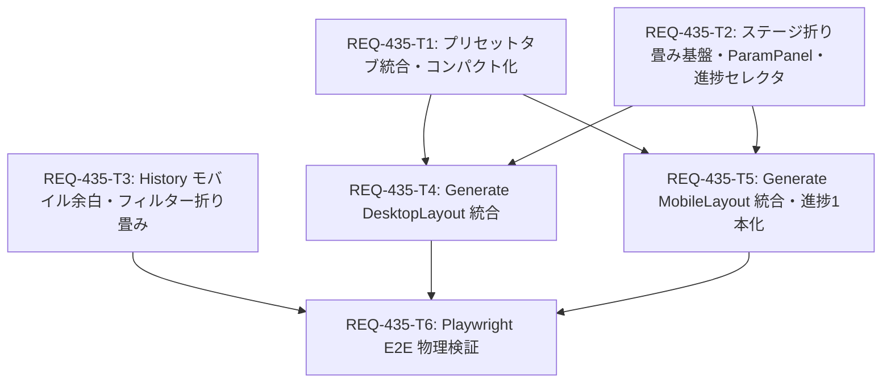

# REQ-435 詳細設計書：UI密度の整理

## 1. 概要・境界監査・SSoT影響分析

### 1.1 目的とスコープ境界
Generate 画面（Desktop 幅 768px 以上／Mobile 幅 767px 以下）および History 画面（主に Mobile 幅 767px 以下、一部 Desktop 互換維持）において、表示面積を圧迫していたボタン・タブの視覚外形、重複する操作入口・進捗バー、常時展開フィルター、および未整理のステージ表示を整理する。

- **対象サブシステム**: Frontend のみ（`frontend/src/` および `frontend/e2e/`）。Backend・API・DB スキーマ・OpenAPI 契約への変更は一切ない。
- **レーンB（System E2E）**: **不要**（バックエンド・API・DB・認証・環境設定の変更を含まず、純粋なフロントエンド UI・状態管理・`localStorage` 永続化の改修であるため。`.agents/context.md` および SPEC-TESTING §4.1.3 に基づき、Gate 1・Gate 2・Gate 3 レーンA で検証する）。
- **他 PBI との境界（非対象）**:
  - `TagChipEditor` / `TagChip` のチップ寸法・余白（密度）および展開編集（REQ-434 / REQ-384 の領域）は変更しない。
  - Mobile プロンプト欄のドロップダウン切替・翻訳一元化（REQ-434）は変更しない（Mobile プロンプト欄は 1 欄表示になるためステージ折り畳みの対象外）。
  - REQ-373 のセクション切替（下線タブ化・左右スワイプ）およびスクロール末尾整理は非対象（本 PBI は REQ-373 の Requirement 2・AC-6 の密度整理部分のみを置き換える）。
  - REQ-374 のヘッダー再編・カード操作「⋯」化・カードオーバーレイボタン変更は非対象（本 PBI は REQ-374 の AC-3 フィルター折り畳み部分のみを置き換える）。
  - REQ-375 の複数選択 UI、API エンドポイントは非対象。

### 1.2 SSoT 影響分析と完了時同期先
`doc_mapper.py` 実行結果（`docs/logs/REQ-435/audit/doc-map.txt`）に加え、PBI 参照仕様を手動監査した結果、完了時に以下を同期する。

| 正本ドキュメント | 影響箇所 | 変更内容 |
|---|---|---|
| `docs/specs/SPEC_GENERATE.md` | §2 / §2-5 | Mobile Generate 側でも `ParamPanel` に `stageGrouping={true}` を渡す仕様、および Desktop Prompt / Desktop・Mobile Parameters のステージ折り畳みと `localStorage` 永続化を追記 |
| `docs/specs/SPEC_GENERATE.md` | §2-6 | `PresetTabItem` の操作ボタン統合（単一メニューボタン＋右クリック＋500ms 長押し）、メニュー内「このタブを閉じる」追加 |
| `docs/specs/SPEC_GENERATE.md` | §3-2 | Mobile 上部ステータスヘッダーの進捗バー 1 本化（実行中 job 進捗）＋全体進捗 `n/m` 文字表示 |
| `docs/specs/SPEC_GENERATE.md` | §3-8 | Mobile セクションタブ・プロファイル行・プロンプトツールバーの Hit-Slop 密度整理 |
| `docs/specs/SPEC_HISTORY.md` | §2 / §3 | Mobile スナップショット一覧のフィルター初期折り畳み・有効件数表示・常時ソート・0 件時フィルター解除 |
| `docs/specs/SPEC_COMMON.md` | §1-6 | MUI-06（Hit-Slop による視覚外形と有効タップ領域の分離）の Generate/History 適用記録（任意） |
| `docs/backlog/pbi/active/REQ-373.md`, `REQ-374.md` | 注記 | 承認・完了時に、REQ-373（Requirement 2・AC-6 密度部分）および REQ-374（AC-3 フィルター折り畳み）を「REQ-435 で置き換え」と整理（本設計・実装フェーズでは未変更） |

---

## 2. 要件別詳細設計

### 2.1 モバイル余白・密度整理と Hit-Slop 設計（要件 1 / AC-1, AC-2, AC-19）

#### 現状の原因
1. `frontend/src/index.css`（`@media (max-width: 767px)`、L387–414）が `button:not([data-tap-target-exempt])` および `label:has(input[type='checkbox']):not([data-tap-target-exempt])` に一律 `min-width: 44px; min-height: 44px;` を強制している。
2. 各コンポーネント JSX にも `min-h-11 min-w-11` / `min-h-[44px]` が直接付与されている。

#### 解決方針（UI 6 大不変条件・SPEC_COMMON §1-3 / §1-5-3 準拠）
- 対象コントロールに `data-tap-target-exempt` を付与して視覚外形を `h-7`（28px）または `h-8`（32px）へスリム化し、`relative touch-manipulation before:absolute before:content-['']` による透明 Hit-Slop 疑似要素で **有効タップ領域 ≥ 44×44px** を保証する。
- **CSS ボックスモデル補正**: `::before` の `inset` は **padding-box** 基準のため、1px `border` がある要素は上下左右 2px 差し引いて算出する（例: `h-8` + `border` → padding-box 30px → `before:-inset-y-[7px]` で 44px；`h-7` + `border` → padding-box 26px → `before:-inset-y-[9px]` で 44px；`border` なしの `h-7` → `before:-inset-y-2` で 44px）。
- **隣接タップ領域の非重複保証（AC-2）**:
  - 視覚幅がすでに ≥ 44px のテキストボタン・幅広タブは横方向の拡張を `0`（`before:inset-x-0`）とし、横方向の重なりを原理的に排除する。
  - アイコン専用ボタン（幅 28px）で左右に `hx` px 拡張する場合は、親コンテナの `gap` を `≥ 2 × hx` とする（例: `before:-inset-2`（8px）同士なら `gap-4`（16px）、`before:-inset-[9px]`（9px）と `before:-inset-x-[7px]`（7px）なら `gap-4`（16px））。
- **クリッピング防止**: `overflow-x-auto` を持つスクロール列には `py-2`（上下 8px）または `py-1.5`（上下 6px）を確保し、セグメント切替ラッパーの `overflow-hidden` を外して（ボタン側 `first:rounded-l-lg last:rounded-r-lg` で角丸維持）、上下 Hit-Slop が切り詰められないようにする。
- **キーボードフォーカス視認性（AC-2）**: 全対象ボタンで `index.css` の `:focus-visible { outline: 2px solid #3ecf8e; outline-offset: 2px; }` を維持し、`focus:outline-none` を単独使用しない（使用箇所は `focus:outline-none focus-visible:outline focus-visible:outline-2 focus-visible:outline-accent-green` または `focus:outline-none` 削除で可視リングを保証）。

#### 対象ボタン・タブ棚卸し一覧（AC-1 変更前／変更後の計測基準）

| 画面・領域 | 対象要素（ID / セレクタ） | 変更前クラス・外形高さ (Mobile 360/390px) | 変更後クラス・外形高さ | 有効タップ領域（Hit-Slop 後） | 隣接間隔と非重複根拠 |
|---|---|---|---|---|---|
| Generate / セクションタブ | `MobileLayout.tsx` `role="group"` 内 3 ボタン | `min-h-[44px]` → **44px**（行全体 ~65px） | `data-tap-target-exempt h-8` → **32px**（行 `py-1.5`） | `before:inset-x-0 before:-inset-y-[7px]` → **≥100×44px** | 横拡張 0px（`gap-2` で完全分離） |
| Generate / プリセットタブ | `PresetTabItem.tsx` 外枠 / 選択 / チェック / 統合ボタン | 外枠 `py-1` + 内部 `min-h-11 min-w-11` → **外枠 54px / 内部 44px** | 外枠 `h-8 py-0.5`（**32px**）、内部 `h-7`（**28px**）`data-tap-target-exempt` | 選択 `before:-inset-x-1.5 before:-inset-y-2`（≥44×44px）、チェック/統合 `w-7 h-7 before:-inset-2`（**44×44px**） | 内部 `gap-4`（16px ≥ 8+8px）、スクローラ `py-2` |
| Generate / プロファイル行 | `#undo-btn-mobile`, `#redo-btn-mobile` | `min-h-11 min-w-11` → **44×44px** | `data-tap-target-exempt h-7 w-7` → **28×28px** | `before:-inset-2` → **44×44px** | ラッパー `gap-4`（16px ≥ 8+8px） |
| Generate / プロファイル行 | `#manage-presets-btn-mobile` | `min-h-11` → **44px** | `data-tap-target-exempt h-7 px-2.5` → **28px** | `before:inset-x-0 before:-inset-y-[9px]` → **≥54×44px** | 横拡張 0px、Undo/Redo 群と `gap-3`（12px ≥ 8+0px） |
| Generate / プロファイル行 | `#add-set-btn-mobile` | `index.css` 強制 → **44×44px** | `data-tap-target-exempt h-7 w-7` → **28×28px** | `before:-inset-[9px]` → **44×44px** | タブ列と `gap-3`（12px ≥ 9+0px） |
| Generate / プロンプトタブ | `MobileLayout.tsx` プロンプト種別タブ | `index.css` 強制 → **44px** | `data-tap-target-exempt h-7 px-2.5` → **28px** | `before:inset-x-0 before:-inset-y-[9px]` → **≥50×44px** | 横拡張 0px、`gap-2`、スクローラ `py-2` |
| Generate / プロンプトツールバー | 開閉ボタン、`PromptSectionClipboardMenu`（コピー・履歴メニュー）、翻訳ボタン、`#add-asset-btn-mobile-*` | `index.css` 強制 → **44px** | `data-tap-target-exempt h-7` → **28px** | コピー `w-7 before:-inset-[9px]`（44×44px）、メニュー `min-w-[32px] before:-inset-x-[7px] before:-inset-y-[9px]`（44×44px）、翻訳 `before:-inset-x-1 before:-inset-y-[9px]`（≥44×44px）、Add Asset `before:inset-x-0 before:-inset-y-[9px]`（≥68×44px） | クリップボード内 `gap-4`（16px ≥ 9+7px）、ツールバー `gap-3`（12px ≥ 7+4px） |
| History / ヘッダー操作 | `#view-snapshots`, `#view-albums`, `#open-batch-speech-modal-btn`, `#start-create-album` | `index.css` 強制 → **44px** | `data-tap-target-exempt h-8` → **32px** | `before:inset-x-0 before:-inset-y-1.5`（枠なし）／`before:-inset-y-[7px]`（枠あり）→ **≥80×44px** | 横拡張 0px、View Toggle 外枠の `overflow-hidden` を除去 |
| History / フィルター操作 | `#history-mobile-filter-toggle`, ソート 2 ボタン（`新しい順`/`古い順`） | 既存ソート `index.css` 強制 → **44px** | `data-tap-target-exempt h-8` → **32px** | `before:inset-x-0 before:-inset-y-[7px]` → **≥64×44px** | 横拡張 0px、ソート外枠の `overflow-hidden` を除去 |

---

### 2.2 PC 表示（幅 768px 以上）に残るモバイル寸法の除去（要件 2 / AC-3）

幅 1280px・幅 800px の Generate 画面でモバイル用の最小寸法（44px）が適用されている箇所を特定し、`md:`（768px 以上）でデスクトップ向けのコンパクト寸法へ変更する。

| 対象ファイル | 対象要素 | 変更前 (Desktop 800px / 1280px) | 変更後 (Desktop `md:`) | 変更後高さ |
|---|---|---|---|---|
| `PresetTabItem.tsx` | タブ外枠・選択ボタン・チェックボックス・統合メニューボタン | 内部 `min-h-11 min-w-11` により外枠 **54px**・内部 **44px** | 外枠 `md:h-7 md:gap-1 md:py-0`、選択 `md:h-6 md:min-w-0`、チェック/メニュー `md:h-6 md:w-6 md:before:hidden` | 外枠 **28px** / 内部 **24px** (< 44px) |
| `DesktopLayout.tsx` | `#desktop-preset-tabs-bar` | `py-2` + 内側 `py-1` + タブ 54px → **~78px** | `py-1.5` + 内側 `py-0.5` + タブ 28px | バー全体 **~40px** (< 44px) |
| `DesktopLayout.tsx` | `#queue-open-btn`, `#generate-btn`, `#save-snapshot-btn` | `#queue-open-btn` が `min-h-11`（**44px**）、他 2 つが `py-3`（**44px**） | 3 ボタンとも `h-9 py-1.5`（`min-h-11` 削除） | 各 **36px** (< 44px) |
| `SnapshotGalleryView.tsx` | 検索 input・有効絞り込みチップ | `min-h-11`（**44px**） | `md:min-h-0 md:h-8` | **32px** (< 44px) |

---

### 2.3 プリセットタブのメニュー統合（要件 3 / AC-4, AC-5, AC-6）

- **`PresetTabItem.tsx`**:
  - 従来の閉じる（`×`）ボタンを削除し、操作ボタンを統合メニューボタン（`data-preset-menu-trigger`, `<MoreHorizontal size={14} />`, `aria-label={`${name}のタブ操作`}`）**1 つだけ**にする（AC-4）。
  - 既存の 3 入口を維持する：統合ボタンのタップ／クリック、タブの右クリック（`onContextMenu`）、タブ名領域の 500ms 長押し（`onPointerDown` touch/pen、8px 移動キャンセル、解放クリック 1 回抑止）。
  - メニューを開くだけでは `onSelect` を呼ばず、選択中のタブおよび入力値を変更しない（AC-5）。
  - `onRemove?: () => void` は後方互換のためオプショナル型として残しても描画には使用せず、T4/T5 で呼び出し側から整理する。
- **`PresetTabCloseMenu.tsx`**:
  - Props に `onCloseSingle?: () => void` を追加する。
  - メニュー先頭（インデックス 0）に **「このタブを閉じる」** ボタンを配置し、続けて既存の一括クローズ 3 項目（「左のタブをすべて閉じる」「右のタブをすべて閉じる」「他のタブを閉じる」）を並べる。
  - 「このタブを閉じる」は `pending` が `true` の間だけ `disabled` とし、タップ／クリックでメニューを閉じた後に `onCloseSingle?.()`（呼び出し元の `removeSet(triggerId)`）を実行する。従来の `×` ボタンと同一の単件保存・クローズ規則を保つ（AC-6）。
  - 一括クローズ 3 項目は既存の `createPresetTabClosePlan` および `handleClosePresetTabs` をそのまま使用し、REQ-402 の対象集合・ACK 待ち・失敗時（503/通信断/409）の全タブ＆ドラフト保持を維持する（AC-6）。
  - 幅 767px 以下では既存の `BottomSheet`、幅 768px 以上では既存のデスクトップメニュー（`role="menu"`）を表示する（AC-5）。キーボード操作（Desktop の `ArrowDown`/`ArrowUp`/`Home`/`End`/`Escape`、Mobile の `Tab` トラップ）は「このタブを閉じる」を含む全有効項目を巡回する。

---

### 2.4 モバイルの単一進捗バーと `n/m` 文字表示（要件 4 / AC-7, AC-8, AC-9）

#### `n/m` のカウント規則（純粋関数 `selectMobileOverallProgress`）
`frontend/src/utils/generationSelectors.ts` に純粋関数を追加し、`SPEC_GENERATE.md` §2-9 の進捗定義と完全に整合させる。

```ts
export interface MobileOverallProgress {
  current: number // n: 実行中jobの通し番号（完了件数+1、全件完了時は m）
  total: number   // m: 今回の生成要求の有効job総数
  label: string   // `${current}/${total}`
}

export function selectMobileOverallProgress(
  normalProgress: { finished: number; total: number } | null,
  activeBatch: ReadonlyArray<{ status?: string }> | null | undefined,
  isGeneratingHere: boolean,
): MobileOverallProgress | null
```

- **`generationSnapshot` あり（`normalProgress !== null`）の場合**:
  - `m = normalProgress.total`：現行 `selectProgress(snapshot, 'normal', sessionId)` の定義に従い、`cancelled`・`released`・`unconfirmed` は母数 `m` から除外する。**キャンセルされた job は `m` を減算し、残存 job で再計算する**。
  - `finished = normalProgress.finished`：`succeeded` + `failed` の合計。**失敗した job は進捗上の完了（`finished`）として数える**（エラー通知は既存経路で表示）。
  - `m <= 0` のときは `null` を返し `n/m` を表示しない。
  - `n = finished >= m ? m : Math.min(m, finished + 1)`（全件完了時は `m/m`、実行中・待機中は `完了件数 + 1`）。
- **`generationSnapshot` なし（レガシー `activeBatch` フォールバック）の場合**:
  - `activeBatch` が空でない場合、`cancelled` を除外した配列から `m = valid.length`、`finished = valid.filter(j => j.status === 'completed' || j.status === 'failed').length` とし、同一式で `n` を算出。
  - `activeBatch` が空かつ `isGeneratingHere === true` の場合は `{ current: 1, total: 1, label: '1/1' }`。

#### Mobile UI 構成 (`MobileLayout.tsx`)
- **上部ステータスヘッダー (`data-testid="mobile-sticky-status-header"`)**:
  - 生成中（`displayProgressActive === true`）は、画面上 **唯一の進捗バー** として **実行中 job の進捗バー 1 本**（`data-testid="mobile-running-job-progress-bar"`, `role="progressbar"`, `aria-valuenow={Math.round(displayNodePercentage)}`, `aria-valuemin={0}`, `aria-valuemax={100}`, `style={{ width: `${displayNodePercentage}%` }}`）を下端に描画する（従来の全体進捗幅ではなく `displayNodePercentage` を使用）。
  - ヘッダー内に全体進捗テキスト **`n/m`**（`data-testid="mobile-overall-progress-text"`）と実行中ノード名・`{Math.round(displayNodePercentage)}%`・`ETA` を表示する。
  - 生成完了直後の「生成完了: 最新画像を表示」ボタン（`data-testid="mobile-completion-nav-btn"`）は従来どおり表示・動作する（AC-8）。
- **補助ステータス行 (`data-testid="mobile-progress-section"`)**:
  - `displayProgressActive === true` のとき、**従来の全体進捗バー・詳細ノード進捗バーの 2 本をすべて削除**し、1 行のメタ情報（スピナー、`経過: {displayElapsedTime}秒`、`残り約: {eta}秒`、`Queue: {totalQueueCount}` クリック導線）のみを表示する。
  - これにより、生成中のモバイル画面上の進捗バー（`[role="progressbar"]` および視覚バー）は **厳密に 1 本のみ** となる（AC-7）。
  - `vramWaitStatus.isWaiting` / 他セッション生成中 / Ready 状態の既存情報・操作導線は維持する（Ready 時も余分な 0% 進捗バーを出さずスリム化）。
- **Desktop (`DesktopLayout.tsx`)**:
  - 進捗表示（全体バー＋ノードバー＋経過時間＋ETA）は **一切変更しない**（AC-9）。

---

### 2.5 History フィルターのモバイル折り畳み（要件 5 / AC-10, AC-11, AC-12）

- **`SnapshotGalleryView.tsx`**:
  - モバイル折り畳み状態 `const [isMobileFilterOpen, setIsMobileFilterOpen] = useState(false)` を追加（初期状態は折り畳み）。
  - 指定中フィルター件数 `activeFilterCount = Number(selectedWorkflowId !== null) + Number(selectedLoraId !== null) + Number(selectedTagSetId !== null)` を算出。
  - **モバイル常時表示 1 行バー (`data-testid="history-mobile-filter-bar"`, `md:hidden`)**:
    - 左: フィルター開閉ボタン（`id="history-mobile-filter-toggle"`, `aria-expanded={isMobileFilterOpen}`, `aria-controls="history-filter-controls"`, `data-tap-target-exempt`, `h-8` + Hit-Slop）：ラベル「フィルター」に加え、`activeFilterCount > 0` のときは文字で `(${activeFilterCount}件)`（`data-testid="history-active-filter-count"`）を表示する（AC-11）。
    - 右: ソート切替（「新しい順」「古い順」）を常時配置（開閉状態によらず操作可能、AC-12）＋件数 `{sortedSnapshots.length}件`。
    - バー全体高さ約 44px に抑え、幅 360×640px 初期表示で最初の画像カードがスクロールなしで視認できる（AC-10）。
  - **展開パネル (`id="history-filter-controls"`)**:
    - `${isMobileFilterOpen ? 'flex' : 'hidden'} md:flex ...` により、モバイルでは展開時のみ、Desktop（`md:` 以上）では常時表示する。
    - Workflow / LoRA / TagSet の検索入力＋セレクトボックス、有効な絞り込みチップ、および Desktop 用ソート＆件数表示を従来どおり AND 結合で提供する（AC-12）。
  - **0 件時 Empty State フィルター解除（AC-12）**:
    - `sortedSnapshots.length === 0 && activeFilterCount > 0` のとき、「条件に一致するスナップショットがありません。」と「フィルターを解除」ボタンを表示し、クリックで 3 条件および検索文字列を一括クリアする。

---

### 2.6 ステージ表示・折り畳みと `localStorage` 永続化（要件 6 / AC-13〜AC-18）

#### 1. モバイル パラメータ欄のステージグループ化（AC-13）
- `MobileLayout.tsx` の `<ParamPanel>` に `stageGrouping={true}` および `workflowId={selectedWorkflowId}` を渡す。
- `ParamPanel.tsx` の `StageGroupedParameters` が `useMappingStageGroups` でワークフローのステージ順（`StageMaster.sort_order`）にグルーピングし、各グループに `<StageInputGroup>` でステージ名見出しを付与する。同一ロール・異ステージのパラメータが所属ステージごとに区別可能になる。

#### 2. `localStorage` 永続化仕様 (`useStageCollapseState.ts`, AC-15, AC-16)
- **キー**: `LS_KEYS.STAGE_COLLAPSED_STATE = 'prompt-surgeon-stage-collapsed-v1'`（`frontend/src/utils/localStorageKeys.ts`）
- **データスキーマ**:
  ```ts
  export type StageCollapsePane = 'prompt' | 'parameters'

  export interface StageCollapseStorageV1 {
    version: 1
    /** key: `${workflowId}:${pane}`, value: 折り畳み中の stage groupKey 配列 */
    collapsed: Record<string, string[]>
  }
  ```
- **挙動規則**:
  - **初回表示既定値（AC-15）**: キー未登録または該当 `${workflowId}:${pane}` が存在しない場合、すべてのステージは **展開（`collapsed = false`）**。
  - **分離と復元（AC-16）**: `workflowId` ごと、かつ欄（`prompt` / `parameters`）ごとに独立管理。ページ再読み込みおよび別ワークフロー往復時に同一ブラウザーで状態を再現する。
  - **存在しないステージ（Stale Stage）処理**: ワークフロー変更等で消滅したステージの `groupKey` が保存されていても、現在描画される `group.key` と照合しないため単に無視され、エラーや表示崩れを起こさない。トグル保存時に `validGroupKeys`（任意引数）が渡された場合は存在しないキーを自動掃除する。
  - **耐障害性**: `localStorage` の読み書きは `try/catch` で保護し、破損 JSON・バージョン不一致・非配列値・QuotaExceededError 時も例外を投げず全展開へ安全フォールバックする。

#### 3. `StageInputGroup` 折り畳み UI と Sticky 維持（AC-14, AC-17, AC-18）
- `StageInputGroupProps` にオプショナル props `collapsible?: boolean`, `collapsed?: boolean`, `onToggleCollapse?: () => void` を追加（既定 `collapsible = false` とし、`AdaptiveWorkflowWiring.tsx` など既存利用元へ影響を与えない）。
- `collapsible === true` のとき、`<h3>` 内に全幅 `<button type="button" className="stage-input-group__toggle" data-tap-target-exempt aria-expanded={!collapsed} aria-controls={bodyId} aria-label={`${resolvedName} (${accessibleKey})`} onClick={onToggleCollapse}>` を配置し、開閉アイコン（`ChevronRight` / `ChevronDown`）＋ステージ名＋支援技術向け状態（`aria-expanded`）を提供する。Enter／Space キーはネイティブ `<button>` で動作する（AC-14）。
- 本体は `<div id={bodyId} className="stage-input-group__body" hidden={Boolean(collapsible && collapsed)}>{children}</div>` とし、`StageInputGroup.css` に `.stage-input-group__body[hidden] { display: none; }` を定義する。
  - **値の保持と生成・ParamSync・プリセット切替（AC-17）**: 入力値（`paramValues` / `promptChips` / `seedMode` / `seed`）はすべて `useGenerationStore` に保持され、DOM も `hidden` で非表示化されるため、折り畳んだステージの値も生成要求・ParamSync 同期・プリセット切替に従来どおり反映され、消失・改変されない。
  - **Desktop Sticky 見出し維持（AC-18）**: `<h3>` の `position: sticky; top: 0; height: 36px; background: #18181b; z-index: 10;` をそのまま維持する。折り畳まれた `<section>` は高さ 36px となり、スクロール時に次グループ見出しへ正しく切り替わり、入力欄を覆わない。
  - **Mobile タップ領域**: `@media (max-width: 767px)` 下で `.stage-input-group__toggle` に `::before` による上下 4px 拡張（36px + 8px = 44px）を適用する。

---

## 3. Seam Map (`[W-DD-SEAM]`)

1. **Integrated (real code)**:
   - React コンポーネント（`DesktopLayout`, `MobileLayout`, `PresetTabItem`, `PresetTabCloseMenu`, `StageInputGroup`, `ParamPanel`, `PromptSectionClipboardMenu`, `SnapshotGalleryView`, `HistoryPage`）
   - 状態管理・フック・純粋関数（`useStageCollapseState`, `useMappingStageGroups`, `selectMobileOverallProgress`, `createPresetTabClosePlan`, `useGenerationStore`）
   - 実 CSS（`index.css`, `StageInputGroup.css`, Tailwind ユーティリティ）および実ブラウザー描画（Playwright レーンA）
2. **Severed (external I/O only)**:
   - Backend HTTP API（`/api/*`）および WebSocket（`/api/ws`）をテスト境界（Vitest の API クライアントモック／Playwright の `page.route`・`page.routeWebSocket`）で切断する。
   - `localStorage` は実 Web Storage（jsdom / 実ブラウザー）を使用。
3. **Mock Level**:
   - 内部ビジネスロジック（`selectMobileOverallProgress`, `createPresetTabClosePlan`, `useStageCollapseState`, `groupMappingsByStage`）のモンキーパッチは禁止。
4. **PBT Decision**:
   - **不要**（パーサー・DSL・数値計算エンジンではなく、有限状態の UI 折り畳み・カウント・CSS 寸法改修のため。ただし `selectMobileOverallProgress` および `useStageCollapseState` の境界値（0 件・キャンセル混在・失敗混在・破損 JSON・stale キー）はパラメータ化単体テストで網羅する）。
5. **Fault Injection**:
   - `localStorage` 破損 JSON／`QuotaExceededError`（`setItem` 例外）時の安全フォールバック（全展開で継続、例外非送出）。
   - プリセットタブ一括クローズ時の 503／409／通信断における全タブ・ドラフト保持（REQ-402 回帰）。

---

## 4. 設計契約 D1–D7 (`[W-DD-BOUNDARY]`)

### D1. タスク別責務・スコープ・完了条件

| Task ID | 責務とスコープ | 完了条件 |
|---|---|---|
| `REQ-435-T1` | `PresetTabItem` / `PresetTabCloseMenu` の統合ボタン化・モバイル Hit-Slop・Desktop コンパクト化・「このタブを閉じる」追加 | 単一ボタン化、3 入口同一メニュー、単件＆一括クローズ・キーボード操作、`usePresetTabClose.integration.test.tsx` と `npm run typecheck` PASS |
| `REQ-435-T2` | `useStageCollapseState`（`localStorage` 永続化）・`StageInputGroup` 折り畳み＆CSS・`ParamPanel` 連携・`selectMobileOverallProgress` 実装 | 新規/既存単体テスト全 PASS、`npm run typecheck` PASS、既存 `AdaptiveWorkflowWiring` 非破壊 |
| `REQ-435-T3` | `HistoryPage` ヘッダーボタンのモバイル Hit-Slop 化、`SnapshotGalleryView` フィルター初期折り畳み・件数表示・常時ソート・0 件時解除 | `SnapshotGalleryView.test.tsx` 追加ケース含め全 PASS、`npm run typecheck` PASS |
| `REQ-435-T4` | `DesktopLayout` のモバイル寸法除去（タブバー・ActionBar）・メニュー統合配線・Desktop Prompt/Param ステージ折り畳み統合 | `DesktopLayout.test.tsx` / `DesktopLayout.tabs.test.tsx` PASS、Desktop 進捗表示無変更、`npm run typecheck` PASS |
| `REQ-435-T5` | `MobileLayout` / `PromptSectionClipboardMenu` のモバイル密度＆Hit-Slop・単一進捗バー＋`n/m`・メニュー統合配線・Mobile `ParamPanel` ステージグループ化 | `MobileLayout.test.tsx` PASS、UI 不変条件 `verify_ui_invariants.py` PASS、`npm run typecheck` PASS |
| `REQ-435-T6` | Playwright レーンA 実ブラウザ物理検証（360/390/800/1280px、Hit-Slop 非重複、フォーカス、進捗 1 本、History 初期表示、ステージ折り畳み/Sticky、SafeArea/KB） | 対象 3 spec 実行 PASS、`verify_test_naming.py` PASS、`workflow_validator.py test-hygiene REQ-435` PASS |

### D2. タスク依存関係と理由

- `REQ-435-T1`, `REQ-435-T2`, `REQ-435-T3`: 依存なし（並列実行可能）。
- `REQ-435-T4` → `depends_on: [REQ-435-T1, REQ-435-T2]`: `PresetTabCloseMenu` の `onCloseSingle` 契約（T1）、`useStageCollapseState`・`StageInputGroup` の `collapsible` props・`ParamPanel` の `workflowId` prop（T2）に依存するため。
- `REQ-435-T5` → `depends_on: [REQ-435-T1, REQ-435-T2]`: `PresetTabCloseMenu` の `onCloseSingle` 契約（T1）、`selectMobileOverallProgress` および `ParamPanel` の `workflowId` / `stageGrouping` 折り畳み契約（T2）に依存するため。
- `REQ-435-T6` → `depends_on: [REQ-435-T3, REQ-435-T4, REQ-435-T5]`: History・Desktop Generate・Mobile Generate の全実装が揃った状態で実ブラウザ物理寸法・操作・レイアウト回帰を検証するため。

### D3. ファイル所有マップ（排他所有・重複ゼロ）

| Task ID | 所有ファイル（編集・作成許可対象） |
|---|---|
| `REQ-435-T1` | `frontend/src/pages/GeneratePage/components/PresetTabItem.tsx`, `frontend/src/pages/GeneratePage/components/PresetTabCloseMenu.tsx`, `frontend/src/pages/GeneratePage/hooks/__tests__/usePresetTabClose.integration.test.tsx` |
| `REQ-435-T2` | `frontend/src/utils/localStorageKeys.ts`, `frontend/src/hooks/useStageCollapseState.ts`, `frontend/src/hooks/__tests__/useStageCollapseState.test.ts`, `frontend/src/components/StageInputGroup.tsx`, `frontend/src/components/StageInputGroup.css`, `frontend/src/components/__tests__/StageInputGroup.test.tsx`, `frontend/src/components/ParamPanel.tsx`, `frontend/src/pages/GeneratePage/components/__tests__/ParamPanel.test.tsx`, `frontend/src/utils/generationSelectors.ts`, `frontend/src/pages/GeneratePage/__tests__/generationQueueSync.test.ts` |
| `REQ-435-T3` | `frontend/src/pages/HistoryPage/index.tsx`, `frontend/src/pages/HistoryPage/views/SnapshotGalleryView.tsx`, `frontend/src/pages/HistoryPage/views/__tests__/SnapshotGalleryView.test.tsx` |
| `REQ-435-T4` | `frontend/src/pages/GeneratePage/components/DesktopLayout.tsx`, `frontend/src/pages/GeneratePage/components/__tests__/DesktopLayout.tabs.test.tsx`, `frontend/src/pages/GeneratePage/components/__tests__/DesktopLayout.test.tsx` |
| `REQ-435-T5` | `frontend/src/pages/GeneratePage/components/MobileLayout.tsx`, `frontend/src/pages/GeneratePage/components/PromptSectionClipboardMenu.tsx`, `frontend/src/pages/GeneratePage/components/__tests__/MobileLayout.test.tsx` |
| `REQ-435-T6` | `frontend/e2e/generatePresetTabs.spec.ts`, `frontend/e2e/generateMobileGallery.spec.ts`, `frontend/e2e/historyResponsive.spec.ts` |

### D4. 共有契約（Shared Contracts）
1. **`PresetTabCloseMenu` 契約**: `onCloseSingle?: () => void` を受け取り、「このタブを閉じる」をメニュー先頭に描画。`PresetTabItem` は `data-preset-menu-trigger` の 1 ボタンのみ描画（`onRemove` はオプショナル互換）。
2. **`selectMobileOverallProgress` 契約**: `frontend/src/utils/generationSelectors.ts` からエクスポート。`cancelled` / `released` / `unconfirmed` は `m` から除外、`failed` は `finished` に加算、全件完了時は `m/m`、未完了時は `min(m, finished + 1)/m`。
3. **`StageCollapseStorageV1` & `useStageCollapseState` 契約**: `LS_KEYS.STAGE_COLLAPSED_STATE = 'prompt-surgeon-stage-collapsed-v1'`、形式 `{ version: 1, collapsed: Record<string, string[]> }`、キー `${workflowId}:${pane}`（`pane: 'prompt' | 'parameters'`）。未登録は全展開。
4. **`StageInputGroup` 契約**: `collapsible?: boolean`（既定 `false`）, `collapsed?: boolean`, `onToggleCollapse?: () => void`。`collapsible` 時は 36px sticky `<h3>` 内ボタン（`aria-expanded` / `aria-controls`）＋ `hidden` 本体。
5. **`ParamPanel` 契約**: `workflowId?: number | null` を追加（オプショナル、既存テスト互換）。`stageGrouping={true}` 時に `useStageCollapseState(workflowId, 'parameters')` を接続。
6. **Hit-Slop 契約**: `data-tap-target-exempt` + `relative touch-manipulation before:absolute before:content-['']` により、有効領域 ≥ 44×44px・隣接非重複・フォーカスリング可視を同時に満たす。

### D5. AC → タスク・検証方式マッピング

| AC | 担当タスク | 検証層・手段 |
|---|---|---|
| AC-1 | T1, T3, T5, T6 | Unit/Component + Playwright E2E（360px/390px 外形高さ縮小＆Hit-Slop ≥44×44px 実測） |
| AC-2 | T1, T3, T5, T6 | Playwright E2E（隣接 Hit-Slop 矩形の交差 0 検証、中心タップ独立実行、`:focus-visible` 検証） |
| AC-3 | T1, T4, T6 | Component + Playwright E2E（800px/1280px でタブ・バー・ボタン高さ < 44px 実測） |
| AC-4 | T1, T4, T5, T6 | Component + Playwright E2E（各タブの操作ボタンが 1 つのみ、`×` 不在） |
| AC-5 | T1, T4, T5, T6 | Integration + Playwright E2E（ボタン・右クリック・500ms 長押しで同一メニュー、Mobile BottomSheet / Desktop menu、選択・入力値不変） |
| AC-6 | T1, T4, T5, T6 | Integration + Playwright E2E（「このタブを閉じる」単件保存クローズ、左/右/他一括クローズ＆REQ-402 失敗保持） |
| AC-7 | T2, T5, T6 | Unit (`selectMobileOverallProgress`) + Component (`MobileLayout`) + Playwright E2E（進捗バー厳密に 1 本＋`n/m` 文字） |
| AC-8 | T2, T5, T6 | Unit + Component + Playwright E2E（job 完了ごとのバー切替・`n/m` 進行、経過時間/ETA/Queue/完了導線維持） |
| AC-9 | T4, T6 | Component (`DesktopLayout`) + Playwright E2E（Desktop 進捗表示不変） |
| AC-10 | T3, T6 | Component (`SnapshotGalleryView`) + Playwright E2E（360×640 初期折り畳み 1 行＆最初の画像カードがビューポート内視認可能） |
| AC-11 | T3, T6 | Component + Playwright E2E（絞り込み指定→折り畳みで件数テキスト表示） |
| AC-12 | T3, T6 | Component + Playwright E2E（開閉両状態でソート可、Workflow/LoRA/TagSet AND 結合・0 件 Empty State ＆解除） |
| AC-13 | T2, T5, T6 | Component (`ParamPanel` / `MobileLayout`) + Playwright E2E（767px 以下でステージ順グループ＋見出し表示、同ロール異ステージ識別） |
| AC-14 | T2, T4, T5, T6 | Unit (`StageInputGroup`) + Component + Playwright E2E（クリック/タップ/Enter/Space 開閉、アイコン＋`aria-expanded`） |
| AC-15 | T2, T4, T5, T6 | Unit (`useStageCollapseState`) + Component + Playwright E2E（初見ワークフロー全展開） |
| AC-16 | T2, T4, T5, T6 | Unit (`useStageCollapseState`) + Playwright E2E（リロードおよび別ワークフロー往復で workflow×pane 別に復元） |
| AC-17 | T2, T4, T5 | Integration (`ParamPanel` / `DesktopLayout` / `MobileLayout`)（折り畳み状態での生成値・ParamSync・プリセット切替保持） |
| AC-18 | T2, T4, T6 | Component (`StageInputGroup`) + Playwright E2E（Desktop 折り畳み時のスクロール sticky 見出し切替＆入力欄非被覆） |
| AC-19 | T5, T6 | Playwright E2E（360px、safe-area CSS 変数注入あり/なし、ソフトキーボード開閉相当の `focusin`/`visualViewport` 変化でレイアウト崩れ・固定バー被覆なし） |

### D6. エンジニアへ委譲する判断範囲
- 各ボタンの微細な内側余白（`px-2` vs `px-2.5` 等）やアイコンサイズ（12px〜14px）の調整は、AC-1/AC-2/AC-3 の数値制約（外形縮小、Hit-Slop ≥ 44×44px、隣接非重複、Desktop < 44px）を満たす範囲内でエンジニアが判断してよい。
- `useStageCollapseState` の内部ヘルパー関数構成や、`SnapshotGalleryView` のモバイルフィルターバー内部レイアウト細部（アイコン選定・`gap` 微調整）は AC-10〜AC-12 を満たす範囲で判断してよい。
- テスト用 fixture データの具体値（ワークフロー名・ステージ名等）の選定。

### D7. 変更禁止範囲（Prohibited Scope）
- `backend/**`、`docs/system/openapi.yaml`、`scripts/**`、および `frontend/src/index.css` のグローバル 44px ルール自体は変更しない（コンポーネント側の `data-tap-target-exempt` + Hit-Slop で局所解決し、他画面の 44px 保証を破壊しない）。
- `TagChipEditor` / `TagChip` のチップ寸法・余白・展開編集機能（REQ-434 / REQ-384 の領域）は変更しない。
- `DesktopLayout` の進捗表示（AC-9）、`MobileLayout` のプロンプト欄折り畳み機能追加（Mobile プロンプトは対象外）、`SnapshotGalleryView` の画像カードオーバーレイボタン（REQ-374 の領域）は変更しない。
- `AdaptiveWorkflowWiring.tsx` など Generate/History 以外の画面の挙動を変更しない。
- テストファイル名・ディレクトリ名にチケット番号（`req435`, `REQ-435` 等）を含めない（SPEC-TESTING v2.1）。

---

## 5. タスク依存 DAG



- 最大深さ: **2**（T1/T2 → T4/T5 → T6）
- 並列度: Wave 1 最大 3 並列（T1, T2, T3）、Wave 2 最大 2 並列（T4, T5）、Wave 3 集約（T6）

---

## 6. トレードオフとリスク開示

1. **単件クローズの 2 タップ化（既承認トレードオフ）**:
   - プリセットタブの `×` ボタンをメニューへ統合するため、単件クローズは 1 タップから 2 タップ（メニュー開く →「このタブを閉じる」）になる。一方で誤タップによるタブ閉じ防止と横幅節約のメリットが上回る（PBI ユーザー回答 Q3-a 承認済み）。
2. **`index.css` グローバル 44px ルールを維持し `data-tap-target-exempt` で個別 opt-out する判断**:
   - 代替案として `index.css` のグローバル `min-height: 44px` 規則自体を緩和する案があるが、Settings・LoRA・TagSet など他画面のタップ領域回帰リスクが高いため採用しない。対象コントロールへの明示的な `data-tap-target-exempt` + Hit-Slop 付与で安全に局所最適化する。
3. **Hit-Slop と `overflow-x-auto` / `overflow-hidden` のクリッピングリスク**:
   - 横スクロール領域（プリセットタブ列・プロンプトタブ列）や角丸グループ（View Toggle・ソートボタン）では、`overflow` が疑似要素 `::before` を切り落とすリスクがある。本設計ではスクロールコンテナに `py-2` を確保し、角丸グループの `overflow-hidden` を外すことで回避し、T6 の実ブラウザ E2E で `getBoundingClientRect`／中心タップによる物理検証を行う。
4. **ステージ折り畳みの DOM 保持（`hidden`） vs アンマウント**:
   - `hidden`（`display: none`）を採用することで、折り畳み中の子コンポーネント内部状態と `aria-controls` 参照先を保ちつつ、`<section>` 高さを 36px へ縮小して sticky 見出し挙動を維持する。非常に多数のステージを持つワークフローでの初期描画コストは従来（全展開）と同等であり増大しない。
5. **REQ-434 との並行・合流リスク**:
   - REQ-434 は Mobile プロンプトタブ行の廃止・翻訳ボタン変更を行う予定。本 PBI（REQ-435）は Mobile プロンプト欄をステージ折り畳み対象外とし、現行のプロンプトツールバーに対して最小限のクラス調整のみ行うことで、REQ-434 とのマージ競合を最小化する。
