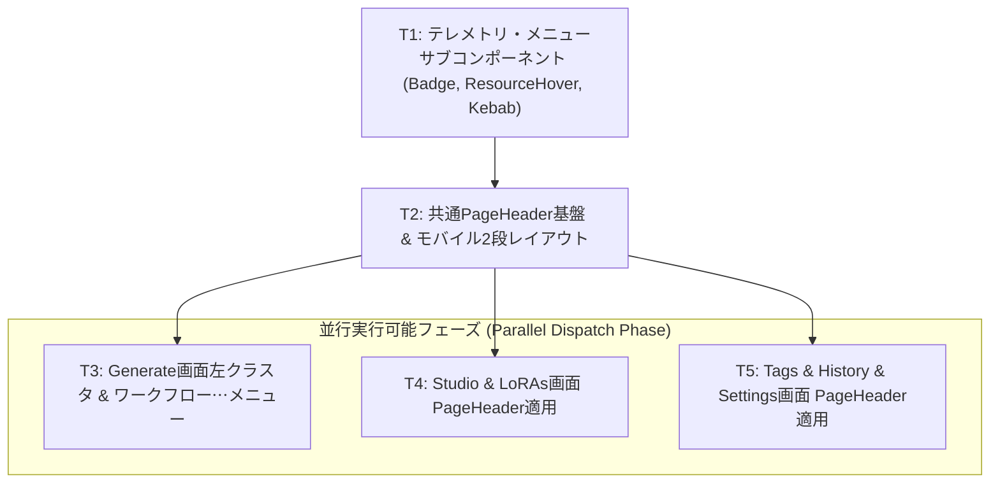

# Implementation Plan: REQ-341 全画面共通ヘッダーデザイン統一・左クラスタリング操作性最適化およびモバイル展開

## 1. Executive Summary (概要)
本計画は、Prompt Surgeon (comfy-create-helper2) の全6画面（Generate, Studio, LoRAs, Tags, History, Settings）において、SSoT仕様書 `tmp/prompt_surgeon_header_spec.html` (UI-SPEC-2026-10-11-v3) に準拠した統一ヘッダー構造（PC: 50px固定、モバイル: 2段レイアウト）を構築し、Fittsの法則に基づく主要操作の左クラスタリング、受動的リソースモニターのHover Card展開、および縦3点メニューへのストレージ診断集約・ComfyUI直通URL完全廃止を実現する実装計画である。

---

## Proposed Changes

#### [LOCAL MODIFY] [frontend/src/components/common/SystemStatusBadge.tsx](file:///c:/Users/audih/ws/comfy-create-helper2/frontend/src/components/common/SystemStatusBadge.tsx)
- スリムピル `[● READY]` への改修（冗長テキスト削除、ホバーツールチップ詳細表示）
- モバイル用 7px 発光ドットインジケーター（`variant="dot"`）の実装

#### [LOCAL NEW] [frontend/src/components/common/header/ResourceHoverMonitor.tsx](file:///c:/Users/audih/ws/comfy-create-helper2/frontend/src/components/common/header/ResourceHoverMonitor.tsx)
- 常時表示チップ（CPU -> RAM -> GPU -> VRAM、パープルアクセント）
- デスクトップ Hover Card（幅250px、m/n GB実メモリ消費量、プロポーショナルバー、--%安全フォールバック）
- モバイル展開ピル（幅96px `[VRAM xx% ◀]` -> 幅330pxスライドオーバーレイ、z-index: 80 vs 10）

#### [LOCAL NEW] [frontend/src/components/common/header/HeaderKebabMenu.tsx](file:///c:/Users/audih/ws/comfy-create-helper2/frontend/src/components/common/header/HeaderKebabMenu.tsx)
- 縦3点ボタン（28x28px）およびドロップダウン（幅270px）
- LocalStorage / SessionStorage 推定使用量（UTF-16概算・Estimate Only明記・例外フォールバック）
- キャッシュ再同期アクションおよび設定画面（`/settings`）リンク
- ComfyUI本体URL直通表示の完全排除

#### [LOCAL MODIFY] [frontend/src/components/common/PageHeader.tsx](file:///c:/Users/audih/ws/comfy-create-helper2/frontend/src/components/common/PageHeader.tsx)
- 高さ50px固定基盤、共通タイポグラフィ（`text-sm font-semibold text-zinc-200`）、アイコン規格（16px `text-zinc-400`）
- 左クラスタ（タイトル ＋ 状態 ＋ 主要アクション）と右クラスタ（ResourceHoverMonitor ＋ HeaderKebabMenu）の統合
- モバイル2段レイアウト（1段目: タイトル省略+7pxドット+スライドピル+縦3点 / 2段目: 横スクロール可能アクションバー）

#### [LOCAL NEW] [frontend/src/pages/GeneratePage/components/WorkflowActionsMenu.tsx](file:///c:/Users/audih/ws/comfy-create-helper2/frontend/src/pages/GeneratePage/components/WorkflowActionsMenu.tsx)
- ワークフローセレクタ直横の「⋯」メニュー
- ベースモデル紐付け（Auto/Anima/SDXL）、デフォルト値保存・リセット、名前変更、複製、ノード再スキャン

#### [LOCAL MODIFY] [frontend/src/pages/GeneratePage/components/DesktopLayout.tsx](file:///c:/Users/audih/ws/comfy-create-helper2/frontend/src/pages/GeneratePage/components/DesktopLayout.tsx)
- `PageHeader` への移行
- 左クラスタリング（ワークフロー選択 ＋ WorkflowActionsMenu ＋ Anima特化 ＋ Undo/Redo）
- 旧 SettingsPopover および旧 ResourceGaugeChips の撤廃

#### [LOCAL MODIFY] [frontend/src/pages/GeneratePage/components/MobileLayout.tsx](file:///c:/Users/audih/ws/comfy-create-helper2/frontend/src/pages/GeneratePage/components/MobileLayout.tsx)
- モバイルヘッダーの `PageHeader` 移行

#### [LOCAL MODIFY] [frontend/src/pages/DatasetStudioPage/index.tsx](file:///c:/Users/audih/ws/comfy-create-helper2/frontend/src/pages/DatasetStudioPage/index.tsx)
- `PageHeader` への移行、左クラスタリング（プロジェクト選択 ＋ ステップボタングループ ＋ 自動保存ステータス）

#### [LOCAL MODIFY] [frontend/src/pages/LoRAsPage.tsx](file:///c:/Users/audih/ws/comfy-create-helper2/frontend/src/pages/LoRAsPage.tsx)
- `PageHeader` への移行、左クラスタリング（検索ボックス ＋ + Register Model ＋ 再スキャン/カテゴリ管理）

#### [LOCAL MODIFY] [frontend/src/pages/TagsPage.tsx](file:///c:/Users/audih/ws/comfy-create-helper2/frontend/src/pages/TagsPage.tsx)
- `PageHeader` への移行、左クラスタリング（検索ボックス ＋ + New Tag Set ＋ エクスポート/インポート）

#### [LOCAL MODIFY] [frontend/src/pages/HistoryPage/index.tsx](file:///c:/Users/audih/ws/comfy-create-helper2/frontend/src/pages/HistoryPage/index.tsx)
- `PageHeader` の最新化、左クラスタリング（スナップ/アルバム ＋ セリフ変換 ＋ アルバム追加）

#### [LOCAL MODIFY] [frontend/src/pages/SettingsPage.tsx](file:///c:/Users/audih/ws/comfy-create-helper2/frontend/src/pages/SettingsPage.tsx)
- `PageHeader` への移行、左クラスタリング（設定カテゴリチップ群）

---

## 3. Task Dependency Graph & Parallelism (タスク依存関係・並行設計)



| タスクID | 概要 | 変更ファイル数 | 依存関係 | 並行実行可能性 |
| :--- | :--- | :--- | :--- | :--- |
| **REQ-341-T1** | テレメトリ・メニューサブコンポーネント実装 | 3 | なし (Root) | 単独実行 |
| **REQ-341-T2** | 共通PageHeader基盤 & モバイル2段レイアウト | 2 | T1 | 単独実行 |
| **REQ-341-T3** | Generate画面左クラスタ & ワークフロー⋯メニュー | 3 | T2 | **T4, T5 と完全並行可能** |
| **REQ-341-T4** | Studio & LoRAs画面 PageHeader適用 | 2 | T2 | **T3, T5 と完全並行可能** |
| **REQ-341-T5** | Tags & History & Settings画面 PageHeader適用 | 3 | T2 | **T3, T4 と完全並行可能** |

---

## Trade-off Disclosure

1. **モバイル展開ピルの z-index 重なり制御**:
   - *メリット*: モバイルの限られたヘッダー幅（390px以下）において、常時はクリティカルなVRAMチップのみを表示し、ワンタップで全テレメトリ（CPU, RAM, GPU, VRAM）へ瞬時にアクセスできる。
   - *トレードオフ*: ピル展開中、右隣の縦3点ボタンの上にオーバーレイ（z-index: 80 vs 10）として重なるため、展開中は縦3点ボタンがクリック不可となる。閉じる操作（✕タップ、ピル再タップ、領域外タップ）により即座に再露出する仕様とし、操作デッドロックを防止。
2. **ブラウザストレージ容量の UTF-16 概算表示**:
   - *メリット*: 外部ライブラリを追加せず、ブラウザ標準の `localStorage` / `sessionStorage` オブジェクトのキー・値の文字数から軽量に計算可能（1文字 = 2 bytes）。
   - *トレードオフ*: ブラウザ内部の圧縮やメタデータ、IndexedDB等の容量は含まれないため、明示的に「推定値（Estimate Only）」とラベリングし、例外発生（プライベートモード等）時は「推定容量: 取得不可」を安全表示する設計とする。
3. **ComfyUI本体URL直通入力の完全撤廃**:
   - *メリット*: フロントエンドとComfyUIの通信はFastAPIリバースプロキシ（`/api/comfy/...`）へ一本化されており、ヘッダーに直通URLを表示・入力させる旧仕様はセキュリティ・運用の観点で有害・冗長であったため、ヘッダーから完全排除してUI領域を大幅に節約。
   - *トレードオフ*: ComfyUIの接続先ポート等を変更したい上級ユーザーは、ヘッダー直接ではなく設定画面（`/settings`）から行う必要がある。縦3点メニューに設定画面へのダイレクト導線を設けることで利便性を担保。

---

## 5. Verification Plan (3-Gate 検証計画)

### Gate 1: 静的型チェック (Typecheck Baseline)
```bash
cd frontend; npm run typecheck
```
- 期待値: 0 errors

### Gate 2: ユニット＆結合テスト (Unit / Full Suite Baseline)
```bash
cd frontend; npm test
```
- 個別タスク検証:
  - `cd frontend; npx vitest run src/components/common/__tests__/SystemStatusBadge.test.tsx src/components/common/header/__tests__/ResourceHoverMonitor.test.tsx src/components/common/header/__tests__/HeaderKebabMenu.test.tsx`
  - `cd frontend; npx vitest run src/components/common/__tests__/PageHeader.test.tsx`
  - `cd frontend; npx vitest run src/pages/GeneratePage/components/__tests__/DesktopLayout.test.tsx src/pages/GeneratePage/components/__tests__/MobileLayout.test.tsx`
  - `cd frontend; npx vitest run src/pages/DatasetStudioPage/__tests__/MatrixGenerationStep.test.tsx src/pages/__tests__/LoRAsPage.test.tsx`
  - `cd frontend; npx vitest run src/pages/__tests__/TagsPage.test.tsx src/pages/HistoryPage/__tests__/HistoryPage.speech.test.tsx src/pages/__tests__/SettingsPage.test.tsx`

### Gate 3: シナリオ＆Red Teaming (AC 100% 準拠)
- 全6画面の共通50pxヘッダー描画・画面遷移CLSゼロ検証 (AC-1)
- 左クラスタリング操作性検証 (AC-2)
- スリム状態バッジ・ホバーツールチップ検証 (AC-3)
- 受動的リソースモニター Hover Card 検証 (AC-4)
- 縦3点メニュー・ストレージ推定値・ComfyUI直通URL完全撤廃検証 (AC-5)
- Generate画面 ワークフロー設定⋯集約検証 (AC-6)
- モバイル2段レイアウト & 7px発光ドット検証 (AC-7)
- モバイルVRAMピル左スライド展開オーバーレイ検証 (AC-8)
- 境界値・異常系 Red Teaming (RT-1: テレメトリ未受信フォールバック, RT-2: ストレージアクセス拒否, RT-3: 極小幅タイトル省略, RT-4: タップ連打競合)
