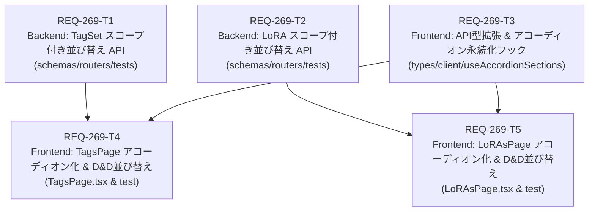

# Implementation Plan: REQ-269 タグセット・LoRAのカテゴリセクション化とセクション内スコープ並び替え（Phase 1）

## 1. Overview & Architectural Goals

本実装計画は、`TagsPage` および `LoRAsPage` のカード一覧を従来の単一フラットグリッドから「カテゴリ別アコーディオンセクション」へと刷新し、カテゴリをスコープとした安全なドラッグ＆ドロップ（D&D）並び替えおよびセクション間カテゴリ移動を実現するものである（REQ-269 Phase 1）。

### 主なアーキテクチャ目標
1. **フラットリストからカテゴリ別セクションへの移行**:
   - 登録済みカテゴリおよび「未分類（その他）」を独立したアコーディオンセクションとして縦スクロール表示。
   - セクション開閉状態を `localStorage` に保持し、再訪・リロード時にも復元。
   - 0件カテゴリを明示表示し、カードのドロップ受け入れ先として利用可能にする。
2. **カテゴリ複数選択フィルタ（OR条件）**:
   - 単一選択から複数選択への拡張。未分類（その他）も独立した選択肢として追加。
   - 選択されたカテゴリに対応するセクションのみを表示・非表示制御。
3. **スコープ化された安全な D&D 並び替え**:
   - バックエンドの `/reorder` API を拡張し、`category_id` スコープ内でのみ `sort_order`（0, 1, 2...）を更新。他カテゴリの順序を一切破壊しない。
   - セクション間ドラッグ時に `category_id` 更新とドロップ先位置への挿入を即時反映（楽観的更新 + 失敗時自動ロールバック）。
   - 検索語句やBaseModelフィルタ適用時は、リストの部分抽出による順序崩壊を防ぐためD&Dを安全に不活性化。
4. **完全な後方互換性とスキーマ維持**:
   - DBスキーマ変更を行わず、レガシーリクエスト（`category_id` 省略時）の動作を100%維持。

---

## 2. Dependency Graph (Mermaid DAG)

- **並列性（Parallelism）**:
  - レイヤー 1（T1, T2, T3）は完全に独立しており、バックエンド2件とフロントエンド基盤1件を並列実行可能。
  - レイヤー 2（T4, T5）はそれぞれの依存関係（T1+T3, T2+T3）完了後、並列実行可能。
- **最大階層深度（Max Depth）**: 2層（制約 <= 3-4層を満たす）。

---

## 3. Atomic Task Decomposition & File Impacts

| タスクID | タイトル | サブシステム | 対象ファイル | 変更行数目安 | 検証コマンド |
|---|---|---|---|---|---|
| **REQ-269-T1** | Backend: TagSet スコープ付き並び替え API の拡張と単体テスト | backend | `backend/app/schemas/tag_set.py` `backend/app/routers/tag_sets.py` `backend/tests/test_tag_sets_reorder.py` [NEW] | ~120行 | `backend\.venv\Scripts\python -m pytest backend/tests/test_tag_sets_reorder.py` |
| **REQ-269-T2** | Backend: LoRA スコープ付き並び替え API の拡張と単体テスト | backend | `backend/app/schemas/lora.py` `backend/app/routers/loras.py` `backend/tests/test_loras_reorder.py` [NEW] | ~120行 | `backend\.venv\Scripts\python -m pytest backend/tests/test_loras_reorder.py` |
| **REQ-269-T3** | Frontend: APIクライアント型拡張 & カテゴリアコーディオン状態永続化フック | frontend | `frontend/src/api/types.ts` `frontend/src/api/client.ts` `frontend/src/hooks/useAccordionSections.ts` [NEW] | ~150行 | `cd frontend; npm run typecheck` |
| **REQ-269-T4** | Frontend: TagsPage のカテゴリ別アコーディオンセクション化とセクション内・間D&D実装 | frontend | `frontend/src/pages/TagsPage.tsx` `frontend/src/pages/__tests__/TagsPage.test.tsx` | ~250行 | `cd frontend; npx.cmd vitest run src/pages/__tests__/TagsPage.test.tsx` |
| **REQ-269-T5** | Frontend: LoRAsPage のカテゴリ別アコーディオンセクション化とセクション内・間D&D実装 | frontend | `frontend/src/pages/LoRAsPage.tsx` `frontend/src/pages/__tests__/LoRAsPage.test.tsx` | ~250行 | `cd frontend; npx.cmd vitest run src/pages/__tests__/LoRAsPage.test.tsx` |

---

## 4. Trade-off Disclosure & Architectural Considerations

### トレードオフ 1: 単一 API コールによるアトミックな並び替え＆カテゴリ移動 vs 2段階 API（移動 PATCH + 並び替え PUT）
- **検討案 A（2段階 API）**: カードを移動した際に `PATCH /api/tag-sets/{id}/category` でカテゴリを変更し、その後 `PUT /api/tag-sets/reorder` で順序を確定する。
  - *問題点*: 2回のリクエストが発生し、ネットワーク遅延による画面のチラつきや、片方だけ成功してもう片方が失敗する分散不整合リスクが生じる。
- **検討案 B（採用: 単一 API でのアトミック更新）**:
  - `PUT /api/tag-sets/reorder` のペイロードに `category_id` を含め、対象リスト内の全アイテムの `sort_order` と同時に `category_id` を1トランザクションで確定更新する。
  - *メリット*: 1回の通信で完結し、失敗時の完全なDBロールバックとクライアント楽観的更新の即時ロールバックが保証される。

### トレードオフ 2: フロントエンド一括取得・クライアントグルーピング vs カテゴリ毎の個別フェッチ
- **検討案 A（個別フェッチ）**: セクションごとに個別の React Query を実行する。
  - *問題点*: カテゴリ数（5〜10件）に応じた同時リクエストが発生し、N+1的な負荷とロード状態のバラつきが発生する。
- **検討案 B（採用: クライアントサイド・セクショニング）**:
  - ページ単位で全アイテムを一括取得（`tagSetsApi.list(undefined, baseModels)`）し、フロントエンド側で `category_id` に応じて各セクションへ高速分配する。
  - *メリット*: リクエストは1回で済み、セクション間ドラッグ時の即時再レンダリングやフィルタ適用時のパフォーマンスが最も優れる。

### トレードオフ 3: 検索/BaseModelフィルタ時の D&D 制御
- **検討案 A**: 絞り込み表示中もD&Dを許可し、表示中のカードのみでインデックスを再計算する。
  - *問題点*: 検索で非表示になっている同カテゴリのカードの間に割って入る場合の挙動が極めて曖昧になり、予期せぬ順序破壊を招く。
- **検討案 B（採用）**:
  - カテゴリフィルタ適用中はセクション内の全カードが表示されているため D&D を100%許可する（AC-7）。
  - 一方、検索キーワードやBaseModelによる「カード内絞り込み」が有効な間は、D&D を安全に不活性化（`isDndActive = !search && selectedBaseModelIds.length === 0`）する（AC-9）。
