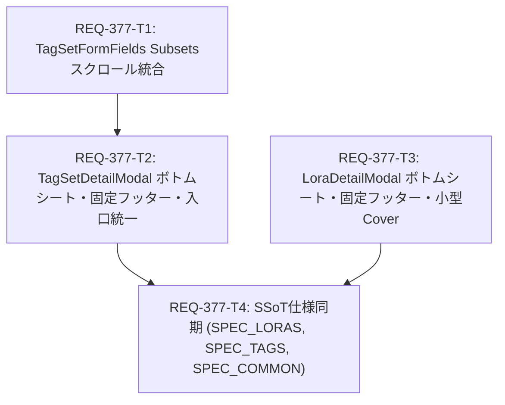

# Implementation Plan - REQ-377: モバイルLoRA／Tag Set 詳細・編集シートの再構成とTag Set編集入口・Subsetsの統一

## Proposed Changes

### 1. 概要と背景
本改修は、モバイル端末（幅767px以下）におけるLoRAおよびTag Set画面の詳細閲覧・編集体験を劇的に改善するものです。
従来の課題（画面上部を占有する巨大画像、スクロール末尾に埋もれた確定ボタン、閲覧時と編集時のボタン配置不整合、Tag Set編集入口の二重分岐、Subsets一覧の独立スクロールによるスタック）を解消し、`SPEC_COMMON` §1-6 に定義されたモバイルUI共通規約（MUI-02, MUI-03, MUI-04, MUI-05, MUI-06, MUI-07, MUI-09）に完全準拠させます。なお、PC環境（幅768px以上）の表示および既存機能（トリガーワード、強度、コピー、タグ編集等）は100%維持します（Baseline-Preserving原則）。

### 2. コンポーネント別の変更内容

#### `TagSetFormFields.tsx` (Subsets スクロール統合) [REQ-377-T1]
- Subsets（バリエーション）一覧のラッパー要素から `max-h-[160px] overflow-y-auto custom-scrollbar pr-1` を撤廃し、`<div className="space-y-2">` に変更。
- Subsets が何件追加されても親モーダルの縦スクロール領域に自然展開され、入れ子スクロール障害を根絶。

#### `TagSetDetailModal.tsx` & `TagsPage.tsx` (Tag Set ボトムシート・固定フッター・入口統一) [REQ-377-T2]
- `TagSetDetailModal`:
  - モバイル時は下端起点のボトムシート（`modal-backdrop items-end md:items-center p-0 md:p-4`, `rounded-t-2xl`, `max-h-[90dvh]`）として表示。
  - 本文先頭に小型Coverサムネイル＋Snapshot件数行を配置。タップで同一モーダル内の画像ギャラリーサブビュー（スナップショット一覧・Cover選択）へスムーズに遷移。
  - 最下部に固定アクションフッターを常駐（閲覧中: 左 `Close` / 右 `Edit`、編集中: 左 `Cancel` / 右 `Save`）。
  - `initialEditing?: boolean` プロパティを追加。
- `TagsPage.tsx`:
  - カード右上の編集アイコン (`#tagset-edit-${id}`) クリック時、`TagSetDetailModal` を `initialEditing=true` で起動するよう接続を統一。カードクリック時の詳細表示と全く同じモーダル・フィールド・固定フッターを共有。

#### `LoraDetailModal.tsx` & `LoRAsPage.tsx` (LoRA ボトムシート・固定フッター・小型Cover) [REQ-377-T3]
- `LoraDetailModal`:
  - モバイル時は下端起点のボトムシートとして再構成。
  - 本文先頭に小型Coverサムネイル＋Snapshot件数行を配置し、タップで画像ギャラリーサブビュー（スナップショット一覧・Cover変更）へ展開。
  - 最下部に固定アクションフッターを常駐（閲覧中: 左 `Close` / 右 `Edit`、編集中: 左 `Cancel` / 右 `Save`）。
  - `initialEditing?: boolean` プロパティを追加。
- `LoRAsPage.tsx`:
  - カード右上の編集アイコンクリック時に `LoraDetailModal` の編集モードを直接開く導線へ統一。

#### SSoT 仕様同期 (`SPEC_LORAS.md`, `SPEC_TAGS.md`, `SPEC_COMMON.md`) [REQ-377-T4]
- 各仕様書に実装結果を正確に反映し、MUI-02/03/04/05/09 の適用状況を「導入済み」へ更新。

---

## Dependency Graph (DAG)



---

## Trade-off Disclosure and Technical Decisions

### 1. 画像ギャラリーサブビュー方式の採用（vs インライン展開）
- **検討内容**: モバイル表示において、画像一覧を本文内でアコーディオン展開するか、同一シート内でサブビュー（画面切替）として表示するか。
- **決定**: 同一シート内のサブビュー切替方式を採用。
- **理由**: 本文内で画像カルーセルやグリッドを展開すると、縦スクロール量が突如増大して入力欄や確定フッターの位置を見失いやすいため。テキスト主体の情報確認と画像閲覧の目的を明確に分離し、モーダルの多重ネスト（アンチパターン 1-5-2 #8）を回避します。

### 2. Tag Set 編集画面の一本化（vs 既存 TagSetEditModal の並行維持）
- **検討内容**: カード編集用の `TagSetEditModal` と詳細内編集を別コンポーネントのまま維持するか、`TagSetDetailModal` に一本化するか。
- **決定**: `TagSetDetailModal(initialEditing=true)` へ一本化。
- **理由**: 入口によってモーダルのデザインやボタン位置が異なる不整合を恒久的に防ぎ、保守コストを削減するため。

### 3. デスクトップ表示の厳格な分離（Baseline Preservation）
- **検討内容**: モバイルボトムシートの構造変更がデスクトップ（幅768px以上）の表示に影響を与えないか。
- **決定**: Tailwind のレスポンシブブレイクポイント (`hidden md:block`, `md:grid-cols-2` 等) を厳格に分離し、デスクトップ表示およびテストスイートに一切の回帰を生じさせない設計としました。

---

## Verification Plan

### Automated Baseline Verification
1. **Gate 1 (静的型チェック)**:
   ```bash
   npm --prefix frontend run typecheck
   ```
2. **Gate 2 (単体・統合テスト)**:
   ```bash
   npm --prefix frontend test -- src/components/TagSetModals/__tests__/TagSetFormFields.test.tsx --run
   npm --prefix frontend test -- src/components/__tests__/TagSetModals.test.tsx src/pages/__tests__/TagsPage.test.tsx --run
   npm --prefix frontend test -- src/components/LoraModals/__tests__/LoraDetailModal.test.tsx src/components/__tests__/LoraModals.test.tsx --run
   ```
3. **Gate 3 (受入基準・異常系検証)**:
   - AC-1〜AC-14 のタグ付きテストによる網羅的検証。
   - 画像欠損、異常強度値（min > max）、Cover 取消整合性の Red Team 検証。

### Manual / Browser Verification
- モバイルビューポート（375px〜430px）およびデスクトップビューポート（1280px）での表示確認：
  - ボトムシートが下端から開き、上端ハンドル・ヘッダー・固定フッターが正しく表示されること。
  - 閲覧時（Close左/Edit右）および編集時（Cancel左/Save右）のボタン位置と操作性。
  - 小型Coverタップでギャラリーサブビューへ遷移し、Cover選択と取消が正常に行えること。
  - カード右上の編集ボタンから直接編集モードで開くこと。
  - 多数のSubsetsがある場合に親コンテナのみが縦スクロールすること。
