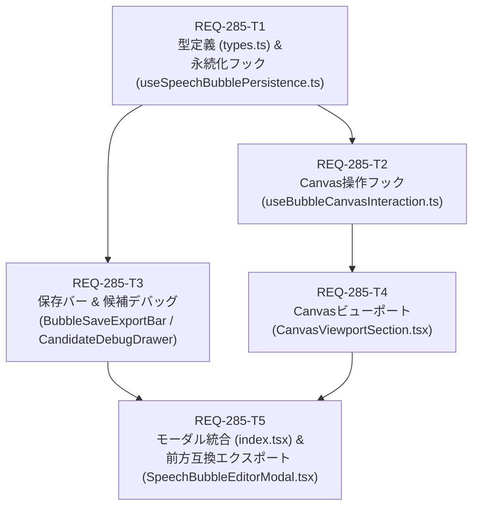

# Implementation Plan: REQ-285 SpeechBubbleEditorModal の Canvas 操作分離とセクション部品化

## 1. Overview & Architectural Goals
本実装計画は、プロジェクト最大規模の単一コンポーネントである `SpeechBubbleEditorModal.tsx`（1,553行）を対象とし、Canvas対話操作・永続化API処理・UIセクション群を独立したモジュールへ分離・部品化することで、保守性・可読性の向上およびAIコンテキスト消費の極小化を図るものである（リファクタ計画 PBI-REF-04 準拠）。

### Target Architecture
```
frontend/src/components/SpeechBubbleEditorModal/
├─ index.tsx                         # モーダル枠・全体State統合・ショートカット（約150行）
├─ types.ts                          # 型定義（MobileTab, SpeechBubbleEditorProps等）（約60行）
├─ hooks/
│  ├─ useBubbleCanvasInteraction.ts  # Canvasマウス/タッチ操作・ROI描画・ドラッグ（約280行）
│  └─ useSpeechBubblePersistence.ts  # 画像合成・下書きAPI呼出・保存処理（約140行）
└─ sections/
   ├─ CanvasViewportSection.tsx      # Canvas本体・しっぽ微調整ツールバー（約140行）
   ├─ BubbleSaveExportBar.tsx        # 下部保存バー（保存モード・アルバム選択）（約110行）
   └─ CandidateDebugDrawer.tsx       # 自動検出候補のフィルタ・ソートテーブル（約130行）
```

---

## 2. Dependency Graph (Mermaid DAG)



- **並列性（Parallelism）**: T1完了後、Canvas操作フック（T2）と独立したUIセクション（T3: 保存バー・デバッグ候補）は並列に実装可能。
- **最大階層深度（Max Depth）**: 4層（T1 → T2 → T4 → T5）。制約を満たす。

---

## 3. Atomic Task Decomposition & File Impacts

| タスクID | タイトル | サブシステム | 対象ファイル | 変更行数目安 | 検証コマンド |
|---|---|---|---|---|---|
| **REQ-285-T1** | 型定義と永続化フックの抽出 | frontend | `frontend/src/components/SpeechBubbleEditorModal/types.ts`<br/>`frontend/src/components/SpeechBubbleEditorModal/hooks/useSpeechBubblePersistence.ts` | ~200行 | `cd frontend && npm run typecheck` |
| **REQ-285-T2** | Canvas操作・描画ループフックの抽出 | frontend | `frontend/src/components/SpeechBubbleEditorModal/hooks/useBubbleCanvasInteraction.ts` | ~280行 | `cd frontend && npm run typecheck` |
| **REQ-285-T3** | 保存バーと候補デバッグセクションの分離 | frontend | `frontend/src/components/SpeechBubbleEditorModal/sections/BubbleSaveExportBar.tsx`<br/>`frontend/src/components/SpeechBubbleEditorModal/sections/CandidateDebugDrawer.tsx` | ~240行 | `cd frontend && npm run typecheck` |
| **REQ-285-T4** | Canvasビューポートセクションの分離 | frontend | `frontend/src/components/SpeechBubbleEditorModal/sections/CanvasViewportSection.tsx` | ~140行 | `cd frontend && npm run typecheck` |
| **REQ-285-T5** | モーダル全体の統合と前方互換リダイレクト | frontend | `frontend/src/components/SpeechBubbleEditorModal/index.tsx`<br/>`frontend/src/components/SpeechBubbleEditorModal.tsx` | ~250行 | `cd frontend && npm run typecheck && npx vitest run src/components/__tests__/SpeechBubbleEditorModal.test.tsx` |

---

## 4. Trade-off Disclosure & Architectural Considerations

### トレードオフ 1: サブコンポーネントへの State リフトアップ vs 個別フック直結
- **検討案 A**: `useBubbleCanvasInteraction` や `useSpeechBubblePersistence` の返り値をすべて各セクション（`CanvasViewportSection` や `BubbleSaveExportBar`）の内部で直接呼び出す。
- **検討案 B（採用）**: モーダル最上位の `index.tsx` で両フックを呼び出し、Props 経由で各セクションに注入する（State Lift-up）。
- **理由**:
  - `bubbles` や `selectedBubbleId` は `SpeechBubbleControls`（既存コンポーネント）やキーボードショートカット、オフスクリーン合成保存処理の全域で同期して参照・更新される。
  - セクション内部にフックを隠蔽すると、Stateの二重管理や不要な再レンダリングループが発生するリスクがあるため、Props バインディングによる単一情報源（SSoT）を維持する。

### トレードオフ 2: 既存 `SpeechBubbleEditorModal.tsx` の削除 vs 再エクスポート転送層（Forwarder）
- **検討案 A**: `frontend/src/components/SpeechBubbleEditorModal.tsx` を削除し、ディレクトリ `SpeechBubbleEditorModal/index.tsx` のみとする。
- **検討案 B（採用）**: `frontend/src/components/SpeechBubbleEditorModal.tsx` を残し、`export * from './SpeechBubbleEditorModal/index'` とする。
- **理由**:
  - `HistoryPage.tsx` や `SpeechBubbleEditorModal.test.tsx` において、`import { SpeechBubbleEditorModal } from '../components/SpeechBubbleEditorModal'` 形式でインポートされており、ファイル拡張子省略のビルド設定・テストモックとの完全な互換性を担保できるため。

### トレードオフ 3: しっぽ微調整モードの配置場所
- **検討案 A**: `SpeechBubbleControls.tsx`（右側パネル）に統合する。
- **検討案 B（採用）**: `CanvasViewportSection.tsx`（Canvas上部オーバーレイ）に維持する。
- **理由**:
  - 現状のUI設計として、Canvasのすぐ上で接点ドラッグのON/OFFおよびリセットを行える視認性が確立されており、既存のUXとテスト（テストセレクタ `aria-label="しっぽ微調整モード"`）を崩さずにリファクタリングを完結させるため。

---

## 5. Verification Plan & Quality Gates

1. **Gate 1 (Typecheck)**:
   - `cd frontend && npm run typecheck`
   - 全ファイルでTypeScript型エラー 0 件を確認。
2. **Gate 2 (Unit & Regression Tests)**:
   - `cd frontend && npx vitest run src/components/__tests__/SpeechBubbleEditorModal.test.tsx`
   - 既存の全24件以上の単体・結合テストが 100% PASS すること。
3. **Gate 3 (Red Team & Boundary Verification)**:
   - 微小ROI（10px未満）のリセット、空アルバム名バリデーション、画像未ロード時の保存抑止、エラー時のローディング復帰を保証。

