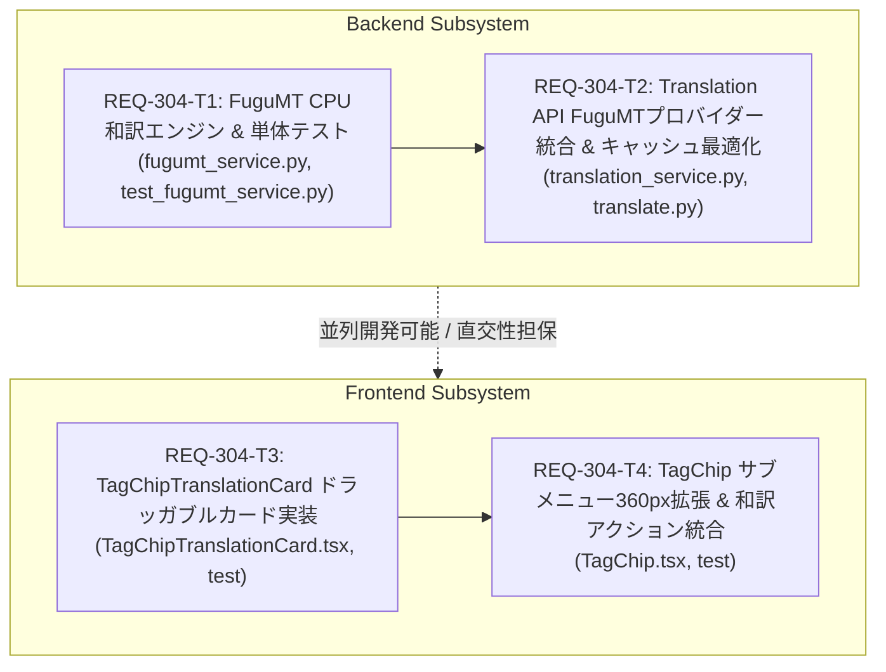

# Implementation Plan - REQ-304: FuguMT軽量和訳エンジン導入とドラッガブルタグチップ和訳プレビュー

Prompt Surgeonおよびタグチップエディタにおいて、ComfyUIのGPU VRAMを一切消費（0MB）しないCPU常駐型の高速和訳エンジン（CTranslate2 / FuguMT）を導入し、タグチップサブメニューの幅拡張（360px）およびマウス・タッチ両対応のドラッガブル・フローティング和訳プレビューカード（`TagChipTranslationCard`）を実装します。

---

## Proposed Changes

### Backend Subsystem

#### [LOCAL NEW] [fugumt_service.py](file:///c:/Users/audih/ws/comfy-create-helper2/backend/app/services/fugumt_service.py)
- CTranslate2 `Translator`（CPU推論・`intra_threads=6`・`compute_type="int8"`）および MarianTokenizer / AutoTokenizer のライフサイクルを管理する `FuguMTService` シングルトンクラスを実装。
- 前後空白トリムおよび連続スペース縮退を行う入力正規化関数 `normalize_input` を実装。
- バッチ一括推論 `translate_batch` とテスト用モック注入メソッド `set_translator` を提供。

#### [LOCAL MODIFY] [requirements.txt](file:///c:/Users/audih/ws/comfy-create-helper2/backend/requirements.txt)
- `ctranslate2>=4.0.0` および `transformers>=4.30.0` を追記。

#### [LOCAL NEW] [test_fugumt_service.py](file:///c:/Users/audih/ws/comfy-create-helper2/backend/tests/test_fugumt_service.py)
- `normalize_input`（空白・特殊記号・空文字処理）、`translate_batch`（モックバッチ推論・トークン保護）、`initialize`（モデル欠落時例外ハンドリング）の単体テスト。

#### [LOCAL MODIFY] [translation_service.py](file:///c:/Users/audih/ws/comfy-create-helper2/backend/app/services/translation_service.py)
- `provider == "fugumt"` 分岐を追加し、`FuguMTService.get_instance().translate_batch(missing_chunks_list)` を呼び出し。
- チャンク入力正規化と SHA256 キャッシュキー照会を連携し、同一ハッシュ再リクエスト時の即時返却（0ms、AC-1）を保証。
- `test_connection` において、`provider == "fugumt"` 時のテスト接続をサポート。

#### [LOCAL MODIFY] [translate.py](file:///c:/Users/audih/ws/comfy-create-helper2/backend/app/routers/translate.py)
- `PromptTranslateRequest` に `provider: Optional[str] = None` を追加し、リクエスト単位のプロバイダー指定を許容。
- `TranslateTestRequest` の `provider` Literalに `"fugumt"` を追加。

#### [LOCAL MODIFY] [test_translation_proxy.py](file:///c:/Users/audih/ws/comfy-create-helper2/backend/tests/test_translation_proxy.py)
- `provider="fugumt"` 指定時の `translate_prompt` 統合テストおよび SHA256 キャッシュヒット検証テストを追加。
- 既存プロバイダー（`google_cloud`, `deepl`, `llm`）の後方互換性を検証。

---

### Frontend Subsystem

#### [LOCAL NEW] [TagChipTranslationCard.tsx](file:///c:/Users/audih/ws/comfy-create-helper2/frontend/src/components/TagChipEditor/TagChipTranslationCard.tsx)
- フローティング和訳プレビューカード（`TagChipTranslationCard`）コンポーネントを新規作成。
- Pointer Events（`onPointerDown`, `onPointerMove`, `onPointerUp`, `setPointerCapture` / `releasePointerCapture`）による滑らかなドラッグ移動機構。
- ヘッダー部に `touch-action: none`（`touch-none`）を適用し、モバイルでのブラウザスクロール誤発火を防止。
- 上下左右の移動可能範囲をビューポート境界内にクランプ（`Math.min/max`）。
- 本文コンテナに `onPointerDown={(e) => e.stopPropagation()}` を適用し、本文の縦スクロール・テキスト選択とヘッダードラッグの操作を完全分離。
- マウント時の `translateApi.translatePrompt` 非同期フェッチ、Loading/Error/Success 状態表現、1クリッククリップボードコピー（1.5秒チェックマーク表示）。
- 閉じるボタン [✕]、`Escape` キー押下、外側クリック検知によるカードクローズ。

#### [LOCAL NEW] [TagChipTranslationCard.test.tsx](file:///c:/Users/audih/ws/comfy-create-helper2/frontend/src/components/TagChipEditor/__tests__/TagChipTranslationCard.test.tsx)
- 和訳取得ライフサイクル、エラーフォールバック、Pointer Eventsドラッグ・クランプ、本文操作分離、コピー機能、クローズトリガーの単体テストを網羅。

#### [LOCAL MODIFY] [TagChip.tsx](file:///c:/Users/audih/ws/comfy-create-helper2/frontend/src/components/TagChipEditor/TagChip.tsx)
- サブメニュー外枠の横幅を `min-w-[220px]` から `w-[360px] max-w-[calc(100vw-24px)]` に拡張。
- サブメニューヘッダーに `[翻訳]` ボタンを新設。
- `isTranslationOpen` state を管理し、ボタンクリックで `TagChipTranslationCard` を開閉。
- 親サブメニューが閉じた際（`isMenuOpen === false`）、連動して和訳カードを閉じるよう制御。

#### [LOCAL MODIFY] [TagChip.test.tsx](file:///c:/Users/audih/ws/comfy-create-helper2/frontend/src/components/TagChipEditor/__tests__/TagChip.test.tsx)
- サブメニュー横幅クラス `w-[360px] max-w-[calc(100vw-24px)]` の検証。
- `[翻訳]` ボタンの描画およびクリック時の和訳カード表示トグルの検証。
- 親サブメニュークローズ時の連動クローズ検証。

---

## Verification Plan

### Automated Tests
1. **バックエンド単体・統合テスト**:
   - `backend\.venv\Scripts\python -m pytest backend/tests/test_fugumt_service.py`
   - `backend\.venv\Scripts\python -m pytest backend/tests/test_translation_proxy.py`
2. **バックエンド型チェック**:
   - `mypy backend`
3. **フロントエンド単体・統合テスト**:
   - `cd frontend; npx vitest run src/components/TagChipEditor/__tests__/TagChipTranslationCard.test.tsx`
   - `cd frontend; npx vitest run src/components/TagChipEditor/__tests__/TagChip.test.tsx`
4. **フロントエンド型チェック**:
   - `cd frontend; npm run typecheck`
5. **全体回帰テスト (Full Test Suite Baseline)**:
   - `backend\.venv\Scripts\python -m pytest`
   - `cd frontend; npm test`

### Manual Verification
1. ブラウザでタグチップをクリックし、サブメニューが横幅360pxでゆったり表示され、ヘッダーに `[翻訳]` ボタンが表示されることを確認。
2. `[翻訳]` ボタンをクリックし、サブメニュー直下に和訳カードがスムーズに展開され、ローディング後に日本語訳が表示されることを確認。
3. カード上部ヘッダーをマウスドラッグおよびタッチ操作で画面端まで動かし、ビューポート外に消えず適切に停止することを確認。
4. 訳文本文をドラッグしてテキスト選択および縦スクロールを行い、カード全体のドラッグが誤発火しないことを確認。
5. コピーボタンをクリックしてクリップボードに訳文がコピーされ、チェックアイコンが表示されることを確認。
6. [✕] ボタン、Escキー、外側クリック、またはタグチップメニューを閉じた際に、和訳カードが連動して安全に閉じることを確認。

---

## Task Dependency & Parallelization

| タスクID | サブシステム | 対象ファイル | 依存関係 | 並列実行 | 検証コマンド |
| :--- | :--- | :--- | :--- | :--- | :--- |
| **REQ-304-T1** | backend | `fugumt_service.py`, `test_fugumt_service.py`, `requirements.txt` | なし (Root) | 可 (T3と並列) | `backend\.venv\Scripts\python -m pytest backend/tests/test_fugumt_service.py` |
| **REQ-304-T2** | backend | `translation_service.py`, `translate.py`, `test_translation_proxy.py` | `REQ-304-T1` | 順次 (T1後) | `backend\.venv\Scripts\python -m pytest backend/tests/test_translation_proxy.py` |
| **REQ-304-T3** | frontend | `TagChipTranslationCard.tsx`, `TagChipTranslationCard.test.tsx` | なし (Root) | 可 (T1と並列) | `cd frontend; npx vitest run src/components/TagChipEditor/__tests__/TagChipTranslationCard.test.tsx` |
| **REQ-304-T4** | frontend | `TagChip.tsx`, `TagChip.test.tsx` | `REQ-304-T3` | 順次 (T3後) | `cd frontend; npx vitest run src/components/TagChipEditor/__tests__/TagChip.test.tsx` |

---

## Trade-off Disclosure

1. **CPU推論スレッド数とサーバーリソースのバランス**:
   - **Trade-off**: `intra_threads=6` を割り当てることで推論速度を 20〜30ms に短縮できますが、推論実行の瞬間にCPUコア負荷が一時的に高まります。
   - **Mitigation**: プロンプト翻訳は常時高頻度で実行されるものではなく（ユーザーのタグ確認時やプロンプト投入時のみ）、かつ SHA256 インメモリキャッシュにより同一フレーズは次回以降 0ms・CPU負荷ゼロで即時返却されるため、全体のCPU使用率は極めて低く抑えられます。
2. **モデル初回ロード時の待機時間（遅延ロード）**:
   - **Trade-off**: サーバー起動時に全モデルをロードしないため、初回和訳リクエスト時にモデル読込（約1〜2秒）の遅延が発生します。
   - **Mitigation**: サーバー起動自体が軽快になり、かつ単体テスト実行時にモデルロードによる不要なオーバーヘッドやエラーを防ぐことができます。初回ロード完了後はCPUメモリに常駐するため、2回目以降は即座に応答します。
3. **フローティングカードの初期位置と画面外はみ出し防止**:
   - **Trade-off**: ポップオーバーが動的に任意位置へドラッグ可能になるため、初期配置時に画面端と被るリスクや、ドラッグによって見失われるリスクがあります。
   - **Mitigation**: マウント時に `anchorRect` とビューポート残余領域を判定して上下位置を自動退避し、Pointer Events の移動ハンドラに厳格なビューポートクランプ（上下左右）を設けることで、画面外への消失を 100% 防止します。