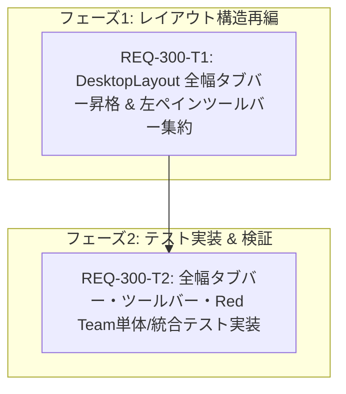

# Implementation Plan: REQ-300

## Target and Current State

REQ-300 は、デスクトップ生成画面（`DesktopLayout.tsx`）における情報設計（Information Design）および操作導線設計（Interaction Design）を根本から最適化する改修です。
現在、プリセットタブバー（`SetTabItem` 一覧）が左ペイン（入力設定カラム）の幅制約内に配置されているため、プリセット名が付与されると2つ程度しか同時にタブを視認できず、一覧性や切り替え作業性が著しく低下しています。一方で、右ペイン（プレビューエリア）の上部は空間を持て余しています。
また、「Add Set（セット追加）」および「管理（プリセット管理）」ボタンは、左ペインでのプロンプト・パラメータ編集やUndo/Redoといった試行錯誤の主導線に属しており、タブバーと一緒に画面右端へ移動してしまうとFittsの法則（Fitts's Law）に反してマウス移動距離が著しく増大します。

本改修では以下の構造的再編を実施します：
1. **全幅プリセットタブバー**: プリセットタブ一覧を左右2ペイン（入力／プレビュー）の共通親コンテナ直上（画面幅100%）に配置昇格し、プレビューエリア上部を含めた全幅を活用して多数のタブを一覧・横スクロール可能にします。
2. **操作ボタンの左ペイン集約**: 「Add Set」「管理」ボタンを全幅タブバーから切り離し、左ペイン最上部のツールバー領域（Undo/Redoボタン配置エリア）へ近接集約配置することで、マウス移動を最小化し入力ワークフローを一元化します。
3. **既存動作およびモバイルレイアウトの完全維持**: 各タブの選択・アクティブ表示・チェックボックス・削除・Undo/Redo・プリセット管理モーダルの開閉機能、およびモバイルレイアウト（`MobileLayout.tsx`）は一切変更せず現状維持します。

## SSoT and Boundary Audit

- **SSoT 仕様書**: `docs/specs/SPEC_GENERATE.md`（Section 2 デスクトップレイアウト）
- **対象サブシステム**: `frontend`（UI/レイアウトコンポーネントの再編であり、バックエンド API 契約の変更はなし）
- **影響ファイル**:
  - `frontend/src/pages/GeneratePage/components/DesktopLayout.tsx` (改修)
  - `frontend/src/pages/GeneratePage/components/__tests__/DesktopLayout.tabs.test.tsx` (新規テスト)

## Mermaid DAG

- **並列性 (Parallelism Priority)**:
  - T1 (コンポーネント構造再編) と T2 (テスト実装) は依存関係を持ちます。T1 での DOM 階層およびセレクタ ID（`#desktop-preset-tabs-bar`, `#left-pane-toolbar`）の確定後、T2 にて厳密な DOM 階層検証・イベント検証・Red Team 境界値テストを記述します。
- **最大深度**: 2層（T1 → T2）。DAG ボトルネックのない最適な依存関係。

## Atomicity Audit and Verification Commands

| タスクID | 対象ファイル | 依存 | 変更行数目安 | 検証コマンド (Verification Command) |
|---|---|---|---:|---|
| **REQ-300-T1** | `frontend/src/pages/GeneratePage/components/DesktopLayout.tsx` | なし | ≤120行 | `cd frontend; npm run typecheck` |
| **REQ-300-T2** | `frontend/src/pages/GeneratePage/components/__tests__/DesktopLayout.tabs.test.tsx` | T1 | ≤180行 | `cd frontend; npx vitest run src/pages/GeneratePage/components/__tests__/DesktopLayout.tabs.test.tsx` |

すべてのタスクカードはファイル数 ≤ 3 かつ行数 ≤ 300行のアトミック基準を満たしています（PASS）。

## Three-Gate Testing Strategy

- **Gate 1 (静的型検査 Baseline)**:
  - コマンド: `cd frontend; npm run typecheck`（`tsc -b --noEmit` エラー 0 件）
- **Gate 2 (全テスト自動実行 Baseline)**:
  - コマンド: `cd frontend; npx vitest run src/pages/GeneratePage/components/__tests__/DesktopLayout.tabs.test.tsx && cd frontend; npx vitest run src/pages/__tests__/GeneratePage.test.tsx`（全テスト PASS）
  - 全スイート回帰確認: `cd frontend; npm test`
- **Gate 3 (シナリオ・Red Team 検証)**:
  - `docs/design/REQ-300-test-plan.md` に記載の 5 シナリオ（全幅配置、複数タブ横スクロール、操作ボタン集約、インタラクション維持、モバイル分離）および 3 件の Red Team 境界値（空プリセット時の安全描画、長大名タブオーバーフロー制御、タブ削除時のフォールバック同期）を検証。

## Trade-off Disclosure and Technical Constraints

1. **タブ名表示幅（max-w）の拡張 vs 極端に多数のタブ時の横スクロール負荷**:
   - *検討内容*: 全幅化に伴い各タブの最大横幅を従来の `max-w-[80px]` からどこまで広げるか。固定幅にするか可変幅にするか。
   - *決定*: `max-w-[140px]` 程度に設定し、`flex-shrink-0` を付与する。長大名でも視認性を確保しつつ、過度に1つのタブが横幅を占有しないバランスとし、画面幅を超える場合は独立した `overflow-x-auto` によりスクロール可能とする。
2. **左ペインツールバーの縦幅（垂直スペース）の消費 vs マウス移動効率（Fitts's Law）**:
   - *検討内容*: 「Add Set」や「管理」ボタンを全幅タブバーの右端（プレビュー右上等）に置けば左ペインの垂直スペースをわずかに節約できるが、Fitts's Law に反して右端への視線・マウス移動が発生する。
   - *決定*: ユーザビリティと操作の一元性を最優先とし、左ペイン最上部（Undo/Redoと同一ライン）に `py-2.5` のコンパクトなツールバーとして集約配置する。入力作業と試行錯誤（プリセット切替・追加・元に戻す）が同一カラム内で完結する。
3. **ワークフロー未選択時のタブバー描画抑制**:
   - *検討内容*: ワークフローが未選択の状態でタブバーを表示するかどうか。
   - *決定*: ワークフローが選択されていない状態ではプリセット（Set）自体が存在し得ないため、従来通り `selectedWorkflowId` が truthy な場合のみタブバーおよび左ペインツールバーを描画する。

## Proposed File Changes

#### [LOCAL MODIFY] [DesktopLayout.tsx](file:///c:/Users/audih/ws/comfy-create-helper2/frontend/src/pages/GeneratePage/components/DesktopLayout.tsx)
#### [LOCAL NEW] [DesktopLayout.tabs.test.tsx](file:///c:/Users/audih/ws/comfy-create-helper2/frontend/src/pages/GeneratePage/components/__tests__/DesktopLayout.tabs.test.tsx)
