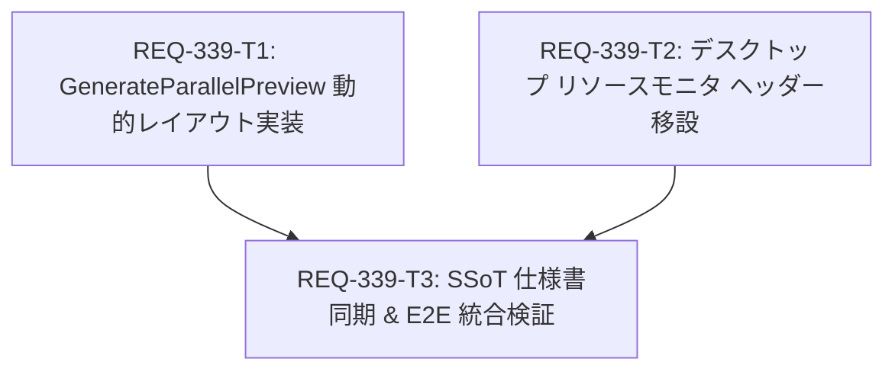

# Implementation Plan - REQ-339: プレビューエリアのアスペクト比非依存・高さ基準動的マルチ表示レイアウトおよびリソースモニタ移設

## Proposed Changes

### Frontend Subsystem

#### [LOCAL MODIFY] [GenerateParallelPreview.tsx](file:///c:/Users/audih/ws/comfy-create-helper2/frontend/src/pages/GeneratePage/components/GenerateParallelPreview.tsx)
- 固定の2:3アスペクト比前提の計算を廃止。
- プレビュー領域の利用可能高さに合わせて全画像の高さを揃え、各画像本来のアスペクト比（幅:高さ）から各カード幅を動的に計算。
- コンテナの利用可能横幅（`size.width`）とギャップ（`GAP`）に基づき、横方向に収まる最大枚数を動的に算出して1行に並べる。
- 画像本来のアスペクト比は Props `aspectRatios` または `img.naturalWidth / naturalHeight` で取得し、未取得時は後方互換性のため 2:3 をフォールバックとする。
- 単一画像がコンテナ幅を超える超横長画像に対する高さ自動縮小、および極端な縦長画像に対する最小幅ガード（80px）を適用。

#### [LOCAL MODIFY] [GenerateParallelPreview.test.tsx](file:///c:/Users/audih/ws/comfy-create-helper2/frontend/src/pages/GeneratePage/components/__tests__/GenerateParallelPreview.test.tsx)
- 既存の2:3基準テスト（812pxで2枚、1224pxで3枚、1636pxで4枚）の回帰検証を維持。
- 16:9（横長）や1:1（正方形）など異なるアスペクト比における動的表示枚数、および混在時の累積幅計算テストを追加。

#### [LOCAL MODIFY] [DesktopLayout.tsx](file:///c:/Users/audih/ws/comfy-create-helper2/frontend/src/pages/GeneratePage/components/DesktopLayout.tsx)
- プレビュー領域（Main Preview）右上に重畳されていた `<ResourceGaugeHUD />` を撤去。
- デスクトップの Global Header（`<h1>Generate</h1>` の右側コントロールエリア）に `<ResourceGaugeChips />` を移設配置。

#### [LOCAL MODIFY] [DesktopLayout.test.tsx](file:///c:/Users/audih/ws/comfy-create-helper2/frontend/src/pages/GeneratePage/components/__tests__/DesktopLayout.test.tsx)
- デスクトッププレビュー内に重畳HUDが存在しないこと、およびGlobal Header内にリソース監視チップ（CPU, RAM, GPU, VRAM）が正しく配置されることを検証するテストを追加。

#### [LOCAL NEW] [e2e_req339_preview_layout.test.tsx](file:///c:/Users/audih/ws/comfy-create-helper2/frontend/src/test/e2e_req339_preview_layout.test.tsx)
- REQ-339の受入基準（AC-1〜AC-8）を網羅する統合E2Eテスト。
- 多様なアスペクト比での高さ統一、横幅に応じた動的枚数変化、リサイズ追従、ヘッダーリソース監視の動作を検証。

### Specifications & Documentation Subsystem

#### [LOCAL MODIFY] [SPEC_GENERATE.md](file:///c:/Users/audih/ws/comfy-create-helper2/docs/specs/SPEC_GENERATE.md)
- 2-9節: `GenerateParallelPreview` の高さ基準・アスペクト比非依存の動的並列表示仕様を最新化。
- 2-10節: デスクトップにおけるリソースモニタのヘッダー移設仕様を最新化。

---

## Task Dependency Visualization & Parallel Design

- **並列実行可能タスク**: `REQ-339-T1` と `REQ-339-T2` は互いに異なるコンポーネント・ファイルスコープを対象とするため、完全に並列実行可能です。

---

## Trade-off and Risk Disclosure

1. **アスペクト比未取得時のフォールバック設計（トレードオフ）**:
   - 画像URLのみが渡された初期描画時点ではブラウザが画像を読み込むまで `naturalWidth` が判明しない。
   - **対策**: 初期フォールバック比率として既存の標準である `2/3` を適用し、画像ロード完了イベント（`onLoad`）で実比率にシームレスに更新する。また、メタデータが事前に渡される場合は `aspectRatios` プロパティ経由で即時反映可能とする。
2. **ヘッダー領域の水平スペース（制約と対策）**:
   - デスクトップの Global Header にリソースモニタを移設することにより、ヘッダーの横幅が狭い場合（例: ウィンドウ幅縮小時）にタイトルやワークフロー選択と干渉するリスクがある。
   - **対策**: モバイルと同様にコンパクトなチップ表現（`ResourceGaugeChips`）を採用し、最小幅（`min-w-0`）と適度なギャップを設定して押し潰れを防止する。
3. **リサイズ頻度とパフォーマンス**:
   - ペインスプリッターのドラッグ中に高頻度でサイズ変更イベントが発生する。
   - **対策**: 既存の `ResizeObserver` を活用し、不要な重い再計算を避けて軽量な幅合算ロジックのみを実行することで、60fpsのスムーズなドラッグ追従を維持する。

---

## Verification Plan

### Automated Baseline Gates
- **Gate 1 (Typecheck)**: `cd frontend; npm run typecheck`
- **Gate 2 (Full Discovery Test Suite)**: `cd frontend; npm test`
- **Gate 3 (Scenario & Red Teaming)**:
  - `cd frontend; npx vitest run src/pages/GeneratePage/components/__tests__/GenerateParallelPreview.test.tsx`
  - `cd frontend; npx vitest run src/pages/GeneratePage/components/__tests__/DesktopLayout.test.tsx`
  - `cd frontend; npx vitest run src/test/e2e_req339_preview_layout.test.tsx`
