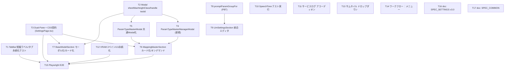

# Implementation Plan: REQ-365 Settings画面再設計：2ペイン適応・情報密度最適化およびモバイルエルゴノミクス対応

大画面（>=1280px）では2ペイン（Adaptive Dual-Pane）、モバイル（<768px）ではスワイプタブ・超スリムカード・ボトムシート・44pxタップ領域へ適応させ、Settings画面のUI構造のみを外科的に刷新します。**API・DB保存契約・`prompt-surgeon-settings-details-expanded-v2` のスキーマ（`{prompt, dialogue}`）は一切変更しません。** バックエンドは対象外です。

- 設計書: `docs/design/REQ-365.md`（SSoT影響分析・Seam Map・トレードオフ・所有ファイル表）
- テスト計画: `docs/design/REQ-365-test-plan.md`（AC-1〜AC-10 トレーサビリティ、境界値 767/768/1279/1280px、Red Team）
- Task Card: `docs/backlog/task/active/REQ-365-T1.md` 〜 `REQ-365-T17.md`

## Proposed Changes

### Frontend: Shell / Layout
#### [MODIFY] SettingsPage.tsx / SettingsResponsive.css / SettingsPage.test.tsx (T3)
- workflowsタブを `xl:grid-cols-2` `xl:grid-rows-[auto_1fr]` の単一Gridへ（左=ワークフロー+BaseModel、右=MappingMaster `row-span-2`）。`<xl` は `order` で ワークフロー → MappingMaster → BaseModel。
- 下部余白を `md:pb-5` へ（bottom navは768px未満のみ）、`max-w-7xl mx-auto` でUltra-Wide上限。
- モバイルCSS契約（`.settings-mobile-card*`、`.settings-mobile-table` の2行カード化、`[role=dialog]` 85dvh）を一元所有。

#### [MODIFY] SettingsTabBar.tsx + tests (T1)
- 短縮ラベルを「① モデル」「② 呪文」「③ セリフ」「④ 翻訳」「⑤ システム」へ。`aria-label` は丸数字なしを維持。タブ保存（`prompt-surgeon-settings-active-tab`）の回帰テスト追加。

### Frontend: Modals（ボトムシート統一）
#### [MODIFY] components/common/Modal.tsx (T2)
- `sheetMaxHeightClass`（opt-in、既定は現行）とハンドル `data-testid="modal-sheet-handle"`。
#### [NEW] ParamTypeMasterManagerModal.tsx (T4) / [MODIFY] ParamTypeMasterModal.tsx (T5)
- カスタム型マスタを一覧モーダル（新規）＋既存フォームモーダル（共通Modal化）へ。list→form は排他遷移（ネスト禁止）。

### Frontend: セクション別
- **T6 MappingMasterSection**: 行を超スリムカード化（アクション右端ピン留め、Target Node非表示＋`aria-label`保持、`+N classes`/`+N stages`）。常時展開のカスタム型バーを撤去し「カスタム型マスタ」ボタンへ。
- **T7 BaseModelSection**: モデルマスタ定義を「モデルマスタ管理」モーダルへ分離、チェックポイント表をモバイルカード化、既存モーダルを共通Modalへ。
- **T8/T9 プロンプト統合型エディタ**: 純粋関数 `promptParamGroupFor`（PBT）＋ `LlmSettingsSection` の `prompt` グループのみ種別連動エディタ化（左=本文、右=共通モデル(読み取り)・Temperature・Max Tokens）。
- **T10 SpeechToneSection**: プリセット選択→テスト入力→「テスト実行」→右ペイン出力（古い応答は破棄）。
- **T11 ServiceConnectionCard**: サービス行ごとの死活ランプと「ログ ▼」インライン・アコーディオン。
- **T12 VramGuardSection**: 2ペイン、黄色の閾値縦線＋閾値タグのリアルタイム連動、接近=黄/未満=赤、`prompt-surgeon-vram-guard-limit` のwrite-through永続化。
- **T13 ThumbnailSettingsSection**: 比率選択を1行ドロップダウンへ。
- **T14 WorkflowConnectionSection**: ワークフロー行アクションを「︙」メニューへ集約。

### Verification
- **T15** `frontend/e2e/settingsResponsive.spec.ts`（新規）: 375/767/768/1279/1280px の実測（2カラム・44px・ボトムシート）。dev server(5173)が前提で、起動不可なら INCONCLUSIVE。

### Documents（document-kind、doc-editor route）
- **T16** `docs/specs/SPEC_SETTINGS.md` v2.6 → v3.0
- **T17** `docs/specs/SPEC_COMMON.md` 共通Modalシート契約・ボトムナビ下部余白境界

## Task DAG

- 最大深さ4（T2→T4→T6→T15）。独立ルール: T1, T2, T3, T8, T10, T11, T12, T13, T14, T16, T17 は並列ディスパッチ可能。
- 同一ファイルの重複所有なし（所有表は設計書§9）。`SettingsPage.tsx`/`SettingsResponsive.css`/`SettingsPage.test.tsx` は T3 のみ。T10/T11/T12/T13/T14 は `SettingsPage.test.tsx` を**編集せず緑のまま**維持（不可能ならescalate）。
- 推奨ディスパッチ順: 第1波 {T1,T2,T3,T8,T10,T11,T12,T13,T14,T16,T17} → 第2波 {T4,T5,T7,T9} → 第3波 {T6} → 第4波 {T15}。

## Trade-off Disclosure（技術的トレードオフ・制約・代替案）

| 論点 | 採用 | 代替案と却下理由 |
|---|---|---|
| モバイルシート | 既存共通 `Modal` のCSS駆動シートに opt-in 拡張し各モーダルを移行 | 未使用の `BottomSheet`(JS駆動)採用: viewport判定のJS分岐が増え、focus trap/body-lock を再実装する必要がある |
| 2ペイン | 単一Grid（`order` + `row-span`）+ `grid-rows-[auto_1fr]` | 2つのflex列: <1280pxでの WF→Mapping→Base の並べ替えがCSSだけでは不可能 |
| 統合エディタの「種別専用モデル」 | 共通モデルは読み取り表示、Temp/MaxTokensは種別が属するパラメータ群に連動（API/DB不変） | 種別ごとのモデル保存: 新規設定キー/契約が必要で「契約100%維持」に反する |
| VRAM永続化 | サーバ値が正、LSは初期表示用のwrite-throughミラー | LSを正にする: 実ガードと乖離し安全性を損なう |
| ParamTypeMaster管理 | 一覧モーダル＋既存フォームの排他遷移 | 1モーダル統合: 482行の既存モーダルが肥大化し原子性を損なう |
| サービスログ | 行ごと独立アコーディオン | 既存 `
` 維持: AC-7（各行直下に展開）を満たさない |
| ファイル所有 | `SettingsPage.tsx` は T3 のみ。他カードは公開propsを変えない | 各カードで編集: 同時所有・マージ競合 |

### リスクと未解決事項（人間レビューで確認してください）
1. **PBIの6プロンプト種別名（最適化/タグ提案/品質評価/翻訳/スタイル/ネガティブ）は現行DBの `prompt` グループ6キーと一致しません。** 本計画は実在6キー＋既存ラベルを採用します（キー追加は別PBI）。
2. **種別ごとのTemp/MaxTokensは2つのパラメータ群（診断系4キー共有・Scene Generator系2キー共有）に限られます。** 同群内の種別切替では本文のみが切り替わります。AC-5の検証は群をまたぐ切替で行います。
3. 「Target Node列」は `MappingMasterV2` に存在しないため、`param_name`/`expected_class_types` を該当情報と解釈します。
4. VRAM「上限閾値」は既存 `vram_min_free_gb`（最小必要空き容量）と同一概念として扱い、ラベルは既存テスト維持のため変更しません。
5. Playwrightは `webServer` 未設定のため、E2E(T15)は開発サーバ起動が前提です（不可なら INCONCLUSIVE）。
6. 既存テストの意図的更新: MappingMaster編集ボタンの `aria-label`（T6）、BaseModel表（T7）、プロンプトのアコーディオン前提（T9）、サービスログ `
`（T11）、サムネイルのボタン群（T13）、ワークフロー行ボタン（T14）。

## Verification Plan（3-Gate）
- Gate 1: `backend\.venv\Scripts\python scripts/verify_ui_invariants.py` / `cd frontend; npm run typecheck` / `scripts/verify_test_naming.py --strict`
- Gate 2: `cd frontend; npm test`（全件）／局所 `npx vitest run src/pages/SettingsPage`
- Gate 3: `cd frontend; npx playwright test e2e/settingsResponsive.spec.ts`（dev server前提）
- 契約不変: 差分に `frontend/src/api/**`・`backend/**`・`docs/system/openapi.yaml` が含まれないこと。
