# Implementation Plan: REQ-361 テストアーキテクチャ再配置・チケット名全廃＆多層ステート隔離 (Frontend / Backend)

## Overview

Prompt Surgeon のテストスイート（Frontend: `frontend/src/` 44件、Backend: `backend/tests/` 2件）に残存するチケット名テストファイル（`req334*.test.ts`, `e2e_req*.test.tsx`, `*.req334.test.tsx` 等）および 89 件の未規約テストケース名を、テストアーキテクチャ設計仕様書（SPEC-TESTING v2.1 / [SPEC_TEST_ARCHITECTURE.md](file:///c:/Users/audih/ws/comfy-create-helper2/docs/specs/SPEC_TEST_ARCHITECTURE.md) v2.2）に完全に準拠させて再配置・規約化する。
さらに、ユーザーレビュー指摘に基づき、単なるリネームにとどまらず**テスト副作用・ステート漏洩によるフレーキー化を根絶**するため、以下を実施する。
1. **Backend**: `test_prompt_metadata.py` の `unittest.TestCase` および手動インメモリDB初期化を全廃し、`conftest.py` の `db_session` (SAVEPOINT rollback) + `client` フィクスチャを用いた pytest 形式へ完全リファクタ。
2. **Frontend**: 再配置対象テスト（特に Storage / IndexedDB / Zustand / QueryClient を操作するもの）に `frontend/src/test/utils/` の 5 層ステート隔離ヘルパー (`cleanupAllTestState()`, `resetTestStore()`, `resetTestIndexedDB()`, `createTestQueryClient()`) を `beforeEach` / `afterEach` で導入・適用。

リファクタリング後も全 2,182 件以上のテストが PASS し、型検査（TypeScript）が 0 errors であること、および `python scripts/verify_test_naming.py --strict` が終了コード 0 で合格することを保証する。

---

## Task Dependency Visualization & Parallel Design [MUST [G-4-4-B]]

```mermaid
graph TD
  subgraph Backend [Backend Naming Fixes & Fixture Refactor]
    T1["REQ-361-T1: Backend pytest/SAVEPOINT 完全リファクタ & 命名規約化"]
  end

  subgraph API_Components [Frontend API & Components]
    T2["REQ-361-T2: API リネーム & グローバルモック解除"]
    T3["REQ-361-T3: LoraModals リネーム Part 1"]
    T4["REQ-361-T4: LoraModals Part 2 & TagSetModals 再配置"]
    T5["REQ-361-T5: Components 汎用リネーム & JobModal 状態隔離"]
    T6["REQ-361-T6: Components & Layout リネーム Part 2"]
    T7["REQ-361-T7: Components 命名規約化 Part 1"]
    T8["REQ-361-T8: Components 命名規約化 Part 2"]
    T9["REQ-361-T9: Utils & Hooks 命名規約化"]
  end

  subgraph Pages [Frontend Pages]
    T10["REQ-361-T10: GeneratePage components リネーム Part 1"]
    T11["REQ-361-T11: GeneratePage hooks リネーム Part 2"]
    T12["REQ-361-T12: GeneratePage ギャラリー リネーム"]
    T13["REQ-361-T13: GeneratePage hooks 命名規約化"]
    T14["REQ-361-T14: HistoryPage リネーム"]
    T15["REQ-361-T15: SettingsPage リネーム Part 1"]
    T16["REQ-361-T16: SettingsPage Part 2 & HistoryPage 命名規約化"]
    T17["REQ-361-T17: DatasetStudioPage & AssetCard 状態隔離"]
    T18["REQ-361-T18: DatasetStudioPage E2E & 5層ステート隔離"]
  end

  subgraph E2E_Relocation [Frontend E2E 再配置 & 5層ステート隔離]
    T19["REQ-361-T19: Common Layout & Settings & 状態隔離"]
    T20["REQ-361-T20: GeneratePage Gallery & Queue Sync 状態隔離"]
    T21["REQ-361-T21: Multi-Device, VRAM 状態隔離 & createTestQueryClient"]
    T22["REQ-361-T22: Storage, Recovery, API Storage 5層ステート完全隔離"]
  end

  subgraph Final_Gate [Final Gate 1-2 Verification]
    T23["REQ-361-T23: Dedicated Seed 隔離 & 最終3-Gate Baseline 検証"]
  end

  T1 --> T23
  T2 --> T23
  T3 --> T23
  T4 --> T23
  T5 --> T23
  T6 --> T23
  T7 --> T23
  T8 --> T23
  T9 --> T23
  T10 --> T23
  T11 --> T23
  T12 --> T23
  T13 --> T23
  T14 --> T23
  T15 --> T23
  T16 --> T23
  T17 --> T23
  T18 --> T23
  T19 --> T23
  T20 --> T23
  T21 --> T23
  T22 --> T23
```

### 並列実行可能グループ (Parallel Execution Groups)
- **完全直交ブランチ (Tasks T1〜T22)**:
  - 各タスク（T1〜T22）が修正・移動するファイル群は互いに完全に独立しており、ファイル競合が一切存在しないため、並列にディスパッチ・実行可能。
- **最終収束ゲート (Task T23)**:
  - T1〜T22 の完了後、最後のシード統合テスト（`dedicatedSeedIntegration.test.tsx`）を再配置し、全ファイル全廃確認、TypeScript型検査（Gate 1）、命名規約厳格検証（Gate 2）、全 2,182 テストスイート（Gate 2）を一括実行して完全合流する。

---

## Proposed Changes

### Backend Subsystem (T1)

#### [LOCAL MODIFY] [backend/tests/governance/test_openapi_contract.py](file:///c:/Users/audih/ws/comfy-create-helper2/backend/tests/governance/test_openapi_contract.py)
- `test_req358_openapi_master_default_enabled_contract_AC_28_AC_30_AC_31` の docstring に `[REQ-358/AC-28][REQ-358/AC-30][REQ-358/AC-31]` を付与。

#### [LOCAL MODIFY] [backend/tests/integration/legacy/test_prompt_metadata.py](file:///c:/Users/audih/ws/comfy-create-helper2/backend/tests/integration/legacy/test_prompt_metadata.py)
- `unittest.TestCase`、モジュール直下の `create_engine("sqlite:///:memory:")`、`connection`、`TestingSessionLocal`、`Base.metadata.create_all/drop_all` を完全削除。
- `conftest.py` の `db_session` (SAVEPOINT rollback) を利用する `client` フィクスチャを定義。
- 全4テストを standalone の pytest 関数へ変換し、docstring に `[REQ-316/AC-1..4]` を付与。
- `clean_dependency_overrides` および `verify_db_pool_clean` による自動検証を通過させる。

---

### Frontend API & Components (T2〜T9)

#### [LOCAL MODIFY] [frontend/src/api/__tests__/previewApis.test.ts](file:///c:/Users/audih/ws/comfy-create-helper2/frontend/src/api/__tests__/previewApis.test.ts)
- `req334PreviewApis.test.ts` からリネーム。

#### [LOCAL MODIFY] [frontend/src/api/__tests__/queuedCancel.test.ts](file:///c:/Users/audih/ws/comfy-create-helper2/frontend/src/api/__tests__/queuedCancel.test.ts)
- `req334QueuedCancel.test.ts` からリネーム。

#### [LOCAL MODIFY] [frontend/src/api/__tests__/mappingApi.test.ts](file:///c:/Users/audih/ws/comfy-create-helper2/frontend/src/api/__tests__/mappingApi.test.ts)
- 3件のテストケース名に `[REQ-358/AC-19]`, `[REQ-358/AC-26]`, `[REQ-358/AC-31]` プレフィックスを付与。

#### [LOCAL MODIFY] [frontend/src/components/LoraModals/__tests__/LoraDetailExamples.test.tsx](file:///c:/Users/audih/ws/comfy-create-helper2/frontend/src/components/LoraModals/__tests__/LoraDetailExamples.test.tsx)
- `LoraDetailExamples.req334.test.tsx` からリネーム。

#### [LOCAL MODIFY] [frontend/src/components/LoraModals/__tests__/LoraDetailModal.test.tsx](file:///c:/Users/audih/ws/comfy-create-helper2/frontend/src/components/LoraModals/__tests__/LoraDetailModal.test.tsx)
- `LoraDetailModal.req334.test.tsx` からリネーム。

#### [LOCAL MODIFY] [frontend/src/components/LoraModals/__tests__/LoraFormExamples.test.tsx](file:///c:/Users/audih/ws/comfy-create-helper2/frontend/src/components/LoraModals/__tests__/LoraFormExamples.test.tsx)
- `LoraFormExamples.req334.test.tsx` からリネーム。

#### [LOCAL MODIFY] [frontend/src/components/LoraModals/__tests__/LoraRegisterModal.test.tsx](file:///c:/Users/audih/ws/comfy-create-helper2/frontend/src/components/LoraModals/__tests__/LoraRegisterModal.test.tsx)
- `LoraRegisterModal.req334.test.tsx` からリネーム。

#### [LOCAL NEW] [frontend/src/components/TagSetModals/__tests__/TagSetFormFields.test.tsx](file:///c:/Users/audih/ws/comfy-create-helper2/frontend/src/components/TagSetModals/__tests__/TagSetFormFields.test.tsx)
- `TagSetModals/TagSetFormFields.req334.test.tsx` を新設 `__tests__/` ディレクトリへ移動し、相対インポート `./TagSetFormFields` を `../TagSetFormFields` に修正。

#### [LOCAL MODIFY] [frontend/src/components/__tests__/ImageCarousel.test.tsx](file:///c:/Users/audih/ws/comfy-create-helper2/frontend/src/components/__tests__/ImageCarousel.test.tsx)
- `ImageCarousel.req334.test.tsx` からリネーム。

#### [LOCAL MODIFY] [frontend/src/components/__tests__/JobManagementModal.test.tsx](file:///c:/Users/audih/ws/comfy-create-helper2/frontend/src/components/__tests__/JobManagementModal.test.tsx)
- `JobManagementModal.req333.test.tsx` からリネーム。

#### [LOCAL MODIFY] [frontend/src/components/__tests__/LazyThumbnail.test.tsx](file:///c:/Users/audih/ws/comfy-create-helper2/frontend/src/components/__tests__/LazyThumbnail.test.tsx)
- `LazyThumbnail.req345.test.tsx` からリネーム。

#### [LOCAL MODIFY] [frontend/src/components/__tests__/LoraStackEditor.test.tsx](file:///c:/Users/audih/ws/comfy-create-helper2/frontend/src/components/__tests__/LoraStackEditor.test.tsx)
- `LoraStackEditor.req334.test.tsx` からリネーム。

#### [LOCAL MODIFY] [frontend/src/components/layout/__tests__/AppShell.test.tsx](file:///c:/Users/audih/ws/comfy-create-helper2/frontend/src/components/layout/__tests__/AppShell.test.tsx)
- `AppShell.req334.test.tsx` からリネーム。

#### [LOCAL MODIFY] [frontend/src/components/layout/__tests__/ResizableSplitLayout.test.tsx](file:///c:/Users/audih/ws/comfy-create-helper2/frontend/src/components/layout/__tests__/ResizableSplitLayout.test.tsx)
- `ResizableSplitLayout.req334.test.tsx` からリネーム。

#### [LOCAL MODIFY] [frontend/src/components/__tests__/BatchSpeechTransformModal.test.tsx](file:///c:/Users/audih/ws/comfy-create-helper2/frontend/src/components/__tests__/BatchSpeechTransformModal.test.tsx)
- 1件のテストケース名に `[REQ-216/AC-1]` プレフィックスを付与。

#### [LOCAL MODIFY] [frontend/src/components/__tests__/HistoryModalPreview.test.tsx](file:///c:/Users/audih/ws/comfy-create-helper2/frontend/src/components/__tests__/HistoryModalPreview.test.tsx)
- 2件のテストケース名に `[REQ-316/AC-1]`, `[REQ-316/AC-2]` を付与。

#### [LOCAL MODIFY] [frontend/src/components/__tests__/SpeechBubbleControls.test.tsx](file:///c:/Users/audih/ws/comfy-create-helper2/frontend/src/components/__tests__/SpeechBubbleControls.test.tsx)
- 4件のテストケース名に `[REQ-180/AC-1]`, `[REQ-188/AC-1..2]` を付与。

#### [LOCAL MODIFY] [frontend/src/components/__tests__/SpeechBubbleEditorModal.test.tsx](file:///c:/Users/audih/ws/comfy-create-helper2/frontend/src/components/__tests__/SpeechBubbleEditorModal.test.tsx)
- 7件のテストケース名に `[REQ-206/AC-1..2]`, `[REQ-294/AC-1..5]` を付与。

#### [LOCAL MODIFY] [frontend/src/components/__tests__/WorkflowMappingPreview.test.tsx](file:///c:/Users/audih/ws/comfy-create-helper2/frontend/src/components/__tests__/WorkflowMappingPreview.test.tsx)
- 1件のテストケース名に `[REQ-358/AC-7]` を付与。

#### [LOCAL MODIFY] [frontend/src/components/__tests__/WorkflowModalMultiStage.test.tsx](file:///c:/Users/audih/ws/comfy-create-helper2/frontend/src/components/__tests__/WorkflowModalMultiStage.test.tsx)
- 14件のテストケース名に `[REQ-358/AC-13..35]` を付与。

#### [LOCAL MODIFY] [frontend/src/hooks/__tests__/useMasterMappingRows.test.ts](file:///c:/Users/audih/ws/comfy-create-helper2/frontend/src/hooks/__tests__/useMasterMappingRows.test.ts)
- 1件のテストケース名に `[REQ-358/AC-16]` を付与。

#### [LOCAL MODIFY] [frontend/src/utils/__tests__/speechBubbleRenderer.test.ts](file:///c:/Users/audih/ws/comfy-create-helper2/frontend/src/utils/__tests__/speechBubbleRenderer.test.ts)
- 9件のテストケース名に `[REQ-180/AC-1..2]`, `[REQ-188/AC-1..4]`, `[REQ-206/AC-1..3]` を付与。

#### [LOCAL MODIFY] [frontend/src/utils/__tests__/wiringStageGroups.test.ts](file:///c:/Users/audih/ws/comfy-create-helper2/frontend/src/utils/__tests__/wiringStageGroups.test.ts)
- 5件のテストケース名に `[REQ-358/AC-21]`, `[REQ-358/AC-23]` を付与。

---

### Frontend Pages (T10〜T18)

#### [LOCAL MODIFY] [frontend/src/pages/GeneratePage/components/__tests__/AddAssetModal.test.tsx](file:///c:/Users/audih/ws/comfy-create-helper2/frontend/src/pages/GeneratePage/components/__tests__/AddAssetModal.test.tsx)
- `AddAssetModal.req334.test.tsx` からリネーム。

#### [LOCAL MODIFY] [frontend/src/pages/GeneratePage/components/__tests__/GenerationProgress.test.tsx](file:///c:/Users/audih/ws/comfy-create-helper2/frontend/src/pages/GeneratePage/components/__tests__/GenerationProgress.test.tsx)
- `GenerationProgress.req333.test.tsx` からリネーム。

#### [LOCAL MODIFY] [frontend/src/pages/GeneratePage/components/__tests__/PromptTranslationModal.test.tsx](file:///c:/Users/audih/ws/comfy-create-helper2/frontend/src/pages/GeneratePage/components/__tests__/PromptTranslationModal.test.tsx)
- `PromptTranslationModal.req334.test.tsx` からリネーム。

#### [LOCAL MODIFY] [frontend/src/pages/GeneratePage/components/__tests__/SettingsPopover.test.tsx](file:///c:/Users/audih/ws/comfy-create-helper2/frontend/src/pages/GeneratePage/components/__tests__/SettingsPopover.test.tsx)
- `SettingsPopover.req333.test.tsx` からリネーム。

#### [LOCAL MODIFY] [frontend/src/pages/GeneratePage/hooks/__tests__/useGenerateDisplayState.availability.test.tsx](file:///c:/Users/audih/ws/comfy-create-helper2/frontend/src/pages/GeneratePage/hooks/__tests__/useGenerateDisplayState.availability.test.tsx)
- `useGenerateDisplayState.req345.test.tsx` からリネーム（既存 `useGenerateDisplayState.test.tsx` との衝突回避）。

#### [LOCAL MODIFY] [frontend/src/pages/GeneratePage/hooks/__tests__/useImageNavigation.test.tsx](file:///c:/Users/audih/ws/comfy-create-helper2/frontend/src/pages/GeneratePage/hooks/__tests__/useImageNavigation.test.tsx)
- `useImageNavigation.req334.test.tsx` からリネーム。

#### [LOCAL MODIFY] [frontend/src/pages/GeneratePage/sections/__tests__/GenerationGallerySection.probing.test.tsx](file:///c:/Users/audih/ws/comfy-create-helper2/frontend/src/pages/GeneratePage/sections/__tests__/GenerationGallerySection.probing.test.tsx)
- `GenerationGallerySection.req333.test.tsx` からリネーム。

#### [LOCAL MODIFY] [frontend/src/pages/GeneratePage/sections/__tests__/GenerationGallerySection.cache.test.tsx](file:///c:/Users/audih/ws/comfy-create-helper2/frontend/src/pages/GeneratePage/sections/__tests__/GenerationGallerySection.cache.test.tsx)
- `GenerationGallerySection.req345.test.tsx` からリネーム。

#### [LOCAL MODIFY] [frontend/src/pages/GeneratePage/hooks/__tests__/useGeneratePageState.test.tsx](file:///c:/Users/audih/ws/comfy-create-helper2/frontend/src/pages/GeneratePage/hooks/__tests__/useGeneratePageState.test.tsx)
- 10件のテストケース名に `[REQ-159/AC-1..3]`, `[REQ-163/AC-1..2]`, `[REQ-202/AC-1]`, `[REQ-218/AC-1..2]`, `[REQ-277/AC-1]`, `[REQ-278/AC-1]` を付与。

#### [LOCAL MODIFY] [frontend/src/pages/GeneratePage/hooks/__tests__/useSnapshotActions.test.ts](file:///c:/Users/audih/ws/comfy-create-helper2/frontend/src/pages/GeneratePage/hooks/__tests__/useSnapshotActions.test.ts)
- 3件のテストケース名に `[REQ-316/AC-1..2]`, `[REQ-267/AC-1]` を付与。

#### [LOCAL MODIFY] [frontend/src/pages/GeneratePage/hooks/__tests__/useWorkflowParams.test.ts](file:///c:/Users/audih/ws/comfy-create-helper2/frontend/src/pages/GeneratePage/hooks/__tests__/useWorkflowParams.test.ts)
- 1件のテストケース名に `[REQ-316/AC-1]` を付与。

#### [LOCAL MODIFY] [frontend/src/pages/HistoryPage/components/__tests__/AlbumListView.test.tsx](file:///c:/Users/audih/ws/comfy-create-helper2/frontend/src/pages/HistoryPage/components/__tests__/AlbumListView.test.tsx)
- `AlbumListView.req334.test.tsx` からリネーム。

#### [LOCAL MODIFY] [frontend/src/pages/HistoryPage/hooks/__tests__/useAlbumOperations.test.tsx](file:///c:/Users/audih/ws/comfy-create-helper2/frontend/src/pages/HistoryPage/hooks/__tests__/useAlbumOperations.test.tsx)
- `useAlbumOperations.req334.test.tsx` からリネーム。

#### [LOCAL MODIFY] [frontend/src/pages/HistoryPage/views/__tests__/AlbumDetailView.test.tsx](file:///c:/Users/audih/ws/comfy-create-helper2/frontend/src/pages/HistoryPage/views/__tests__/AlbumDetailView.test.tsx)
- `AlbumDetailView.req334.test.tsx` からリネーム。

#### [LOCAL MODIFY] [frontend/src/pages/SettingsPage/components/__tests__/BubbleDetectionSection.test.tsx](file:///c:/Users/audih/ws/comfy-create-helper2/frontend/src/pages/SettingsPage/components/__tests__/BubbleDetectionSection.test.tsx)
- `BubbleDetectionSection.req334.test.tsx` からリネーム。

#### [LOCAL MODIFY] [frontend/src/pages/SettingsPage/components/__tests__/DictionaryPanel.test.tsx](file:///c:/Users/audih/ws/comfy-create-helper2/frontend/src/pages/SettingsPage/components/__tests__/DictionaryPanel.test.tsx)
- `DictionaryPanel.req334.test.tsx` からリネーム。

#### [LOCAL MODIFY] [frontend/src/pages/SettingsPage/components/__tests__/WorkflowAdaptiveStaging.test.tsx](file:///c:/Users/audih/ws/comfy-create-helper2/frontend/src/pages/SettingsPage/components/__tests__/WorkflowAdaptiveStaging.test.tsx)
- 1件のテストケース名に `[REQ-358/AC-23]` を付与。

#### [LOCAL MODIFY] [frontend/src/pages/SettingsPage/components/__tests__/MappingMasterSection.modals.test.tsx](file:///c:/Users/audih/ws/comfy-create-helper2/frontend/src/pages/SettingsPage/components/__tests__/MappingMasterSection.modals.test.tsx)
- `MappingMasterSection.req336.test.tsx` からリネームし、内部4件のテストケース名を `[REQ-358/AC-26..30]` に更新。

#### [LOCAL MODIFY] [frontend/src/pages/SettingsPage/components/__tests__/MappingMasterSection.fallbacks.test.tsx](file:///c:/Users/audih/ws/comfy-create-helper2/frontend/src/pages/SettingsPage/components/__tests__/MappingMasterSection.fallbacks.test.tsx)
- `MappingMasterSection.req340.test.tsx` からリネーム。

#### [LOCAL MODIFY] [frontend/src/pages/__tests__/HistoryPage.test.tsx](file:///c:/Users/audih/ws/comfy-create-helper2/frontend/src/pages/__tests__/HistoryPage.test.tsx)
- 2件のテストケース名に `[REQ-267/AC-1]`, `[REQ-267/AC-2]` を付与。

#### [LOCAL MODIFY] [frontend/src/pages/__tests__/AssetCardInteractions.test.tsx](file:///c:/Users/audih/ws/comfy-create-helper2/frontend/src/pages/__tests__/AssetCardInteractions.test.tsx)
- `AssetCardInteractions.req334.test.tsx` からリネーム。

#### [LOCAL MODIFY] [frontend/src/pages/DatasetStudioPage/__tests__/MatrixGenerationStep.test.tsx](file:///c:/Users/audih/ws/comfy-create-helper2/frontend/src/pages/DatasetStudioPage/__tests__/MatrixGenerationStep.test.tsx)
- 4件のテストケース名に `[REQ-321/AC-1..2]`, `[REQ-330/AC-1..2]` を付与。

#### [LOCAL MODIFY] [frontend/src/pages/DatasetStudioPage/__tests__/useStudioStore.test.ts](file:///c:/Users/audih/ws/comfy-create-helper2/frontend/src/pages/DatasetStudioPage/__tests__/useStudioStore.test.ts)
- 3件のテストケース名に `[REQ-331/AC-1..3]` を付与。

#### [LOCAL MODIFY] [frontend/src/pages/DatasetStudioPage/components/__tests__/NodeRemapModal.test.tsx](file:///c:/Users/audih/ws/comfy-create-helper2/frontend/src/pages/DatasetStudioPage/components/__tests__/NodeRemapModal.test.tsx)
- 1件のテストケース名に `[REQ-342/AC-1]` を付与。

#### [LOCAL NEW] [frontend/src/pages/DatasetStudioPage/__tests__/loraStudioPipeline.test.tsx](file:///c:/Users/audih/ws/comfy-create-helper2/frontend/src/pages/DatasetStudioPage/__tests__/loraStudioPipeline.test.tsx)
- `frontend/src/test/e2e_req319_lora_studio.test.tsx` から移動し相対インポートを更新。

#### [LOCAL NEW] [frontend/src/pages/DatasetStudioPage/__tests__/autosaveDraftLifecycle.test.tsx](file:///c:/Users/audih/ws/comfy-create-helper2/frontend/src/pages/DatasetStudioPage/__tests__/autosaveDraftLifecycle.test.tsx)
- `frontend/src/test/e2e_req323_autosave_draft.test.tsx` から移動し相対インポートを更新。

---

### E2E Relocation (T19〜T23)

#### [LOCAL NEW] [frontend/src/components/common/__tests__/unifiedHeaderIntegration.test.tsx](file:///c:/Users/audih/ws/comfy-create-helper2/frontend/src/components/common/__tests__/unifiedHeaderIntegration.test.tsx)
- `frontend/src/test/e2e_req341_header_unification.test.tsx` から移動し相対インポートを更新。

#### [LOCAL NEW] [frontend/src/pages/SettingsPage/components/__tests__/workflowMappingIntegration.test.tsx](file:///c:/Users/audih/ws/comfy-create-helper2/frontend/src/pages/SettingsPage/components/__tests__/workflowMappingIntegration.test.tsx)
- `frontend/src/test/e2e_req336_workflow_mapping.test.tsx` から移動し相対インポートを更新。

#### [LOCAL NEW] [frontend/src/pages/GeneratePage/components/__tests__/previewLayoutIntegration.test.tsx](file:///c:/Users/audih/ws/comfy-create-helper2/frontend/src/pages/GeneratePage/components/__tests__/previewLayoutIntegration.test.tsx)
- `frontend/src/test/e2e_req339_preview_layout.test.tsx` から移動し相対インポートを更新。

#### [LOCAL NEW] [frontend/src/pages/GeneratePage/sections/__tests__/residualHistoryRestore.test.tsx](file:///c:/Users/audih/ws/comfy-create-helper2/frontend/src/pages/GeneratePage/sections/__tests__/residualHistoryRestore.test.tsx)
- `frontend/src/test/e2e_req345_residual_history.test.tsx` から移動し相対インポートを更新。

#### [LOCAL NEW] [frontend/src/pages/GeneratePage/sections/__tests__/trialAvailabilityIntegration.test.tsx](file:///c:/Users/audih/ws/comfy-create-helper2/frontend/src/pages/GeneratePage/sections/__tests__/trialAvailabilityIntegration.test.tsx)
- `frontend/src/test/e2e_req345_trial_availability.test.tsx` から移動し相対インポートを更新。

#### [LOCAL NEW] [frontend/src/pages/GeneratePage/__tests__/generationQueueSync.test.ts](file:///c:/Users/audih/ws/comfy-create-helper2/frontend/src/pages/GeneratePage/__tests__/generationQueueSync.test.ts)
- `frontend/src/test/e2e_req207.test.ts` から移動し相対インポートを更新。

#### [LOCAL NEW] [frontend/src/pages/GeneratePage/__tests__/multiDeviceSync.test.ts](file:///c:/Users/audih/ws/comfy-create-helper2/frontend/src/pages/GeneratePage/__tests__/multiDeviceSync.test.ts)
- `frontend/src/test/e2e_req240_multidevice.test.ts` から移動し相対インポートを更新。

#### [LOCAL NEW] [frontend/src/pages/GeneratePage/__tests__/vramGuardIntegration.test.ts](file:///c:/Users/audih/ws/comfy-create-helper2/frontend/src/pages/GeneratePage/__tests__/vramGuardIntegration.test.ts)
- `frontend/src/test/e2e_req260_vram_guard.test.ts` から移動し相対インポートを更新。

#### [LOCAL NEW] [frontend/src/pages/GeneratePage/__tests__/previewAutoFollow.test.ts](file:///c:/Users/audih/ws/comfy-create-helper2/frontend/src/pages/GeneratePage/__tests__/previewAutoFollow.test.ts)
- `frontend/src/test/e2e_req264_preview_autofollow.test.ts` から移動し相対インポートを更新。

#### [LOCAL NEW] [frontend/src/pages/GeneratePage/__tests__/storageUsageIntegration.test.tsx](file:///c:/Users/audih/ws/comfy-create-helper2/frontend/src/pages/GeneratePage/__tests__/storageUsageIntegration.test.tsx)
- `frontend/src/test/e2e_req317_storage.test.tsx` から移動し相対インポートを更新。

#### [LOCAL NEW] [frontend/src/pages/GeneratePage/__tests__/queryCacheRecovery.test.tsx](file:///c:/Users/audih/ws/comfy-create-helper2/frontend/src/pages/GeneratePage/__tests__/queryCacheRecovery.test.tsx)
- `frontend/src/test/e2e_req332_recovery.test.tsx` から移動し相対インポートを更新、内部5件のテストケース名を `[REQ-332/AC-3..17]` に規約化。

#### [LOCAL NEW] [frontend/src/pages/GeneratePage/__tests__/apiCacheStorage.test.tsx](file:///c:/Users/audih/ws/comfy-create-helper2/frontend/src/pages/GeneratePage/__tests__/apiCacheStorage.test.tsx)
- `frontend/src/test/e2e_req332_storage.test.tsx` から移動し相対インポートを更新、内部6件のテストケース名を `[REQ-332/AC-1..18]` に規約化。

#### [LOCAL NEW] [frontend/src/pages/GeneratePage/__tests__/dedicatedSeedIntegration.test.tsx](file:///c:/Users/audih/ws/comfy-create-helper2/frontend/src/pages/GeneratePage/__tests__/dedicatedSeedIntegration.test.tsx)
- `frontend/src/test/e2e_req350_seed.test.tsx` から移動し相対インポートを更新。

---

## Trade-off Disclosure [MUST [G-03]]

### 1. ファイルマージを行わず個別リネーム（ドット修飾子）を採用したトレードオフ
- **代替案**: 同一コンポーネントに対する複数のレガシーテスト（例: `MappingMasterSection.req336.test.tsx` と `req340.test.tsx`、`GenerationGallerySection.req333.test.tsx` と `req345.test.tsx`）を既存の単一テストファイルへ統合・マージする。
- **採用案**: 既存ファイルと衝突するファイルには `<Component>.<aspect>.test.tsx` の形式でアスペクト修飾子を付与し、ファイルをマージせず独立して再配置する。
- **トレードオフの理由**:
  - ファイルを合体・マージすると、各テストファイル内で定義された `vi.mock()` やセットアップ処理（QueryClient や Store の初期化）が競合・干渉し、予期せぬテストフレーキーや破壊的デグレを誘発するリスクが極めて高い。
  - ファイルを分離したままアスペクト修飾子で命名することにより、Git diff が極めて明確になり、テスト実行時間・分離性が完全に保持される。

### 2. 旧 e2e_req* テストの Gate 2 統合とディレクトリ再配置のトレードオフ
- **代替案**: 旧 `e2e_req*.test.tsx` を `frontend/e2e/` 配下へ移動する。
- **採用案**: `frontend/e2e/` へは移動せず、各機能のページ統合テスト（Gate 2: `pages/**/__tests__/`）として再配置する。
- **トレードオフの理由**:
  - `frontend/e2e/` は Playwright による実ブラウザ環境（Headless Chrome / WebKit / Firefox）専用のディレクトリであり、Vitest + jsdom のテストを配置するとランナーおよび CI の設計思想に矛盾が生じる。
  - 旧テスト群は実際には Vitest でレンダリングされる DOM 結合テストであるため、ドメインコロケーション規約に基づき `pages/**/__tests__/` に配置するのが SPEC-TESTING v2.1 の設計理念に最も合致する。

### 3. 未規約テストケース名修正における PBI 逆引きタグ付与のトレードオフ
- **代替案**: チケット番号を完全に削除し、汎用テストケース名（例: `should compute total queue count`）に変更する。
- **採用案**: 過去の PBI 番号と対応する AC 番号を特定し、`[REQ-159/AC-1] ...` のように完全なプレフィックスを付与する。
- **トレードオフの理由**:
  - PBI 番号を単に削除するとトレーサビリティが失われ、過去の仕様意図がブラックボックス化する。
  - `[REQ-xxx/AC-n]` を付与することで、`grep -rn "[REQ-" frontend/src` による双方向検索が可能となり、長期的なテスト保守性と仕様変更時のインパクト分析が飛躍的に向上する。

### 4. 単なるリネームにとどまらず、Backend SAVEPOINT フィクスチャ化および Frontend 5層ステート隔離ヘルパーを同時適用するトレードオフ
- **代替案**: ファイル名のリネーム・移動および `[REQ-xxx/AC-n]` 付与のみにとどめ、フィクスチャやステート隔離コードはそのまま残す。
- **採用案**: `backend/tests/integration/legacy/test_prompt_metadata.py` を pytest + `db_session` (SAVEPOINT rollback) へ完全リファクタし、Frontend の再配置対象テストへ `test/utils` の 5 層ステート隔離ヘルパー (`cleanupAllTestState()` 等) を標準導入する。
- **トレードオフの理由**:
  - ファイルの移動やリネームを行うと、テストスイートの実行順序が変わり、これまで偶然隠蔽されていた「前テストのステート漏洩（Zustand、localStorage、IndexedDB、DBコミット）」が表面化してフレーキーテストが多発する重大リスクがある。
  - SSoT (`SPEC_TEST_ARCHITECTURE.md` v2.2) の多層防護（第 3 節）に基づき、最初からステート隔離規約を強制することで、将来にわたる完全な決定論的テスト実行を保証する。

---

## Acceptance Criteria Verification Plan

| AC ID | 受入基準 (AC) | 検証手順 / コマンド | 合格基準 (PASS) |
|---|---|---|---|
| **AC-1** | `frontend/src` 配下に `req[0-9]+` / `REQ-[0-9]+` を含むテストファイルが 0 件であること | `python scripts/verify_test_naming.py --strict` | ファイルパス違反 0 件 |
| **AC-2** | 旧 `frontend/src/test/e2e_req*.test.tsx` の 15 ファイルが各ページまたはコンポーネントの `__tests__/` に再配置されていること | `Test-Path frontend/src/test/e2e_req*` および各新配置先ファイルの存在確認 | 旧ファイル 0 件、新ファイル 15 件全存在 |
| **AC-3** | 旧モーダル・コンポーネントテストが各コンポーネント直下の `__tests__/` にチケット番号抜きの名前で配置されていること | `Test-Path frontend/src/components/**/__tests__/*` | `LoraDetailModal.test.tsx`, `AppShell.test.tsx`, `JobManagementModal.test.tsx`, `TagSetFormFields.test.tsx` 等が存在 |
| **AC-4** | 全テストケース走査でファイルパス違反 0 件、テスト名規約違反 0 件で終了コード 0 となること | `python scripts/verify_test_naming.py --strict` | Violations 0, Exit code 0 |
| **AC-5** | 再構成後もテスト欠落ゼロで全 2,182 件以上のテストが PASS すること | `cd frontend && npm test` | 2,182+ tests passed, 0 failures, Exit code 0 |
| **AC-6** | `test_prompt_metadata.py` が pytest + `db_session` (SAVEPOINT rollback) + `client` で動作し、DB コネクションリーク 0 件であること | `pytest backend/tests/integration/legacy/test_prompt_metadata.py` | 4 tests passed, verify_db_pool_clean PASS |
| **AC-7** | 再配置された Frontend 統合テスト間で 5 層ステート隔離 (`cleanupAllTestState`) が適用され、テスト間副作用漏洩が 0 件であること | `npx vitest run src/pages/GeneratePage/__tests__/storageUsageIntegration.test.tsx src/pages/GeneratePage/__tests__/vramGuardIntegration.test.ts` | 副作用・フレーキーなしで PASS |

