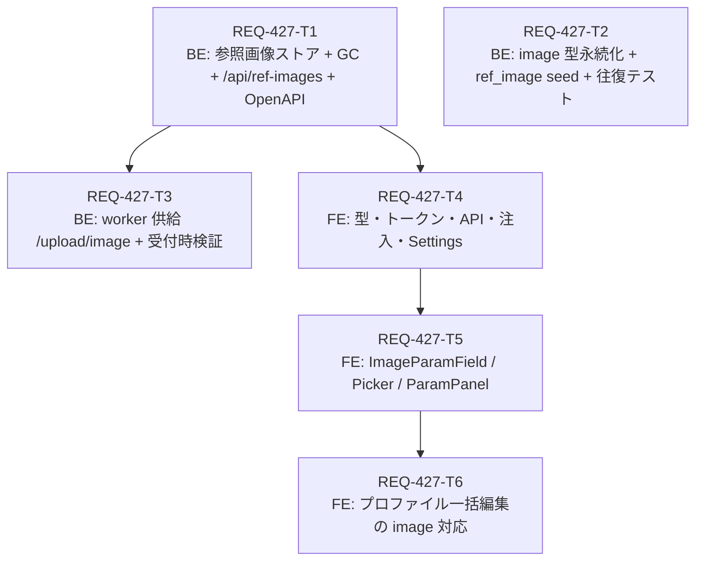

# Implementation Plan - REQ-427: 参照画像（ref画像）入力型・汎用ロールおよび画像選択UIの追加

## User Review Required

> [!IMPORTANT]
> **主要な設計判断（詳細は設計書 [REQ-427.md](docs/design/REQ-427.md)、テスト計画 [REQ-427-test-plan.md](docs/design/REQ-427-test-plan.md)）**
> - **画像値の保存形式 = 参照トークン文字列 `refimg:<sha256>.<ext>`**: 既存の role→文字列契約（プリセット値・Multi-Set・生成記録・Snapshot.params）をそのまま使い、スキーマ変更なしでプリセット/Multi-Set/履歴再現（AC-8）に乗せます。実体はバックエンドの内容アドレス型ストア（既定 `db/ref_images/`）に原本バイトのまま保存します。
> - **履歴・スナップショットからの選択は「取り込み（複製）」**: ComfyUI 出力は 200 件窓でパージされ得るため、選択時にストアへ複製してトークン化します。
> - **ComfyUI への供給は生成 worker の上流投入直前**: worker が `POST /upload/image` で供給し、ノード入力を `prompt_surgeon_ref/<sha256>.<ext>` へ置換してから `/prompt` へ投入します。未指定の欄はノード入力を上書きしません（AC-6）。供給失敗時は job を `failed` にし `/prompt` は送りません。
> - **受付時検証**: トークンがストアに無い場合は `POST /api/generation/batches` を 422 `ref_image_not_found` で全体拒否します（上流通信は受付時に行いません）。
> - **初期定義は起動時 seeder**: `ref_image`（`input_type: 'image'`、RuleSet `LoadImage`×`image`、main Variant）を冪等に追加します。`input_type` は自由文字列列のため DB migration は不要です。role 衝突 DB でも起動が失敗しないガードを入れます。
> - **未参照画像の自動クリーンアップ（GC）**: どこからも参照されず原本の更新から 72 時間を過ぎた画像を、起動後 60 秒と以降 6 時間ごとに削除します。参照の収集は保存場所を個別に列挙せず、DB の全テーブル・全列を走査してトークンを探す方式とし、将来の保存場所追加でも漏れません。収集が一部でも失敗したらその回は 1 件も削除しません。アップロード・取り込み・生成受付・画像表示のたびに猶予を延長し、削除直前にはロック下で再確認するため、操作中の画像は消えません。
> - **プロファイル一括編集で image 型を正式対応**: 一括編集のパラメータタブで、Generate と同じ画像入力部品（`ImageParamField`：サムネイル、履歴/スナップショット選択、アップロード、D&D、ペースト）を再利用して画像を選び、選択中の複数プリセットへ同じ画像を一括適用します。チェック ON かつ画像選択済みのロールだけを上書きし、未選択・チェック OFF は変更しません。保存は既存の一括適用経路（並列 PUT、途中失敗はエラー通知・成功分は保持）をそのまま使います。ピッカー表示中の Escape は一括編集モーダルを閉じません。
> - **ref_images を挟む理由（維持）**: 履歴 200 件窓のパージ対策、スナップショット WebP の劣化回避、ComfyUI 非依存、内容ハッシュ名による冪等性。
> - **リスク分類 high / V1 Baseline**: 新規公開 API・生成 worker・seed を含むため、Gate 2 フルスイートは常に必須です。

> [!WARNING]
> **ご判断いただきたい未解決事項**
> 1. GC は AC を変更せず設計上の決定として扱います（検証は AC-8 の保護に紐付け）。受入可否を明示したい場合は「AC-9: 未参照かつ猶予超過の画像が自動削除され、参照中・猶予内の画像は削除されない」を PBI に追加することを提案します。猶予 72 時間・周期 6 時間でよいか。
> 2. 一括編集での image 対応は現 AC-1〜8 の範囲外です。AC-9（GC）に加えて「AC-10: プロファイル一括編集で image 型の画像を選択（プレビュー・履歴/スナップショット選択・アップロード等）し、選択中の複数プリセットへ同一画像を一括適用できる。未選択時は当該ロールが変更されない」を PBI に追加することを提案します（それまでは検証を AC-3/4/5/8 に暫定紐付け）。
> 3. 初期 RuleSet は `LoadImage` のみです。`LoadImageMask` やカスタムノードは Settings の RuleSet 編集で追加する運用でよいか。
> 4. `LoadImage` を含む workflow の新規登録時、`ref_image` slot が既定で取り込まれます（未指定なら生成結果は不変、workflow 単位で無効化可能）。この既定で問題ないか。

---

## Proposed Changes

### Backend Subsystem

#### [REQ-427-T1: 参照画像ストア（保存・touch・GC）と /api/ref-images API、OpenAPI 生成物](docs/backlog/task/active/REQ-427-T1.md)
- `backend/app/services/ref_image_store.py`（新規）: トークン解析、Pillow による形式・サイズ・画素数検証、内容アドレス保存（原子的・冪等）、サムネイル生成。
- `backend/app/routers/ref_images.py`（新規）: `POST /upload`、`POST /import`（history/snapshot、パストラバーサル拒否）、`GET /{ref_id}`、`GET /{ref_id}/thumbnail`。
- `backend/app/services/ref_image_gc.py`（新規）: DB 全テーブル走査による参照収集、二段階収集＋ロック下 mtime 再確認による削除、fail-safe 中止、`gc_loop`（起動後 60 秒＋6 時間周期）。
- `backend/app/main.py`: router 登録と lifespan での GC タスク開始・終了。`backend/openapi.json` / `frontend/src/api/schema.ts` を再生成。
- テスト: `backend/tests/unit/test_ref_image_store.py`（PBT 含む）、`backend/tests/integration/api/test_ref_images.py`、`backend/tests/integration/services/test_ref_image_gc.py`（参照保持・猶予・fail-safe・並行・対象限定・列挙漏れ防止）。

#### [REQ-427-T2: image 型の永続化、ref_image 初期定義と seed 衝突ガード、プリセット/Snapshot 往復](docs/backlog/task/active/REQ-427-T2.md)
- `backend/app/seed_data.py`: `ref_image` seed を末尾追加。`backend/app/seeder.py`: role 衝突時のスキップガード。
- テスト: `test_workflows.py`（AC-1 永続化、AC-2 seed・scan・保存・衝突ガード）、`test_presets.py` / `test_snapshots.py`（AC-8 トークン往復）。

#### [REQ-427-T3: 生成 worker による ComfyUI 供給と受付時実在検証](docs/backlog/task/active/REQ-427-T3.md)
- `backend/app/services/comfy_generation_bridge.py`: `upload_image`（`POST /upload/image`）。
- `backend/app/services/ref_image_supply.py`（新規）: `collect_ref_ids` / `replace_ref_tokens` / `RefImageSupplier`。
- `backend/app/services/generation_service.py`: 受付時に `claim`（存在確認と猶予延長を原子的に実施）、欠落なら 422、worker の供給・置換・失敗時 `failed`（`/prompt` 非送信）。既存 Protocol・スキーマは不変。
- テスト: `test_comfy_generation_bridge.py`、`test_generation_service.py`（シナリオ・失敗注入・PBT）。

### Frontend Subsystem

#### [REQ-427-T4: 型・トークンユーティリティ・API クライアント・graph 注入・Settings 入力型](docs/backlog/task/active/REQ-427-T4.md)
- `frontend/src/utils/refImage.ts`（新規）、`frontend/src/api/domains/refImages.ts`（新規）、`client.ts` / `types.ts` / stage group の union 追加。
- `frontend/src/utils/workflowParamInjector.ts`: `image` はトークン時のみ注入、未指定は非上書き。初期値はトークン時のみ採用。
- `frontend/src/components/MappingMasterEditModal.tsx`: 標準型に「画像 (参照画像)」を追加（AC-1）。
- テスト: `refImage.test.ts`（fast-check）、`workflowParamInjector.test.ts`（AC-6/AC-7）、`generationRecord.test.ts`・`useWorkflowParams.test.ts`・`useGenerateAction.test.ts`（AC-8）、`MappingMasterEditModal.test.tsx`（AC-1）。

#### [REQ-427-T5: ImageParamField / RefImagePickerModal と ParamPanel 分岐](docs/backlog/task/active/REQ-427-T5.md)
- `frontend/src/components/ImageParamField.tsx`（新規）: サムネイル、履歴/スナップショット選択、アップロード、D&D、フォーカス時ペースト、失敗時の値保持、最終操作優先。
- `frontend/src/components/RefImagePickerModal.tsx`（新規）: 共通 Modal（モバイルはボトムシート）、履歴/スナップショットタブ、取り込み。
- `frontend/src/components/ParamPanel.tsx`: `input_type === 'image'` 分岐（Desktop/Mobile 共通）。
- テスト: `ImageParamField.test.tsx`、`RefImagePickerModal.test.tsx`、`ParamPanel.test.tsx`（AC-3/7/8）、E2E `frontend/e2e/generateParamImageField.spec.ts`（360px/1280px 実寸）。
- `ImageParamField` の props は mapping 型に依存しない共通契約（`label` / `fieldKey` / `onPickerOpenChange`）とし、T6 から再利用します。

#### [REQ-427-T6: プロファイル一括編集での image 型](docs/backlog/task/active/REQ-427-T6.md)
- `frontend/src/components/ProfileBulkEditModal/tabs/ParamBulkEditTab/ImageParamSection.tsx`（新規）: チェックボックス＋`ImageParamField` の薄いラッパー。
- `tabs/ParamBulkEditTab/index.tsx`: `image` ロールを `ImageParamSection` へ分岐（従来はテキスト入力になっていた）。
- `ProfileBulkEditModal/index.tsx`: 画像ピッカー表示中は Escape で一括編集モーダルを閉じない。
- 既存の `buildPayload.ts` / `presetBulkPatcher.ts` / `usePresetState.ts` は変更せず、トークンを通常の文字列値として一括適用。
- テスト: `ProfileBulkEditModal.test.tsx`、`usePresetState.test.ts`、E2E `frontend/e2e/profileBulkEditImage.spec.ts`（360px/1280px）。

---

## Task DAG

- 並列性: T1 と T2 は同時着手可能。T1 完了後に T3 と T4 を並列実行し、T4 完了後に T5、T5 完了後に T6。
- 最大深さ 4（T1→T4→T5→T6）で警告域です。各段は実際の型・部品の依存で、T6 は T5 の共通部品を再利用するため T5 の後になります。統合すると T5 が 300 行を超え、Generate 系と一括編集系のファイル所有が混在するため分割しています。
- ファイル所有は全カードで重複なし（設計書 §8 D3）。

---

## Trade-off Disclosure

| 論点 | 採用案 | 検討した代替案 | 採用理由 / 代償 |
|---|---|---|---|
| 画像値の表現 | トークン文字列 | JSON メタデータ、専用 DB テーブル | 既存契約を変えずに全保存経路へ乗る。出自（履歴/アップロード）情報は保持しない。 |
| 実体の保存 | 内容アドレス型ストア（原本保持） | Snapshot 画像（WebP q90）流用、ComfyUI input の直参照 | 制御画像の劣化回避・冪等・ComfyUI 状態に非依存。肥大化は GC で抑える。 |
| GC の参照収集 | DB 全テーブル・全列の汎用走査 | 保存場所ごとの個別列挙、参照カウント列 | 個別列挙は将来の追加で漏れて参照中画像を消す恐れ。参照カウントは全保存経路の改修とスキーマ変更が必要。走査負荷は 6 時間周期・別スレッドで許容。 |
| GC の猶予・契機 | 猶予 72 時間（mtime）＋ touch、起動後 60 秒＋6 時間周期 | 即時削除、手動削除のみ | ブラウザ側の未保存状態と競合を安全側で吸収。未参照画像は最長約 3 日強残る。 |
| GC を AC 化するか | AC は変更せず AC-8 の保護に紐付け | AC-9 を PBI に追加 | 受入可否を明示したい場合は AC-9 追加を推奨（ユーザー判断）。 |
| 一括編集での image 対応 | 共通 `ImageParamField` を薄いラッパーで再利用し、既存 `paramPatch` 経路で同一トークンを一括適用 | 一括編集専用 UI の別実装 / 一括適用専用 API | 二重実装を避け、選択体験・失敗時保持・UI 不変条件を共有。既存の部分適用セマンティクスと整合し、保存経路の変更が不要。 |
| 一括編集を AC 化するか | 現 AC は変更せず AC-3/4/5/8 に暫定紐付け | AC-10 を PBI に追加 | 現 AC の範囲外のため、AC-9 とあわせて AC-10 の追加を推奨（ユーザー判断）。 |
| ComfyUI 供給タイミング | worker の上流投入直前 | 選択時アップロード、受付時アップロード | ComfyUI 再起動・URL 変更に強く、受付が上流状態を待たない既存契約を維持。job ごとにアップロード通信が発生（同一内容は上書きで冪等）。 |
| graph 内の受け渡し | 文字列トークンを注入し worker で完全一致置換 | `BatchItem` に専用フィールド追加 | 公開スキーマ不変、生成記録にもトークンが残る。64 桁 hex 完全一致のため誤置換は実質なし。 |
| 初期定義の投入 | 起動時 seeder（冪等） | migration step | 列追加不要で既存 seed と同経路。role 衝突時はスキップガードで起動を守る。 |
| 履歴選択 | 原本（`/view`）優先、失敗時フルサイズ WebP キャッシュ | キャッシュのみ | 品質優先しつつ、ComfyUI 側で消えた画像も選択可能。 |

### Risks
- DB 外の参照（未保存ドラフト・Undo 履歴・閉じたタブ）が 72 時間を超えて残ると、その画像は GC で削除され得る。その場合は値を保持したまま「プレビューを表示できません」と生成時 422 `ref_image_not_found` で明示し、無断で画像なし生成はしない。
- 一括適用の一部プリセットで保存に失敗すると、適用済みと未適用が混在する（既存規則どおり通知。同一トークンの再適用で揃う）。一括編集で画像を選んだまま 72 時間超放置して適用すると、適用先でプレビュー不可・生成 422 になり得る。
- `LoadImage` を持つ workflow で `ref_image` 欄が既定表示される（未指定なら非上書きで生成不変、無効化可能）。
- 旧プロキシ `POST /api/comfy/prompt` はトークンを解決しない（Generate / Studio は `/api/generation/batches` のため影響なし）。
- 「既定値として保存」で workflow `json_body` にトークンが入るとアプリ外の ComfyUI 単体利用では無効なファイル名になる。
- Dataset Studio も `ParamPanel` を使うため画像欄が表示される（同じ供給経路で機能的に整合）。

---

## Verification Plan

### Automated Tests（V1 Baseline）
- Gate 1: `backend\.venv\Scripts\python.exe -m mypy backend` / `backend\.venv\Scripts\python.exe -m pytest backend/tests/unit` / `backend\.venv\Scripts\python.exe scripts/run_in_dir.py frontend npm.cmd exec -- vitest run src/utils src/components/**/__tests__` / `backend\.venv\Scripts\python.exe scripts/verify_ui_invariants.py` / `npm.cmd --prefix frontend run typecheck` / `backend\.venv\Scripts\python.exe scripts/verify_openapi_sync.py` / `backend\.venv\Scripts\python.exe scripts/verify_test_naming.py --strict`
- Gate 2: `backend\.venv\Scripts\python.exe scripts/run_full_suite.py`（ファイルフィルタなし、必須）
- Gate 3: `backend\.venv\Scripts\python.exe scripts/run_e2e.py` と テスト計画 §5 の Red Team シナリオ

### Spec Sync at Closure
- `docs/specs/SPEC_SETTINGS.md` §4-1、`docs/specs/SPEC_GENERATE.md` §2-5 / §2-9 / §5 / API 一覧 / 参照画像ストアと GC（新設節）、`docs/specs/SPEC_GENERATE.md` §2-6（プリセット一括編集の image 型）、`docs/specs/SPEC_COMMON.md` §5-4（ProfileBulkEditModal の構成・Escape 制御）、`docs/specs/SPEC_HISTORY.md` Snapshot params（設計書 §3）。
