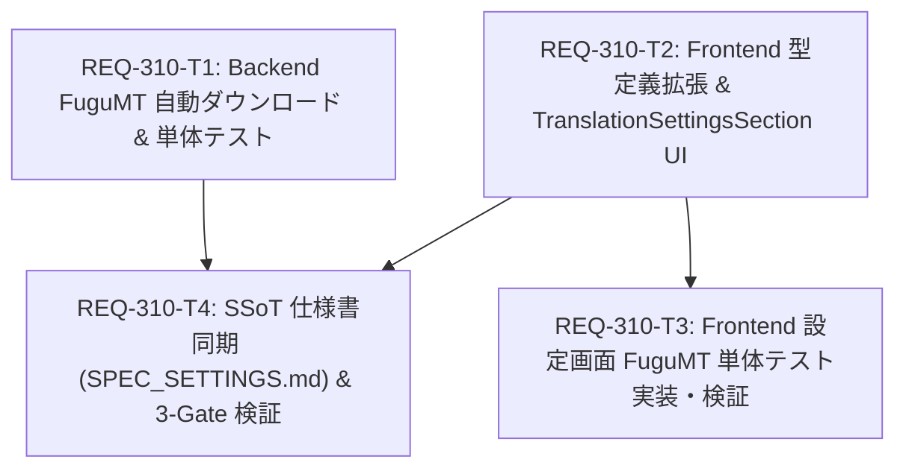

# Implementation Plan - REQ-310: 設定画面における FuguMT プロバイダ統合

設定画面（`TranslationSettingsSection.tsx`）の翻訳プロバイダー選択肢に、CPU常駐・超低レイテンシ（20〜30ms）・VRAM消費ゼロ（0MB）の「FuguMT（推奨 (CPU)）」を追加し、初使用時の自動モデルダウンロード・配置、UIからの選択・保存・接続テストおよびGenerate画面への高速和訳ルーティングを可能にする。

## Proposed Changes

#### [LOCAL MODIFY] [fugumt_service.py](file:///c:/Users/audih/ws/comfy-create-helper2/backend/app/services/fugumt_service.py)
- `FuguMTService` に `HF_REPO_ID = "jkawamoto/fugumt-en-ja-ct2"` を定義。
- `initialize()` メソッドにおいて、モデルディレクトリ（`models/fugumt-en-ja`）が存在しない場合に `huggingface_hub.snapshot_download` を用いて自動ダウンロード＆配置するロジックを実装。
- オフライン時や通信失敗時の例外安全ハンドリング（`return False`）を保証。

#### [LOCAL MODIFY] [test_fugumt_service.py](file:///c:/Users/audih/ws/comfy-create-helper2/backend/tests/test_fugumt_service.py)
- ディレクトリ未配置時の自動ダウンロード成功、失敗時の例外安全、および自動ダウンロード無効化の単体テストを追加。

#### [LOCAL MODIFY] [types.ts](file:///c:/Users/audih/ws/comfy-create-helper2/frontend/src/api/types.ts)
- `TranslateTestRequest.provider` 型定義に `'fugumt'` を追加。

#### [LOCAL MODIFY] [TranslationSettingsSection.tsx](file:///c:/Users/audih/ws/comfy-create-helper2/frontend/src/pages/SettingsPage/components/TranslationSettingsSection.tsx)
- `provider` state 型を `'google_cloud' | 'deepl' | 'llm' | 'fugumt'` に拡張。
- 翻訳プロバイダー選択カードに FuguMT（「推奨 (CPU)」バッジ付き）を追加（AC-1）。
- FuguMT 選択時に API キーおよびカスタム API URL 入力欄を非表示化し、「完全オフライン・CPU常駐推論のため、APIキーや外部URLの設定は不要です（初回利用時にモデルが自動配置されます）。」という案内文を表示（AC-2）。
- 保存処理（`saveSettingsMutation`）において、FuguMT 選択時は `llmPromptsApi.update('translation_provider', { content: 'fugumt' })` のみを実行し、不要な `translation_api_key` / `translation_api_url` ペイロードの送信を完全にスキップ（AC-2）。
- 疎通テスト（`handleTestConnection`）において、FuguMT 選択時は `{ provider: 'fugumt' }`（apiKey, apiUrl なし）をバックエンドへ送信（AC-3）。

#### [LOCAL MODIFY] [TranslationSettingsSection.test.tsx](file:///c:/Users/audih/ws/comfy-create-helper2/frontend/src/pages/SettingsPage/components/__tests__/TranslationSettingsSection.test.tsx)
- FuguMT ラジオカードおよび「推奨 (CPU)」バッジのレンダリングテスト（AC-1）。
- FuguMT 選択時の API キー・URL 入力欄非表示テスト（AC-2）。
- FuguMT 保存時に `translation_provider` のみ更新され、apiKey / apiUrl が送信されないことの検証（AC-2）。
- FuguMT 選択時の疎通テストペイロード（`{ provider: 'fugumt' }`）および成功結果描画の検証（AC-3）。
- 初期ロード時に DB の `translation_provider = 'fugumt'` が正しく反映されることの検証。

#### [LOCAL MODIFY] [SPEC_SETTINGS.md](file:///c:/Users/audih/ws/comfy-create-helper2/docs/specs/SPEC_SETTINGS.md)
- 第2章「機能一覧」の翻訳設定説明に FuguMT（CPU常駐・推奨・初回自動配置・APIキー不要）を追記。
- 第3章「レイアウト」および第6章「API呼び出し」テーブルに `fugumt` プロバイダ種別を同期。

---

## Task Dependency & Parallelization

- **並列性設計**:
  - `REQ-310-T1`（Backend 自動ダウンロード）と `REQ-310-T2`（Frontend UI実装）は対象サブシステム・ファイルが完全に直交しているため、**完全並列に実行可能**。
  - `REQ-310-T3`（Frontend 単体テスト）は `REQ-310-T2` 完了後に着手。
  - `REQ-310-T4`（仕様書同期・全体検証）は `REQ-310-T1` および `REQ-310-T2` 完了後に統合検証を実施。
- **タスク粒度**:
  - 各 Task Card は修正対象ファイル数 1〜2 件、行数 100 行前後に厳密に収め、密閉コンテキスト（Hermetic Context）と検証コマンドを完備。

---

## Verification Plan

### Gate 1: 静的型検査 (Baseline 0 errors)
- `cd frontend; npm run typecheck`
- `mypy backend`

### Gate 2: 単体テスト & 全体テストスイート (0 failures)
- `backend\.venv\Scripts\python -m pytest backend/tests/test_fugumt_service.py`
- `backend\.venv\Scripts\python -m pytest backend/tests/test_translation_proxy.py`
- `cd frontend; npx vitest run src/pages/SettingsPage/components/__tests__/TranslationSettingsSection.test.tsx`
- `cd frontend; npm test`
- `backend\.venv\Scripts\python -m pytest`

### Gate 3: シナリオ & Red Teaming (AC 100% 達成)
- 設定画面での FuguMT ラジオカード・推奨バッジ表示確認（AC-1）
- FuguMT 選択時の入力欄非表示および DB への `provider: "fugumt"` 保存確認（AC-2）
- FuguMT 接続テスト押下時のモデル自動ダウンロード＆疎通確認・成功サンプル表示（AC-3）
- Generate 画面での和訳実行時、ローカル LLM が呼び出されず FuguMT で 100ms 以内に高速応答することの確認（AC-4）
- Red Teaming: 初回自動ダウンロードのネットワーク障害ハンドリング（RT-1）、既存クラウドAPIキーの保持（RT-2）、連続クリック耐性（RT-3）、完全オフライン動作（RT-4）

---

## Trade-off Disclosure (トレードオフとリスクの開示)

1. **初回自動ダウンロードのサイズとレイテンシ**:
   - `jkawamoto/fugumt-en-ja-ct2` は CTranslate2 最適化済み int8 モデル一式で合計約 125MB です。
   - 一般的な光回線環境では 2〜5 秒程度でダウンロード完了しますが、初回のみ接続テストまたは初翻訳時に数秒のダウンロード待機が発生します。2回目以降はローカルキャッシュから 0ms でロードされるため、長期的な運用パフォーマンスへの悪影響はありません。
2. **既存 API キー保持と非送信のトレードオフ**:
   - FuguMT を選択して保存する際、DB 上の既存の `translation_api_key` / `translation_api_url` を空文字で上書き消去せず保持する設計としています。
   - メリット: 将来ユーザーが DeepL や Google Cloud に戻した際、再度長い API キーを再入力する手間を防止できる。
   - デメリット: DB レコード上には過去の API キーが残存するが、`translation_provider` が `'fugumt'` である限りバックエンドは API キーを参照しないためセキュリティ・動作上の実害はない。
3. **オフライン環境での初回起動**:
   - 初回モデルダウンロード前に PC が完全オフラインである場合、自動ダウンロードが失敗し、バックエンドは例外をキャッチして安全に `TranslateTestResponse(success=False, error="FuguMT engine is not available")` を返却します。
   - UI はこれを赤色エラーバナーとして表示し、アプリのクラッシュを完全防止しながらネットワーク接続またはモデル配置の必要性を伝達します。

