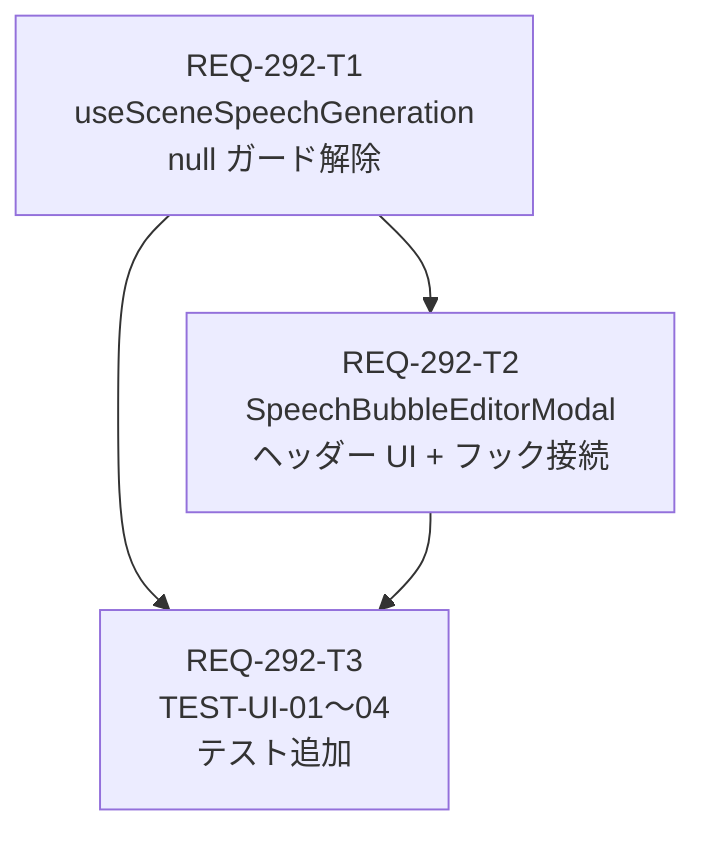

# REQ-292 実装計画書

## Acceptance Criteria (承認基準)

| AC | 内容 | 担当タスク |
|---|---|---|
| AC-1 | ヘッダーに「シーン一括生成」ボタン描画（Sparkles + disabled + loading spinner） | T2 |
| AC-2 | `useSceneSpeechGeneration` 接続、クリックで `handleBatchGenerateClick` 発火 | T2 |
| AC-3 | `primaryTagSetId=null` でも API 呼出継続（サイレント終了しない） | T1 |
| AC-4 | モバイル「編集設定」タブ中の生成完了後 `setActiveMobileTab('preview')` 自動発火 | T2 |
| AC-5 | TEST-UI-01〜04 全 PASS、`npm run typecheck` エラー 0 件 | T3 |

---

## タスク DAG (依存関係グラフ)



**最大依存深度**: 2 層 (T1 → T2 → T3)  
**並列可能**: T1 は独立実行可能 (依存なし)

---

## タスク詳細

### REQ-292-T1: `useSceneSpeechGeneration` null ガード解除
- **対象**: `frontend/src/hooks/useSceneSpeechGeneration.ts`
- **変更**: L28 `if (!primaryTagSetId) return;` を `if (primaryTagSetId != null) { ... } else { null ルート }` に変更
- **カードパス**: `docs/backlog/pbi/active/REQ-292/REQ-292-T1.md`
- **検証**: `npx vitest run src/hooks/__tests__/useSceneSpeechGeneration.test.ts`
- **依存**: なし

### REQ-292-T2: モーダルヘッダー UI + フック接続
- **対象**: `frontend/src/components/SpeechBubbleEditorModal/index.tsx`, `types.ts`
- **変更**: props 拡張 + `Sparkles`/`Loader2` import + `useSceneSpeechGeneration` 接続 + ヘッダーボタン追加 + モバイルタブ遷移
- **カードパス**: `docs/backlog/pbi/active/REQ-292/REQ-292-T2.md`
- **検証**: `npx vitest run src/components/__tests__/SpeechBubbleEditorModal.test.tsx`
- **依存**: T1

### REQ-292-T3: TEST-UI-01〜04 追加
- **対象**: `frontend/src/components/__tests__/SpeechBubbleEditorModal.test.tsx`
- **変更**: `speechBubblePresetsApi.getByTagSetId` モック追加 + TEST-UI-01〜04 describe ブロック追加
- **カードパス**: `docs/backlog/pbi/active/REQ-292/REQ-292-T3.md`
- **検証**: `npx vitest run src/components/__tests__/SpeechBubbleEditorModal.test.tsx --reporter=verbose`
- **依存**: T1, T2

---

## トレードオフ開示 (Trade-off Disclosure)

### 1. null ガード方式の選択

| 方式 | 採用/却下 | 根拠 |
|---|---|---|
| `if (!primaryTagSetId) return` 完全削除 | 却下 | `0` の場合も null ルートに落ちてしまう型安全性の問題 |
| `if (primaryTagSetId != null)` 分岐 | **採用** | `null` と `undefined` のみを除外し、`0` は正しく通常ルートに流れる |
| 呼び出し側で undefined チェック | 却下 | フック内部で完結すべき単責原則に反する |

### 2. generateDraftApi / applyPresetToBubbles の注入方式

| 方式 | 採用/却下 | 根拠 |
|---|---|---|
| Props 経由で注入（オプション） | **採用** | テスト容易性・疎結合・既存呼び出し側を無変更に保てる |
| フック内でハードコード | 却下 | テストで実際 API が呼ばれてしまう、モック不可 |
| Context API で注入 | 却下 | このスケールには過剰設計 |

**Default fallback**: `generateDraftApi` が未注入の場合は `() => Promise.resolve({ bubbles: [] })` を使用し、エラーなく graceful 処理。

### 3. モバイルタブ遷移の管理場所

| 方式 | 採用/却下 | 根拠 |
|---|---|---|
| フック (`useSceneSpeechGeneration`) 内で管理 | 却下 | フックが UI state (`activeMobileTab`) を知る必要があり単責違反 |
| モーダル側の `onClick.finally()` で管理 | **採用** | フックの単責原則維持。`handleBatchGenerateClick()` が Promise を返すことを利用 |

---

## リスク評価

| リスク | 確率 | 対策 |
|---|---|---|
| `handleBatchGenerateClick` の Promise 化（現在 void） | 中 | T1 で戻り値型を `Promise<void>` に明示。T2 で `.finally()` 使用 |
| 既存フックテスト (`does nothing if primaryTagSetId is not provided`) のリグレッション | 低 | AC-3 変更後も `primaryTagSetId=null` でフック内に入り API 呼出するが、既存テストは `null` で `getByTagSetId` が呼ばれないことを検証 → null ルートで分岐するため互換 |
| `speechBubblePresetsApi.getByTagSetId` が既存モックに未定義 | 中 | T3 で vi.mock 拡張を明示 |

---

## 検証コマンド一覧

```bash
# T1 検証
cd frontend && npx vitest run src/hooks/__tests__/useSceneSpeechGeneration.test.ts

# T2/T3 検証
cd frontend && npx vitest run src/components/__tests__/SpeechBubbleEditorModal.test.tsx --reporter=verbose

# 全体型チェック
cd frontend && npm run typecheck

# フルスイート
cd frontend && npm test
```
