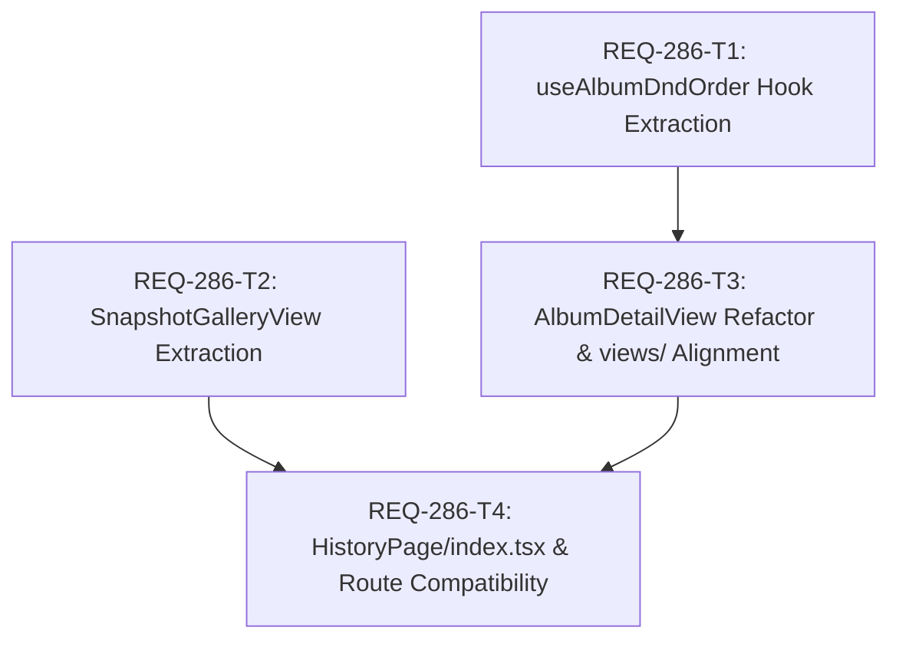

# Implementation Plan - REQ-286: HistoryPage のビュー分離（ギャラリー vs アルバム詳細）

## Executive Summary
`HistoryPage.tsx` は 842 行に及び、全スナップショット一覧（検索フィルタ、無限スクロール、一括操作、Lightbox、セリフ編集）と、アルバム詳細・並び替え（Dnd-kit、グループ移動、昇順降順、一括削除スコープ）という 2 つの独立したユースケースが 1 つのファイルに混在し、状態・JSX の肥大化を招いている（リファクタ計画 PBI-REF-05）。
本計画では、以下の 4 タスクにアトミック分割し、物理的な責任分離を実施する：
1. **Dnd並び替えロジックのカスタムフック化 (`useAlbumDndOrder.ts`)**: 単一ドラッグおよび複数選択グループ移動アルゴリズムを抽出し、単体テストを整備。
2. **全スナップショット一覧のコンポーネント分離 (`SnapshotGalleryView.tsx`)**: フィルタバー・グリッド描画・無限スクロールを独立ビューとして切り離し。
3. **アルバム詳細ビューの配置整理・フック統合 (`AlbumDetailView.tsx`)**: Dndフックとの結合とディレクトリ構造（`views/`）の適合。
4. **親コンテナ軽量化とルーティング互換性担保 (`HistoryPage/index.tsx` & `HistoryPage.tsx`)**: 共通クエリ・モーダル制御に特化させ、既存エントリからの完全な後方互換 re-export を保証。

---

## Architectural Design & DAG Dependency Graph

- **最大依存深度**: 2層（T1 -> T3 -> T4 / T2 -> T4）
- **並行性**: T1（Dndフック分離）と T2（スナップショット一覧ビュー分離）は完全に直交しており並行着手可能。T3（アルバム詳細ビュー）は T1 完了後に着手し、T4（親コンテナ統合）で全体を統合。

---

## Task Decomposition & Atomicity Audit

| Task ID | タイトル | 変更対象ファイル (<= 3) | 推定行数 (<= 300) | 検証コマンド |
|---|---|---|---|---|
| **REQ-286-T1** | アルバム内Dnd並び替えロジックのカスタムフック（useAlbumDndOrder）分離 | `frontend/src/pages/HistoryPage/hooks/useAlbumDndOrder.ts` `frontend/src/pages/HistoryPage/hooks/__tests__/useAlbumDndOrder.test.ts` | 約90行 | `cd frontend && npx vitest run src/pages/HistoryPage/hooks/__tests__/useAlbumDndOrder.test.ts` |
| **REQ-286-T2** | 全スナップショット一覧ビュー（SnapshotGalleryView）のコンポーネント分離 | `frontend/src/pages/HistoryPage/views/SnapshotGalleryView.tsx` `frontend/src/pages/HistoryPage/views/__tests__/SnapshotGalleryView.test.tsx` | 約250行 | `cd frontend && npx vitest run src/pages/HistoryPage/views/__tests__/SnapshotGalleryView.test.tsx` |
| **REQ-286-T3** | アルバム詳細ビュー（AlbumDetailView）の配置整理とDndフック統合 | `frontend/src/pages/HistoryPage/views/AlbumDetailView.tsx` `frontend/src/pages/HistoryPage/components/AlbumDetailView.tsx` | 約150行 | `cd frontend && npx vitest run src/pages/__tests__/HistoryPage.test.tsx` |
| **REQ-286-T4** | HistoryPage親エントリの軽量化統合・ルーティング後方互換性担保 | `frontend/src/pages/HistoryPage/index.tsx` `frontend/src/pages/HistoryPage.tsx` | 約140行 | `cd frontend && npm run typecheck && npx vitest run src/pages/__tests__/HistoryPage.test.tsx` |

**アトミシティ判定**: 全タスクが「変更ファイル数 3以下」「総行数 300行以下」を満たしており **PASS**。

---

## Trade-off Disclosure & Technical Decisions

### 1. ディレクトリ構造とインポート互換性の両立
- **検討**:
  - `frontend/src/pages/HistoryPage.tsx` を直接 `frontend/src/pages/HistoryPage/index.tsx` に置き換えるか、あるいは既存ファイルを薄いラッパーとして残すか。
- **決定理由**:
  - `App.tsx` や既存の `HistoryPage.test.tsx` は `import { HistoryPage } from './pages/HistoryPage'` を参照している。
  - `frontend/src/pages/HistoryPage/index.tsx` を真の SSoT 実装とし、`frontend/src/pages/HistoryPage.tsx` は `export * from './HistoryPage/index'` とする。
  - さらに `toSafeImageUrl` と `toThumbnailUrl` も同時に re-export することで、外部モジュールやテストの型・関数参照を一切破壊しない。

### 2. 共通モーダル（Lightbox / セリフ編集 / 一括削除）の状態保持レイヤー
- **検討**:
  - 各ビュー（`SnapshotGalleryView`, `AlbumDetailView`）の内部に各モーダルを持たせるか、親コンテナ（`HistoryPage/index.tsx`）で一括管理するか。
- **決定理由**:
  - セリフ編集モーダルや Lightbox、アルバム追加モーダルは、スナップショット一覧とアルバム詳細の両方から同一の操作体系でトリガーされる。
  - モーダル状態をビュー側に重複配置すると、QueryClient の invalidate や状態同期が二重化してバグの原因になるため、親コンテナ（`index.tsx`）がモーダル群を一元ホストし、ビューにはトリガーコールバックを渡す設計とする。

### 3. ビュー遷移時における MultiSelect 選択状態の残留防止
- **検討**:
  - スナップショット一覧で複数選択した状態で「Albums」タブへ遷移したり、アルバム詳細へ入った場合に選択状態が意図せず残存するリスク（BA 監査指摘事項）。
- **決定理由**:
  - タブ切り替え（`setView`）およびアルバム詳細進入/脱出（`setSelectedAlbumId`）のトリガー時に `exitMultiSelectMode()` を明示的に呼び出し、選択状態のリークを確実に防止する。

---

## Local Model BA Audit Reflection
- **実施モデル**: `qwen3.5-9b-claude-4.6-highiq-instruct-heretic-uncensored` (Domain: Reasoning, Verdict: Approved with Technical Edge-Case Guidance 88/100)
- **監査結果の反映**:
  1. **複数選択状態のリーク防止**: ビュー遷移（Snapshots ↔ Albums ↔ AlbumDetail）時の `exitMultiSelectMode` クリーンアップを設計に反映。
  2. **ソート方向反転とDnd計算**: `useAlbumDndOrder` 内で `desc` ソート時の ID 反転計算をユニットテストで厳密にカバーすることをタスク要件に明記。
  3. **ルーティング・ヘルパー互換性**: `toSafeImageUrl` / `toThumbnailUrl` の re-export を明示し、REQ-267 等の既存テストが一切壊れない構造を保証。
- **GPUリソース解放**: `local_model_adapter.py unload` を実行し、VRAM 100% 解放確認完了（Exit Code 0）。

