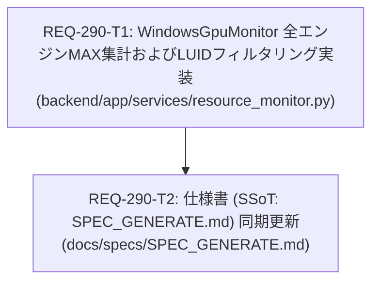

# Implementation Plan: REQ-290 リソース監視 GPU使用率算出是正 (3D偏重解消および全エンジンMAX採用)

## User Review Required

> [!IMPORTANT]
> **本改修の要点**:
> - ComfyUI やローカル LLM（LM Studio / Ollama）等の AI 推論処理はグラフィックスパイプライン（3D エンジン）を使用せず、汎用計算ユニット（Compute エンジン）のみで動作します。
> - 現行の Prompt Surgeon は PDH カウンターが `*engtype_3D` に固定されているため、推論フル稼働時でも使用率が 0% と誤認されていました。
> - 本改修により、PDH カウンターを全エンジン監視（`\GPU Engine(*)\Utilization Percentage`）に拡張し、DXGI で特定したプライマリ GPU の LUID で他アダプターのノイズを除外した上で、物理エンジン毎のプロセス合算値から最大値（MAX across all engines）を抽出するタスクマネージャー準拠の算出ロジックへと刷新します。

---

## Architectural Analysis & Trade-offs

### 1. 算出方式のトレードオフ
- **全エンジン単純合算 (SUM) vs エンジン別合算の最大値 (MAX)**:
  - 単純合算を採用した場合、複数エンジン（3D + Compute + Copy）が同時に稼働した際に合計が容易に 100% を超過し、物理的な GPU 占有率として直感に反する値となります。
  - Windows タスクマネージャーの「GPU 全体使用率 (Overall GPU Utilization)」は、物理エンジン単位でプロセスを合算した値のうち最も逼迫しているエンジンの値（MAX）を採用しています。本設計でもタスクマネージャーと完全準拠の MAX 方式を採用し、ComfyUI / LLM 推論時の負荷を正確に捉えます。

### 2. マルチ GPU / マルチアダプター環境への対応
- **無差別全取得 vs DXGI LUID フィルタリング**:
  - `\GPU Engine(*)\Utilization Percentage` に拡張すると、CPU 内蔵グラフィックス（iGPU）や仮想ディスプレイドライバーのエンジンインスタンス（500件以上）も同時に列挙されます。
  - アダプター不問で集計した場合、別 GPU の負荷が混入するリスクがあります。
  - 本設計では、起動時に DXGI から特定したプライマリ GPU の `AdapterLuid`（例: `0x00000000_0x00011e9f`）を保持し、szName 文字列照合により他アダプターのインスタンスを厳密にスキップします。

### 3. サンプリングオーバーヘッド
- インスタンス数が約 50 件から 500 件超へと増加しますが、Ctypes ネイティブメモリ配列の線形走査（Python 内での文字列走査と辞書加算）は 0.3ms〜0.5ms 程度で完了し、2.5 秒のサンプリング周期および FastAPI イベントループに与える影響は皆無です。

---

## Dependency Analysis (DAG Topology)



- **最大深度**: 2 レイヤー
- **独立性**: T1（バックエンド実装）完了後、仕様書（T2）の SSoT 同期を実施する。

---

## Task List & Atomicity Audit

| Task ID | タイトル | 変更対象ファイル | 変更行数見込み | アトミシティ判定 | 検証コマンド |
|---|---|---|---|---|---|
| **REQ-290-T1** | WindowsGpuMonitor 全エンジンMAX集計およびLUIDフィルタリング実装 | `backend/app/services/resource_monitor.py` (1ファイル) | 約40行 | **PASS** (<=3ファイル, <=300行) | `& "backend\.venv\Scripts\python.exe" -m pytest backend/tests/test_ws.py` |
| **REQ-290-T2** | 仕様書 (SSoT: SPEC_GENERATE.md) 同期更新 | `docs/specs/SPEC_GENERATE.md` (1ファイル) | 約10行 | **PASS** (<=3ファイル, <=300行) | `python C:\Users\audih\.gemini\antigravity\scripts\doc_mapper.py docs/specs docs/backlog/pbi/active/REQ-290.md` |

---

## Verification Plan

### 1. 自動テスト (Gate 2: Unit & Regression)
- コマンド: `backend\.venv\Scripts\python -m pytest backend/tests/test_ws.py`
- 期待値: 終了コード 0、全件 PASS。

### 2. 実機サンプリング検証 (Gate 3: Baseline Integration)
- コマンド:
  ```powershell
  & "c:\Users\audih\ws\comfy-create-helper2\backend\.venv\Scripts\python.exe" -c "import sys; sys.path.insert(0, 'backend'); from app.services.resource_monitor import WindowsGpuMonitor; import time; m = WindowsGpuMonitor(); assert m.primary_luid_hex is not None; time.sleep(0.2); res = m.collect(); print('collect:', res); assert res[0] is not None and 0.0 <= res[0] <= 100.0; m.close()"
  ```
- 期待値: プライマリ GPU の LUID が抽出され、`gpu_pct` が正常に取得されること。

### 3. Red Teaming (異常系フォールバック)
- PDH クエリ取得例外注入時にも WebSocket 配信がクラッシュせず、`gpu_pct: None` として CPU/RAM 配信が安全に継続すること。
