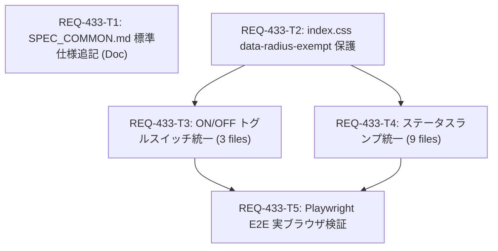

# REQ-433 Implementation Plan: モバイル表示におけるステータスランプ・トグルスイッチの標準デザイン定義およびUI改善

## 1. Overview & Feasibility
- **PBI**: [REQ-433](docs/backlog/pbi/active/REQ-433.md)
- **設計書**: [REQ-433 設計書](docs/design/REQ-433.md)
- **テスト計画**: [REQ-433 テスト計画](docs/design/REQ-433-test-plan.md)
- **実現可能性**: **Feasible**。`frontend/src/index.css` における `button` セレクタへの無条件角丸上書き（`8px`）およびモバイル時 `min-width/min-height: 44px` 強制が、トグルスイッチとドット型ステータスランプの角丸正方形化の根本原因であることを特定した。`data-radius-exempt` / `data-tap-target-exempt` の整合と 44×44px Hit-Slop 適用により全画面で標準デザインを統一できる。

## 2. Task Decomposition & Mermaid DAG
- `REQ-433-T1` (Document Card — `doc-architect` 担当): `docs/specs/SPEC_COMMON.md` への標準仕様追記
- `REQ-433-T2` (Code Card): `frontend/src/index.css` の `button:not([data-radius-exempt])` 対応
- `REQ-433-T3` (Code Card): 全 ON/OFF トグルスイッチ（3 ファイル）のピル型・Hit-Slop・ARIA 統一
- `REQ-433-T4` (Code Card): 全ステータスランプ（9 ファイル）の正円保護・`shrink-0`・`SystemStatusBadge` Hit-Slop 統一
- `REQ-433-T5` (Code Card): Playwright E2E モバイル/デスクトップ実計算スタイル検証

## 3. Trade-offs & Risks
1. **CSS `!important` 不使用の選択**:
   - `scripts/verify_ui_invariants.py`（`rule-no-indiscriminate-important`）に準拠するため、`index.css` 側で `:not([data-radius-exempt])` を付与する方式を採用した。これにより既存モーダルや一般ボタンの 8px 角丸契約への副作用を最小化している。
2. **既存 DOM 構造の維持 vs 共通スイッチコンポーネント新設**:
   - `VramGuardSection`（`<label>` + `<input type="checkbox">`）と `ParamPanel` / `ParamFieldControl`（`<button>`）で既存マークアップが異なるため、既存テスト・レイアウトへの影響を最小化する目的で既存 DOM 構造を維持しつつ `role="switch"`・`data-radius-exempt`・Hit-Slop 契約を統一した。
3. **Hit-Slop 寸法の精密設計**:
   - `h-5 w-9`（36×20px）に従来の `-inset-2`（±8px）を使うと高さが 36px に留まるため、`before:-inset-x-2 before:-inset-y-3`（52×44px）を採用した。`h-4 w-7` には `before:-inset-x-2 before:-inset-y-3.5`（44×44px）、`SystemStatusBadge` の 7×7px ドットには `before:-inset-[19px]`（45×45px）を採用する。

## 4. Verification Contract (V1 Default Baseline)
- **Gate 1**: `verify_ui_invariants.py` / `verify_test_naming.py --strict` / `npm run typecheck`
- **Gate 2**: `cd frontend; npm test`（全件フィルタなし実行）
- **Gate 3**: `run_e2e.py frontend/e2e/settingsResponsive.spec.ts` および `generateMobileGallery.spec.ts`