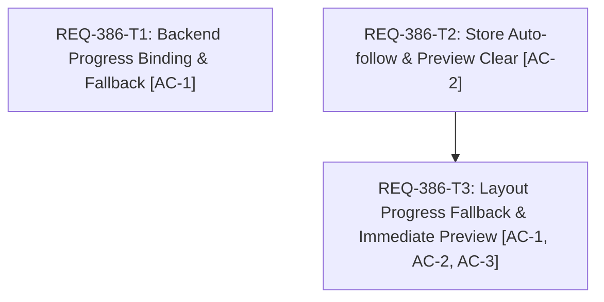

# Implementation Plan: REQ-386 生成中ステップ進捗（個別プログレスバー）の停止および次画像完了までのプレビュー表示遅延の解消

## 1. Overview & Objectives (概要と目的)
画像生成中に個別のノード/ステップ進捗（個別プログレスバー）が停止したまま動かず、さらにバッチ生成等において直前の生成画像のプレビューが次の画像の生成完了タイミングまで表示されない（または大幅に遅延する）問題を解消する。

## 2. Architecture & Seam Map (設計方針とSeam Map)
- **Integrated (実コード実行)**:
  - `backend/app/services/generation_service.py`: `on_event` の `progress` イベント受信時の `prompt_id` 解決フォールバックおよびノード進捗更新。
  - `frontend/src/store/slices/connectionSlice.ts`: `autoFollowImage` 発生時の旧 `previewImage` 即時解除。
  - `frontend/src/pages/GeneratePage/hooks/useGenerateDisplayState.ts`: モーダル自動追従URLの消費タイミング制御。
  - `frontend/src/pages/GeneratePage/components/DesktopLayout.tsx`: 個別進捗率フォールバックおよび `selectedImg` 即時プレビュー供給。
  - `frontend/src/pages/GeneratePage/components/MobileLayout.tsx`: 個別進捗率フォールバック。
- **Severed (外部I/O遮断)**:
  - ComfyUI HTTP/WS API: `FakeBridge` / `httpx.AsyncClient` モックで切断。
  - ブラウザ WebSocket: `applyGenerationSnapshot` / `wsHelpers` によるステート注入。
- **PBT判定**: 不採用（No）。進捗パーセンテージ計算（`Math.min(100, Math.max(0, ...))`）のクランプおよび境界値テストで網羅。
- **Fault Injection**:
  - `progress` イベント受信時に `prompt_id` が存在しないケース。
  - `node` が数値型 `10` や `None` で送られるケース。
  - `value > max` や `max == 0` の異常進捗データが送られたケース。
  - 画像生成完了直後に後続ジョブが未初期化（preview_url: null）の状態で snapshot が届くケース。

## 3. Task Breakdown & Mermaid DAG (タスク分解とDAG)
- **REQ-386-T1**: GenerationService.on_eventのprogressイベントprompt_id/nodeバインド強化およびactive jobフォールバック [change_kind: code]
  - 対象: `backend/app/services/generation_service.py`, `backend/tests/integration/legacy/test_generation_service.py`
  - AC: AC-1
- **REQ-386-T2**: connectionSliceのautoFollowImage契機previewImage即時解除およびuseGenerateDisplayStateの自動追従URL保持 [change_kind: code]
  - 対象: `frontend/src/store/slices/connectionSlice.ts`, `frontend/src/pages/GeneratePage/hooks/useGenerateDisplayState.ts`, `frontend/src/store/__tests__/slices/connectionSlice.test.ts`
  - AC: AC-2
- **REQ-386-T3**: DesktopLayoutおよびMobileLayoutの個別進捗バーフォールバック表示とプレビュー即時表示統合 [change_kind: code]
  - 対象: `frontend/src/pages/GeneratePage/components/DesktopLayout.tsx`, `frontend/src/pages/GeneratePage/components/MobileLayout.tsx`, `frontend/src/pages/GeneratePage/components/__tests__/GenerationProgress.test.tsx`
  - AC: AC-1, AC-2, AC-3

## 4. Technical Trade-offs & Alternatives (技術的トレードオフと代替案)
- **ComfyUI progress 受信時の prompt_id フォールバック**:
  - *採否*: 採用。ComfyUI 標準では progress イベントに `prompt_id` が含まれない場合があり、都度 `/queue` HTTP照会を走らせると 30ms 毎のステップ更新パケットに対して大量の不要なHTTPリクエストが発生し、ネットワークの飽和や進捗イベントの脱落を招く。単一の実行中ジョブが存在する場合はその `prompt_id` に即座に紐付けることで、低負荷かつリアルタイムな反映を実現する。
- **autoFollowImage 発生時の previewImage 即時解除**:
  - *採否*: 採用。バッチ処理で次ジョブが開始された直後、次ジョブのプレビューフレームが未到着の間に旧ジョブの中間プレビューが残存すると、完了原画（`selectedImg`）が覆い隠されてしまう。完了画像が得られた時点で `previewImage` を直ちに null 化し、原画を最優先でプレビュー表示する。後続ジョブが実際のフレームを受信した場合は正しく上書きされるため仕様整合性も保たれる。
- **DesktopLayout での effectiveDisplayImages 合成**:
  - *採否*: 採用。TanStack Query のキャッシュ反映と React レンダリングの極小のタイムラグにより、完了直後に `images.indexOf(selectedImage)` が -1 になるのを防止する。完了画像 `selectedImg` を先頭に付加した一時配列を供給することで、完了の瞬間から 1 秒以内（即時）にメインプレビューへ新画像がレンダリングされることを保証する。

## 5. Verification Plan (3-Gate検証計画)
- **Gate 1: 静的型チェック & 命名規約**
  - バックエンド型検査: `mypy backend`
  - フロントエンド型検査: `npm run typecheck`
- **Gate 2: ユニット＆結合テストスイート**
  - バックエンド: `pytest backend/tests/integration/legacy/test_generation_service.py`
  - フロントエンド: `npm test -- src/store/__tests__/slices/connectionSlice.test.ts src/pages/GeneratePage/components/__tests__/GenerationProgress.test.tsx --run`
- **Gate 3: シナリオ受け入れ検証**
  - `[REQ-386/AC-1]`: 個別ノード進捗（サンプラー進捗）がリアルタイムに 0%〜100% へ進行表示されることの検証。
  - `[REQ-386/AC-2]`: バッチ生成時、1枚目完了時に次ジョブの完了を待たずに 1 秒以内にプレビュー領域へ即時表示（auto-follow）されることの検証。
  - `[REQ-386/AC-3]`: 全ジョブ完了時に全体・個別進捗バーが共に 100% 完了状態となり、最新画像がプレビュー表示されていることの検証。

## 6. BA Design Audit Results & Disposition (BA設計監査結果と対応)
- **監査モデル**: `qwen/qwen3.5-9b` (LM Studio, `--context-length 32768`)
- **パッケージ**: `scratch/req386_audit_pkg_v14.json` (`sha256: 6397715d5c3014f88f2e09710df3c3e54987548b9075f1179cc11c548203eed1`)
- **監査判定ステータス**: `ISSUES_FOUND` (6 件の指摘)
- **指摘事項と対応方針 (Disposition)**:

| 指摘ID | 対象 | 対象AC | 指摘内容概要 | 対応方針 (Disposition) | 詳細対応内容 |
| :--- | :--- | :--- | :--- | :--- | :--- |
| **F-001** | `REQ-386-test-plan.md` | AC-1 | Gate 2 ユニットテストにおける進捗イベントUI伝播の具体的ケース明記 | `resolved` | Section 2「ケース名タグ定義」および Task Card T3 にて `[REQ-386/AC-1]` タグ付きテストケースを定義し、UI へのリアルタイム伝播検証を網羅。 |
| **F-002** | `REQ-386-test-plan.md` | AC-2 | プレビュー自動追従の1秒以内表示および旧フレーム保護の検証明記 | `resolved` | Section 2 および Task Card T2/T3 にて `[REQ-386/AC-2]` タグ付きテストケースを定義し、1秒以内の即時レンダリングと旧プレビュー即時解除を検証。 |
| **F-003** | `REQ-386-test-plan.md` | AC-3 | 単体・複数完了時の全体および個別プログレス双方の100%表示検証 | `resolved` | Section 2 および Section 3「境界値テスト 4」にて `[REQ-386/AC-3]` タグ付きテストケースを定義し、全体・個別プログレス双方の100%固定と最新画像維持を検証。 |
| **F-004** | `REQ-386.md` | AC-1 | 個別進捗率計算・ゼロ除算回避の具体的ロジックの明記 | `resolved` | `REQ-386.md` Section 2 および Task Card T1/T3 にて `Math.min(100, Math.max(0, ...))` によるクランプ計算式およびゼロ除算ガードを明記。 |
| **F-005** | `REQ-386.md` | AC-2 | 1秒以内プレビュー反映を満たすステート更新ロジックの明記 | `resolved` | `REQ-386.md` Section 2 および Task Card T2 にて `autoFollowImage` 遷移時の `previewImage = null` 即時解除と `pendingAutoFollowUrl` 保持制御を明記。 |
| **F-006** | `REQ-386.md` | AC-3 | 全ジョブ完了時の状態整合を満たす実装ロジックの明記 | `resolved` | `REQ-386.md` Section 2 および Task Card T1/T3 にて `status == 'succeeded'` 時のプログレス100%維持と最新画像プレビュー整合ロジックを明記。 |