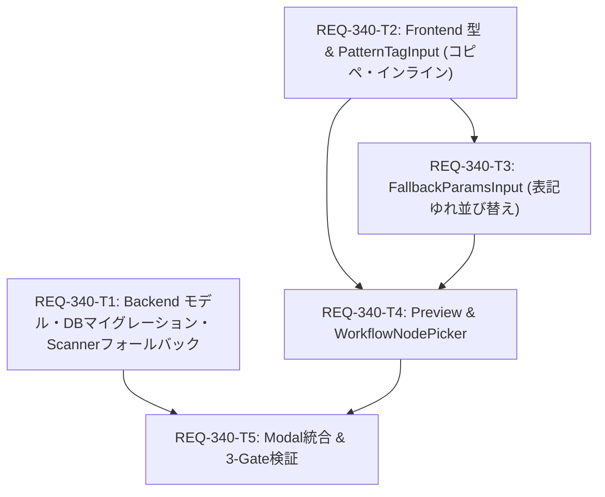

# Implementation Plan: REQ-340 Settingsマッピングマスタ編集のUX強化

## 1. Overview & Objectives (概要と目的)
本実装計画は、`REQ-340` に基づき、Settingsページにおけるマッピングマスタ編集の運用性を抜本的に向上させるためのアーキテクチャ・コンポーネント改修を定義します。
- タイトル検索パターンのクリップボード一括コピー＆ペースト（カンマ/改行区切り展開）およびインライン編集
- パラメータ表記ゆれ（`fallback_param_names`）の優先順フォールバック解決（DB・バックエンド・フロントエンド）
- 登録済みワークフローまたは新規JSON（最大10MB）を指定したコンテキスト連動リアルタイムプレビュー
- ワークフローからの逆引きノード・引数エクスプローラ（上書きガード付きワンクリック自動転記）

---

## 2. Proposed Changes & File Identification (変更対象ファイル)

### Backend (Subsystem: backend)
#### [LOCAL MODIFY] [backend/app/models.py](file:///c:/Users/audih/ws/comfy-create-helper2/backend/app/models.py)
- `MappingMaster` モデルに `fallback_param_names: Mapped[Optional[str]] = mapped_column(Text, nullable=True)` を追加

#### [LOCAL MODIFY] [backend/app/migrations/steps.py](file:///c:/Users/audih/ws/comfy-create-helper2/backend/app/migrations/steps.py)
- `mapping_masters` テーブルに `fallback_param_names TEXT` カラムを追加する冪等マイグレーションステップを追加

#### [LOCAL MODIFY] [backend/app/schemas/workflow.py](file:///c:/Users/audih/ws/comfy-create-helper2/backend/app/schemas/workflow.py)
- `MappingMasterBase`, `MappingMasterCreate`, `MappingMasterRead` に `fallback_param_names: Optional[list[str]] = None` を追加

#### [LOCAL MODIFY] [backend/app/routers/mapping_masters.py](file:///c:/Users/audih/ws/comfy-create-helper2/backend/app/routers/mapping_masters.py)
- `MappingMasterV2Read`, `MappingMasterUpdate`, `MappingMasterCreatePayload` に `fallback_param_names` を追加し、JSONシリアライズ／デシリアライズ処理を実装

#### [LOCAL MODIFY] [backend/app/services/workflow_scanner.py](file:///c:/Users/audih/ws/comfy-create-helper2/backend/app/services/workflow_scanner.py)
- `_find_candidate_nodes` および `scan_workflow` において、`param_name`（プライマリ）未合致時に `fallback_param_names` を順次評価するフォールバック解決ロジックを実装

#### [LOCAL NEW] [backend/tests/test_req340_backend_fallback.py](file:///c:/Users/audih/ws/comfy-create-helper2/backend/tests/test_req340_backend_fallback.py)
- モデル永続化、マイグレーション、APIスキーマ、フォールバック探索ロジックのユニットテスト

### Frontend (Subsystem: frontend)
#### [LOCAL MODIFY] [frontend/src/api/types.ts](file:///c:/Users/audih/ws/comfy-create-helper2/frontend/src/api/types.ts)
- `MappingMasterV2Read`, `MappingMasterV2Create`, `MappingMasterV2Update` に `fallback_param_names?: string[] | null` を追加

#### [LOCAL NEW] [frontend/src/components/PatternTagInput.tsx](file:///c:/Users/audih/ws/comfy-create-helper2/frontend/src/components/PatternTagInput.tsx)
- タイトル検索パターンチップ管理、クリップボード一括コピペ、インライン編集（Enter確定/Escape破棄）コンポーネント

#### [LOCAL NEW] [frontend/src/components/__tests__/PatternTagInput.test.tsx](file:///c:/Users/audih/ws/comfy-create-helper2/frontend/src/components/__tests__/PatternTagInput.test.tsx)
- PatternTagInput の単体テスト

#### [LOCAL NEW] [frontend/src/components/FallbackParamsInput.tsx](file:///c:/Users/audih/ws/comfy-create-helper2/frontend/src/components/FallbackParamsInput.tsx)
- 表記ゆれパラメータ名のチップ追加・削除・優先順位並び替えコンポーネント

#### [LOCAL NEW] [frontend/src/components/__tests__/FallbackParamsInput.test.tsx](file:///c:/Users/audih/ws/comfy-create-helper2/frontend/src/components/__tests__/FallbackParamsInput.test.tsx)
- FallbackParamsInput の単体テスト

#### [LOCAL NEW] [frontend/src/components/WorkflowMappingPreview.tsx](file:///c:/Users/audih/ws/comfy-create-helper2/frontend/src/components/WorkflowMappingPreview.tsx)
- 登録済みWF選択／新規JSONドロップ連動のリアルタイム合致シミュレーションコンポーネント（10MB上限・エラーガード）

#### [LOCAL NEW] [frontend/src/components/WorkflowNodePicker.tsx](file:///c:/Users/audih/ws/comfy-create-helper2/frontend/src/components/WorkflowNodePicker.tsx)
- ワークフロー内ノード・引数エクスプローラ（検索・選択・上書き確認ガード付き自動転記）

#### [LOCAL NEW] [frontend/src/components/__tests__/WorkflowMappingPreview.test.tsx](file:///c:/Users/audih/ws/comfy-create-helper2/frontend/src/components/__tests__/WorkflowMappingPreview.test.tsx)
- WorkflowMappingPreview の単体テスト

#### [LOCAL NEW] [frontend/src/components/__tests__/WorkflowNodePicker.test.tsx](file:///c:/Users/audih/ws/comfy-create-helper2/frontend/src/components/__tests__/WorkflowNodePicker.test.tsx)
- WorkflowNodePicker の単体テスト

#### [LOCAL MODIFY] [frontend/src/components/MappingMasterEditModal.tsx](file:///c:/Users/audih/ws/comfy-create-helper2/frontend/src/components/MappingMasterEditModal.tsx)
- 各サブコンポーネントの統合、フォーム状態管理、保存ペイロードへの `fallback_param_names` 連動

#### [LOCAL NEW] [frontend/src/pages/SettingsPage/components/__tests__/MappingMasterSection.req340.test.tsx](file:///c:/Users/audih/ws/comfy-create-helper2/frontend/src/pages/SettingsPage/components/__tests__/MappingMasterSection.req340.test.tsx)
- Settings画面統合回帰テスト・E2Eテスト

---

## 3. Task Dependency & Parallel Execution Plan (DAG)

- **並列実行可能性**:
  - `REQ-340-T1`（Backend）と `REQ-340-T2`（Frontend基盤）は完全独立しており、初期フェーズで並列実行可能です。

---

## 4. Verification & Baseline Strategy (検証戦略)

- **Gate 1: Static Typecheck**:
  - Frontend: `cd frontend; npm run typecheck`
  - Backend: `mypy backend`
- **Gate 2: Unit Test Discovery**:
  - Frontend: `cd frontend; npx vitest run src/components/__tests__/PatternTagInput.test.tsx src/components/__tests__/FallbackParamsInput.test.tsx src/components/__tests__/WorkflowMappingPreview.test.tsx src/components/__tests__/WorkflowNodePicker.test.tsx`
  - Backend: `backend\.venv\Scripts\python -m pytest backend/tests/test_req340_backend_fallback.py`
- **Gate 3: Baseline & Red Teaming**:
  - E2E統合テスト: `cd frontend; npx vitest run src/pages/SettingsPage/components/__tests__/MappingMasterSection.req340.test.tsx`
  - フルスイート回帰: `cd frontend; npm test` および `backend\.venv\Scripts\python -m pytest`

---

## 5. Trade-off Disclosure (技術的トレードオフの開示)

1. **プレビュー判定のローカル実行**:
   - バックエンドAPIを介さずフロントエンド側で直接ワークフローJSONをパースして合致判定を行うことで、ゼロレイテンシかつComfyUIオフライン時にも軽快に動作します。判定ロジックの厳格な同期をテストコードで担保します。
2. **非破壊的自動補完の確認ダイアログ**:
   - 逆引きノード選択時、即時上書きではなくブラウザ確認ダイアログを挟むことで、ユーザーが誤って既存の設定内容を消失する事故を防止します。
3. **ファイルサイズ10MB制限**:
   - 巨大な埋め込み画像等を含むComfyUIワークフローJSONによってブラウザがフリーズするのを防ぐため、明示的なサイズ上限（10MB）と構文ガードを設けます。
