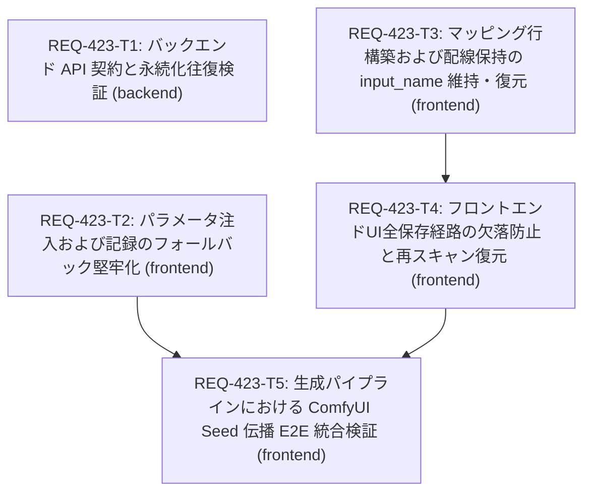

# Implementation Plan: REQ-423 マッピング保存時のinput_name属性欠落によるComfyUIへのSeed未伝播不具合の修正と回帰抑止テスト網の構築

## Overview
生成画面においてSeed値を変更してもComfyUIでの生成画像が変化しない不具合（インシデント報告書 `docs/incident_report.md` 参照）を根本解決します。
本不具合は、スキャナーで合致したノード入力名（`input_name`）をDBに永続化して注入に使う仕様（REQ-417）に対し、フロントエンド側の複数の保存処理で `input_name` 属性が欠落・除外され、DBに空文字列が保存されていたことに起因します。この結果、`workflowParamInjector.ts` がマスタ既定の `param_name`（`"seed"`）へフォールバックし、サンプラーノード（KSamplerAdvanced等）本来の入力である `noise_seed` ではなく実在しない `node.inputs["seed"]` へ値を誤注入していました。

本実装では、ユーザー特別指示（「今後、デグレに気づけるようにテストの拡充も合わせて設計して」）に基づき、以下の4つの柱で修復と回帰抑止を実施します：
1. **シード注入・記録ロジックのフォールバック堅牢化 (`REQ-423-T2`)**: `input_name` 優先注入に加え、空・未設定時でも `node.inputs` に実在するキー（`noise_seed`, `seed`, `value` 等）を自動探索して解決し、実在しないキーの誤注入を完全に防ぎます。
2. **マッピング行構築・配線コンポーネントでの `input_name` 保持と自動ヒーリング (`REQ-423-T3`)**: `useMasterMappingRows` の `getMappings` がスキャン結果および既存保存マッピングから `input_name` を漏れなく抽出し、空のレガシーマッピングを再スキャンで自動補完（ヒーリング）します。
3. **フロントエンドUI全保存経路の欠落防止 (`REQ-423-T4`)**: `WorkflowConnectionSection`、`RescanModal`、`useWorkflowManagement`、`NodeRemapModal` の各更新処理において `input_name` を確実に保持・送信します。
4. **多層回帰抑止テスト網の構築 (`REQ-423-T1`, `REQ-423-T5`)**: バックエンド API 永続化往復テスト（T1）および ComfyUI プロンプト生成バッチ E2E 統合テスト（T5）を拡充し、今後のUI改修やリファクタリングでの再発を完全に遮断します。

---

## User Review Required
> [!IMPORTANT]
> **設計判断とユーザー特別指示への対応方針（設計書 §0・§6・§7）**
> - **特別指示への対応**: 単体・フック・画面保存・API契約・E2E生成バッチの4層にわたる包括的な回帰テスト網を構築します。
> - **再スキャン時の自動ヒーリング**: 既存 DB に `input_name = ""` で保存されてしまっているワークフローについて、`RescanModal` で再スキャンして保存した際、検出された `noise_seed` が自動補完されて DB へ正常永続化されます。
> - **ゼロマイグレーション**: バックエンド DB スキーマ（`workflow_mappings.input_name`）および API ルーターは既に `input_name` に対応しているため、新たな DB マイグレーションは発生せず、安全に適用可能です。

---

## Proposed Changes

### Backend Subsystem

#### 1. バックエンド API 契約と永続化往復検証 (`REQ-423-T1`)
- [test_workflows.py](file:///c:/Users/audih/ws/comfy-create-helper2/backend/tests/integration/api/test_workflows.py):
  - `[REQ-423/AC-2]` `test_req423_ac2_workflow_mappings_persist_and_roundtrip_input_name`: `POST /api/workflows` で `input_name="noise_seed"` を作成、`GET /api/workflows/{id}` での往復取得、`PUT` による更新を検証。
  - `[REQ-423/AC-2]` `test_req423_ac2_workflow_duplicate_preserves_mapping_input_names`: ワークフロー複製時に `input_name` が欠落なく引き継がれることを検証。

---

### Frontend Subsystem

#### 2. パラメータ注入およびメタ情報記録のフォールバック堅牢化 (`REQ-423-T2`)
- [workflowParamInjector.ts](file:///c:/Users/audih/ws/comfy-create-helper2/frontend/src/utils/workflowParamInjector.ts):
  - `seedOptions` の注入処理で `seedNode.input_name` を優先。未設定時は `node.inputs` に実在する候補キー（`noise_seed`, `seed`, `value` 等）を自動解決し、`inputs["seed"]` の誤生成を防止。
- [generationRecord.ts](file:///c:/Users/audih/ws/comfy-create-helper2/frontend/src/utils/generationRecord.ts):
  - `capture` において `mapping.input_name` および実在するシードキーを認識し、記録キーと値の整合を担保。
- [workflowParamInjector.test.ts](file:///c:/Users/audih/ws/comfy-create-helper2/frontend/src/utils/__tests__/workflowParamInjector.test.ts):
  - `[REQ-423/AC-3]` `noise_seed` への注入と `inputs.seed` 誤生成防止の単体テスト。
  - `[REQ-423/AC-4]` 空 `input_name` 時の `noise_seed` / `value` 自動フォールバック単体テスト。
- [generationRecord.test.ts](file:///c:/Users/audih/ws/comfy-create-helper2/frontend/src/utils/__tests__/generationRecord.test.ts):
  - `[REQ-423/AC-3]` 記録されたメタデータが注入グラフの `noise_seed` と完全一致することの検証。

#### 3. マッピング行構築および配線保持における `input_name` の維持・復元 (`REQ-423-T3`)
- [useMasterMappingRows.ts](file:///c:/Users/audih/ws/comfy-create-helper2/frontend/src/hooks/useMasterMappingRows.ts):
  - `StageSlotItem`, `MasterMappingRow` に `input_name?: string` を追加。
  - `buildRows` でスキャンマッチまたは既存マッピングから `input_name` を抽出。
  - `getMappings` が返却するマッピング配列に `input_name` を確実に含め、再スキャン時の自動ヒーリングを実現。
- [AdaptiveWorkflowWiring.tsx](file:///c:/Users/audih/ws/comfy-create-helper2/frontend/src/components/AdaptiveWorkflowWiring.tsx) & [wiringStageGroups.ts](file:///c:/Users/audih/ws/comfy-create-helper2/frontend/src/utils/wiringStageGroups.ts):
  - `WiringMappingItem` 型に `input_name?: string` を追加し、配線変更ループでの欠落を防止。
- [useMasterMappingRows.test.ts](file:///c:/Users/audih/ws/comfy-create-helper2/frontend/src/hooks/__tests__/useMasterMappingRows.test.ts) & [WorkflowAdaptiveStaging.test.tsx](file:///c:/Users/audih/ws/comfy-create-helper2/frontend/src/pages/SettingsPage/components/__tests__/WorkflowAdaptiveStaging.test.tsx):
  - `[REQ-423/AC-1]` スキャン結果からの `input_name` 抽出・ヒーリング、配線保存時の維持を検証。

#### 4. フロントエンドUI各種保存経路における `input_name` 欠落防止と再スキャン復元 (`REQ-423-T4`)
- [WorkflowConnectionSection.tsx](file:///c:/Users/audih/ws/comfy-create-helper2/frontend/src/pages/SettingsPage/components/WorkflowConnectionSection.tsx):
  - `ConfigDraft.mappings` 型に `input_name?: string` を追加し、初期化・保存・エクスポート・変更の全経路で維持。
- [RescanModal.tsx](file:///c:/Users/audih/ws/comfy-create-helper2/frontend/src/components/RescanModal.tsx):
  - `initFromScan` で `input_name` を保持して渡し、`saveMutation` で完全なペイロードを送信。
- [useWorkflowManagement.ts](file:///c:/Users/audih/ws/comfy-create-helper2/frontend/src/pages/GeneratePage/hooks/useWorkflowManagement.ts):
  - `handleUpdateMapping` でマスタ変更時にも各マッピングの `input_name` を保持。
- [NodeRemapModal.tsx](file:///c:/Users/audih/ws/comfy-create-helper2/frontend/src/pages/DatasetStudioPage/components/NodeRemapModal.tsx):
  - `handleSave` で Positive/Negative 以外のパラメータの `input_name` と `variant_id` を保持。
- [WorkflowConnectionSection.test.tsx](file:///c:/Users/audih/ws/comfy-create-helper2/frontend/src/pages/SettingsPage/components/__tests__/WorkflowConnectionSection.test.tsx), [WorkflowModalMultiStage.test.tsx](file:///c:/Users/audih/ws/comfy-create-helper2/frontend/src/components/__tests__/WorkflowModalMultiStage.test.tsx), [useWorkflowManagement.seed.test.ts](file:///c:/Users/audih/ws/comfy-create-helper2/frontend/src/pages/GeneratePage/hooks/__tests__/useWorkflowManagement.seed.test.ts), [NodeRemapModal.test.tsx](file:///c:/Users/audih/ws/comfy-create-helper2/frontend/src/pages/DatasetStudioPage/components/__tests__/NodeRemapModal.test.tsx):
  - `[REQ-423/AC-1]`, `[REQ-423/AC-2]` 各画面・モーダルの保存ペイロードに `input_name` が保持されることを検証。

#### 5. 生成パイプラインにおける ComfyUI Seed 伝播 E2E / 統合検証 (`REQ-423-T5`)
- [useGenerateAction.seed.test.ts](file:///c:/Users/audih/ws/comfy-create-helper2/frontend/src/pages/GeneratePage/hooks/__tests__/useGenerateAction.seed.test.ts):
  - `[REQ-423/AC-3]` `noise_seed` を持つワークフローで生成実行時、ComfyUI送信バッチペイロードのノード入力に新しい Seed が正しく注入され、`inputs.seed` が生成されないことを E2E レベルで検証。
  - `[REQ-423/AC-4]` レガシー空 `input_name` ワークフローでも生成実行時に安全にフォールバック注入されることを検証。

---

## Dependency Graph (Mermaid DAG)

---

## Trade-off Disclosures & Alternatives

1. **既存空 `input_name` の自動ヒーリング vs 既存値の温存**:
   - **採用**: 再スキャン時、既存 DB に空文字列が入っているスロットについて、スキャナーが合致した `input_name`（`"noise_seed"` 等）で自動上書き・修復する。
   - **理由**: 手動で意図的に空にするユースケースは存在せず、REQ-417の実装不備で空になっていたため、ユーザーが再スキャンを実行した際に自動的に正常状態へ復旧できることが最大のメリットであるため。
2. **`workflowParamInjector` のシード探索フォールバック**:
   - **採用**: `input_name` が空または未設定の場合、`[param_name, fallback_param_names, 'noise_seed', 'seed', 'value']` を走査して実在キーへ注入する。
   - **理由**: 万が一将来の画面改修やサードパーティインポート等で `input_name` が欠落した場合でも、サンプラー本来の入力への注入を保証し、ComfyUI へのシード未伝播障害の再発を二重に防止できるため。
3. **テストファイルのコロケーション厳守**:
   - **採用**: チケット名を含む新規テストファイル（`*req423*` 等）は新設せず、既存のテストファイル群（`test_workflows.py`, `workflowParamInjector.test.ts`, `useGenerateAction.seed.test.ts` 等）へ `[REQ-423/AC-n]` タグ付きケースを追加する。
   - **理由**: SPEC-TESTING v2.1 およびリポジトリガバナンス（MUST [REQ-356/AC-1]）に完全準拠し、テスト負債の蓄積を防ぐため。

---

## Verification Plan

- **リスク区分**: **Low**（DB スキーマ変更なし、公開エンドポイント変更なし。ただし生成パイプラインの核心であるため Gate 1/2/3 を完全に実行）。
- **Gate 1 (Static)**:
  - `backend\.venv\Scripts\python scripts/verify_ui_invariants.py`
  - `mypy backend`
  - `cd frontend; npm run typecheck`
  - `backend\.venv\Scripts\python scripts/verify_test_naming.py --strict`
- **Gate 2 (Focused & Full Suite)**:
  - Focused:
    - Backend: `backend\.venv\Scripts\python -m pytest backend/tests/integration/api/test_workflows.py -k "REQ-423"`
    - Frontend: `cd frontend; npx vitest run src/utils/__tests__/workflowParamInjector.test.ts src/utils/__tests__/generationRecord.test.ts src/hooks/__tests__/useMasterMappingRows.test.ts src/pages/SettingsPage/components/__tests__/WorkflowConnectionSection.test.tsx src/components/__tests__/WorkflowModalMultiStage.test.tsx src/pages/GeneratePage/hooks/__tests__/useWorkflowManagement.seed.test.ts src/pages/DatasetStudioPage/components/__tests__/NodeRemapModal.test.tsx src/pages/GeneratePage/hooks/__tests__/useGenerateAction.seed.test.ts -t "REQ-423"`
  - Full Discovery Baseline:
    - `backend\.venv\Scripts\python -m pytest -n auto`
    - `cd frontend; npm test`
- **Gate 3 (E2E & Red Team)**:
  - `cd frontend; npx vitest run src/pages/GeneratePage/hooks/__tests__/useGenerateAction.seed.test.ts -t "REQ-423"`

