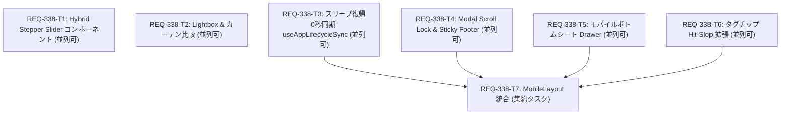

# REQ-338: Prompt Surgeon モバイル最適化および全ビュー共通基盤改修 実装計画書

## 1. Executive Summary
本PBIは、スマートフォン・タブレット端末（360px〜768px未満）におけるUI要素の押し潰れ・親指タップ不能・Safariツールバー潜水・キーボード遮蔽・背面連動スクロールといった課題を抜本的に解決するとともに、デスクトップ（PC）の生産性をも同時に向上させる「全ビュー共通基盤（Part 1）」と「モバイル特化仕様（Part 2）」の二大再編改修を実施する計画です。

---

## 2. Proposed Changes

### PART 1: 全ビュー共通基盤 (Desktop / Tablet / Mobile 共通)

#### [LOCAL NEW] [frontend/src/components/common/StepperSlider.tsx](file:///c:/Users/audih/ws/comfy-create-helper2/frontend/src/components/common/StepperSlider.tsx)
- 粗調整スライダーに [-] [+] ステッパーボタンと直接数値入力を統合した共通コンポーネント。
- 数値表示に `tabular-nums font-mono` を徹底し、桁揺れ・レイアウトシフトを抑止。
- プリセット値（0.50, 0.70, 1.00, 1.20 等）のクイックピル表示をサポート。

#### [LOCAL NEW] [frontend/src/components/common/__tests__/StepperSlider.test.tsx](file:///c:/Users/audih/ws/comfy-create-helper2/frontend/src/components/common/__tests__/StepperSlider.test.tsx)
- ステッパー増減、直接入力バリデーション、最小値・最大値クランプ、キーボード操作の単体テスト。

#### [LOCAL NEW] [frontend/src/components/common/LightboxModal.tsx](file:///c:/Users/audih/ws/comfy-create-helper2/frontend/src/components/common/LightboxModal.tsx)
- 全画面固定の画像検査モーダルコンポーネント。`Escape` キーでのクローズをサポート。

#### [LOCAL NEW] [frontend/src/components/common/CurtainCompareView.tsx](file:///c:/Users/audih/ws/comfy-create-helper2/frontend/src/components/common/CurtainCompareView.tsx)
- マウスホイールによる等倍ズーム（100%〜400%）およびドラッグパン操作。
- 2画像選択時の垂直スプリットカーテン比較（中央バーのドラッグによる境界比率 0%〜100% の無段階変更）。
- [Space] 比較切り替え、[K] キープ、[D] 破棄ショートカット対応。

#### [LOCAL NEW] [frontend/src/components/common/__tests__/CurtainCompareView.test.tsx](file:///c:/Users/audih/ws/comfy-create-helper2/frontend/src/components/common/__tests__/CurtainCompareView.test.tsx)
- ホイールズーム、パン座標更新、カーテン境界変更、キーボードイベントの単体テスト。

#### [LOCAL NEW] [frontend/src/hooks/useAppLifecycleSync.ts](file:///c:/Users/audih/ws/comfy-create-helper2/frontend/src/hooks/useAppLifecycleSync.ts)
- `document.visibilitychange` および `window.focus` イベントを監視する共通フック。
- スリープ・タブ復帰時に古い Half-Open ソケットを破棄して `systemWsService.resume()` を実行し、並行して `generationApi.getState()` を即座にフェッチして 0 秒で最新の生成スナップショット（Epoch / Revision）を反映。

#### [LOCAL NEW] [frontend/src/hooks/__tests__/useAppLifecycleSync.test.ts](file:///c:/Users/audih/ws/comfy-create-helper2/frontend/src/hooks/__tests__/useAppLifecycleSync.test.ts)
- `visibilitychange` (state: visible) および `focus` イベント発火時のソケット再開と REST API 状態フェッチの並行実行・リカバリ検証。

#### [LOCAL MODIFY] [frontend/src/components/common/Modal.tsx](file:///c:/Users/audih/ws/comfy-create-helper2/frontend/src/components/common/Modal.tsx)
- モーダル展開時の Body Scroll Lock (`body { overflow: hidden }`) 適用および参照カウント式の復元処理。
- ダイアログ内部コンテナへの `overscroll-behavior: contain` 徹底と、下部決定ボタンの Sticky Footer 化。

#### [LOCAL NEW] [frontend/src/components/common/__tests__/Modal.test.tsx](file:///c:/Users/audih/ws/comfy-create-helper2/frontend/src/components/common/__tests__/Modal.test.tsx)
- モーダル開閉時の `document.body.style.overflow` 設定・復元、ネスト展開時の Lock 排他制御テスト。

---

### PART 2: モバイル特化仕様 (Mobile-Only: < 768px)

#### [LOCAL NEW] [frontend/src/components/common/BottomSheet.tsx](file:///c:/Users/audih/ws/comfy-create-helper2/frontend/src/components/common/BottomSheet.tsx)
- 画面幅 768px 未満専用のボトムシート（Drawer）コンポーネント。
- 上部ドラッグハンドルによる下スワイプ即クローズ（移動量 > 80px）と親指ゾーン Sticky Footer。

#### [LOCAL NEW] [frontend/src/components/common/__tests__/BottomSheet.test.tsx](file:///c:/Users/audih/ws/comfy-create-helper2/frontend/src/components/common/__tests__/BottomSheet.test.tsx)
- 開閉、タッチスワイプ（下スワイプクローズ）、Sticky Footer レンダリングの単体テスト。

#### [LOCAL MODIFY] [frontend/src/components/TagChipViewer.tsx](file:///c:/Users/audih/ws/comfy-create-helper2/frontend/src/components/TagChipViewer.tsx)
- チップ間の見た目の余白（`gap-1.5`）と高密度な表示を完全に維持。
- 上下左右の判定重複を避けるコンパクトな Hit-Slop と `touch-action: manipulation`（300ms 遅延防止）を付与。

#### [LOCAL MODIFY] [frontend/src/components/TagChipEditor/TagChip.tsx](file:///c:/Users/audih/ws/comfy-create-helper2/frontend/src/components/TagChipEditor/TagChip.tsx)
- チップおよびボタンに自然な近接吸着・適正 Hit-Slop と `active:scale-[0.97]` タッチフィードバックを適用。密度の低下（スカスカ感）を抑止。

#### [LOCAL MODIFY] [frontend/src/pages/GeneratePage/components/MobileLayout.tsx](file:///c:/Users/audih/ws/comfy-create-helper2/frontend/src/pages/GeneratePage/components/MobileLayout.tsx)
- ルートコンテナの `100dvh` 動的追従とセーフエリアクリアランス（`pb-[calc(env(safe-area-inset-bottom)+12px)]`）。
- 画面外枠 `px-3 py-2.5`、カード内 `p-2.5`、グリッド `gap-2` による情報密度圧縮。
- 入力欄フォーカス時の固定 Action Bar 自動退避（`hidden`）およびキーボード直上タグサジェストバー吸着。
- 下部 40% Natural Zone への Generate、選別、キュー管理アクション集約。
- 最外層スクロールへの `overscroll-behavior-y: contain` 付与による Pull-to-refresh 暴発防止。
- 端末回転（縦 ↔ 横）時のセーフエリア・ボタン配置の堅牢性維持。

#### [LOCAL NEW] [frontend/src/pages/GeneratePage/components/__tests__/MobileLayout.test.tsx](file:///c:/Users/audih/ws/comfy-create-helper2/frontend/src/pages/GeneratePage/components/__tests__/MobileLayout.test.tsx)
- 360px モバイル環境における余白クラス、Action Bar 退避、Natural Zone 配置、回転適応のテスト。

---

## 3. Task Dependency Visualization & Parallel Design

### 並行実行性分析
- **第1フェーズ (並列実行可能)**: `REQ-338-T1`, `REQ-338-T2`, `REQ-338-T3`, `REQ-338-T4`, `REQ-338-T5`, `REQ-338-T6` の6タスクは互いに依存せず、完全に独立して実装・単体テスト可能です。
- **第2フェーズ (集約統合)**: `REQ-338-T7` は、T3（ライフサイクルフック）、T4/T5（モーダル・ボトムシート基盤）、T6（Hit-Slop タグ）の成果物を `MobileLayout.tsx` に統合します。
- **DAG 最大深度**: 2層（ボトルネックなし、高並行性達成）。

---

## 4. Verification Plan

### Automated Baseline 3-Gate Verification
1. **Gate 1: Static Typecheck Baseline**
   - コマンド: `npm --prefix frontend run typecheck`
   - 期待値: 0 errors (Exit code 0)
2. **Gate 2: Full Test Suite Baseline**
   - コマンド: `npm --prefix frontend test`
   - 期待値: 全テスト PASS (Exit code 0)
3. **Gate 3: Scenario & Red Teaming (AC 100% 準拠)**
   - 各 Task 単体テスト（T1〜T7）の全件 PASS
   - Red Team 異常系テスト（スライダー境界値、オフライン復帰、複数モーダル Lock 排他、高速スワイプ）の全件 PASS

---

## 5. Trade-off Disclosure (トレードオフ開示)

1. **共通基盤化 vs モバイル個別実装の分離コスト**:
   - スライダーや Lightbox、モーダル基盤を全ビュー共通基盤として昇格させることで、PC 版にも恩恵が波及する一方、PC 側の既存レイアウト（ParamPanel, GeneratePage）との統合テストが必要になります。
   - **判定**: 既存の `Modal.tsx` の互換性を 100% 維持しつつ Body Scroll Lock と Sticky Footer を付与し、既存コードへの波及リスクを最小化します。
2. **タッチ判定 Hit-Slop と要素近接衝突**:
   - `before:-inset-2` による 40px タップ領域拡張を単純適用すると、密集するタグチップ間で判定が重複し、意図しないタグがタップされるリスクがあります。一方、単に gap を広げると情報密度が低下してスカスカになってしまいます。
   - **判定**: チップ間の見た目の余白（`gap-1.5`）と高密度な表示は完全に維持します。静的な矩形拡張による重複を避け、重複のないコンパクトな Hit-Slop とタッチポイントへの自然な近接判定吸着（および `touch-manipulation` + `active:scale-[0.97]`）を適用し、密集度とタップ精度の両立を実現します。
3. **IME キーボード検知のブラウザ差異**:
   - iOS Safari と Android Chrome で仮想キーボード起動時の `window.visualViewport` 挙動や `resize` イベントのタイミングが異なります。
   - **判定**: 単純な Viewport リサイズ判定に依存せず、input / textarea の `focus` / `blur` イベント駆動と `visualViewport.height` のハイブリッド検知を適用し、環境依存の誤作動を防止します。
