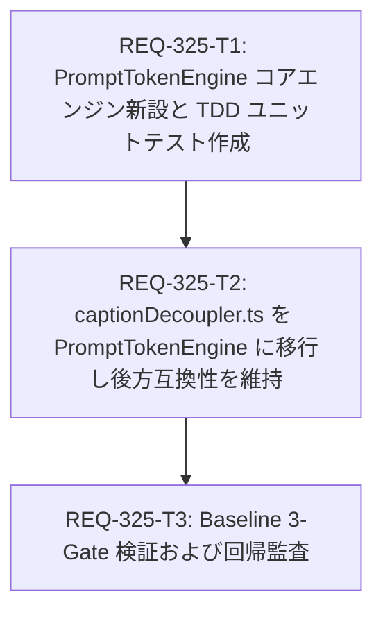

# Implementation Plan: REQ-325 Prompt Surgeon: 共通プロンプト構文解析エンジン (PromptTokenEngine) の新設と統合

複数箇所（`TagChipEditor`, `captionDecoupler.ts`, `promptUtils.ts` 等）で個別実装されているプロンプト文字列・タグ構文の解析、重み付け `((tag:1.2))` の展開、カンマ正規化、デカップリング置換処理を統一する共通トークンエンジン `PromptTokenEngine`（`frontend/src/utils/prompt/` 配下）を新設し、`captionDecoupler.ts` を移行統合します。

## User Review Required
- **コアエンジン新設 (`src/utils/prompt/`)**: `PromptToken` データモデル（`raw`, `text`, `weight`, `bracketDepth`, `enabled`, `category`）および静的クラス `PromptTokenEngine` を新設します。
- **既存機能への透過的統合**: まず最重要リファクタリング対象である `captionDecoupler.ts`（Dataset Studio）の内部ロジックを `PromptTokenEngine` 委任へと切り替えます。関数のシグネチャ（`decoupleCaption(params: DecoupleParams): string`）や既存のテスト期待値は 100% 後方互換を維持します。

## Proposed Changes

### Core Token Engine Module

#### [LOCAL NEW] [types.ts](file:///c:/Users/audih/ws/comfy-create-helper2/frontend/src/utils/prompt/types.ts)
- `PromptTokenCategory` 型（`meta | physical | outfit | trigger | general`）
- `PromptToken` インターフェース（`raw`, `text`, `weight`, `bracketDepth`, `enabled`, `category`）
- `DecoupleOptions` インターフェース（`position?: 'prepend' | 'append'`）

#### [LOCAL NEW] [PromptTokenEngine.ts](file:///c:/Users/audih/ws/comfy-create-helper2/frontend/src/utils/prompt/PromptTokenEngine.ts)
- `tokenize(promptText: string): PromptToken[]`: 括弧ネスト（(), [], {}）を追跡しながらカンマ/改行で安全に分割。重み付け構文 `((tag:1.2))` や多重括弧 `(((tag)))` を解析し、連続カンマや無駄な空白を正規化。
- `serializeToComfyPrompt(tokens: PromptToken[]): string`: 有効なトークンを ComfyUI 構文に準拠してカンマ区切りのクリーンな平文文字列へ再構成。
- `decoupleTags(tokens, removeTags, injectTrigger?, options?)`: 大文字小文字を区別せず対象タグを除去し、オプションのトリガーワードを注入。
- `adjustWeight(token, delta)`: 重み倍率の加算・丸め・0下限保護処理。

#### [LOCAL NEW] [PromptTokenEngine.test.ts](file:///c:/Users/audih/ws/comfy-create-helper2/frontend/src/utils/prompt/__tests__/PromptTokenEngine.test.ts)
- AC-1（トークン化・正規化）、AC-2（シリアライズ）、AC-3（タグ除外・トリガー注入）、および Red Team 境界値（連続カンマ `,,`、空入力、括弧不整合、ReDoS 防止）の単体テストスイート。

### Caption Decoupler Integration

#### [LOCAL MODIFY] [captionDecoupler.ts](file:///c:/Users/audih/ws/comfy-create-helper2/frontend/src/pages/DatasetStudioPage/utils/captionDecoupler.ts)
- 内部の素朴な `split(',')` および `filter` 処理を、新設した `PromptTokenEngine.tokenize`, `decoupleTags`, `serializeToComfyPrompt` に移行。
- デフォルト衣装スロットおよび代替衣装スロットにおける挙動と後方互換性を完全維持。

#### [LOCAL NEW] [captionDecoupler.test.ts](file:///c:/Users/audih/ws/comfy-create-helper2/frontend/src/pages/DatasetStudioPage/utils/__tests__/captionDecoupler.test.ts)
- `decoupleCaption` 単体の網羅的テスト。デフォルト衣装・代替衣装・大文字小文字混在・連続カンマ入力に対する挙動を検証。

## Task Dependency Graph (DAG)

### Parallel Execution Capabilities
- `REQ-325-T1` は基盤実装であるため最優先で実行。
- `REQ-325-T2` は `REQ-325-T1` のエンジン完成後に移行を実施。
- `REQ-325-T3` は全実装完了後にシステム全体の型検証およびフルテストを実行。

## Trade-off Disclosure

| 設計選択肢 | メリット | デメリット・トレードオフ | 採用理由・緩和策 |
|---|---|---|---|
| **ステートマシン走査によるトークン化** | 括弧ネストと重み付けを $O(N)$ で確実に解析可能。ReDoS のリスクが皆無 | 単純な `split(',')` よりコード量が増加 | プロンプト解析の正確性とエッジケースの安全性を最優先。詳細な単体テストで堅牢性を担保 |
| **段階的移行（まず captionDecoupler から適用）** | 影響範囲を極小化し、即座に安全性を実証できる | `TagChipEditor` 等の他箇所移行は次ステップへ残る | 巨大な一括移行による破壊リスクを避け、REF-02 のロードマップに沿って安全に段階移行する方針を採用 |
| **透過的後方互換性（decoupleCaption シグネチャ不変）** | 既存の UI コンポーネント（`CuratorGrid`）や E2E テストの書き換えが不要 | ラッパー関数が残る | 既存機能の安定稼働と回帰防止を最優先 |

## Verification Plan

### Automated Baseline Gates
1. **Gate 1 (静的型チェック)**: `cd frontend; npm run typecheck` (型エラー 0 件)
2. **Gate 2 (単体・全体テストスイート)**: `cd frontend; npm test` (全テストスイート 100% PASS)
3. **Gate 3 (個別検証 & Red Teaming)**:
   - `cd frontend; npx vitest run src/utils/prompt/__tests__/PromptTokenEngine.test.ts` (コアエンジン正常系・境界値・異常系)
   - `cd frontend; npx vitest run src/pages/DatasetStudioPage/__tests__/CuratorGrid.test.tsx src/test/e2e_req319_lora_studio.test.tsx src/pages/DatasetStudioPage/utils/__tests__/captionDecoupler.test.ts` (キャプションデカップリング互換性)

