# Implementation Plan: REQ-418 プリセット・スナップショット・同期グループの role 参照から variant_id 参照への移行

## Overview
現行のプリセット（`workflow_presets.param_values`）、スナップショット（`snapshots.params`）、およびパラメータ同期グループ（`param_sync_groups`）は、パラメータ参照キーとして文字列の `role` を使用しており、外部キー制約による整合性が保証されていません。
本実装では、REQ-417 で確立された `MappingVariant` の永続 ID（`variant_id`）を基準として参照を正規化し、以下を実現します。
1. **プリセット値の正規化とマイグレーション (`step_035`)**: `workflow_preset_values` テーブルを新設して `mapping_variants(id)` への外部キーを付与し、検証相→変更相の 2 相マイグレーションにより未解決行がある場合は DB を無変更で中断します（AC-1）。
2. **スナップショットの `v:<variant_id>` 永続化と後方互換リゾルバ**: 保存時は `v:<id>[:sub]` 形式で保存し、復元（GET）時は旧 `role` キーも含めて現在の `role` へ展開します。対応する `variant_id` が存在しない欠落キーは `logger.warning` を出力した上でレスポンスから除外し、画面フォームの該当フィールドを初期値（未設定）のまま維持します（AC-2）。
3. **同期グループの `variant_id` 永続化と UI 連携**: `param_sync_groups.master_variant_id` および `param_sync_group_members` テーブルにより `variant_id` の組として永続化し、`ParamSyncModal` から `variant_id` を送信します（AC-3）。
4. **Variant 属性更新への即時追従**: プリセット一覧・同期グループ一覧・スナップショット取得 API が `variant_id` 外部キー参照を通じて最新の `role` / `display_name`（および `variants: list[VariantRef]`）を返却します（AC-4）。

---

## User Review Required
> [!IMPORTANT]
> **仕様と現行実装のギャップ解決方針（設計書 §1・§11）**
> - **Q1（マイグレーション時のゴーストキー扱い）**: `step_035` は AC-1 どおり未解決キーが 1 件でもある場合にエラー中断（DB 無変更）とします。予約キー（`__*`）および LoRA スタック派生キー（`<role>_lora_count` 等）は解決済みとして扱います。また本番 DB 事前確認用に読み取り専用の `audit_role_references(conn)` を提供します。
> - **Q2（フロントエンド変更範囲の境界）**: API レスポンスが `variant_id` から解決した最新の `role` キーを返す境界変換方式（トレードオフ T-A）を採用し、フロントエンド内部ストアは既存の `role` キーを維持して変更を API 型と `ParamSyncModal` に限定します。
> - **Q3（プリセット値テーブルの新設）**: 現行 DB にはプリセット値テーブルが存在せず `workflow_presets.param_values` JSON 列のみであるため、正規化テーブル `workflow_preset_values` を新設します（旧 JSON 列は予約キー `__*` の退避先として維持）。
> - **Q4（`applied_assets` の扱い）**: `workflow_presets.applied_assets` は本 PBI の対象外とし、既存のカスケードリネームによる追従を維持します。

---

## Proposed Changes

### Backend Subsystem

#### 1. 共有キー分類・正規化・展開ロジック (`REQ-418-T1`)
- [variant_keys.py](backend/app/services/variant_keys.py) (新規):
  - `KeyKind` (`RESERVED`, `VARIANT`, `ROLE`, `DERIVED_ROLE`, `UNRESOLVED`) の固定優先順判定。
  - `VariantIndex`, `normalize_params`, `expand_stored_params`, `to_storage_params`, `encode_variant_key`, `decode_variant_key` の提供。
- [variant_ref.py](backend/app/schemas/variant_ref.py) (新規):
  - `VariantRef(id, role, display_name)` スキーマ定義。

#### 2. DB モデル追加とマイグレーション `step_035` (`REQ-418-T2`)
- [models.py](backend/app/models.py):
  - `WorkflowPresetValue` (`workflow_preset_values`)、`ParamSyncGroupMember` (`param_sync_group_members`) の新設。
  - `ParamSyncGroup.master_variant_id` 列および ORM リレーション（`cascade="all, delete-orphan"`）の追加。
- [steps.py](backend/app/migrations/steps.py):
  - `step_035_variant_id_references` と `audit_role_references(conn)` の実装（前提テーブル検査 → 検証相 → 変更相、冪等性保証）。

#### 3. プリセット API と Workflow コピー (`REQ-418-T3`)
- [preset.py](backend/app/schemas/preset.py) & [presets.py](backend/app/routers/presets.py):
  - `WorkflowPresetRead` に `variant_param_values` と `variants` を追加。
  - GET 時に値テーブルから現在の `role` キーへ展開、POST/PUT 時に `normalize_params` で値テーブルを更新し `updated_at` 競合判定（409）を維持。
- [workflows.py](backend/app/routers/workflows.py):
  - `copy_workflow` でプリセット値行および同期グループ（`master_variant_id` と `members`）を同一 `variant_id` で複製。

#### 4. スナップショット保存・復元リゾルバ (`REQ-418-T4`)
- [snapshot.py](backend/app/schemas/snapshot.py), [snapshot_service.py](backend/app/services/snapshot_service.py), [snapshots.py](backend/app/routers/snapshots.py):
  - 保存・更新時に `to_storage_params` で `v:<id>` キー形式に変換。
  - 取得・一覧時に `expand_stored_params` で最新 `role` キーへ展開し、未解決キーは `logger.warning` に記録して除外。

#### 5. パラメータ同期グループ API (`REQ-418-T5`)
- [param_sync_groups.py](backend/app/schemas/param_sync_groups.py) & [param_sync_groups.py](backend/app/routers/param_sync_groups.py):
  - `master_variant_id` / `slave_variant_ids` 優先の受付（旧 `master_role` / `slave_roles` フォールバック対応、未知の指定は 422）。
  - 一覧・応答で最新の `master_role`, `slave_roles`, `variants` を返却。

---

### Frontend Subsystem

#### 6. API 型定義と同期グループ UI (`REQ-418-T6`)
- [types.ts](frontend/src/api/types.ts):
  - `VariantRef` 追加、`WorkflowPreset` / `Snapshot` / `SnapshotSummary` / `ParamSyncGroup*` の型拡張。
- [ParamSyncModal.tsx](frontend/src/components/ParamSyncModal.tsx):
  - `activeWorkflow.mappings` から `role -> variant_id` を解決し、グループ作成・更新時に `master_variant_id` / `slave_variant_ids` を送信（`variant_id` が無いマッピングのみ `role` にフォールバック）。UI クラス・レイアウトは不変。

---

## Dependency Graph (Mermaid DAG)

```mermaid
graph TD
  REQ-418-T1["REQ-418-T1: variant_keys 共有ロジック + VariantRef (backend)"] --> REQ-418-T2["REQ-418-T2: モデル追加 + step_035 マイグレーション (backend)"]
  REQ-418-T1 --> REQ-418-T4["REQ-418-T4: スナップショット保存・復元リゾルバ (backend)"]
  REQ-418-T1 --> REQ-418-T3["REQ-418-T3: プリセット API + workflow copy (backend)"]
  REQ-418-T1 --> REQ-418-T5["REQ-418-T5: パラメータ同期グループ API (backend)"]
  REQ-418-T2 --> REQ-418-T3
  REQ-418-T2 --> REQ-418-T5
  REQ-418-T6["REQ-418-T6: フロントエンド型 + ParamSyncModal (frontend)"]
```

---

## Trade-off Disclosures & Alternatives

1. **T-A: API 境界変換の採用 vs フロント内部ストアの全面 `variant_id` 化**:
   - **採用**: DB 永続化を `variant_id` 化し、API レスポンスで最新の `role` キーに展開して返す（追加フィールドとして `variant_param_values` / `variant_params` / `variants` も提供）。同期グループ UI のみ `variant_id` を直接送受信する。
   - **理由**: フロントの生成注入・LoRA スタック派生キー・自動保存に跨る大規模変更による回帰リスクを排除しつつ、AC-1〜AC-4（role 名・display_name 変更への自動追従を含む）を完全に満たせるため。
2. **T-B: `workflow_preset_values` テーブル新設 vs JSON 列内での `v:<id>` 置換**:
   - **採用**: プリセット値を正規化テーブル `workflow_preset_values` に切り出し、`mapping_variants(id)` への FK と `UNIQUE(preset_id, variant_id, sub_key)` を付与する。
   - **理由**: JSON 文字列のままでは DB レベルの FK 参照整合性を宣言できないため。予約キー（`__*`）のみ旧 JSON 列に保持する。
3. **T-C: 実行時 API 書き込みでの未解決キー破棄+警告 vs 422 エラー拒否**:
   - **採用**: マイグレーション（`step_035`）は AC-1 どおり未解決キーで厳格に中断・ロールバックするが、実行時のプリセット/スナップショット保存では未解決キーを `logger.warning` で記録して破棄する。
   - **理由**: フロントエンドの自動保存が旧綴りキー等を送信した場合に保存全体が 422 で失敗し続けることを防ぐため（同期グループ API は明示的な選択操作のため 422 とする）。
4. **T-F: SQLite における検証相→変更相の 2 相マイグレーション**:
   - **採用**: Python 3.12 `sqlite3` の DDL トランザクション挙動に依存せず、全行の解決可否を読み取り専用の検証相で検査し、通過後にのみ DDL とデータ移行を実行する。
   - **理由**: 未解決行が存在する場合に DB が 1 バイトも変更されないこと（AC-1）を確実に保証するため。

---

## Verification Plan

- **リスク区分**: **high**（DB スキーマ・マイグレーション・公開 API 契約の変更を含むため、V1 ベースラインのフルスイート検証を必須とする）。
- **Gate 1 (Static)**:
  - `backend\.venv\Scripts\python scripts/verify_ui_invariants.py`
  - `mypy backend`
  - `cd frontend; npm run typecheck`
  - `backend\.venv\Scripts\python scripts/verify_test_naming.py --strict`
- **Gate 2 (Full Test Suite)**:
  - `backend\.venv\Scripts\python -m pytest -n auto`
  - `cd frontend; npm test`
- **Gate 3 (Scenario & Red Team)**:
  - `docs/design/REQ-418-test-plan.md` §5 の通しシナリオ（S-1〜S-3）および Playwright E2E 回帰テスト。

