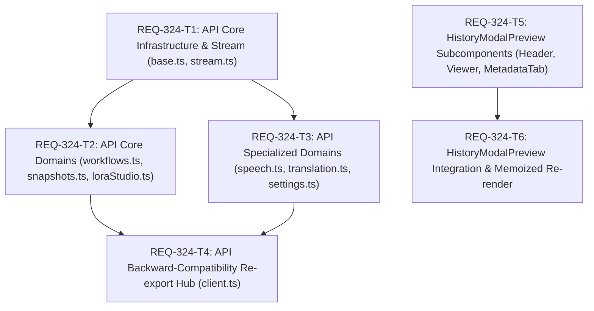

# Implementation Plan: REQ-324 フロントエンド肥大化モジュールおよびコンポーネントの構造分割整理 (api/client.ts & HistoryModalPreview)

Prompt Surgeon の機能急拡大に伴い肥大化した 2 大フロントエンド要素（API通信層 `api/client.ts` 約700行、UIプレビュー層 `HistoryModalPreview.tsx` 約420行）の構造分割整理を実施します。透過的 re-export ハブの採用により外部コードへの後方互換性を100%維持し、Atomic なサブコンポーネント化と `React.memo` により再レンダリング最適化を実現します。

## User Review Required
- **API 後方互換性方針**: `api/client.ts` を集約 re-export ハブとして維持するため、既存のコンポーネント・フック・テストコードからのインポートパス（`@/api/client` や `../api/client`）および公開型・シンボルの変更は一切生じません。
- **HistoryModalPreview 分割方針**: ヘッダー操作部（`PreviewHeader`）、画像表示部（`PreviewImageViewer`）、メタデータ情報部（`SnapshotMetadataTab`）に分離し、モーダル内タイマーやタブ操作による不要な再描画を抑制します。既存の全画面表示・キーボード操作・スワイプ・保存中ロック動作は完全に保持されます。

## Proposed Changes

### API Layer Modularization

#### [LOCAL NEW] [base.ts](file:///c:/Users/audih/ws/comfy-create-helper2/frontend/src/api/core/base.ts)
- `BASE_URL` (`/api`) および汎用 HTTP 通信関数 `request<T>` を配置。FormData ヘッダー制御、204 No Content、JSON パース、API 例外生成を担当。

#### [LOCAL NEW] [stream.ts](file:///c:/Users/audih/ws/comfy-create-helper2/frontend/src/api/core/stream.ts)
- NDJSON/SSE ストリーム処理用例外クラス `SceneSpeechStreamError`、`abortError`、およびイベント行パース関数 `parseSceneSpeechEvent` を配置。

#### [LOCAL NEW] [base.test.ts](file:///c:/Users/audih/ws/comfy-create-helper2/frontend/src/api/core/__tests__/base.test.ts)
- `request<T>` およびストリームイベントパースの単体テスト。正常系、204 返却、HTTP エラー送出、異常系フォーマットを網羅。

#### [LOCAL NEW] [workflows.ts](file:///c:/Users/audih/ws/comfy-create-helper2/frontend/src/api/domains/workflows.ts)
- ワークフローおよびノードパラメータ系 API（`workflowsApi`, `workflowPresetsApi`, `bypassProfilesApi`, `paramSyncGroupsApi`, `mappingMastersApi`, `paramTypeMastersApi`）を配置。

#### [LOCAL NEW] [snapshots.ts](file:///c:/Users/audih/ws/comfy-create-helper2/frontend/src/api/domains/snapshots.ts)
- スナップショットおよびメタデータ・タグ系 API（`snapshotsApi`, `albumsApi`, `promptMetadataApi`, `tagSetsApi`, `tagsetCategoriesApi`）と `PromptMetadataRead` 型を配置。

#### [LOCAL NEW] [loraStudio.ts](file:///c:/Users/audih/ws/comfy-create-helper2/frontend/src/api/domains/loraStudio.ts)
- LoRA、モデル、Dataset Studio、学習、ベンチマーク系 API（`lorasApi`, `loraCategoriesApi`, `baseModelsApi`, `checkpointMappingsApi`, `datasetApi`, `trainingApi`, `benchmarkApi`）を配置。

#### [LOCAL NEW] [speech.ts](file:///c:/Users/audih/ws/comfy-create-helper2/frontend/src/api/domains/speech.ts)
- 音声・フキダシ・ストリーム生成系 API（`sceneSpeechApi`, `speechBatchApi`, `speechBubblePresetsApi`, `speechTonePresetsApi`, `fontsApi`）を配置。

#### [LOCAL NEW] [translation.ts](file:///c:/Users/audih/ws/comfy-create-helper2/frontend/src/api/domains/translation.ts)
- 翻訳および LLM 連携系 API（`translateApi`, `llmPromptsApi`）を配置。

#### [LOCAL NEW] [settings.ts](file:///c:/Users/audih/ws/comfy-create-helper2/frontend/src/api/domains/settings.ts)
- システム設定・監査ログ・ComfyUI 通信系 API（`settingsApi`, `configApi`, `auditApi`, `comfyApi`）と `VramSettings` 型を配置。

#### [LOCAL MODIFY] [client.ts](file:///c:/Users/audih/ws/comfy-create-helper2/frontend/src/api/client.ts)
- `core/` および `domains/` の各モジュールと `./types` の型を集約再エクスポートする透過的ハブとしてスリム化（約700行から約30行へ削減）。

#### [LOCAL NEW] [clientReExport.test.ts](file:///c:/Users/audih/ws/comfy-create-helper2/frontend/src/api/__tests__/clientReExport.test.ts)
- 集約ハブ `client.ts` が 27 個の全 API オブジェクトおよび必要な型を過不足なくエクスポートしていることを担保する単体テスト。

### History Modal Preview Decomposition

#### [LOCAL NEW] [PreviewHeader.tsx](file:///c:/Users/audih/ws/comfy-create-helper2/frontend/src/components/history/PreviewHeader.tsx)
- スナップショットダウンロード（WebP/PNG/JPEG）、一時画像直接ダウンロード、自動追従トグル、閉じるボタンを包含するヘッダーコンポーネント（`React.memo` 適用）。

#### [LOCAL NEW] [PreviewImageViewer.tsx](file:///c:/Users/audih/ws/comfy-create-helper2/frontend/src/components/history/PreviewImageViewer.tsx)
- 画像プレビュー本体、前後ナビゲーションボタン、全画面拡大、タッチスワイプハンドラ、カルーセル枚数表示、情報開閉トグルを包含するビューワーコンポーネント（`React.memo` 適用）。

#### [LOCAL NEW] [SnapshotMetadataTab.tsx](file:///c:/Users/audih/ws/comfy-create-helper2/frontend/src/components/history/SnapshotMetadataTab.tsx)
- メタデータローディング状態、`GenerationMetadataPanel`、アルバム所属、タグ関連付けエディタ（`SnapshotTagAssociationsPanel`）のレンダリングを包含するパネルコンポーネント（`React.memo` 適用）。

#### [LOCAL MODIFY] [HistoryModalPreview.tsx](file:///c:/Users/audih/ws/comfy-create-helper2/frontend/src/components/HistoryModalPreview.tsx)
- サブコンポーネントを合成するオーケストレータとして再構築。全画面監視、3秒無操作タイマー、保存中ロック、キーボードショートカット制御に専念（約420行から約180行へ削減）。

#### [LOCAL NEW] [PreviewSubcomponents.test.tsx](file:///c:/Users/audih/ws/comfy-create-helper2/frontend/src/components/history/__tests__/PreviewSubcomponents.test.tsx)
- `PreviewHeader`, `PreviewImageViewer`, `SnapshotMetadataTab` 各サブコンポーネントの Props 伝播・イベント発火単体テスト。

#### [LOCAL MODIFY] [HistoryModalPreview.test.tsx](file:///c:/Users/audih/ws/comfy-create-helper2/frontend/src/components/__tests__/HistoryModalPreview.test.tsx)
- 既存の全テストケース（メタデータ表示、保存中ロック、キーボード制御）を維持しつつ、分割後のサブコンポーネント統合・不要再レンダリング防止の検証を追加。

## Task Dependency Graph (DAG)

### Parallel Execution Capabilities
- **第一階層 (Layer 1)**: `REQ-324-T1`（API Core）と `REQ-324-T5`（UI サブコンポーネント群）は完全に独立しているため、**並列実行可能**です。
- **第二階層 (Layer 2)**: `REQ-324-T1` 完了後、`REQ-324-T2`（Workflows/Snapshots/LoRA）と `REQ-324-T3`（Speech/Translation/Settings）は互いに依存しないため、**並列実行可能**です。同時に `REQ-324-T5` 完了後の `REQ-324-T6` も並列に進行可能です。
- **第三階層 (Layer 3)**: 全 API ドメイン完了後、`REQ-324-T4` で `client.ts` の集約 re-export を完了します。

## Trade-off Disclosure

| 設計選択肢 | メリット | デメリット・トレードオフ | 採用理由・緩和策 |
|---|---|---|---|
| **透過的 re-export ハブ (`client.ts`)** | 既存全コード（数十ファイル）のインポート修正が不要で回帰リスク 0 | 将来的に直接ドメインパスを推奨する運用との二重性 | 移行期の安全性を最優先。新機能開発時はドメイン直接インポートも許可する方針とする |
| **API ドメイン 6 分割** | ファイル行数が各 50〜100 行程度に縮小し、責務分離・可読性が大幅向上 | ファイル数が増加（管理対象モジュール増） | ドメイン別ディレクトリ `api/domains/` に隔離し、明確な命名規則で可視性を担保 |
| **HistoryModalPreview の 3 分割 & React.memo** | 3秒無操作タイマー発火時やタブ切替時の不要な重いパネル再描画を抑制 | Props バケツリレーの発生、インターフェース定義の手間 | Props インターフェースを明示し、親から渡すコールバックを `useCallback` で固定化してメモ化効果を最大化 |

## Verification Plan

### Automated Baseline Gates
1. **Gate 1 (静的型チェック)**: `cd frontend; npm run typecheck` (型エラー 0 件)
2. **Gate 2 (単体・全体テストスイート)**: `cd frontend; npm test` (135 テストスイート / 1284 テスト 100% PASS)
3. **Gate 3 (個別検証 & Red Teaming)**:
   - `cd frontend; npx vitest run src/api/core/__tests__/base.test.ts` (API 通信・ストリームパース異常系)
   - `cd frontend; npx vitest run src/api/__tests__/clientReExport.test.ts` (re-export 完全性)
   - `cd frontend; npx vitest run src/components/history/__tests__/PreviewSubcomponents.test.tsx` (サブコンポーネント単体動作)
   - `cd frontend; npx vitest run src/components/__tests__/HistoryModalPreview.test.tsx` (全画面操作・保存中ロック・回帰検証)

