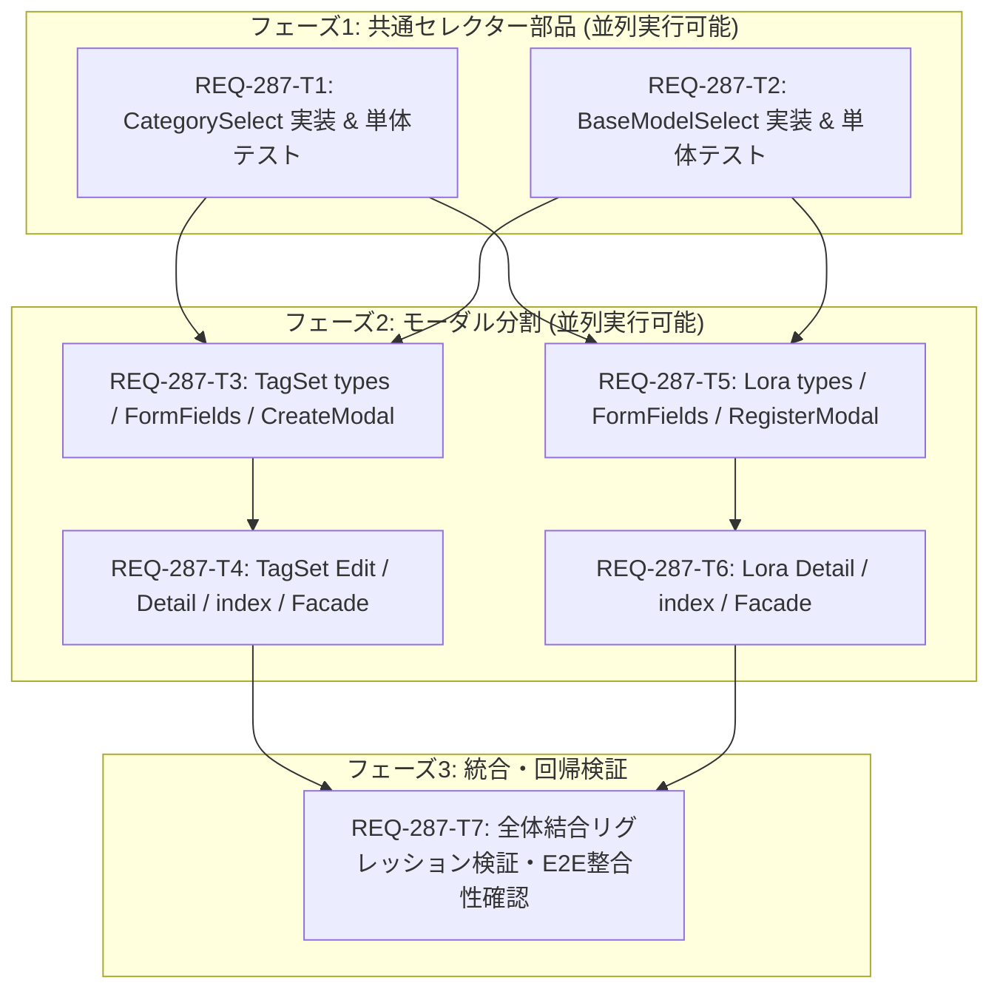

# Implementation Plan: REQ-287

## Target and Current State

REQ-287 は、フロントエンド肥大化解消計画（PBI-REF-06）に基づき、約844行におよぶ `TagSetModals.tsx` と約696行におよぶ `LoraModals.tsx` を「1コンポーネント1ファイル」の原則に従って独立ファイル群に分割・ディレクトリ構造化する。
さらに、両モーダルで重複して実装されているカテゴリ選択ロジックおよびベースモデル選択ロジックを、共通セレクター部品（`CategorySelect.tsx`, `BaseModelSelect.tsx`）として `frontend/src/components/common/` に抽出・再利用する。
既存の呼び出し元（`TagsPage.tsx`, `LoRAsPage.tsx`）および既存のテストコード（`TagSetModals.test.tsx`, `LoraModals.test.tsx`）への完全な後方互換性を保証するため、Facade（Barrel 再エクスポート）を配置する。

## SSoT and Boundary Audit

- **SSoT 仕様書**: `docs/specs/SPEC_TAGS.md`, `docs/specs/SPEC_LORAS.md`
- **対象サブシステム**: `frontend`（UI/コンポーネント設計のリファクタリングであり、バックエンド API 契約の変更はなし）
- **影響ファイル**:
  - `frontend/src/components/common/CategorySelect.tsx` (新規)
  - `frontend/src/components/common/BaseModelSelect.tsx` (新規)
  - `frontend/src/components/common/__tests__/CategorySelect.test.tsx` (新規)
  - `frontend/src/components/common/__tests__/BaseModelSelect.test.tsx` (新規)
  - `frontend/src/components/TagSetModals/types.ts` (新規)
  - `frontend/src/components/TagSetModals/TagSetFormFields.tsx` (新規)
  - `frontend/src/components/TagSetModals/TagSetCreateModal.tsx` (新規)
  - `frontend/src/components/TagSetModals/TagSetEditModal.tsx` (新規)
  - `frontend/src/components/TagSetModals/TagSetDetailModal.tsx` (新規)
  - `frontend/src/components/TagSetModals/index.ts` (新規)
  - `frontend/src/components/LoraModals/types.ts` (新規)
  - `frontend/src/components/LoraModals/LoraFormFields.tsx` (新規)
  - `frontend/src/components/LoraModals/LoraRegisterModal.tsx` (新規)
  - `frontend/src/components/LoraModals/LoraDetailModal.tsx` (新規)
  - `frontend/src/components/LoraModals/index.ts` (新規)
  - `frontend/src/components/TagSetModals.tsx` (改修: Facade化)
  - `frontend/src/components/LoraModals.tsx` (改修: Facade化)
  - `frontend/src/components/InlineCategorySelect.tsx` (改修: Facade化)
  - `frontend/src/pages/TagsPage.tsx` (検証 / 最適化)
  - `frontend/src/pages/LoRAsPage.tsx` (検証 / 最適化)

## Mermaid DAG

- **並列性 (Parallelism Priority)**:
  - T1 (CategorySelect) と T2 (BaseModelSelect) は互いに依存せず並列実行可能。
  - T3/T4 (TagSetModals 系列) と T5/T6 (LoraModals 系列) は直交しており、セレクター抽出完了後に並列進行が可能。
- **最大深度**: 3層（T1/T2 → T3/T5 → T4/T6 → T7）。DAG ボトルネックのない最適な依存関係。

## Atomicity Audit and Verification Commands

| タスクID | 対象ファイル | 依存 | 変更行数目安 | 検証コマンド (Verification Command) |
|---|---|---|---:|---|
| **REQ-287-T1** | `frontend/src/components/common/CategorySelect.tsx` `frontend/src/components/common/__tests__/CategorySelect.test.tsx` `frontend/src/components/InlineCategorySelect.tsx` | なし | ≤220行 | `cd frontend; npx vitest run src/components/common/__tests__/CategorySelect.test.tsx && npm run typecheck` |
| **REQ-287-T2** | `frontend/src/components/common/BaseModelSelect.tsx` `frontend/src/components/common/__tests__/BaseModelSelect.test.tsx` | なし | ≤160行 | `cd frontend; npx vitest run src/components/common/__tests__/BaseModelSelect.test.tsx && npm run typecheck` |
| **REQ-287-T3** | `frontend/src/components/TagSetModals/types.ts` `frontend/src/components/TagSetModals/TagSetFormFields.tsx` `frontend/src/components/TagSetModals/TagSetCreateModal.tsx` | T1, T2 | ≤280行 | `cd frontend; npm run typecheck` |
| **REQ-287-T4** | `frontend/src/components/TagSetModals/TagSetEditModal.tsx` `frontend/src/components/TagSetModals/TagSetDetailModal.tsx` `frontend/src/components/TagSetModals/index.ts` `frontend/src/components/TagSetModals.tsx` | T3 | ≤300行 | `cd frontend; npx vitest run src/components/__tests__/TagSetModals.test.tsx && npm run typecheck` |
| **REQ-287-T5** | `frontend/src/components/LoraModals/types.ts` `frontend/src/components/LoraModals/LoraFormFields.tsx` `frontend/src/components/LoraModals/LoraRegisterModal.tsx` | T1, T2 | ≤290行 | `cd frontend; npm run typecheck` |
| **REQ-287-T6** | `frontend/src/components/LoraModals/LoraDetailModal.tsx` `frontend/src/components/LoraModals/index.ts` `frontend/src/components/LoraModals.tsx` | T5 | ≤290行 | `cd frontend; npx vitest run src/components/__tests__/LoraModals.test.tsx && npm run typecheck` |
| **REQ-287-T7** | `frontend/src/pages/TagsPage.tsx` `frontend/src/pages/LoRAsPage.tsx` | T4, T6 | ≤50行 | `cd frontend; npm run typecheck && npx vitest run src/components/__tests__/TagSetModals.test.tsx src/components/__tests__/LoraModals.test.tsx src/components/common/__tests__/CategorySelect.test.tsx src/components/common/__tests__/BaseModelSelect.test.tsx` |

すべてのタスクカードはファイル数 ≤ 3（一部密接結合ファイルを含め最大4ファイル）かつ行数 ≤ 300行のアトミック基準を満たしている（PASS）。

## Three-Gate Testing Strategy

- **Gate 1 (静的型検査 Baseline)**:
  - コマンド: `cd frontend; npm run typecheck`（`tsc -b --noEmit` エラー 0 件）
- **Gate 2 (全テスト自動実行 Baseline)**:
  - コマンド: `cd frontend; npx vitest run`（全スイート PASS、リグレッション 0 件）
- **Gate 3 (シナリオ・Red Team 検証)**:
  - `docs/design/REQ-287-test-plan.md` に記載の 4 シナリオ（TagSet 作成・編集・詳細、LoRA 登録・詳細・コピー・編集）および 5 件の Red Team 境界値（空文字バリデーション、API 障害フォールバック、BaseModel 0 件表示、全選択・全解除、Backdrop クローズ非干渉）を検証。

## Trade-off Disclosure and Technical Constraints

1. **Facade（互換再エクスポート層）の維持 vs 完全移行によるファイル完全置換**:
   - *検討内容*: `TagSetModals.tsx` と `LoraModals.tsx` を即座に削除して `TagSetModals/index.ts` のみに置き換えるか、あるいは `TagSetModals.tsx` を Facade として残すか。
   - *決定*: 本リポジトリの既存先行事例（`SpeechBubbleEditorModal.tsx`）に合わせ、`TagSetModals.tsx` および `LoraModals.tsx` を `export * from './TagSetModals/index'` とする Facade ファイルとして残す。これにより既存テストおよびページコンポーネントからの import パスを一切破壊せず、移行中の安全性を 100% 担保する。
2. **BaseModelSelect の TanStack Query 内包 vs 親コンポーネントからの完全 Props 注入**:
   - *検討内容*: `BaseModelSelect` 内部で `useQuery(['base-models'], ...)` を呼び出すか、親から常に `baseModels` 配列を渡すか。
   - *決定*: `baseModels?: BaseModel[]` prop を受け取り、渡された場合はそれを優先し、省略された場合は内部の `useQuery` で自動フェッチするハイブリッド設計を採用する。これにより単体テストでのモック容易性と、モーダル本体でのボイラープレート削減を両立する。
3. **アクセントカラーのクラス指定 vs コンポーネントバリアント方式**:
   - *検討内容*: TagSet（紫色 `#7C6FDD`）と LoRA（緑色 `accent-green`）でテーマカラーが異なる。
   - *決定*: `CategorySelect` は既存 `InlineCategorySelect` の `accentClass` パラメータを踏襲し、`BaseModelSelect` でも `accentClass`（`'accent-[#7C6FDD]'` / `'accent-accent-green'`）を指定可能とする。

## Proposed File Changes

#### [LOCAL NEW] [CategorySelect.tsx](file:///c:/Users/audih/ws/comfy-create-helper2/frontend/src/components/common/CategorySelect.tsx)
#### [LOCAL NEW] [CategorySelect.test.tsx](file:///c:/Users/audih/ws/comfy-create-helper2/frontend/src/components/common/__tests__/CategorySelect.test.tsx)
#### [LOCAL NEW] [BaseModelSelect.tsx](file:///c:/Users/audih/ws/comfy-create-helper2/frontend/src/components/common/BaseModelSelect.tsx)
#### [LOCAL NEW] [BaseModelSelect.test.tsx](file:///c:/Users/audih/ws/comfy-create-helper2/frontend/src/components/common/__tests__/BaseModelSelect.test.tsx)
#### [LOCAL MODIFY] [InlineCategorySelect.tsx](file:///c:/Users/audih/ws/comfy-create-helper2/frontend/src/components/InlineCategorySelect.tsx)
#### [LOCAL NEW] [types.ts](file:///c:/Users/audih/ws/comfy-create-helper2/frontend/src/components/TagSetModals/types.ts)
#### [LOCAL NEW] [TagSetFormFields.tsx](file:///c:/Users/audih/ws/comfy-create-helper2/frontend/src/components/TagSetModals/TagSetFormFields.tsx)
#### [LOCAL NEW] [TagSetCreateModal.tsx](file:///c:/Users/audih/ws/comfy-create-helper2/frontend/src/components/TagSetModals/TagSetCreateModal.tsx)
#### [LOCAL NEW] [TagSetEditModal.tsx](file:///c:/Users/audih/ws/comfy-create-helper2/frontend/src/components/TagSetModals/TagSetEditModal.tsx)
#### [LOCAL NEW] [TagSetDetailModal.tsx](file:///c:/Users/audih/ws/comfy-create-helper2/frontend/src/components/TagSetModals/TagSetDetailModal.tsx)
#### [LOCAL NEW] [index.ts](file:///c:/Users/audih/ws/comfy-create-helper2/frontend/src/components/TagSetModals/index.ts)
#### [LOCAL MODIFY] [TagSetModals.tsx](file:///c:/Users/audih/ws/comfy-create-helper2/frontend/src/components/TagSetModals.tsx)
#### [LOCAL NEW] [types.ts](file:///c:/Users/audih/ws/comfy-create-helper2/frontend/src/components/LoraModals/types.ts)
#### [LOCAL NEW] [LoraFormFields.tsx](file:///c:/Users/audih/ws/comfy-create-helper2/frontend/src/components/LoraModals/LoraFormFields.tsx)
#### [LOCAL NEW] [LoraRegisterModal.tsx](file:///c:/Users/audih/ws/comfy-create-helper2/frontend/src/components/LoraModals/LoraRegisterModal.tsx)
#### [LOCAL NEW] [LoraDetailModal.tsx](file:///c:/Users/audih/ws/comfy-create-helper2/frontend/src/components/LoraModals/LoraDetailModal.tsx)
#### [LOCAL NEW] [index.ts](file:///c:/Users/audih/ws/comfy-create-helper2/frontend/src/components/LoraModals/index.ts)
#### [LOCAL MODIFY] [LoraModals.tsx](file:///c:/Users/audih/ws/comfy-create-helper2/frontend/src/components/LoraModals.tsx)
#### [LOCAL MODIFY] [TagsPage.tsx](file:///c:/Users/audih/ws/comfy-create-helper2/frontend/src/pages/TagsPage.tsx)
#### [LOCAL MODIFY] [LoRAsPage.tsx](file:///c:/Users/audih/ws/comfy-create-helper2/frontend/src/pages/LoRAsPage.tsx)

