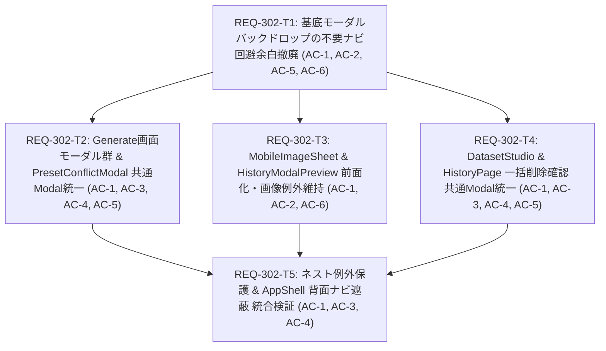

# Implementation Plan: REQ-302 未統一オーバーレイの前面化と不要なナビ回避余白の解消

## Overview
本改修では、モバイルおよびレスポンシブ表示時にボトムナビゲーション（`--z-mobile-nav: 50`）と同順位または未統一（`z-50`）となっていた各画面の独自モーダル・画像確認シートを棚卸しし、共通設計トークン `--z-modal: 100` および共通Modal（`Modal.tsx`）契約へ統一します。
また、`frontend/src/index.css` の `.modal-backdrop` に残存していた `--mobile-nav-height`（4rem / 64px）の不要なナビ回避余白を一掃し、768〜1023px タブレット幅（ボトムナビ非表示時）での不整合を解消します。
明示的に承認されたネスト例外（`MappingMasterEditModal` 内の `WorkflowNodePicker`）および画像閲覧例外（`MobileImageSheet` / `HistoryModalPreview`）の既存機能を保護し、背面ナビへの操作・フォーカス漏れを完全に遮断します。

---

## User Review Required
> [!IMPORTANT]
> **主要な設計判断と方針（設計書 `docs/design/REQ-302.md` 参照）**
> - **重なり順の統一 (AC-1)**: ボトムナビ（50）＜ 共通Modal（100）の絶対階層を確立。ハードコード `z-50` の独自overlayを一掃し、背面ナビへのタップ・キーボード抜けを完全に遮断します。
> - **不要ナビ回避余白の解消 (AC-2)**: `.modal-backdrop` から `--mobile-nav-height` の加算を撤廃し、`calc(1rem + env(safe-area-inset-bottom, 0px))` に統一。特に 768〜1023px でナビ非表示時にも余白が残っていた条件（`:not(:has(> [role='dialog']))` や `.flex-col` 除外）を撤廃し、画面高さを有効活用します。
> - **共通Modalへの統合 (AC-3)**: 独自モーダルを共通 `Modal.tsx` に統合することで、Focus Trap、Escapeキー、Backdropクリック、スクロール遮断、フォーカス復帰を一元保証します。
> - **排他モーダル切替と明示的ネスト例外の維持 (AC-4)**: モーダルは原則排他。`SPEC_COMMON.md` §1-4 で承認された `MappingMasterEditModal` 内の `WorkflowNodePicker` の例外（外側 `closeOnEsc={!isNodePickerOpen}`、内側Escape単独クローズ）のみを保護し、二次モーダルの一般化を防止します。
> - **safe-area・キーボード対応と画像閲覧例外維持 (AC-5, AC-6)**: raw `100vh` を禁止し `100dvh` を徹底。`MobileImageSheet`（WakeLock・全画面切り替え・アスペクト比）と `HistoryModalPreview` の画像閲覧例外を維持します。

---

## Proposed Changes

### Frontend Subsystem: CSS & Design Tokens
#### [REQ-302-T1] 基底モーダルバックドロップの不要ナビ回避余白撤廃とレスポンシブ余白改修
- `frontend/src/index.css`:
  - `.modal-backdrop` 基底の `padding-bottom` から `--mobile-nav-height` の加算を撤廃し、`calc(1rem + env(safe-area-inset-bottom, 0px))` に統一。
  - `@media (min-width: 768px)` において `.modal-backdrop` の `padding-bottom: 1rem;` を無条件適用（旧除外条件の撤廃）。
- `frontend/src/components/common/__tests__/Modal.test.tsx`:
  - ナビ回避余白の撤廃（AC-2）、タブレット幅での 1rem 適用（AC-2）、safe-area 処理（AC-5）のユニットテストを追加。

---

### Frontend Subsystem: Generate Page & Preset Modals
#### [REQ-302-T2] Generate画面モーダル群およびPresetConflictModalの共通Modal統一
- `frontend/src/pages/GeneratePage.tsx`:
  - `selectedLoraForModal`: `<Modal size="sm">` へ移行。
  - `isPresetManagerOpen`: `<Modal size="sm" sheetMaxHeightClass="max-h-[75dvh]">` へ移行。既存 testid を維持。
  - `isBulkDeleteConfirmOpen`: `<Modal size="sm">` へ移行し排他切替。
- `frontend/src/pages/GeneratePage/sections/GenerateModalsOverlay.tsx`:
  - `showCopyModal`: `<Modal size="sm">` へ移行。
- `frontend/src/components/PresetConflictModal.tsx`:
  - 外枠を `<Modal size="4xl" sheetMaxHeightClass="max-h-[90dvh]">` へ移行。raw `90vh` を `90dvh` に変更。
- `frontend/src/components/__tests__/PresetConflictModal.test.tsx`:
  - Escape、Focus Trap、Backdropクリックのテスト（AC-3）を追加。

---

### Frontend Subsystem: Image Viewers & Sheet Exceptions
#### [REQ-302-T3] MobileImageSheetおよびHistoryModalPreviewの前面化と画像閲覧例外維持
- `frontend/src/pages/GeneratePage/components/MobileImageSheet.tsx`:
  - 全画面ビューアおよび下部シートの `z-50` を `z-[var(--z-modal)]`（100）へ引き上げ。
  - 画像閲覧例外（WakeLock、アスペクト比、100dvh、fullscreen）を完全維持。
- `frontend/src/pages/GeneratePage/components/__tests__/MobileImageSheet.test.tsx`:
  - 前面化 z-modal アサーション（AC-1）および画像閲覧例外維持（AC-6）のテストを追加。
- `frontend/src/components/HistoryModalPreview.tsx`:
  - `.modal-backdrop flex flex-col` 構造を維持し、T1のCSS改修との適合性を確認。
- `frontend/src/components/__tests__/HistoryModalPreview.test.tsx`:
  - タブレット幅でのナビ回避余白撤廃テスト（AC-2）を追加。

---

### Frontend Subsystem: Studio & History Delete Modals
#### [REQ-302-T4] DatasetStudioモーダル群およびHistoryPage一括削除確認の共通Modal統一
- `frontend/src/pages/DatasetStudioPage/components/CreateProjectModal.tsx`:
  - `<Modal size="lg">` へ移行。testid（`create-project-modal-backdrop`, `create-project-modal`）を維持。
- `frontend/src/pages/DatasetStudioPage/components/NodeRemapModal.tsx`:
  - `<Modal size="xl" sheetMaxHeightClass="max-h-[90dvh]">` へ移行。testid を維持。
- `frontend/src/pages/DatasetStudioPage/components/BenchmarkCellModal.tsx`:
  - `<Modal size="lg" sheetMaxHeightClass="max-h-[90dvh]">` へ移行。testid を維持。
- `frontend/src/pages/HistoryPage/index.tsx`:
  - `isDeleteSnapshotsModalOpen`: `<Modal size="sm">` へ移行。
- 各テストファイル（`CreateProjectModal.test.tsx`, `NodeRemapModal.test.tsx`, `BenchmarkGrid.test.tsx`, `HistoryPage.test.tsx`）:
  - 前面化（AC-1）、Escape/Focus Trap（AC-3）、排他切替（AC-4）、90dvh到達性（AC-5）のテストケースを追加。

---

### Frontend Subsystem: Integration & Navigation Occlusion
#### [REQ-302-T5] ネスト例外保護とAppShell背面ナビ遮蔽の統合検証
- `frontend/src/components/__tests__/WorkflowNodePicker.test.tsx`:
  - `MappingMasterEditModal` 内 `WorkflowNodePicker` のネスト例外（外側 `closeOnEsc={!isNodePickerOpen}`、内側単独クローズ）の保護テスト（AC-4）を追加。
- `frontend/src/components/layout/__tests__/AppShell.test.tsx`:
  - モーダル表示中のボトムナビへのタップ遮断・ルーティング非遷移テスト（AC-1）および Red Teaming RT-1（高速連続タップ）テストを追加。

---

## Dependency Graph & Implementation DAG

---

## Trade-off Disclosures & Risk Mitigation

1. **独自オーバーレイの共通Modal置換 vs 独自CSSでの前面化のみ**:
   - *判断*: `Modal.tsx` を再利用することで、Escape制御、Focus Trap、Body Scroll Lock、モバイル下部シート化（16px角丸、スワイプハンドル、safe-area処理）が一元的に適用され、各画面での重複実装を排除できます。
2. **画像ビューア（`MobileImageSheet`, `HistoryModalPreview`）の通常Modal置換の不採用**:
   - *判断*: 画像確認シート・全画面ビューアはアスペクト比維持、WakeLock、全画面切り替えなどの特殊要件があるため、機械的に通常Modalへ置換せず、画像閲覧例外として維持しつつ z-index のみを統一します（AC-6遵守）。
3. **768〜1023px での余白解消リスクと対策**:
   - *対策*: 768px以上では一律 `padding-bottom: 1rem;` を維持し、安全なクリアランス（16px）を確保するため、コンテンツの見切れは発生しません。

---

## Verification Plan

### Automated Baseline Gates
- **Gate 1**: `cd frontend; npm run typecheck` (エラー 0 件)
- **Gate 2**: `cd frontend; npm test` (全 120+ テストスイート 100% PASS)
- **Gate 3**: シナリオ・境界値・Red Teaming 検証
  - RT-1: モーダル表示中のボトムナビへの高速重複タップ遮断
  - RT-2: 多重 Escape キー押下の伝播耐性
  - RT-3: セーフエリア極端値注入耐性

## Verification Plan

### Gate 1: 静的型チェック (Typecheck Baseline)
- `cd frontend && npm run typecheck`
  - 期待値: 型エラー 0 件 (Exit code 0)

### Gate 2: ユニット＆結合テスト (Unit / Full Suite Baseline)
- `cd frontend && npm test src/store/__tests__/slices/jobQueueSlice.test.ts`
  - 期待値: 全テスト PASS (Exit code 0)
- `cd frontend && npm test src/components/__tests__/JobManagementModal.test.tsx`
  - 期待値: 全テスト PASS (Exit code 0)
- `cd frontend && npm test`
  - 期待値: フロントエンド全テスト PASS (Exit code 0)

### Gate 3: シナリオ・境界値・Red Teaming検証
- `cd frontend && npm test src/components/__tests__/JobManagementModal.test.tsx -t "REQ-424"`
- `cd frontend && npm test src/store/__tests__/slices/jobQueueSlice.test.ts -t "REQ-424"`
  - 境界値: 2999msでのUndo成功 vs 3001msでのUndo失効確定
  - 異常系: キャンセルAPI障害時のエラー通知、復元時再投入失敗時のフォールバック、連続キャンセル時のタイマー安全競合処理

---

## BA Design Audit
- **Audit Tool**: `local_model_adapter.py ba-audit --audit-kind design`
- **Model**: `qwen/qwen3.5-9b` (Context: 32768, Reasoning: none)
- **Status**: **PASS_NO_FINDINGS** (AC-1〜AC-5の全受入基準カバレッジ確認済み、全ユニット整合性検証完了)
- **GPU Cleanup**: `local_model_adapter.py unload` 実行確認済み（LM Studio reports no models loaded）

