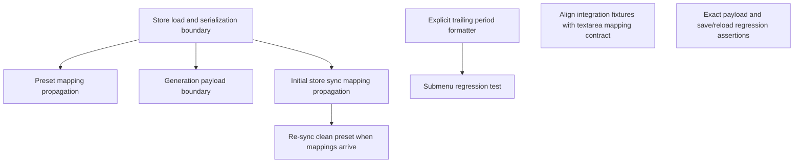

# Implementation Plan - REQ-308: プロンプト区切り適用範囲と末尾ドット編集の修正

Anima のピリオド区切りを textarea prompt role に限定し、プリセット読込・一括更新・生成で checkpoint や LoRA の値を保持する。サブメニュー編集では編集後の文字列に残るドットだけを次のタグとの結合規則に使う。

## Proposed Changes
- Store / preset paths: workflow mapping の `input_type === 'textarea'` role だけを chip 化・chip 値の反映対象にする。未知または未ロード mapping は安全に空集合として扱う。
- Generation: 単一・複数セットとも textarea role allowlist と Anima 状態をシリアライズへ渡す。
- Chip formatting: `formatTagWeight` が Anima モードだけを理由にピリオドを追加しない。
- SSoT: REQ-303、REQ-306、SPEC_COMMON を明示的ドット状態と prompt mapping 範囲へ整合。

## Task Dependency & Parallelization

T1 は T2/T3/T6 の前提。T4 は独立して開始でき、T5 はその後に検証する。T7 は旧統合テストの workflow fixture に明示的な mapping を追加し、全体テストを新しい role allowlist 仕様に合わせる。T8 は mapping 到着時に clean active preset を再同期し、T6 に続く。T9 は AC の文字列および保存・再読込に関する厳密な回帰アサーションを追加する。各カードは最大3ファイルで責務を限定する。

## Verification Plan
各カード記載の Vitest と `cd frontend; npm run typecheck` を実行する。完了後は全体 `cd frontend; npm run typecheck`、`cd frontend; npx vitest run`、テスト計画の AC と Red Team ケースを確認する。

## Trade-offs and Risks
- textarea mapping がないときは原値を保つ。プロンプトのチップ同期が遅れる可能性はあるが、ファイル名等を破損させるより安全である。
- explicit period を使うことで、Anima の文末表現とユーザー編集の意図を両立する。末尾の連続ピリオドは一つに正規化する。
- API/保存形式は変えず、workflow mapping と既存 chips を使う。
- Regression coverage spans preset restoration, bulk update, single/multi-set generation and submenu editing. UI-level manual confirmation may still be needed if component simulation cannot cover actual popover focus behavior.

## Review Gate
ユーザーの「これで進めよう」は事故報告に記載した scope を承認しており、この計画はその範囲を具体化したもの。追加の機能要件は含めない。
