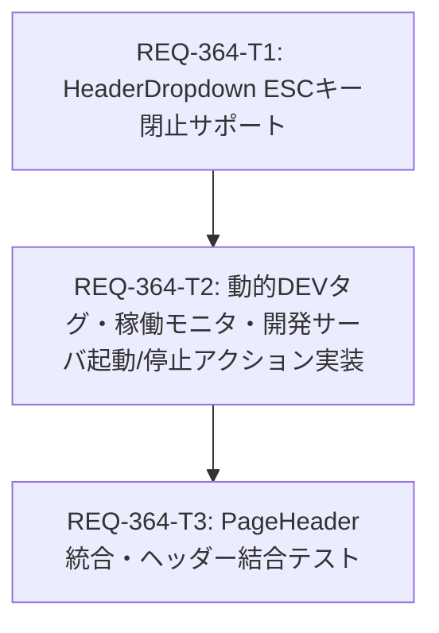

# Implementation Plan: REQ-364 FE環境切替・ライフサイクル制御（起動/停止）およびヘッダーステータス稼働モニタ表示

## Proposed Changes

Vite開発サーバーとFastAPI本番ホスティングの識別性を高め、将来的なポート変更（例: 5173 -> 5174, 8000 -> 8080 等）が発生した場合でも表示が矛盾せず実態に動的追従するアーキテクチャを採用します。
さらに、単なるページジャンプにとどまらず、開発サーバーが停止している際の本番環境からの「▶ 開発起動」要求、および不要になった際の開発環境からの「■ 停止して本番へ」要求を ServerManager (`/api/action`) 連携によりワンストップで実行可能にします。

### 1. HeaderDropdown ESCキー閉止サポート (T1)
- `frontend/src/components/common/header/HeaderDropdown.tsx`
  - `closeOnEsc` オプション（既定値: `true`）を追加し、Popover展開中に `Escape` キー押下で `onClose` を発火するハンドラーを実装。
- `frontend/src/components/common/header/__tests__/HeaderDropdown.test.tsx`
  - ESCキー押下時の閉止動作を検証する単体テストを追加。

### 2. 動的DEVタグ・Popover・動的環境切替 & 起動/停止アクション実装 (T2)
- `frontend/src/api/domains/systemManager.ts`
  - `ManagedServiceName` 型に `'frontend' | 'fe'` を追加し、フロントエンドプロセスの制御API呼び出しを型安全にサポート。
- `frontend/src/components/common/SystemStatusBadge.tsx`
  - `import.meta.env.DEV` および `isDev` / `currentPort` に基づく動的環境判定を実装。
  - DEV環境時、デスクトップステータスバッジ横へ動的に「DEV :${currentPort}」タグバッジを描画（非DEV時やモバイルdotバリアント時は非表示）。
  - ステータスバッジのクリックで「システム稼働モニタ」Popover（HeaderDropdown）を展開。
  - Frontend, FastAPI (BE), ComfyUI, Manager の4サービス行を、環境変数やPropsから解決される動的ポート番号とともに右寄せ垂直整列フォーマットで描画。
  - Frontend行のライフサイクルアクション & 切替ボタン:
    - 本番アクセス時（!isDev）:
      - 開発サーバー停止中（fe.running=false）: `▶ 開発起動` ボタンを表示（押下で `systemManagerApi.action('start', 'frontend')` を実行）。
      - 開発サーバー稼働中（fe.running=true）: `⇄ 開発用` ボタンを表示（押下で開発ポートへURLを保持して遷移）。
    - 開発アクセス時（isDev）:
      - `⇄ 本番用` ボタン（本番ポートへの遷移）。
      - `■ 停止して本番へ` ボタン（`systemManagerApi.action('stop', 'frontend')` を呼び出し、本番URLへ安全に遷移）。
    - アクション実行中の二重クリック防止とスピナー表示。
  - パス・クエリ・ハッシュを安全に合成する `buildSwitchUrl` 純粋関数を実装。
- `frontend/src/components/common/__tests__/SystemStatusBadge.test.tsx`
  - AC-1〜AC-6、Red Team 境界値、動的ポート追従、および起動/停止ライフサイクルアクションの単体テストを追加。

### 3. PageHeader統合および共通ヘッダー結合テスト (T3)
- `frontend/src/components/common/__tests__/unifiedHeaderIntegration.test.tsx`
  - デスクトップ表示（md以上）での動的DEVタグ描画と、モバイル表示（md未満）でのタグ抑制・dot表示のレスポンシブ統合テストを追加。

---

## Dependency DAG (Mermaid)

---

## Verification Plan

### Automated 3-Gate Baseline
1. **Gate 1: Static Typecheck**
   - コマンド: `npm run typecheck`
   - 型エラーおよびプロパティ不整合がないことを確認。
2. **Gate 2: Unit & Component Tests**
   - コマンド: `npm test -- HeaderDropdown.test.tsx -t "Escape"`
   - コマンド: `npm test -- SystemStatusBadge.test.tsx -t "REQ-364"`
   - 全11既存テスト + 新規AC-1〜AC-6テスト + ライフサイクルアクションテストがすべてPASSすることを確認。
3. **Gate 3: Integration Tests**
   - コマンド: `npm test -- unifiedHeaderIntegration.test.tsx -t "REQ-364"`
   - 共通ヘッダー全体のレイアウトおよび表示切替が正しく動作することを確認。

---

## Trade-offs and Risks Disclosure

### 1. トレードオフ: 動的ポート追従方式（ハードコード vs 環境変数・ランタイム動的解決）
- **選択**: `import.meta.env.DEV` + ランタイムポート（`window.location.port`）+ 設定環境変数の組み合わせ動的解決
- **理由**: 「今後ポートを変えたとしても表示が矛盾しないように追従させたい」というフィードバックに対し、固定値ではなく実行時ポートおよび設定値を動的参照することで、ポート変更やポート競合時の自動インクリメントにも100%追従可能としました。
- **緩和策**: 単体テスト時に hermetic にポートをテストできるよう `SystemStatusBadgeProps` に各ポートのオプショナル注入口を設けています。

### 2. トレードオフ: 開発サーバー停止時の遷移挙動（停止のみ vs 停止して本番へ遷移）
- **選択**: 開発環境（DEV）からの停止要求時は「■ 停止して本番へ」として停止要求発行後に本番ポートURLへ自動遷移
- **理由**: 開発サーバー（Vite）自身を停止すると、開発環境に留まったままではページ再読込や次操作時にブラウザが接続切断エラーとなってしまいます。停止と同時に確実に稼働している本番サーバーへ誘導することで、ユーザーをエラー画面に放置しない安全な運用フローを実現します。

### 3. トレードオフ: 画面遷移方式（SPA内ルーティング vs window.location.assign）
- **選択**: `window.location.assign`（ブラウザレベルのURL遷移）
- **理由**: 異なるポート番号間（別Origin）の移動となるためSPA内部ルーティングは使用できません。ブラウザ遷移を用いつつ、pathname, search, hash を完全保持して状態の継続性を担保します。
