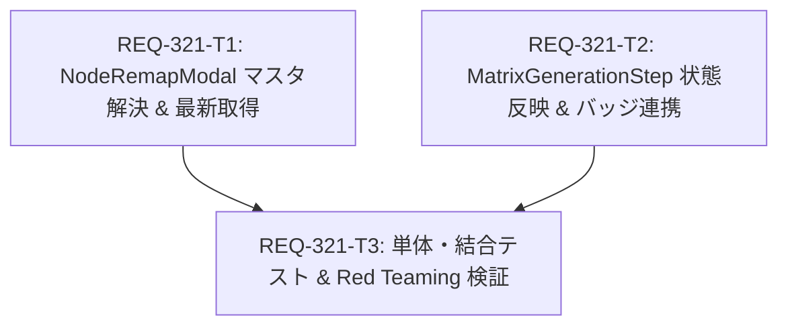

# Implementation Plan: REQ-321 Fix Dataset Studio Node Remapping Save Failure and Incomplete State Update

LoRA Dataset Studio (`/dataset-studio`) の `NodeRemapModal` において、Positive または Negative のプロンプト注入先ノードを変更して「マッピングを保存」を実行した際に、既存マッピングに未設定のロールが存在しても新規マッピングとして正常に保存され、保存直後に最新のワークフロー（WorkflowRead）を再取得して画面上のバッジおよび状態に即時反映させるための実装計画です。

## Proposed Architectural Changes

### 1. Frontend Component (`frontend/src/pages/DatasetStudioPage/components/`)
- #### [LOCAL MODIFY] [NodeRemapModal.tsx](file:///c:/Users/audih/ws/comfy-create-helper2/frontend/src/pages/DatasetStudioPage/components/NodeRemapModal.tsx)
  - `mappingMastersApi` を `../../../api/client` からインポート。
  - `useEffect` を用いて初回マウント時に `mappingMastersApi.list()` を取得し、`Main_Positive_Prompt` および `Negative_Prompt` の `master_id` を特定・保持。
  - `handleSave` において、既存マッピングに対象ロールが存在しない場合でも特定した `master_id` を用いて新規マッピングオブジェクト `{ master_id, node_id }` を `updatedMappingsList` に追加。
  - `workflowsApi.update` 成功後、`workflowsApi.get(workflow.id)` を呼び出してサーバーから最新の完全な `Workflow` オブジェクトを取得し、`onSaved` に渡す（通信エラー時のローカルフォールバックも維持）。
- #### [LOCAL MODIFY] [MatrixGenerationStep.tsx](file:///c:/Users/audih/ws/comfy-create-helper2/frontend/src/pages/DatasetStudioPage/components/MatrixGenerationStep.tsx)
  - `NodeRemapModal` の `onSaved` コールバックで渡された最新の `Workflow` オブジェクトにより、`currentWorkflow` および `workflows` 配列を即時更新。
  - ノードバッジ（`positive-node-badge`, `negative-node-badge`）の表示が再割当後の最新ノード番号・タイトル（例: `#6 Main Positive`）に即座に切り替わることを保証。
  - ComfyUI 直接投入処理（`handleBatchDirectSubmit`）において、最新マッピング情報が正しくプロンプト注入ロジックに渡されることを保証。

### 2. Frontend Automated Tests (`frontend/src/pages/DatasetStudioPage/__tests__/`)
- #### [LOCAL MODIFY] [MatrixGenerationStep.test.tsx](file:///c:/Users/audih/ws/comfy-create-helper2/frontend/src/pages/DatasetStudioPage/__tests__/MatrixGenerationStep.test.tsx)
  - `api/client` モックに `mappingMastersApi.list` を追加。
  - マッピング未設定（初期 `mappings: []`）のワークフローからモーダルを開き、ノード再割当を行って「マッピングを保存」を実行する統合テストを追加。
  - `mappingMastersApi.list` から master_id が解決されて `workflowsApi.update` が呼ばれ、`workflowsApi.get` で最新ワークフローが再取得されてバッジ表示が更新されることを検証。
  - `workflowsApi.update` 失敗時の Red Teaming（エラーハンドリング）テストを追加。

---

## Task Dependency DAG



- **並行可能タスク**: `REQ-321-T1` と `REQ-321-T2` はコンポーネントごとのインターフェース境界が明確であり、並行して実装可能です。
- **依存関係**: `REQ-321-T3` (テスト作成・検証) は T1 および T2 の完了後に実行します。

---

## Verification Plan

### Automated Test Commands
1. **Frontend Typecheck**:
   ```bash
   cd frontend; npm run typecheck
   ```
2. **Frontend Unit & Integration Tests**:
   ```bash
   cd frontend; npx vitest run src/pages/DatasetStudioPage/__tests__/MatrixGenerationStep.test.tsx
   ```
3. **Full Frontend Test Suite**:
   ```bash
   cd frontend; npm test
   ```

### Acceptance Criteria Verification Table
| AC 番号 | 検証内容 | 検証方法 |
|---|---|---|
| AC-1 | `NodeRemapModal` において、`mappingMastersApi.list()` から `Main_Positive_Prompt` および `Negative_Prompt` の `master_id` を正しく特定し、既存マッピングに対象ロールが存在しない場合でも新規マッピングとして `workflowsApi.update` のためのペイロードに含めて保存できること。 | Vitest: 未設定状態からの `workflowsApi.update` ペイロードの引数アサート |
| AC-2 | `workflowsApi.update` の保存完了後、最新のワークフロー情報（`workflowsApi.get`）を取得して `onSaved` に渡し、親コンポーネント（`MatrixGenerationStep`）の `currentWorkflow` およびノードバッジ・プロンプト注入処理に即時反映されること。 | Vitest: `workflowsApi.get` 呼び出しおよび保存後のバッジテキスト更新アサート |
| AC-3 | `MatrixGenerationStep.test.tsx` において、マッピングが存在しない初期状態からのノード再割当・保存フロー、および最新ワークフロー再取得のテストケースが追加されパスすること。 | Vitest 実行および全テスト PASS 検証 |

---

## Trade-off Disclosure

1. **マスタ情報の取得タイミング（モーダルマウント時 vs 保存ボタン押下時）**:
   - *メリット*: モーダルマウント時に `mappingMastersApi.list()` を先行取得しておくことで、ユーザーが「マッピングを保存」をクリックした際に追加の通信遅延なしに即座に `master_id` を解決し、UXを軽快に保てます。
   - *配慮事項*: 通信障害発生時は保存ボタン押下時にフォールバックまたは明示的エラーメッセージを表示し、無効な ID による不正リクエストを防止します。
2. **サーバー再取得 (`workflowsApi.get`) vs 楽観的ローカル更新**:
   - *メリット*: バックエンドの DB 側で採番された `workflow_mappings.id` やマスターのリレーション情報を含んだ canonical な `WorkflowRead` を SSoT として取得することで、以降の更新処理やバッジ表示でのメタ情報欠落や整合性の不一致を根本的に解消します。
   - *配慮事項*: 保存処理後に 1 回の追加 GET リクエストが発生しますが、ワークフロー単体の取得は軽量であり、状態の完全性が確実に保証されます。

