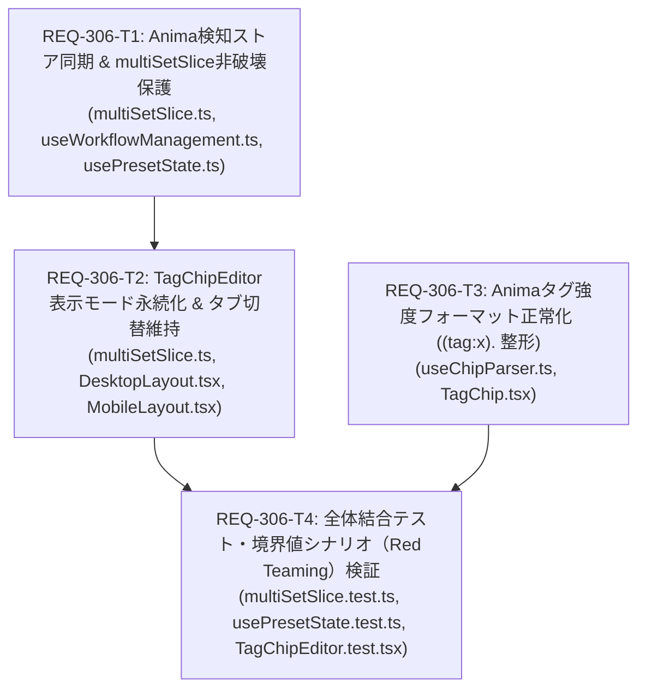

# Implementation Plan - REQ-306: Animaモードにおけるタブ切替時のタグチップ結合状態先祖返り不具合および強度書式不整合の修正

Animaモード（自然言語・ピリオド区切り対応モデル）において、プリセットタブ切替や画面遷移、ウィンドウフォーカス復帰時に分割されたタグチップが単一チップに再結合される、またはテキストモードへ先祖返りしてしまう不具合、ならびにピリオド区切りタグへの強度指定時に `(tag.:x), ` と不正フォーマットされる問題を包括的に修正します。

---

## Proposed Changes

### Frontend Subsystem

#### [LOCAL MODIFY] [multiSetSlice.ts](file:///c:/Users/audih/ws/comfy-create-helper2/frontend/src/store/slices/multiSetSlice.ts)
- `loadPresetData` において `get().isAnimaMode` を `parseToChips(val, isAnimaMode)` に渡し、ピリオド区切りのタグ分割を維持。
- 既存の `existingSet?.promptChips?.[role]` が存在し、`chipsToString(existingChips, isAnimaMode) === val` の場合は不要に再パース・上書きせず既存チップ（enabled状態やメタデータ含む）を非破壊的に維持。
- ロールごとの表示モード（Text/Chip）選択状態を保持する `roleTextModes: Record<string, boolean>` 状態および `setRoleTextMode(role: string, isTextMode: boolean)` アクションを追加。

#### [LOCAL MODIFY] [types.ts](file:///c:/Users/audih/ws/comfy-create-helper2/frontend/src/store/types.ts)
- `MultiSetState` に `roleTextModes?: Record<string, boolean>` を追加。
- `MultiSetActions` に `setRoleTextMode?: (role: string, isTextMode: boolean) => void` を追加。

#### [LOCAL MODIFY] [useWorkflowManagement.ts](file:///c:/Users/audih/ws/comfy-create-helper2/frontend/src/pages/GeneratePage/hooks/useWorkflowManagement.ts)
- BaseModel が "Anima" であるかの検知時（`selectedModel?.name === 'Anima'`）および手動切替時に、`useGenerationStore.getState().setIsAnimaMode?.(isAnima)` を確実に実行し、グローバルストアと常時同期。

#### [LOCAL MODIFY] [usePresetState.ts](file:///c:/Users/audih/ws/comfy-create-helper2/frontend/src/pages/GeneratePage/hooks/usePresetState.ts)
- プリセット一括更新・同期処理（L498, L523付近）における `parseToChips(val)` 呼び出しに `storeRef.current.isAnimaMode ?? false` を渡す。

#### [LOCAL MODIFY] [DesktopLayout.tsx](file:///c:/Users/audih/ws/comfy-create-helper2/frontend/src/pages/GeneratePage/components/DesktopLayout.tsx)
- `defaultTextMode` 解決時に `roleTextModes?.[m.role!] ?? false` を使用し、Animaモードを含む全モデルで初期表示をタグチップモードに統一。
- `TagChipEditor` の `onTextModeToggle` コールバックで `(isText) => { setRoleCollapsed(m.role!, false); setRoleTextMode(m.role!, isText); }` を呼び出し、ユーザーが手動でテキストモードへ切り替えた選択状態を永続化。

#### [LOCAL MODIFY] [MobileLayout.tsx](file:///c:/Users/audih/ws/comfy-create-helper2/frontend/src/pages/GeneratePage/components/MobileLayout.tsx)
- DesktopLayout と同様に `roleTextModes?.[role] ?? false` を参照し、`onTextModeToggle` で `setRoleTextMode` を呼び出してエディタ表示モードを維持。

#### [LOCAL MODIFY] [useChipParser.ts](file:///c:/Users/audih/ws/comfy-create-helper2/frontend/src/components/TagChipEditor/useChipParser.ts)
- `parseTagWeight`: `^\((.+):([0-9.]+)\)\.?$` に拡張し、末尾ピリオド付き `(tag:x).` および旧フォーマット `(tag.:x)` を自動認識して `cleanBase` を抽出。
- `formatTagWeight`: `isAnimaMode` 引数を追加。ピリオド付きタグまたは Anima モード時、括弧の前の末尾ピリオドを除去し、`(${cleanBase}:${rounded}).` 形式として出力。強度 1.0 または null 時は元の末尾ピリオドを保持。

#### [LOCAL MODIFY] [TagChip.tsx](file:///c:/Users/audih/ws/comfy-create-helper2/frontend/src/components/TagChipEditor/TagChip.tsx)
- `handleStepWeight`, `handleWeightSubmit`, `handleWordSubmit` の `formatTagWeight` 呼び出しに `isAnimaMode` を伝播。

#### [LOCAL MODIFY] [useChipParser.test.ts](file:///c:/Users/audih/ws/comfy-create-helper2/frontend/src/components/TagChipEditor/__tests__/useChipParser.test.ts)
- Animaモードでの強度フォーマット（`formatTagWeight('1girl.', 1.2, true) -> '(1girl:1.2).'`）、パース修復、`chipsToString` での後続空白区切りテストを追加。

#### [LOCAL MODIFY] [TagChip.test.tsx](file:///c:/Users/audih/ws/comfy-create-helper2/frontend/src/components/TagChipEditor/__tests__/TagChip.test.tsx)
- Animaモードにおけるステップボタン・直接入力での `(tag:x).` 生成テストを追加。

#### [LOCAL MODIFY] [multiSetSlice.test.ts](file:///c:/Users/audih/ws/comfy-create-helper2/frontend/src/store/__tests__/slices/multiSetSlice.test.ts)
- Animaモードにおける `loadPresetData` のピリオド区切りタグチップ分割維持（AC-1）、既存チップ保持の非破壊性、Red Teaming 境界値（小数点・連続ピリオド）テストを追加。

#### [LOCAL MODIFY] [DesktopLayout.tabs.test.tsx](file:///c:/Users/audih/ws/comfy-create-helper2/frontend/src/pages/GeneratePage/components/__tests__/DesktopLayout.tabs.test.tsx)
- Animaモードでチップモード切り替え後、プリセットタブを切り替えて復帰した際にチップモードが維持されるテスト（AC-4）を追加。

---

## Verification Plan

### Automated Tests
1. **型チェック (Gate 1 Baseline)**:
   - `cd frontend; npm run typecheck` (エラー 0 件)
2. **単体テスト (Gate 2 TDD Baseline)**:
   - `cd frontend; npx vitest run src/components/TagChipEditor/__tests__/useChipParser.test.ts src/components/TagChipEditor/__tests__/TagChip.test.tsx`
   - `cd frontend; npx vitest run src/store/__tests__/slices/multiSetSlice.test.ts`
   - `cd frontend; npx vitest run src/pages/GeneratePage/components/__tests__/DesktopLayout.tabs.test.tsx`
   - `cd frontend; npx vitest run src/pages/GeneratePage/components/__tests__/MobileLayout.test.tsx`
   - `cd frontend; npx vitest run src/pages/GeneratePage/hooks/__tests__/usePresetState.test.ts`
3. **全件回帰テスト (Full Discovery Run)**:
   - `cd frontend; npm test` (全テスト通過)

### Manual Verification
1. Animaモデルのワークフローを選択し、`useGenerationStore.getState().isAnimaMode` が `true` に同期されていることを確認（AC-3）。
2. Generate画面の初期表示時点で、プロンプト入力欄がデフォルトでタグチップモード（TagChip一覧）としてレンダリングされることを確認（AC-4）。
3. `Main_Positive_Prompt` に `1girl., solo., red dress.` を入力し、3つのチップとして分割表示されることを確認。
4. `1girl.` チップの強度を 1.5 に変更し、チップが `(1girl:1.5).` と表示され、文字列化した際に `(1girl:1.5). solo. red dress.`（空白区切り、カンマなし）となることを確認（AC-6）。
5. プリセットタブを Set 2 に切り替えた後、再度 Set 1 に戻し、各チップおよび強度が維持されていることを確認（AC-1）。
6. 手動で「テキストモード」に切り替えた後、History 画面へ遷移して Generate 画面に戻り、選択したテキストモードが維持されていることを確認（AC-2, AC-4）。
7. 非Animaモデルのワークフローに切り替え、従来のカンマ区切りによるタグチップ分割・強度指定が正常に動作することを確認（AC-5）。

---

## Task Dependency & Parallelization

| タスクID | サブシステム | 対象ファイル | 依存関係 | 並列実行性 | 単体検証コマンド |
| :--- | :--- | :--- | :--- | :--- | :--- |
| **REQ-306-T1** | frontend | `useWorkflowManagement.ts`, `multiSetSlice.ts`, `usePresetState.ts` | なし (Root) | 可 (T3と並列可能) | `cd frontend; npm run typecheck && npx vitest run src/store/__tests__/slices/multiSetSlice.test.ts` |
| **REQ-306-T3** | frontend | `useChipParser.ts`, `TagChip.tsx` | なし (Root) | 可 (T1と完全並列) | `cd frontend; npm run typecheck && npx vitest run src/components/TagChipEditor/__tests__/useChipParser.test.ts src/components/TagChipEditor/__tests__/TagChip.test.tsx` |
| **REQ-306-T2** | frontend | `multiSetSlice.ts`, `DesktopLayout.tsx`, `MobileLayout.tsx` | REQ-306-T1 | T1完了後 | `cd frontend; npm run typecheck && npx vitest run src/pages/GeneratePage/components/__tests__/DesktopLayout.tabs.test.tsx src/pages/GeneratePage/components/__tests__/MobileLayout.test.tsx` |
| **REQ-306-T4** | frontend | `multiSetSlice.test.ts`, `usePresetState.test.ts`, `TagChipEditor.test.tsx` | T2, T3 | 順次 (T2, T3完了後) | `cd frontend; npm run typecheck && npx vitest run src/store/__tests__/slices/multiSetSlice.test.ts src/pages/GeneratePage/hooks/__tests__/usePresetState.test.ts src/components/TagChipEditor/__tests__/TagChipEditor.test.tsx` |

---

## Trade-off Disclosure

1. **表示モード（Text/Chip）のグローバル状態保持スコープ**:
   - **Trade-off**: `roleTextModes` を `useGenerationStore` に保持することで、プリセットタブ切替や画面遷移を跨いだモード維持を実現しますが、メモリ上の揮発性状態となるため、ブラウザ全体のリロード（F5）時には初期状態（Animaの場合デフォルトTextモード）へリセットされます。
   - **Rationale**: ユーザーの一連の作業セッション中（タブ切替・History確認・生成実行）の利便性を損なうことなく解決でき、localStorage に無制限にキーが増殖する汚染リスクを防止できます。
2. **既存 promptChips の非破壊的再利用と外部同期の整合性**:
   - **Trade-off**: `chipsToString(existingChips, isAnimaMode) === val` の場合に既存チップを再利用する設計とすることで、enabled/disabled 状態やピリオド区切り構造を保持しますが、もし別端末等から文字列レベルで同一だが内部チップ構造が異なるプリセット同期が来た場合、ローカルのチップ構造が優先されます。
   - **Rationale**: 同一セッションでのタブ切替やサーバー定期ポーリングによる意図しないチップ結合（マージ）破壊を防止するために必須の保護機構です。
3. **Animaタグ強度フォーマットの末尾ピリオド位置統一**:
   - **Trade-off**: `formatTagWeight` において `(tag:x).` 形式を出力することでピリオド文終端判定を維持しますが、手動テキスト入力で `(tag.:x)` や `(tag:x)` と書かれた古いプロンプトが混在する可能性があります。
   - **Mitigation**: `parseTagWeight` にて括弧内外のいずれのピリオド位置も寛容にパースし、次回編集・フォーマット時に `(tag:x).` へ自動修復する堅牢な実装とします。

