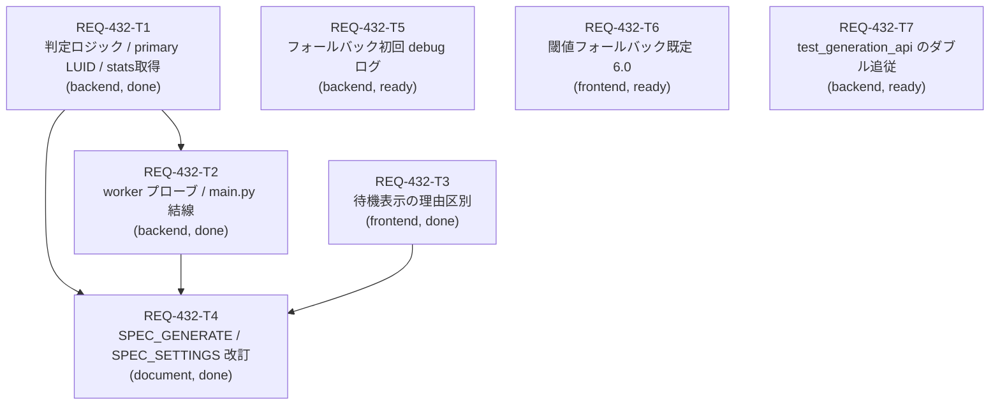

# Implementation Plan - REQ-432: VRAMガードの自セッション残留判別・primary LUID限定・判定直前サンプリング

## User Review Required

> [!IMPORTANT]
> **主要な設計判断**（詳細は設計書 [REQ-432.md](docs/design/REQ-432.md)、テスト計画 [REQ-432-test-plan.md](docs/design/REQ-432-test-plan.md)）
> - **採用案 (b): 自セッション残留をガード判定から除外**。ComfyUI `/system_stats` の torch 予約量を ComfyUI 自身が回収できる残留とみなします。判定用空き = (デバイス空き − torch 予約内の未使用量) + torch 予約量 です。実機計測 B 点では約 13.8GB となり、閾値 6.0GB でも保留しません（AC-1）。
> - **案 (a) の自動 /free は採用しません**（既定・オプトインとも）。毎回モデル再ロードが発生し、Windows 側計測の約 12 秒の反映遅延も残るため、単独では AC-1 を満たしません。手動「メモリ解放」は現状のままです。
> - **保留理由の区別（AC-2）**: `external`（残留を除いても不足 = 他プロセス）と `unattributed`（ComfyUI 値が取得できず占有元を判別できない）。自セッション残留は保留理由になりません。`SYSTEM_STATS` に追加フィールドで配信し、ログと待機表示でも区別します。
> - **primary LUID 限定（AC-3）**: PDH のアダプタ使用量を primary LUID のインスタンスだけで合算します。未解決・一致 0 件のときは全合算（安全側）とし、0 にはしません。
> - **判定直前の取得（AC-4）**: worker は判定のたびに新規取得（PDH 収集 + `/system_stats`、timeout 1.0 秒）します。保留中は 1.0 秒間隔で再評価します。
> - **REST/OpenAPI は変更しません**。`SYSTEM_STATS` は加算のみで、`vram_safe` の意味だけを改訂します（SPEC 改訂対象）。
> - **リスク分類 high / V1 Baseline**: 生成ゲートと公開 WS 契約の変更を含むため、Gate 2 フルスイートと Gate 3（E2E 全件 + 実機 R-1〜R-4）を必須とします。

> [!WARNING]
> **ご判断いただきたい事項**
> 1. **Q1（受入の前提）**: WSL2 内の ComfyUI が報告する空き容量が、Windows ネイティブの他プロセス（LM Studio 等）の使用量を反映するかは 1 標本の整合しか確認していません。Gate 3 の実機 R-2 を必須の受入証跡とし、不成立なら判定式を `min(ComfyUI 基準, PDH空き + torch予約量)` に切り替える再設計に戻します。
> 2. **Q2（T3 の要否）**: AC-2 の「区別できること」を利用者が画面上で判別できる形にするため、Frontend の文言・空き表示（T3）を含めています。ログと WS フィールドによる区別だけでよければ T3 を除外できます。
> 3. **Q3**: Settings の VRAM メーターは物理空きのまま変更しません（SPEC 注記のみ）。メーターが赤でも生成は保留されないという見え方の差が残ります。揃える場合は別 PBI とします。
> 4. **Q4**: 自動 /free のオプトイン設定が必要な場合は別 PBI とします。

## Proposed Changes

### REQ-432-T1: 判定ロジック・primary LUID・新規サンプリング・ComfyUI stats（engineer / backend / code）
- [MODIFY] `backend/app/services/resource_monitor.py`（`parse_comfy_system_stats`、`evaluate_vram_guard`、`sum_adapter_dedicated_usage`、`_read_counter_items`、`configure_comfy_stats`、`sample_guard_status`、`SYSTEM_STATS` 追加フィールド）
- [MODIFY] `backend/app/services/comfy_generation_bridge.py`（`system_stats()`。ヘルス状態は変更しない）
- [MODIFY] `backend/tests/governance/test_vram_guard.py`、`backend/tests/integration/legacy/test_comfy_generation_bridge.py`（PBT・故障注入）

### REQ-432-T2: worker の判定直前プローブと結線（engineer / backend / code、T1 に依存）
- [MODIFY] `backend/app/services/generation_service.py`（`vram_probe`、`vram_recheck_seconds`、`_is_vram_blocked` の判定用空き優先、理由付きログ）
- [MODIFY] `backend/app/main.py`（`configure_comfy_stats(bridge.system_stats)`、`vram_probe=resource_monitor.sample_guard_status`、`vram_recheck_seconds=1.0`）
- [MODIFY] `backend/tests/integration/legacy/test_generation_service.py`

### REQ-432-T3: 待機表示の理由区別（engineer / frontend / code、並列可）
- [MODIFY] `frontend/src/store/types.ts`、`frontend/src/pages/GeneratePage/hooks/useGenerateAction.ts`、`DesktopLayout.tsx`、`MobileLayout.tsx`
- [MODIFY] `vramGuardIntegration.test.ts`、`DesktopLayout.test.tsx`、`MobileLayout.test.tsx`

### REQ-432-T4: SSoT 改訂（doc-editor / document、T1〜T3 に依存）
- [MODIFY] `docs/specs/SPEC_GENERATE.md`（L274、§2-10 L283、§5-4 L476-L486。既定値「4.0GB」と実装 6.0GB の食い違いも確認・修正）
- [MODIFY] `docs/specs/SPEC_SETTINGS.md`（L113 メーター注記）

### 手戻り（ユーザー承認済み。T1〜T4 は done のため再オープンせず、新規カードで対応）

#### REQ-432-T5: primary LUID フォールバック時の初回のみ debug ログ（engineer / backend / code、依存なし、`[REQ-432/AC-3]`）
- [MODIFY] `backend/app/services/resource_monitor.py`（`logger` とモジュールフラグ `_adapter_fallback_logged` を追加。`sum_adapter_dedicated_usage` の戻り値は不変）
- [MODIFY] `backend/tests/governance/test_vram_guard.py`（末尾に AC3-U-4/U-5 を追記）

#### REQ-432-T6: Settings 閾値フォールバック既定値 4.0 → 6.0（engineer / frontend / code、依存なし、SPEC 整合の是正。タグは最も近い `[REQ-432/AC-2]`）
- [MODIFY] `frontend/src/pages/SettingsPage/components/VramGuardSection.tsx`（`VRAM_LIMIT_DEFAULT = 6.0`）
- [MODIFY] `frontend/src/pages/SettingsPage/components/__tests__/VramGuardSection.test.tsx`（AC2-FE-5 追加、既存 L208 の期待値 4 → 6）
- grep の結果、4.0 フォールバックを固定値で前提にするテストは L208 のみでした。他テストの `vram_min_free_gb: 4` はサーバー応答のモック値で、変更不要です。

#### REQ-432-T7: lifespan 用テストダブルの実インターフェース追従（engineer / backend / code、依存なし、独立 QA の Gate 2 FAIL を受けた手戻り）
- [MODIFY] `backend/tests/integration/legacy/test_generation_api.py` のみ（`FakeMonitor` に `configure_comfy_stats`（同期、provider を記録）と `async sample_guard_status`（`self.status` から導出し、`vram_guard_free_gb` の既定値は `vram_free_gb`）を追加。`FakeBridge` に `async system_stats() -> None` を追加。`main.py` は引数評価で `bridge.system_stats` も参照するため、FakeMonitor だけでは同じ 13 件が再び ERROR になります）
- `vram_recheck_seconds=1.0` の注入により、`test_committed_work_continues_after_request_without_browser_connection` の待機（約 1.0〜1.6 秒）が競合しうるため、待機上限だけを 3.0 秒に広げます（assert は変更しません）
- 本番コード（`main.py` を含む）は変更しません。設計書 §8.1 に影響分析の補足（モジュールレベル `resource_monitor` のテストダブル一覧）を追記しました。grep の結果、修正が必要なダブルはこのファイルだけでした

## Task DAG

- 最大深さ 2（T1 → T2 → T4）。T5・T6・T7 は依存なしの独立ノードで、互いに並列に実施できます（所有ファイルの重複なし: T5 は backend 2 ファイル、T6 は frontend 2 ファイル、T7 は `test_generation_api.py` の 1 ファイル）。
- T5 は T1 が所有していた `resource_monitor.py` と `test_vram_guard.py` を引き継ぎます（T1 は done）。
- ファイル所有の重複はありません（設計書 §8 D3）。
- 手戻り後の Gate 1〜3 は、T5〜T7 を含む最終候補で新規に再実行します。

## Trade-offs and Alternatives

| 論点 | 採用 | 代替案と不採用理由 |
|---|---|---|
| 残留の扱い | (b) 判定から除外 | (a) 自動 /free: 毎回再ロード（数秒〜十数秒）が発生し、PDH 遅延（約 12 秒）も残る。他クライアントの実行とも競合しうる |
| 判定の主値 | ComfyUI `/system_stats`（即時に更新） | PDH のプロセス別カウンタ: ComfyUI が `vmwp.exe` としてしか見えず特定できない。遅延も大きい |
| 外部占有の検知 | ComfyUI のデバイス空き | `min(ComfyUI 基準, PDH + R)`: 外部検知はより堅牢だが、手動 /free 直後に約 12 秒誤保留し、理由も誤る。Q1 不成立時の代替として保持 |
| 鮮度 | 判定のたびに新規取得、保留中は 1.0 秒間隔 | 0.2 秒ポーリング毎の取得: `/system_stats` の負荷が過大。2.5 秒キャッシュ: AC-4 を満たさない |
| primary 不一致時 | 全合算（安全側） | 0 を返す: 空きを過大評価して保護を失う |
| 表示値 | 物理空きと判定用空きを分けて配信 | `vram_free_gb` の意味変更: Settings・ヘッダー・REST の意味が変わり影響範囲が広い |
| ロック内でのプローブ | timeout 1.0 秒で上限を設ける | ロック外への移動: worker 構造の大幅な改修となり範囲外 |

| T5 のログ抑止 | モジュールフラグで初回のみ（共通 1 フラグ） | 理由別に各 1 回: 情報量は増えるが状態が増える。周期ごとに出力: 2.5 秒ごとにログが増え続ける。マルチスレッドで初回が 2 回出る可能性は debug ログのため許容 |
| T6 の既定値 | Backend・SPEC の 6.0 に揃える | 4.0 のまま SPEC 側を注記: Backend 既定と表示初期値の食い違いが残るため不採用 |
| T7 の是正方法 | テストダブルを本番の C3/C5 シグネチャに合わせる | `main.py` に `getattr`/`hasattr` の防御を追加: 本番コードがテスト都合で分岐し、契約欠落を隠すため不採用。ダブルを `MagicMock` に置換: 契約外の呼び出しも通ってしまい検出力が落ちるため不採用 |
| T7 の待機上限 | 3.0 秒の時間ベース上限 | `main.py` の再評価間隔をテストで短縮: 本番値を monkeypatch する内部パッチになるため不採用 |

**残存リスク**: Q1（WSL の空き値の意味）、保留中のキャンセル応答が最大約 1 秒遅れうること、監視表示と worker 判定の最大 1 周期の食い違い、Settings メーターと判定基準の差。

## Verification Plan

- **Gate 1**: `backend\.venv\Scripts\python.exe -m mypy backend` / `backend\.venv\Scripts\python.exe -m pytest backend/tests/unit` / `npm.cmd --prefix frontend run typecheck` / `backend\.venv\Scripts\python.exe scripts/run_in_dir.py frontend npm.cmd exec -- vitest run src/utils src/components/**/__tests__` / `backend\.venv\Scripts\python.exe scripts/verify_ui_invariants.py` / `backend\.venv\Scripts\python.exe scripts/verify_openapi_sync.py` / `backend\.venv\Scripts\python.exe scripts/verify_test_naming.py --strict`
- **Gate 2**: `backend\.venv\Scripts\python.exe scripts/run_full_suite.py`（ファイルフィルタなし）
- **Gate 3**: `backend\.venv\Scripts\python.exe scripts/run_e2e.py`（全件）、Red Team RT-1〜RT-11、実機 R-1〜R-4（証跡は `docs/logs/REQ-432/`）
- **ケース選択**: BE `-k "REQ-432 and AC-n"`、FE `-t "REQ-432/AC-n"`。ケース ID はテスト計画 §4。
