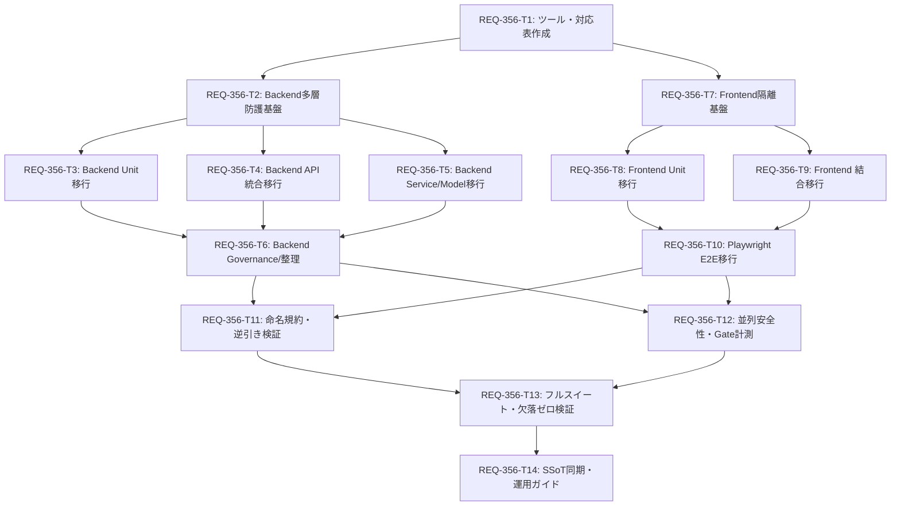

# Implementation Plan: REQ-356 テストスイート再構成 (SPEC-TESTING v2.1 準拠)

## Overview

Prompt Surgeon のテストスイートをテストアーキテクチャ設計仕様書（SPEC-TESTING v2.1 / `docs/specs/SPEC_TEST_ARCHITECTURE.md`）に沿って再構成する。
フラットなチケット名テストファイル（`test_req*.py`, `e2e_req*.test.tsx`）を全廃し、責務・レイヤー別の配置（Unit / Integration / Governance / E2E Playwright）へ集約する。
多層防護（SAVEPOINT ロールバック、respx トランスポート遮断、tmp_path サンドボックス、Frontend 5層ステート分離）により、テストの副作用と実行時間（旧約113秒から大幅短縮）を抜本的に改善する。

## Task Dependency Visualization & Parallel Design [MUST [G-4-4-B]]

### 並列実行可能グループ
- **Backend 単体/結合並列ブランチ**: T3 (Unit), T4 (API), T5 (Services/Models) は T2 完了後に並行実行可能。
- **Frontend 単体/結合並列ブランチ**: T8 (Unit) と T9 (Integration) は T7 完了後に並行実行可能。
- **Backend & Frontend 独立ブランチ**: Backend 側（T2〜T6）と Frontend 側（T7〜T10）は相互にブロックせず並行実行可能。
- **検証並列ブランチ**: T11 (命名規則検証) と T12 (並列安全性・Gate時間計測) は並行実行可能。

---

## Proposed Changes

#### [LOCAL NEW] [scripts/verify_test_naming.py](file:///c:/Users/audih/ws/comfy-create-helper2/scripts/verify_test_naming.py)
- PBI紐づきテスト名形式（`[REQ-xxx/AC-n]`）およびファイル名 `req\d+` 排除を機械検証するスクリプト。

#### [LOCAL NEW] [docs/design/REQ-356-test-mapping.md](file:///c:/Users/audih/ws/comfy-create-helper2/docs/design/REQ-356-test-mapping.md)
- 既存全テスト（約757件 + FE約80ファイル）の移行先対応表および非破壊・削除記録表。

#### [LOCAL MODIFY] [backend/tests/conftest.py](file:///c:/Users/audih/ws/comfy-create-helper2/backend/tests/conftest.py)
- `sqlite:///:memory:` + SAVEPOINT Commit Interceptor、`tmp_path` snapshot サンドボックス、`respx` トランスポート遮断を実装。

#### [LOCAL NEW] [backend/tests/unit/test_schemas.py](file:///c:/Users/audih/ws/comfy-create-helper2/backend/tests/unit/test_schemas.py)
- DB非接続の純粋ロジック・スキーマ検証テストを配置。

#### [LOCAL NEW] [backend/tests/integration/api/test_workflows.py](file:///c:/Users/audih/ws/comfy-create-helper2/backend/tests/integration/api/test_workflows.py)
- FastAPI ルーターに対する HTTP 統合テスト（TestClient + SAVEPOINT ロールバック）。

#### [LOCAL NEW] [backend/tests/governance/test_no_req_naming.py](file:///c:/Users/audih/ws/comfy-create-helper2/backend/tests/governance/test_no_req_naming.py)
- Backend ディレクトリ階層規約（直下 `conftest.py`, `unit`, `integration`, `governance` のみ）を担保する回帰テスト。

#### [LOCAL NEW] [frontend/src/test/utils/storeHelpers.ts](file:///c:/Users/audih/ws/comfy-create-helper2/frontend/src/test/utils/storeHelpers.ts)
- `resetTestStore(overrides, true)` による Zustand 状態の完全置換初期化ヘルパー。

#### [LOCAL NEW] [frontend/src/test/utils/queryHelpers.ts](file:///c:/Users/audih/ws/comfy-create-helper2/frontend/src/test/utils/queryHelpers.ts)
- `gcTime: 0` の短命 React Query クライアント生成ヘルパー。

#### [LOCAL NEW] [frontend/src/test/utils/networkGuard.ts](file:///c:/Users/audih/ws/comfy-create-helper2/frontend/src/test/utils/networkGuard.ts)
- 実 fetch / 実 WebSocket 呼び出しを検出して遮断する多層防御ガード。

#### [LOCAL NEW] [frontend/e2e/stickyHeader.spec.ts](file:///c:/Users/audih/ws/comfy-create-helper2/frontend/e2e/stickyHeader.spec.ts)
- Playwright による実ブラウザ環境での sticky 追従および実スクロール検証（Desktop & Mobile）。

---

## Trade-off Disclosure [MUST [G-03]]

1. **ファイル名PBI番号全廃 vs テスト名タグプレフィックス (`[REQ-xxx/AC-n]`)**:
   - *採用理由*: ファイル名にPBI番号を含めると、複数PBIで拡張されたコードのテストが分散・重複し、機能ごとの凝集度が失われる。ファイル名を機能・モジュール単位とし、テストケース名に `[REQ-xxx/AC-n]` を付与することで、`grep -rn "REQ-xxx"` による完全なトレーサビリティとモジュールコロケーションを両立する。
2. **SAVEPOINT インターセプター vs テスト毎の DB 再作成 (Base.metadata.create_all)**:
   - *採用理由*: テスト毎に SQLite テーブルを再作成すると、700件超のテストで数百秒のオーバーヘッドが発生する。セッション開始時にインメモリに1度テーブルを作成し、テスト毎に SAVEPOINT をロールバックする方式により、完全なクリーン状態を維持しつつ数ミリ秒でテストを切り替えることができる。
3. **jsdom 擬似スクロールテスト全廃 vs Playwright E2E への集約**:
   - *採用理由*: jsdom はレイアウトエンジンを持たないため、`scrollTop` や `position: sticky` の挙動をモックしても偽陽性または偽陰性を生みやすい。SPEC-TESTING v2.1 境界B規約に従い、物理スクロールと sticky は Playwright に集約し、jsdom 側での擬似スクロールテストを禁止する。
4. **制約とリスク**:
   - Backend と Frontend の既存テスト全件（約800件）を再編するため、一時的なテスト欠落のリスクが存在する。これに対処するため、事前抽出した対応表（`REQ-356-test-mapping.md`）との厳格な突合（AC-10）および機械検証スクリプト（AC-15）を必須ゲートとする。

