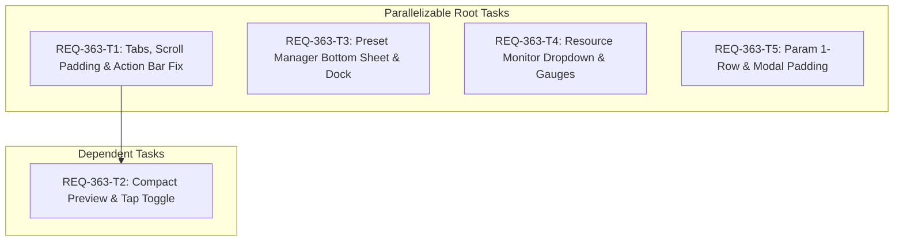

# Implementation Plan: REQ-363 モバイルレイアウト破綻解消およびUI操作性最適化

スマートフォン実機環境（幅360px〜390px等）において、プロンプトタブの重なり・見切れ、チェックボックスタップによるアクションバー消失、プレビュー常時占有による操作性低下、プリセットモーダルのアドレスバー突き抜け、リソースモニタのヘッダー被り、およびパラメータ行の冗長な2行化を解消し、モバイルでの快適な生成ワークフローを実現します。

## Proposed Changes

### Frontend Subsystem

#### [LOCAL MODIFY] [MobileLayout.tsx](file:///c:/Users/audih/ws/comfy-create-helper2/frontend/src/pages/GeneratePage/components/MobileLayout.tsx)
- **プロンプトタブ横スクロール化 (AC-1)**:
  - 各タブボタンに shrink-0 whitespace-nowrap を厳格適用し、幅狭端末での折り返し・文字重なりを根絶。
- **isTextInput 判定厳密化 (AC-2)**:
  - isTextInput において target.type !== 'checkbox' && target.type !== 'radio' && target.type !== 'range' && target.type !== 'button' を明示し、チェックボックスタップ時にアクションバーが誤って隠れる（消失する）バグを修正。
- **スクロール終端パディング (AC-3)**:
  - スクロールコンテナの pb に固定下部バーおよびセーフエリアを考慮したパディング (pb-[calc(54px+env(safe-area-inset-bottom)+56px+16px)] 等) を確保し、最下部タグチップがボタンの影に隠れないようにする。
- **コンパクトプレビュー＆手動トグル (AC-5)**:
  - isCompactPreview 状態（初期値 true）を導入。
  - 初期表示時は約105pxのコンパクト表示とし、プレビュー領域タップで [コンパクト: 105px] ⇔ [展開プレビュー: 220px/42vh] を手動トグル可能にする。
  - 生成開始時（isGenerating 変化時）に自動で拡大展開させず直前のトグル状態を維持し、プロンプト編集・キュー投入をスムーズに継続可能にする。
  - 展開状態で再度タップまたは拡大ボタン押下により、全画面モーダルへ展開。

#### [LOCAL MODIFY] [GeneratePage.tsx](file:///c:/Users/audih/ws/comfy-create-helper2/frontend/src/pages/GeneratePage.tsx)
- **ボトムシートコンテナ化 (AC-4)**:
  - プリセット管理モーダルの外側コンテナを、モバイル時に画面下部配置（items-end md:items-center）かつ高さ上限キャップ（max-h-[75dvh]）のボトムシート形式へ変更。
  - iOS Safari 等のアドレスバー突き抜け・タイトル見切れを根絶。

#### [LOCAL MODIFY] [PresetManagerPanel.tsx](file:///c:/Users/audih/ws/comfy-create-helper2/frontend/src/components/PresetManagerPanel.tsx)
- **固定操作ドック配置 (AC-4)**:
  - プリセット管理下部に固定ドック領域（shrink-0 bg-surface-2 border-t border-white/10 pt-3）を配置。
  - 既存の「全選択」「全解除」ボタン（セットチェック状態切り替え用）、および「💾 上書き保存」「➕ 別名で保存」、Scene Generator 連携ボタンを固定配置し、長大なプリセットリストでもスクロールなしで即時操作可能にする。
  - 一括操作モード切替（ListChecks）や複数選択ツールバー、並び替えハンドルなどの既存機能は 100% 維持。

#### [LOCAL MODIFY] [ResourceHoverMonitor.tsx](file:///c:/Users/audih/ws/comfy-create-helper2/frontend/src/components/common/header/ResourceHoverMonitor.tsx)
- **ドロップダウンカード化 (AC-6)**:
  - ヘッダー全体を覆う330px横長カプセルを廃止し、VRAMピル直下に展開するフローティングカード（w-[240px] absolute right-0 top-full mt-2）へ改修。
  - VRAM（パープル #7C6FDD）および RAM（ブルー #3B82F6）のプロポーショナルバーゲージとパーセンテージ表示を配置。
  - 44px 以上のタップターゲットおよび外側タップ閉止を確保し、ヘッダーの「Generate」タイトルやステータスバッジを破壊・被覆しない。

#### [LOCAL MODIFY] [ParamPanel.tsx](file:///c:/Users/audih/ws/comfy-create-helper2/frontend/src/components/ParamPanel.tsx)
- **スマート適応型1行レイアウト (AC-7)**:
  - 無条件の2行化による余白の浪費を撤廃。
  - 数値ステッパー（Steps, CFG, Denoise 等）やトグルはコンパクト（約105px）なため、ラベル領域（`flex-1 pr-2`）と合わせて確実に1行を維持。
  - セレクトボックス（Sampler, Scheduler 等）は w-36 固定を撤廃し、モバイル時に w-[125px]（または適応幅）とし、1行レイアウトを基本とする。

#### [LOCAL MODIFY] [AddAssetModal.tsx](file:///c:/Users/audih/ws/comfy-create-helper2/frontend/src/pages/GeneratePage/components/AddAssetModal.tsx)
- **モーダルパディングの引き締め (AC-8)**:
  - パディングを p-3.5（14px）に最適化し、一覧表示領域を拡大。

---

### Test Suites (No Ticket-Named Files [SPEC-TESTING / REQ-356])

#### [LOCAL MODIFY] [MobileLayout.test.tsx](file:///c:/Users/audih/ws/comfy-create-helper2/frontend/src/pages/GeneratePage/components/__tests__/MobileLayout.test.tsx)
- [REQ-363/AC-1]: プロンプトタブの shrink-0 と whitespace-nowrap による折り返し防止の検証。
- [REQ-363/AC-2]: チェックボックス・ラジオボタン操作時にアクションバーが非表示にならないことの検証。
- [REQ-363/AC-3]: スクロール終端パディングにより最下部タグチップが隠れないことの検証。
- [REQ-363/AC-5]: 初期コンパクト表示（105px）、タップ手動トグル、および生成ジョブ開始時の状態維持の検証。

#### [LOCAL MODIFY] [GeneratePage.test.tsx](file:///c:/Users/audih/ws/comfy-create-helper2/frontend/src/pages/GeneratePage/__tests__/GeneratePage.test.tsx)
- [REQ-363/AC-4]: プリセット管理ボトムシートの max-h-[75dvh]、固定操作ドック、全選択/全解除ボタン・保存ボタンの常時アクセスの検証。

#### [LOCAL MODIFY] [ResourceHoverMonitor.test.tsx](file:///c:/Users/audih/ws/comfy-create-helper2/frontend/src/components/common/header/__tests__/ResourceHoverMonitor.test.tsx)
- [REQ-363/AC-6]: VRAMピル押下時のドロップダウンカード展開、プロポーショナルバーゲージ描画、ヘッダー非破壊の検証。

#### [LOCAL MODIFY] [ParamPanel.test.tsx](file:///c:/Users/audih/ws/comfy-create-helper2/frontend/src/pages/GeneratePage/components/__tests__/ParamPanel.test.tsx)
- [REQ-363/AC-7]: モバイルでのステッパー・セレクトの1行配置とラベル非折れ・幅最適化の検証。

#### [LOCAL MODIFY] [AddAssetModal.test.tsx](file:///c:/Users/audih/ws/comfy-create-helper2/frontend/src/pages/GeneratePage/components/__tests__/AddAssetModal.test.tsx)
- [REQ-363/AC-8]: モバイル表示時の p-3.5 パディング最適化の検証。

---

## Task Dependency & Parallel Execution Plan [MUST [G-4-4]]



| Task ID | Title | Impacted Files | Parallelizable | Dependencies |
| :--- | :--- | :--- | :--- | :--- |
| **REQ-363-T1** | プロンプトタブ横スクロール・余白・isTextInput修正 | `MobileLayout.tsx`, `MobileLayout.test.tsx` | YES (Root) | なし |
| **REQ-363-T2** | コンパクトプレビュー初期化＆手動トグル | `MobileLayout.tsx`, `MobileLayout.test.tsx` | NO | `REQ-363-T1` (同一ファイル競合防止) |
| **REQ-363-T3** | プリセット管理ボトムシート＆固定操作ドック | `GeneratePage.tsx`, `PresetManagerPanel.tsx`, `GeneratePage.test.tsx` | YES (Root) | なし |
| **REQ-363-T4** | リソースモニタドロップダウンカード化 | `ResourceHoverMonitor.tsx`, `ResourceHoverMonitor.test.tsx` | YES (Root) | なし |
| **REQ-363-T5** | パラメータ行スマート1行化＆モーダル余白 | `ParamPanel.tsx`, `AddAssetModal.tsx`, `ParamPanel.test.tsx`, `AddAssetModal.test.tsx` | YES (Root) | なし |

---

## Verification Plan

### Automated 3-Gate Baseline

1. **Gate 1: Static Typecheck**
```bash
cd frontend; npm run typecheck
```

2. **Gate 2: Unit & Component Tests**
```bash
cd frontend; npx vitest run src/pages/GeneratePage/components/__tests__/MobileLayout.test.tsx -t 'REQ-363'
cd frontend; npx vitest run src/pages/GeneratePage/__tests__/GeneratePage.test.tsx -t 'REQ-363'
cd frontend; npx vitest run src/components/common/header/__tests__/ResourceHoverMonitor.test.tsx -t 'REQ-363'
cd frontend; npx vitest run src/pages/GeneratePage/components/__tests__/ParamPanel.test.tsx -t 'REQ-363'
cd frontend; npx vitest run src/pages/GeneratePage/components/__tests__/AddAssetModal.test.tsx -t 'REQ-363'
cd frontend; npm test
```

3. **Gate 3: E2E & Red Team Scenarios**
- フォーカス競合 (AC-2): チェックボックスとテキスト入力を高速交互タップしてもアクションバーの表示/非表示が正しく追従すること。
- プレビュートグル連打 (AC-5): プレビュー領域を連続タップしても状態破綻せず生成進行プログレスと連動すること。
- プリセット大量登録 (AC-4): 30件以上のプリセットがある場合も下部ドックが固定され、リスト内のみスクロール可能であること。

---

## Trade-off Disclosure [MUST [G-03]]
1. **全画面モーダルプレビューへの遷移が2段階タップ**: コンパクトプレビュー（105px）から全画面拡大モーダルへ遷移するには、1度タップして標準プレビュー（220px/42vh）に展開してから再度タップ（または拡大ボタン押下）する必要があります。これは、画像閲覧よりも高頻度に行われるプロンプト編集・連続キュー投入の快適性を最優先するための意図的なトレードオフです。
2. **ボトムシートの上限高さ制限（75dvh）**: 画面高の75%を上限とすることで、iOS Safari等のブラウザアドレスバーによる上部突き抜け・タイトル切断を確実に防止しますが、一度に視認可能なプリセット件数は4〜5件程度となります（内部スクロールで全件アクセス可能）。
3. **セレクトボックスの幅コンパクト化（125px）**: 幅360pxの極小画面でラベルとセレクトを1行に収めるため、選択肢の閉じた状態では長大なスケジューラー名等が末尾省略される場合があります（ドロップダウンを開けば全文字確認可能）。
