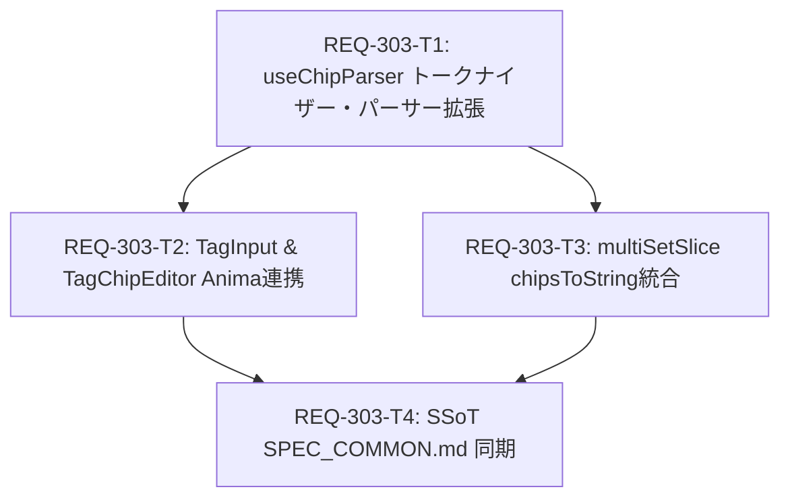

# Implementation Plan: REQ-303 Animaモードにおけるピリオド区切りタグチップ分割とプロンプト結合制御

## User Review Summary
Animaモード（自然言語/センテンス指向プロンプト）において、タグチップ入力およびプロンプト送信処理を自然言語構文に最適化します。
ユーザーがタグ入力欄でピリオド（`.`）を入力またはペーストした際に、末尾のピリオドを保持したまま文単位でタグチップ化し、プロンプト生成時には直前のチップがピリオドで終わる場合にカンマではなく半角スペース（`" "`）で後続と結合する仕組みを導入します。
括弧付きのタグ強度記号（`(tag:1.2)`）や文中の小数点（`1.5`）は区切りとして誤認されないよう保護され、通常モード（非Animaモード）では既存のカンマ区切りおよび一律カンマ結合の動作が100%維持されます。

---

## Proposed Changes

### Tag Parser & Serializer Core
#### [LOCAL MODIFY] [useChipParser.ts](file:///c:/Users/audih/ws/comfy-create-helper2/frontend/src/components/TagChipEditor/useChipParser.ts)
- `splitTags(text: string, isAnimaMode: boolean = false): string[]` を新規実装。
  - 括弧ネスト（`()`, `[]`, `{}`）深度を追跡し、括弧内での区切り分割を抑止。
  - `isAnimaMode: true` 時は、直前後の数字判定により小数点を保護しつつ、文末ピリオドをトークン末尾に残して分割。
  - 連続区切りによる空トークンを除外。
- `parseToChips(text: string, isAnimaMode: boolean = false): TagChip[]` を更新し、`splitTags` を用いてチップを生成。
- `chipsToString(chips: TagChip[], isAnimaMode: boolean = false): string` を更新し、Animaモード時は直前チップが `.` 終端の場合に半角スペース `" "` で結合する動的ロジックを実装。

#### [LOCAL MODIFY] [useChipParser.test.ts](file:///c:/Users/audih/ws/comfy-create-helper2/frontend/src/components/TagChipEditor/__tests__/useChipParser.test.ts)
- AC-1〜AC-6 および境界値 RT-1〜RT-4 に対する単体テストを追加。

---

### UI Input & Component Integration
#### [LOCAL MODIFY] [TagInput.tsx](file:///c:/Users/audih/ws/comfy-create-helper2/frontend/src/components/TagChipEditor/TagInput.tsx)
- Props に `isAnimaMode?: boolean` を追加。
- `handleInputChange` で `isAnimaMode` かつ `val.endsWith('.')` の際に、括弧外であれば末尾ピリオドを保持してチップ確定。
- `handlePaste` で `splitTags(text, isAnimaMode)` を使用して一括チップ生成。

#### [LOCAL MODIFY] [index.tsx](file:///c:/Users/audih/ws/comfy-create-helper2/frontend/src/components/TagChipEditor/index.tsx)
- `<TagInput ... isAnimaMode={isAnimaMode} />` にモードを伝播。
- テキストモード切替（`handleSwitchToTextMode`）およびチップ復帰（`handleSwitchToChipMode`）での `chipsToString` / `parseToChips` 呼び出しに `isAnimaMode` を適用。
- 外部プロパティ同期および内部変更通知の `chipsToString` 呼び出しに `isAnimaMode` を適用。

#### [LOCAL MODIFY] [TagChipEditor.test.tsx](file:///c:/Users/audih/ws/comfy-create-helper2/frontend/src/components/TagChipEditor/__tests__/TagChipEditor.test.tsx)
- Animaモードでのピリオド確定、ペースト、テキストモード往復（AC-7）のコンポーネントテストを追加。

---

### Store & Effective Param Synchronization
#### [LOCAL MODIFY] [multiSetSlice.ts](file:///c:/Users/audih/ws/comfy-create-helper2/frontend/src/store/slices/multiSetSlice.ts)
- `chipsToString` を `useChipParser.ts` から再利用してコード重複を解消。
- `MultiSetState` に `isAnimaMode: boolean`（デフォルト `false`）と `setIsAnimaMode` アクションを追加。
- `getEffectiveParamValues(paramValues, promptChips, isAnimaMode?: boolean)` に `isAnimaMode` を伝播。

#### [LOCAL MODIFY] [types.ts](file:///c:/Users/audih/ws/comfy-create-helper2/frontend/src/store/types.ts)
- `MultiSetState` および `MultiSetActions` の型定義に `isAnimaMode` / `setIsAnimaMode` を追加。

#### [LOCAL MODIFY] [multiSetSlice.test.ts](file:///c:/Users/audih/ws/comfy-create-helper2/frontend/src/store/__tests__/slices/multiSetSlice.test.ts)
- Animaモードでの有効パラメータ抽出（空白結合）のテストを追加。

---

### SSoT Documentation
#### [LOCAL MODIFY] [SPEC_COMMON.md](file:///c:/Users/audih/ws/comfy-create-helper2/docs/specs/SPEC_COMMON.md)
- 第3章「TagChipEditor コンポーネント」の仕様（TagInput入力ルール、パース規則、`chipsToString` 結合仕様）を更新。

---

## Task Dependency & Parallel Execution Plan

| タスクID | タイトル | 担当スコープ | 依存関係 | 並列実行 |
|---|---|---|---|---|
| **REQ-303-T1** | useChipParser トークナイザー・パーサー拡張 | `useChipParser.ts`, テスト | なし (Root) | 単独先行 |
| **REQ-303-T2** | TagInput & TagChipEditor Anima連携 | `TagInput.tsx`, `index.tsx`, テスト | T1 | **T3と並列可能** |
| **REQ-303-T3** | multiSetSlice chipsToString統合 | `multiSetSlice.ts`, `types.ts`, テスト | T1 | **T2と並列可能** |
| **REQ-303-T4** | SSoT SPEC_COMMON.md 同期 | `SPEC_COMMON.md` | T2, T3 | 最終同期 |

---

## Verification Plan

### Automated Tests
- **型チェック**: `cd frontend; npm run typecheck` (0 errors)
- **T1 単体テスト**: `cd frontend; npx vitest run src/components/TagChipEditor/__tests__/useChipParser.test.ts`
- **T2 コンポーネントテスト**: `cd frontend; npx vitest run src/components/TagChipEditor/__tests__/TagChipEditor.test.tsx`
- **T3 ストアテスト**: `cd frontend; npx vitest run src/store/__tests__/slices/multiSetSlice.test.ts`
- **リグレッション検証**: `cd frontend; npm test` (全スイートPASS)

### Manual / Scenario Verification
- **AC-1**: Animaモードの `TagInput` で `1girl.` と入力し、末尾ピリオド付きのタグが生成されることを確認。
- **AC-2 & AC-3**: `1girl, solo. red dress. (tag:1.2), masterpiece` をペーストし、5つのチップに意図通り分割されることを確認。
- **AC-4 & AC-5**: 有効チップ間に無効チップが挟まれている場合でも、`chipsToString` で末尾ピリオド直後が半角スペースで結合されることを確認。
- **AC-6**: 通常モードにおいてピリオド付きテキストが分割されず、従来通りカンマ結合されることを確認。
- **AC-7**: テキストモードとチップモードを往復した際、ピリオド付きチップの構造が維持されることを確認。

---

## Trade-off Disclosure
1. **ピリオド直後の単独入力確定と小数点入力の競合**:
   - **トレードオフ**: `TagInput` においてユーザーが数字の直後に `.` を入力した際、それが文末ピリオドなのか小数点の途中入力（例: `1.` の後に `5` を入力しようとしている）なのかをリアルタイムに区別することは困難です。
   - **採用方針**: 括弧ネスト外かつ単語末尾で `.` が入力された場合は即座にチップとして確定します。タグ内で小数を直接指定したい場合は、Stable Diffusion の標準記法である `(tag:1.5)` のように括弧で囲むか、ペーストによる入力を行うことで小数点が確実に保護されます。
2. **`chipsToString` の重複解消とストア依存**:
   - **トレードオフ**: `multiSetSlice.ts` に存在していた独自の `chipsToString` を `useChipParser.ts` からのインポートに統一します。これにより結合ロジックの二重管理を防ぎますが、ストアレイヤーがコンポーネント配下のユーティリティに依存する結合度が生じます。
   - **採用方針**: `useChipParser.ts` の `chipsToString` は純粋関数（Pure Function）であり、Reactコンポーネントへの副作用を持たないため、単体ユーティリティ関数として安全に共有可能です。
