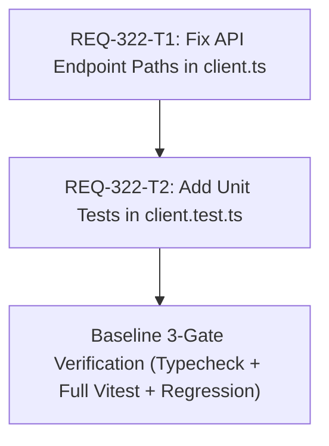

# Implementation Plan: REQ-322 Fix LoRA Studio API Path Double Prefix

Dataset Studio (LoRA Studio) において、直交マトリクス再計算やプロジェクト操作を行うと、APIリクエスト先が `/api/api/...` となり `405 Method Not Allowed` が発生する問題を解消するための実装計画です。

## Proposed Changes

### Frontend Subsystem

#### [LOCAL MODIFY] [frontend/src/api/client.ts](file:///c:/Users/audih/ws/comfy-create-helper2/frontend/src/api/client.ts)
- `settingsApi`: `/api/settings/vram` を `/settings/vram` に変更。
- `datasetApi`: `/api/dataset/...` を `/dataset/...` に変更（全9メソッド）。
- `trainingApi`: `/api/training/...` を `/training/...` に変更（全5メソッド）。
- `benchmarkApi`: `/api/benchmark/...` を `/benchmark/...` に変更（全2メソッド）。

#### [LOCAL MODIFY] [frontend/src/api/__tests__/client.test.ts](file:///c:/Users/audih/ws/comfy-create-helper2/frontend/src/api/__tests__/client.test.ts)
- `settingsApi`, `datasetApi`, `trainingApi`, `benchmarkApi` のインポートを追加。
- 各APIメソッドが正しく `/api/<endpoint>` に対してリクエストを発行すること、および `/api/api/` という二重プレフィックスが決して発生しないことを網羅的にアサートする単体テストを追加。

## Task Dependency & DAG Visualization



### Task Execution Table

| Task ID | Description | Target Files | Dependencies | Parallelizable | Verification Command |
|---|---|---|---|---|---|
| REQ-322-T1 | `client.ts` の二重プレフィックス `/api` を除去 | `frontend/src/api/client.ts` | None | No (T1 provides implementation for T2 tests) | `npm run typecheck` |
| REQ-322-T2 | `client.test.ts` に各APIのURL検証テストを追加 | `frontend/src/api/__tests__/client.test.ts` | REQ-322-T1 | No | `npx vitest run src/api/__tests__/client.test.ts` |

## Trade-off Disclosure

1. **ベースURLヘルパーの一括自動除去 vs 個別エンドポイント修正**:
   - 代替案: `request` 関数内部で `path.startsWith('/api')` の場合に先頭の `/api` を自動ストリップする防衛的フォールバックを入れる案。
   - 採用案: `client.ts` 内のエンドポイント文字列リテラルをすべて `/xxx` の相対パスに統一修正する案。
   - トレードオフ・判断理由: `request` 関数内部での暗黙的パス書換は、将来的に意図的な外部/別プレフィックスルーティングを導入した際に隠れた挙動差を生むリスクがある。また、他のすべてのAPI（`workflowsApi`, `mappingMastersApi` 等）が `/workflows` などの形式で整然と記述されているため、エンドポイント定義側を既存のアーキテクチャ規約に厳格に適合させることが SSoT 的に最もクリーンで保守性が高い。

2. **コンポーネントテストのモック構造**:
   - `DatasetStudioPage` やその配下コンポーネントのテストは `client.ts` のエクスポート関数（`datasetApi.calculateMatrix` など）をモックしており、HTTPレベルのパス文字列を直接テストしていなかったため、本バグが検出されなかった。
   - 対策: `client.test.ts` において各 API オブジェクトの呼び出し先 URL（`/api/...`）を網羅的に検証するユニットテストを追加することで、今後のパス回帰を完全に防止する。

## Verification Plan

1. **Gate 1 (Static Typecheck)**:
   ```bash
   cd frontend
   npm run typecheck
   ```
2. **Gate 2 (Unit & Regression Tests)**:
   ```bash
   cd frontend
   npx vitest run src/api/__tests__/client.test.ts
   npm test
   ```
3. **Gate 3 (Scenario & Red Teaming)**:
   - `client.test.ts` の Red Team アサーション（`/api/api/` が発行されていないこと）の検証。
   - LoRA Studio E2E 回帰テスト（`npx vitest run src/test/e2e_req319_lora_studio.test.tsx`）の実行。

