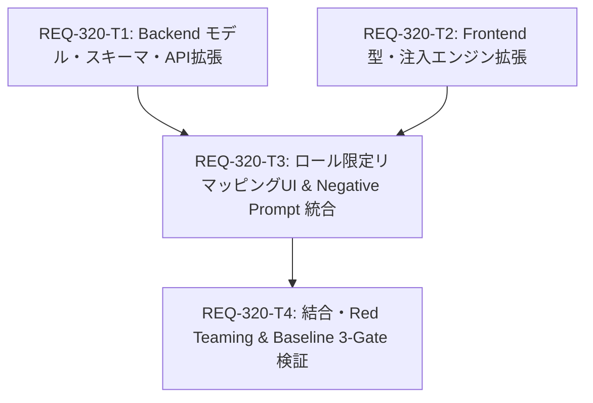

# Implementation Plan: REQ-320 LoRA Studio Prompt Node Remapping & Negative Prompt Input

LoRA Studio (Step 1) における既存ワークフロー永続マッピングを流用した Positive / Negative プロンプト注入先ノードのリマッピング機能および Negative Prompt 編集・永続化機能の実装計画です。

## Proposed Architectural Changes

### 1. Backend Data Layer & Persistence (`backend/`)
- #### [LOCAL MODIFY] [models.py](file:///c:/Users/audih/ws/comfy-create-helper2/backend/app/models.py)
  - `DatasetProject` モデルにプロジェクト固有のプロンプトテキストである `prompt_negative: Mapped[str]` を追加。
  - （※ノードマッピングはワークフロー本体の `workflow_mappings` テーブルを SSoT として共有・流用するため、別管理カラムは不要）
- #### [LOCAL MODIFY] [schemas/dataset.py](file:///c:/Users/audih/ws/comfy-create-helper2/backend/app/schemas/dataset.py)
  - `DatasetProjectCreate`、`DatasetProjectUpdate`、`DatasetProjectResponse` に `prompt_negative` を追加。
- #### [LOCAL MODIFY] [steps.py](file:///c:/Users/audih/ws/comfy-create-helper2/backend/app/migrations/steps.py)
  - マイグレーションステップ `026_dataset_projects_prompt_negative` を追加。
- #### [LOCAL MODIFY] [dataset_router.py](file:///c:/Users/audih/ws/comfy-create-helper2/backend/app/routers/dataset_router.py)
  - プロジェクト作成および更新時の `prompt_negative` の受け渡しと保存を処理。

### 2. Frontend Types & Prompt Injection Engine (`frontend/`)
- #### [LOCAL MODIFY] [types.ts](file:///c:/Users/audih/ws/comfy-create-helper2/frontend/src/api/types.ts)
  - `DatasetProject` に `prompt_negative?: string` を定義。
- #### [LOCAL MODIFY] [MatrixGenerationStep.tsx](file:///c:/Users/audih/ws/comfy-create-helper2/frontend/src/pages/DatasetStudioPage/components/MatrixGenerationStep.tsx)
  - `injectPromptAndSeed` を拡張し、`options: { positiveNodeId, negativeNodeId, negativePrompt, seedNodeId }` に基づくピンポイント個別注入をサポート。
  - 選択中ワークフローの `mappings` から Positive / Negative ロールを直接参照して注入。
- #### [LOCAL NEW] [NodeRemapModal.tsx](file:///c:/Users/audih/ws/comfy-create-helper2/frontend/src/pages/DatasetStudioPage/components/NodeRemapModal.tsx)
  - 既存マッピング編集ロジックを流用し、Positive (`Main_Positive_Prompt`) と Negative (`Negative_Prompt`) の 2 ロールにフィルタリングしたリマッピングモーダル。
  - 保存時は他ロールを維持したまま `workflowsApi.update` を呼び出してワークフロー本体のマッピングを更新・永続化。

### 3. Step 1 UI 統合 (`frontend/`)
- ワークフロー選択エリアに Positive / Negative 対象ノード情報バッジ（Node ID、クラス名、タイトル）と「ノード再割当」ボタンを配置。
- 3分割タグ入力欄の下部に全幅カードとして「④ ネガティブプロンプト (Negative Prompt)」を配置し、`TagChipEditor` を採用。
- ワークフロー選択時の初期値自動取得（Presets -> ノードテキスト -> 定型フォールバック）。

---

## Task Dependency DAG



- **並行可能タスク**: `REQ-320-T1` (Backend) と `REQ-320-T2` (Frontend Data Layer) は独立しており並行実行可能。
- **依存関係**: `REQ-320-T3` は T1 と T2 の双方に依存。`REQ-320-T4` は T3 完了後に実行。

---

## Verification Plan

### Automated Test Commands
1. **Frontend Typecheck**:
   ```bash
   cd frontend; npm run typecheck
   ```
2. **Frontend Unit & Component Tests**:
   ```bash
   cd frontend; npx vitest run src/pages/DatasetStudioPage/__tests__/MatrixGenerationStep.test.tsx
   ```
3. **Backend Typecheck**:
   ```bash
   backend\.venv\Scripts\python -m mypy backend
   ```
4. **Backend DB & API Tests**:
   ```bash
   backend\.venv\Scripts\python -m pytest backend/tests/test_dataset_router.py backend/tests/test_dataset_db.py -v
   ```
5. **Full Baseline 3-Gate**:
   ```bash
   cd frontend; npm test
   backend\.venv\Scripts\python -m pytest
   ```

### Acceptance Criteria Verification Table
| AC 番号 | 検証内容 | 検証方法 |
|---|---|---|
| AC-1 | ワークフロー選択時に Positive/Negative 対象ノード情報（ID, タイトル, クラス名）がバッジ表示されること | Vitest: `workflow.mappings` に基づくノード情報バッジの描画検証 |
| AC-2 | Studio 画面上で Positive/Negative ロールに絞り込んだテキスト候補ノードから手動リマッピングし、ワークフローへ永続化できること | Vitest: `NodeRemapModal` 操作と `workflowsApi.update` 呼び出し検証 |
| AC-3 | 3分割正プロンプト枠に加えて Negative プロンプト入力枠（TagChipEditor）が表示され編集・保存できること | Vitest: TagChipEditor 描画・タグ編集・文字数カウント検証 |
| AC-4 | ComfyUI バッチ投入時に Positive ノードに raw_prompt、Negative ノードに負プロンプトが個別注入されること | Vitest: `injectPromptAndSeed` ペイロード構造の厳密アサート |
| AC-5 | プロジェクトの保存および再読み込みで Negative プロンプトが完全復元されること | Pytest & Vitest: CRUD 永続化および復元サイクル検証 |

---

## Trade-off Disclosure

1. **ワークフロー永続マッピングの直接流用 (`workflow.mappings`)**:
   - *メリット*: 設定ページ・生成ページ・LoRA Studio 間でマッピングの SSoT（Single Source of Truth）が完全に統一され、重複するマッピングテーブルや同期ずれのリスクを根本から排除。
   - *配慮事項*: Studio 側からのリマッピング時に他ロール（Sampler, Seed 等）を誤って上書き消去しないよう、Positive / Negative の `master_id` のみを部分置換し他ロールを維持するマージ更新パターンを採用。
2. **リマッピング UI におけるロールのフィルタリング**:
   - *メリット*: Studio では画像生成用の正・負プロンプトのみが関心事であるため、不要なロール（ステップ数、CFG、シードなど）を削ぎ落とすことで、ユーザーの認知負荷を最小化。
   - *配慮事項*: 既存の汎用モーダル資産を活用しつつ、表示対象ロールを `Main_Positive_Prompt` と `Negative_Prompt` に絞り込むシンプルな設計を採用。
