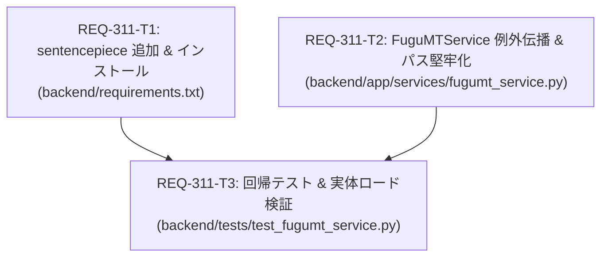

# Implementation Plan - REQ-311: FuguMT翻訳実行時のsentencepiece依存欠落によるエンジン初期化失敗の修正

FuguMT（MarianMT）トークナイザー初期化に必須となる `sentencepiece` 依存パッケージを `backend/requirements.txt` に追加してインストールし、`FuguMTService` における初期化例外の詳細伝播とパスフォールバックを実装、さらにモックなしの実体依存ロード検証を含む回帰テストを配備する。

## Proposed Changes

### Backend Subsystem

#### [LOCAL MODIFY] [backend/requirements.txt](file:///c:/Users/audih/ws/comfy-create-helper2/backend/requirements.txt)
- `sentencepiece>=0.2.0` を追加。
- 仮想環境（`.venv`）へのパッケージ導入。

#### [LOCAL MODIFY] [backend/app/services/fugumt_service.py](file:///c:/Users/audih/ws/comfy-create-helper2/backend/app/services/fugumt_service.py)
- `_init_error: Optional[str]` フィールドを追加。
- `initialize()` の例外捕捉時に `self._init_error` に例外クラス名とメッセージを記録。
- `translate_batch()` で初期化失敗時の `RuntimeError` に詳細メッセージを付与。
- `__init__` において、CWD がルートの場合と `backend/` の場合の双方で `models/fugumt-en-ja` を検出できるようフォールバックパス解決を実装。

#### [LOCAL MODIFY] [backend/tests/test_fugumt_service.py](file:///c:/Users/audih/ws/comfy-create-helper2/backend/tests/test_fugumt_service.py)
- `sentencepiece` インポート可能性テストを追加。
- `initialize()` 失敗時の例外メッセージ伝播テストを追加。
- パスフォールバック解決テストを追加。
- 実モデルファイル存在時の実トークナイザー初期化検証テストを追加。

---

## Verification Plan

### Automated Baseline 3-Gate Verification

1. **Gate 1: Static Typecheck**
   ```bash
   mypy backend
   ```
2. **Gate 2: Unit & Regression Tests**
   ```bash
   backend\.venv\Scripts\python -m pytest backend/tests/test_fugumt_service.py backend/tests/test_translation_proxy.py -v
   backend\.venv\Scripts\python -m pytest
   ```
3. **Gate 3: Integration & Red Teaming**
   - 実稼働環境での FuguMT 和訳推論の正常動作確認。
   - 異常系時の具体的エラーメッセージ伝播確認。

---

## Task Decomposition & Parallelism DAG



- **並列性 (Parallelism)**: `REQ-311-T1` と `REQ-311-T2` は依存関係がなく並列実行可能。`REQ-311-T3` は依存関係が満たされた後に実行。

---

## Trade-off Disclosure

1. **依存パッケージ追加による環境サイズ（約1.2MB）**:
   - `sentencepiece` パッケージの追加により仮想環境のディスク使用量が約 1.2MB 増加しますが、MarianMT トークナイザーの動作には必須であり、事前ビルド済み Windows wheel（`sentencepiece-0.2.2-cp312-cp312-win_amd64.whl`）が存在するため C++ コンパイラ等の追加ツールチェーンは不要です。
2. **エラーメッセージ詳細化による影響**:
   - 内部例外の詳細メッセージ（クラス名＋要約）を `RuntimeError` に含めることでデバッグ性が劇的に向上しますが、機密情報（APIキー等）が含まれないよう、例外スタックトレース全体ではなくクラス名とエラーメッセージのみに限定して伝播します。
