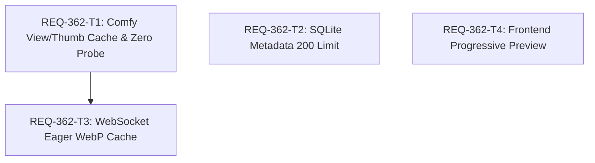

# Implementation Plan: REQ-362 Prompt Surgeon: プレビュー高速化と200件三位一体キャッシュ実装

Prompt Surgeon における生成履歴プレビュー表示遅延（十数MB未圧縮PNG転送・多重プローブ）を解消するため、ゼロプローブWebPキャッシュ、生成完了時先行生成、および200件三位一体管理（ComfyUI履歴窓・WebPキャッシュ・SQLiteメタデータ）を実装します。

## Proposed Changes

### Backend Subsystem

#### [LOCAL MODIFY] [comfy.py](file:///c:/Users/audih/ws/comfy-create-helper2/backend/app/routers/comfy.py)
- `/api/comfy/view` エンドポイント:
  - ローカルディスク（`db/full_cache/`）にキャッシュが存在する場合は ComfyUI への HTTP 通信を一切行わず即座に WebP を返却。
  - キャッシュミス時のみ ComfyUI から元画像を取得し、Quality 90 WebP へ非同期変換してディスク保存・返却。
  - キャッシュファイル数が220件を超過した際、古いファイルから自動間引き（最大200件維持）。
- `/api/comfy/thumbnail` エンドポイント:
  - キャッシュヒット時の不要な `_check_comfy_exists` プローブ呼び出しを撤廃。
- WebSocket 生成完了ハンドラ (`executed`):
  - サムネイル生成と同時にフルサイズ WebP（Quality 90）も非同期先行生成（Eager Cache）してディスクへ保存。

#### [LOCAL MODIFY] [prompt_metadata.py](file:///c:/Users/audih/ws/comfy-create-helper2/backend/app/routers/prompt_metadata.py)
- `persist_prompt_metadata`:
  - 上限保持件数を従来の 1,000 件から 200 件へ変更。
  - キュー滞留・実行中のアクティブプロンプトを除外した古いレコード（`created_at` 昇順）からトランザクション内で自動削除。

#### [LOCAL MODIFY] [test_comfy_proxy.py](file:///c:/Users/audih/ws/comfy-create-helper2/backend/tests/integration/legacy/test_comfy_proxy.py)
- AC-1, AC-2, AC-4, AC-5 を検証するテストケースを追加（タグ: `[REQ-362/AC-1]`, `[REQ-362/AC-2]`, etc.）。

#### [LOCAL MODIFY] [test_comfy_generation_bridge.py](file:///c:/Users/audih/ws/comfy-create-helper2/backend/tests/integration/legacy/test_comfy_generation_bridge.py)
- AC-3（生成完了時のフルサイズ WebP 先行生成）を検証するテストケースを追加。

#### [LOCAL MODIFY] [test_prompt_metadata.py](file:///c:/Users/audih/ws/comfy-create-helper2/backend/tests/integration/legacy/test_prompt_metadata.py)
- AC-6（メタデータ 200 件上限パージとアクティブプロンプト保護）を検証するテストケースを追加。

---

### Frontend Subsystem

#### [LOCAL MODIFY] [GenerateParallelPreview.tsx](file:///c:/Users/audih/ws/comfy-create-helper2/frontend/src/pages/GeneratePage/components/GenerateParallelPreview.tsx)
- フルサイズ画像ロード待ち状態において、先行して取得済みのサムネイル WebP をプレースホルダーとして描画し、ロード完了時にシームレスに切り替えるプログレッシブプレビュー表示を実装。

#### [LOCAL MODIFY] [GenerateParallelPreview.test.tsx](file:///c:/Users/audih/ws/comfy-create-helper2/frontend/src/pages/GeneratePage/components/__tests__/GenerateParallelPreview.test.tsx)
- AC-7（サムネイルプレースホルダーの先行描画と切り替え）を検証する単体テストを追加。

---

## Verification Plan

### Automated Tests (3-Gate Baseline)
```bash
# Gate 1: Typecheck
cd frontend; npm run typecheck
mypy backend

# Gate 1 & 2: Targeted & Integration Tests
cd frontend; npx vitest run src/pages/GeneratePage/components/__tests__/GenerateParallelPreview.test.tsx
backend\.venv\Scripts\python -m pytest backend/tests/integration/legacy/test_comfy_proxy.py -k "REQ-362"
backend\.venv\Scripts\python -m pytest backend/tests/integration/legacy/test_prompt_metadata.py -k "REQ-362"
backend\.venv\Scripts\python -m pytest backend/tests/integration/legacy/test_comfy_generation_bridge.py -k "REQ-362"

# Full discovery run
backend\.venv\Scripts\python -m pytest -n auto
```

---

## Task Dependency Visualization & Parallel Design



- **並列実行可能性**:
  - `REQ-362-T1`（Backend キャッシュ・プローブ撤廃）、`REQ-362-T2`（Backend メタデータ200件上限）、`REQ-362-T4`（Frontend プログレッシブプレビュー）の3タスクは互いに依存せず並列実行可能です。
  - `REQ-362-T3`（WebSocket 先行生成）のみ、T1 のキャッシュヘルパー関数に依存します。

---

## Trade-off Disclosure

1. **ディスク容量とキャッシュ件数 (200件枠)**:
   - メリット: ディスク消費量を約 300MB（1画像約 1.5MB × 200件）に確実に抑え、UI 履歴枠（200件）と 1:1 に同期できる。
   - デメリット / トレードオフ: 201件以前の画像はディスクから間引かれるため、もし古い履歴画像を表示する場合は ComfyUI からのオンデマンド再取得（数秒）が発生する。ただし、UI 上で 201 件以上前の画像を表示する導線は存在しないため、実用上の悪影響はない。
2. **WebP Quality 90 圧縮の画質 vs パフォーマンス**:
   - メリット: 未圧縮 PNG（10〜15MB）から約 1.5MB へ削減され、転送速度およびブラウザデコード速度が劇的に向上する（< 5ms）。
   - デメリット / トレードオフ: 非可逆圧縮（Quality 90）となるため、ピクセル単位での厳密な原画保存が必要な外部ツールへのエクスポート時は、SQLite DB に保存された構造化ワークフロー情報からの動的再構成を行う必要がある。
