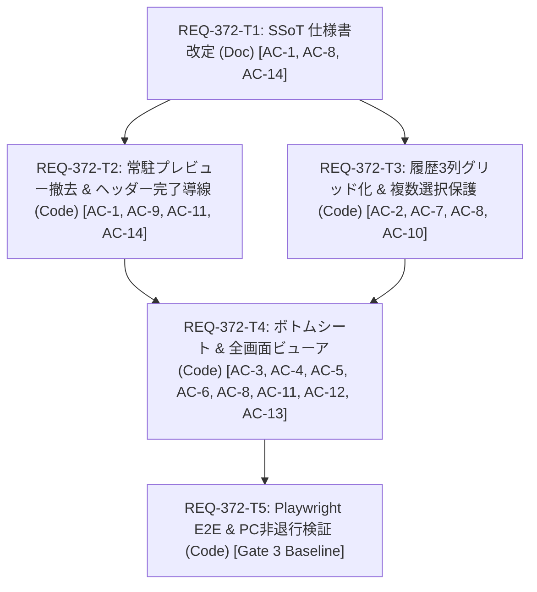

# Implementation Plan: REQ-372 モバイルGenerate：常駐プレビューを廃止し、履歴グリッド・画像シート・全画面ビューアで画像を確認できるようにする

## 1. Overview & Objectives (概要と目的)
現行モバイルGenerate（幅767px以下）において、縦面積を恒常的に圧迫していた常駐プレビュー（105px〜220px）を撤去し、プロンプト入力およびタグ編集の有効面積を最大化する。
画像確認は「履歴（3列縦スクロール正方形グリッド） → 画像ボトムシート（MobileImageSheet） → 黒背景全画面ビューア（Fullscreen + Screen Wake Lock API）」の3段階導線へ分離・再設計する。
常駐プレビューが担っていた既存機能（進捗・ETA表示、自動追従/固定、ダウンロード、スナップショット保存、画像エラー表示、複数選択）は機能対応表に基づき100%継承し、PCレイアウト（幅768px以上）や他ページへの影響はゼロとする。

## 2. Architecture & Seam Map (設計方針とSeam Map)
- **Integrated (実コード実行)**:
  - `MobileLayout.tsx`: 常駐プレビュー撤去、プロンプト領域解放、最上部固定ステータスヘッダー（進捗/ETA/キュー数）の維持と生成完了時の新画像導線。
  - `GenerationGallerySection.tsx`: 履歴の3列正方形グリッド化（縦スクロール）、空状態（0枚）保護、複数選択モード保護。
  - `MobileImageSheet.tsx`: サムネイルタップ時のボトムシート展開、画像タップ時の全画面ビューア切り替え、Fullscreen API & Screen Wake Lock API制御、CSS 100dvh縮退フォールバック。
  - `useGalleryInteraction.ts`: サムネイルタップ時のシート起動と複数選択モード時のタップ選択トグル制御。
- **Severed (外部I/O遮断)**:
  - ComfyUI WebSocket & HTTP API: トランスポート層（MSWまたはモッククライアント）で遮断。
  - Fullscreen / Wake Lock DOM API: コンポーネント単体テストではDOMインターフェースをモック化。E2Eテストでは実ブラウザ挙動を検証。
- **PBT判定**: 不採用（No）。UIレイアウトおよび状態遷移マトリクステストで網羅検証。
- **Fault Injection**: Fullscreen API非対応/拒否時の100dvh CSS縮退、Wake Lock拒否時の非阻害継続とバックグラウンド時の解除、画像URL破損時のエラー表示。

## 3. Task Breakdown & Mermaid DAG (タスク分解とDAG)
- **REQ-372-T1**: SSoT 仕様書改定（`SPEC_GENERATE.md`, `SPEC_COMMON.md`）[change_kind: document]
  - 対象: `docs/specs/SPEC_GENERATE.md`, `docs/specs/SPEC_COMMON.md`
- **REQ-372-T2**: モバイルGenerate：常駐プレビュー撤去・入力領域解放・ステータスヘッダー完了導線 (`MobileLayout.tsx`) [change_kind: code]
  - 対象: `frontend/src/pages/GeneratePage/components/MobileLayout.tsx`, `frontend/src/pages/GeneratePage/components/__tests__/MobileLayout.test.tsx`
- **REQ-372-T3**: モバイル履歴：3列縦スクロールグリッド化・空状態・複数選択保護 (`GenerationGallerySection.tsx`, `useGalleryInteraction.ts`) [change_kind: code]
  - 対象: `frontend/src/pages/GeneratePage/sections/GenerationGallerySection.tsx`, `frontend/src/pages/GeneratePage/sections/__tests__/GenerationGallerySection.cache.test.tsx`, `frontend/src/pages/GeneratePage/hooks/useGalleryInteraction.ts`
- **REQ-372-T4**: モバイル画像確認：ボトムシート・全画面ビューア・WakeLock・Fullscreen縮退フォールバック (`MobileImageSheet.tsx`) [change_kind: code]
  - 対象: `frontend/src/pages/GeneratePage/components/MobileImageSheet.tsx`, `frontend/src/pages/GeneratePage/components/__tests__/MobileImageSheet.test.tsx`, `frontend/src/pages/GeneratePage/components/MobileLayout.tsx`
- **REQ-372-T5**: 結合検証：Playwright E2E実ブラウザ描画・縮退フロー・PC非退行検証 (`generateMobileGallery.spec.ts`) [change_kind: code]
  - 対象: `frontend/e2e/generateMobileGallery.spec.ts`

## 4. Technical Trade-offs & Alternatives (技術的トレードオフと代替案)
- **常駐プレビュー撤去に伴う画像確認の2段階化**:
  - *採否*: 採用。モバイル幅でのプロンプト・タグ編集の作業性を最優先し、画像確認は「サムネイルタップ（シート） → 画像タップ（全画面）」へ分離。
  - *緩和策*: ジョブ完了直後に最上部ステータスヘッダーに「生成完了: 最新画像を表示」導線を配置し、1タップで履歴タブおよび最新画像へ切り替え可能とする。
- **Fullscreen API 非対応環境の縮退設計（CSS 100dvh）**:
  - *採否*: 採用。iOS Safari等のブラウザ制限を考慮し、Fullscreen APIが拒否または未サポートの場合でも例外を握り潰して CSS `fixed inset-0 w-full h-[100dvh] z-50 bg-black` による全景表示へ安全にフォールバックする。
- **Screen Wake Lock API の厳格な解放制御**:
  - *採否*: 採用。全画面ビューア表示中のみ自動ロックを抑止し、シート復帰・ビューア閉じる・アプリバックグラウンド移行（`visibilitychange`）で直ちに sentinel を release して無駄なバッテリー消費を抑止。

## 5. Verification Plan (3-Gate検証計画)
- **Gate 1: 静的型チェック & ユニットテスト (3〜5秒)**
  - UI不変条件: `backend\.venv\Scripts\python scripts/verify_ui_invariants.py`
  - テスト命名規約: `backend\.venv\Scripts\python scripts/verify_test_naming.py`
  - フロント型検査: `cd frontend; npm run typecheck`
  - 局所ユニットテスト: `cd frontend; npx vitest run src/pages/GeneratePage/components/__tests__/MobileLayout.test.tsx src/pages/GeneratePage/sections/__tests__/GenerationGallerySection.cache.test.tsx src/pages/GeneratePage/components/__tests__/MobileImageSheet.test.tsx`
- **Gate 2: フルスイート統合テスト (~30秒)**
  - `cd frontend; npm test`
  - `backend\.venv\Scripts\python -m pytest`
- **Gate 3: 実ブラウザ E2E & Red Team 検証 (~1.2秒)**
  - `cd frontend; npx playwright test generateMobileGallery.spec.ts`
  - 縮退フォールバック・異常系検証（Fullscreen API/Wake Lock API非対応、画像URL破損、履歴0枚、360px狭幅・セーフエリア）